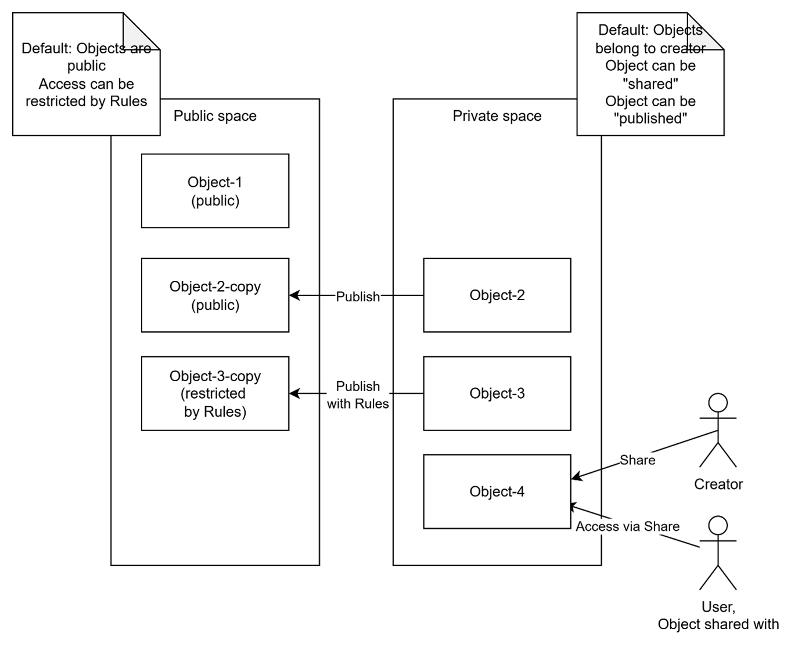
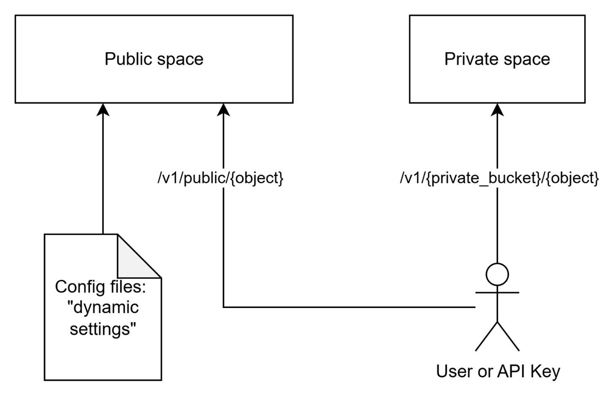
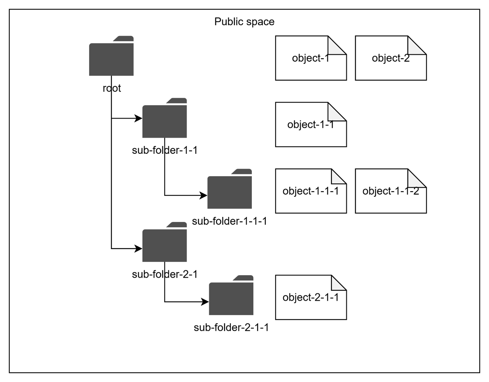

# Authorization rules and spaces

This page continues the [objects and subjects model](./1.authentication-and-access-control.md) with authorization-rule notation, public/private defaults, and the public-space hierarchy. For restrictions, sharing, and delegated access, continue to [Public and private access](./3.public-and-private-access.md).

## Authorization rules

In this article we use the following logical notation for the Authorization Rule, allowing access for a `{set-of-subjects}` to a `{set-of-objects}`:

`(object: {set-of-objects}, subject: {set-of-subjects}, action: {actions}) `

> **Note**: This notation is not how DIAL stores or interprets authorization rules. It was made up for the purpose of this article, for the sake of unification and brevity.

## Authorization mechanisms

DIAL uses various mechanisms to maintain and enforce authorization rules in different business scenarios. They include **Public** and **Private** spaces, publication and objects sharing, which will be described in the following sections.

### Default authorization rules: public and private spaces

DIAL supports two logical spaces for resource objects: **Public** and **Private**. Every resource object belongs to only one of the spaces. Configuration entities such as roles and keys belong to neither space.

* The **Public** space allows making objects available to a wide audience while maintaining full control and governance.
* The **Private** space assumes objects are available only to their creators (owners) by default. This allows regular users to work with DIAL without compromising their privacy, as the objects they create cannot be accessed by anyone else unless explicitly stated (will be described [further in text](./3.public-and-private-access.md#how-to-provide-access-in-the-private-space)).

As their names assume, the two spaces define default [authorization rules](#authorization-rules), applied to their resources (Objects):

* Any Object in a Public space is available in READ-ONLY mode for any user by default, unless access is restricted as shown [further in the article](./3.public-and-private-access.md#how-to-restrict-access-in-the-public-space); WRITE operations are allowed only for the role of DIAL Administrators. Default authorization rules in Public space are:
    - `(object: public:*, subject: *, action: read)` - Default READ-ONLY access in Public space.
    - `(object: public:*, subject: role:admin, action: *)` - Default full access for users with the DIAL Administrators role in Public space.

    Where:

    * `public:*` - A wildcard for any Object in the Public space.
    * `subject: *` - A wildcard for any Subject.
    * `role:admin` – A notation for all Subjects, belonging to "admin" role. We use the "admin" name for the DIAL Administrators role. As was mentioned earlier, [roles can be used as Subjects](./1.authentication-and-access-control.md#roles-as-subjects) in the definition of authorization rules.

* Any Object in a Private space is available only to its creator (User, API Key) by default, unless access is [explicitly granted](./3.public-and-private-access.md#how-to-provide-access-in-the-private-space) to another Subject. Logically, every Subject (user or API Key) has its own Private space. The default authorization rule in the Private space is: `(object: private:subject_id:*, subject: subject_id, action:*)`

    Where:

    * `private:subject_id:*` - Any Object in a Private space of a particular Subject (User or API Key), identified by `"subject_id"`.
    * `subject_id` - A unique identifier of a Subject (user or API Key).

These are default rules. Sharing and delegated application access add the grants described in [Public and private access](./3.public-and-private-access.md). A configured [global reader](../../6.services/1.core/1.configuration/2.settings/7.access.md#admin-and-global-reader-rules) can also read public and private resources; per-request keys are excluded from that privilege.

#### Pre-configured objects

All resource objects defined in DIAL Core configuration files belong to the Public space, where appropriate default Authorization rules apply. Configuration entities such as roles and keys are separate from these spaces; see [Special objects](./4.access-control-reference.md#acls-for-special-objects).

> **Note**: Objects cannot be defined in a Private space via DIAL Core configuration files.

#### Runtime objects

[DIAL Core API](https://dialx.ai/dial_api) allows creating Objects in both Public and Private spaces. Only DIAL Administrators can create Objects directly in the Public space. Regular users and API Keys create Objects within their own Private space. A user with administrator privileges also has a Private space for their own resources.

## Hierarchical structure of the public space

This section provides details about how the Public space is structured, which is important for understanding of authorization rules.

Objects in the Public space are arranged hierarchically, like a file system. This means that every object logically belongs to a  “sub-folder” within the hierarchy. All pre-configured objects are automatically placed into the “root” folder of the Public space. DIAL Core API allows specifying a sub-folder for newly-created objects.

As described in [Public and private access](./3.public-and-private-access.md), authorization restrictions can be applied to any sub-folder in the hierarchy. The effective authorization rule for an object in a sub-folder includes restrictions applied to all parent sub-folders up to the “root” folder.

## Further reading

- [Public and private access](./3.public-and-private-access.md) — restrict public objects, share private objects, and delegate to applications
- [Access control reference](./4.access-control-reference.md) — access patterns and permission matrices
- [Authentication and access control](./1.authentication-and-access-control.md) — the access-control model: authentication, objects, and subjects
- [DIAL Core settings: Access](../../6.services/1.core/1.configuration/2.settings/7.access.md) — admin rules, API-key IP checks, and sharing lifetimes
