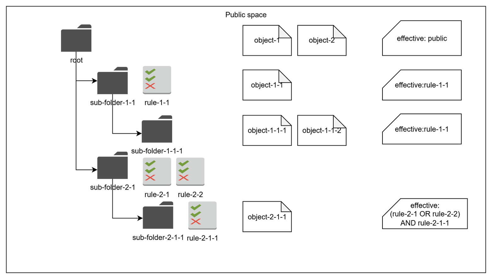

# Public and private access

This page explains how DIAL narrows public access, extends private access through sharing, and limits applications acting on a caller’s behalf. Read [Authorization rules and spaces](./2.authorization-rules-and-spaces.md) first.

## How to restrict access in the public space

Default public access to objects in the Public space can be narrowed/restricted as needed.

### Pre-configured objects

You can use the `"userRoles"` attribute in the object's definition in the DIAL Core dynamic settings to list all roles that should have access to the object. Refer to [Tutorials](../../4.operating-dial/5.auth-and-access-control/2.jwt.md) to learn how to do it. It creates the following authorization rule that overrides the default public READ-ONLY access:

`(object: public:object_id, subject: role:{list-of-roles-via-OR}, action: read)`

Where:

* `public:object_id` – A particular object in the Public space (in our case, defined in the DIAL Core configuration file).
* `role:{list-of-roles-via-OR}` – Any user or API key that belong to any role (Role1 OR Role2 OR…OR RoleN), specified in `"userRoles"` attribute of the object definition in the DIAL Core configuration file.

### Runtime objects

For Runtime objects, the Public space supports hierarchical structure, similar to a file system. Objects can be placed (or published) to the root folder or any sub-folder within this hierarchy.

Each sub-folder (with the exception of the root folder) can be assigned one or many attribute-based logical predicates, describing Subjects that need access to this sub-folder. These predicates are called `"rules"`. E.g. `“group == my-role”`.

The effective set of rules for each sub-folder includes all rules associated with the sub-folder (via OR) and all the rules inherited from the parent sub-folders (via AND). The final authorization rule for objects in a sub-folder:

`(object: public:sub_folder_path:*, subject: {effective-set-of-rules}, action: read)`

Where:

* `public:sub_folder_path:*` - Any object in the sub-folder of the Public space.
* `{effective-set-of-rules}` – A logical expression, combining all rules from the parent sub-folders (via AND), with each sub-folder rule being a set of predicates joined by OR.

A folder without its own rules adds no restriction beyond its parents. For example, a parent with rules `a` and `b` and a child with rules `c` and `d` gives the child the effective rule `(a OR b) AND (c OR d)`. See [Effective rules](../../3.building-with-dial/7.working-with-dial-resources/2.publications-api.md#effective-rules).

Rules associated with sub-folders can be created by either DIAL Administrators or regular users during the [Publication process](../../3.building-with-dial/7.working-with-dial-resources/2.publications-api.md).

> **Note**: Publication is the only way for regular users to add objects to the Public space, which requires an explicit approval from DIAL Administrators.

## How to provide access in the private space

Default access, limited by the Private space’s owner, can be extended as needed.

### Pre-configured objects

**N/A** - Objects defined in DIAL Core configuration files are placed only in the Public space.

### Runtime objects

As discussed earlier, by default, only the object's creator (e.g. Private space’s owner) maintains full access to the object in the Private space. The object's creator may want to provide access to other users. In this case, they can generate a temporary **Sharing link** for the object, specifying the kind of access required (READ or READ/WRITE). The link can be sent to any DIAL user.

> Refer to [Sharing](../../3.building-with-dial/7.working-with-dial-resources/3.sharing-api.md) for details.

When the sharing link is used, the following authorization rule is created:

`(object: private:subject_id:object_id, subject: {user-id-who-used-the-link}, action: {action-specified-by-the-link})`

Where:

* `private:subject_id:object_id` – A particular object in a Private space of the particular subject (User or API Key).
* `{user-id-who-used-the-link}` – A particular user who activated the link (accepted invite).
* `{action-specified-by-the-link}` – READ or READ/WRITE type of permissions, specified by object's creator while creating the Sharing link.

## Special subject: DIAL application acting on user's behalf

In the preceding sections, we examined authorization rules applicable to standard subjects, such as users and API keys. We reviewed the default access privileges in both Public and Private spaces, as well as methods for refining or extending these permissions as required.

There is a special case when user or API key allows DIAL Applications to act on their behalf. For example, a user invokes a DIAL Application A, which calls DIAL Core services (e.g. File API), another Application B or a Model M. In such case, the application uses a so called [per-request key](../../3.building-with-dial/7.working-with-dial-resources/5.per-request-keys.md), that contains information about both Application A and the User (or API Key).

Logically, since Applications act as a user, they should have the same level of access in DIAL. However, since applications in DIAL are also Objects, and can be created and deployed by any user, they can potentially contain malicious code and cannot be fully trusted. It means that their access should be minimized to reduce potential negative impact.

Because a per-request key represents both User and Application, it has access to both user’s and application’s objects. Applications in DIAL also have their Private space, where an application (acting via a per-request key) can store and, later, access its objects.

Below, is the summary of what a DIAL application, acting on behalf of a user or API key via a per-request key, can access in DIAL:

* **Objects in a dedicated sub-folder**: Usually, users or API keys can access all objects in their Private space without restrictions. A per-request key for the same user or API key has access to only application’s dedicated sub-folder within user’s or API key's Private space:
    - `(object: private:subject_id:app_id:*, subject: per-request-key, action: READ/WRITE)`, where `private:subject_id:app_id:*` is any object in application-dedicated (`app_id`) sub-folder within user's or API key’s (subject_id) Private space.
* **All objects in the app's Private space**: Apps can access all objects in their own Private space (note, that a per-request key of any user has access to the application’s private space):
    - `(object: private:app_id:*, subject: per-request-key, action: READ/WRITE)`, where `private:app_id:*` is any object in application’s Private space.

The private-space rules above do not exclude files explicitly attached to a request. Core links those files to the per-request key for the request lifetime. See [Per-request keys: file access](../../3.building-with-dial/7.working-with-dial-resources/5.per-request-keys.md#file-access) for this additional access and [Auth matrix for apps](../../3.building-with-dial/7.working-with-dial-resources/6.auth-matrix-for-apps.md) for consent across application dependencies.

## Further reading

- [Authorization rules and spaces](./2.authorization-rules-and-spaces.md) — authorization-rule notation and the public-space hierarchy
- [Access control reference](./4.access-control-reference.md) — the permission matrices for users, keys, administrators, and applications
- [Folder permissions](../../5.administering-dial-new/6.governance/3.folders-storage.md) — manage public folder rules in DIAL Admin
- [Sharing API](../../3.building-with-dial/7.working-with-dial-resources/3.sharing-api.md) — grant users or deployments access without publishing
- [Publications API](../../3.building-with-dial/7.working-with-dial-resources/2.publications-api.md) — publish private resources to the Public space and review them
- [Per-request keys](../../3.building-with-dial/7.working-with-dial-resources/5.per-request-keys.md) — short-lived keys Core issues to applications for a single request
