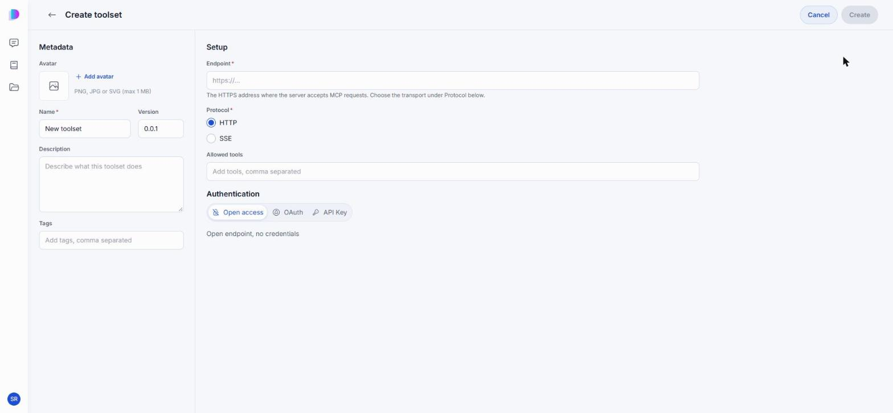
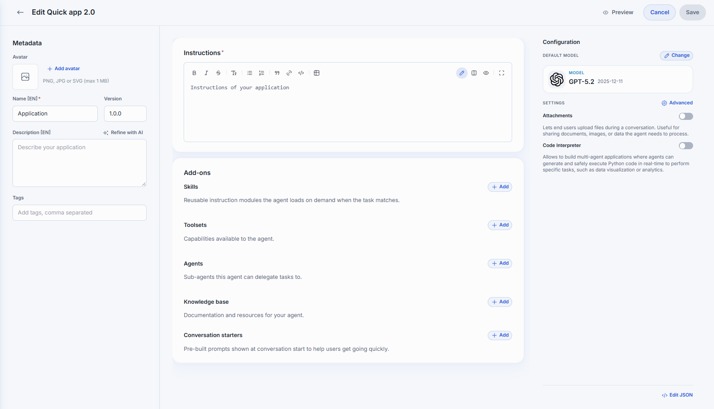
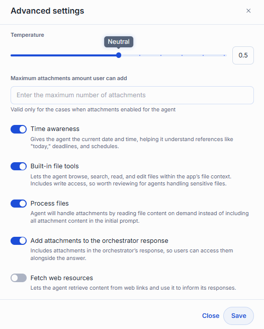
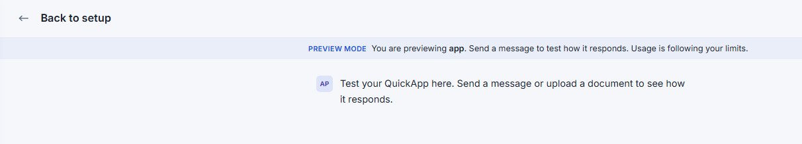

# Tutorial: build an agent with a Toolset

In this tutorial you build a Research Assistant: a Quick App that answers questions with live data from an MCP server. You register the server as a Toolset, create the agent in DIAL Chat, and watch it call tools in an agent loop. It is for developers new to Quick Apps. You need a DIAL Chat account and an MCP server you can reach; no code is involved.

## What you will build

A Research Assistant that:

- Takes a question from the user
- Calls tools from your Toolset to gather data
- Answers with the results, citing where they came from

Each tool call shows as a stage in the chat, so you can see what the agent did.

## Prerequisites

- An account in DIAL Chat, with the Quick App editor deployed. See [DIAL Quick Apps](../../../6.services/7.quick-apps/0.index.md).
- A model in your DIAL deployment that supports tool calls.
- An MCP server reachable from DIAL, over HTTPS, with its URL and any credentials it needs. It can be any server your organization runs, such as a search service or an internal API.

## Step 1: Register the MCP server as a Toolset

1. In the Catalog, click **Create** and choose **Toolset**.
2. In **Metadata**, enter the name `My Search Tools` and the description `Search and data tools for the Research Assistant`.
3. In **Setup**, enter the server's **Endpoint**, and choose the **Protocol** it speaks: **HTTP** or **SSE**.
4. Optionally, list the **Allowed tools** to expose only some of the server's tools.
5. Under **Authentication**, choose **Open access**, **OAuth**, or **API Key**, to match the server.
6. Click **Create**.



The Toolset is in your private folder. Each authentication option is explained in [Create a toolset](../../../7.chat-user-guide/3.catalog/3.toolsets.md#create-a-toolset).

## Step 2: Create the Quick App

1. In the Catalog, click **Create** and choose **Quick App** under **Runners**.
2. In **Metadata**, enter the name `Research Assistant`, the version `1.0.0`, and the description `Answers research questions with live data`.



## Step 3: Write the instructions

In **Instructions**, paste:

```text
You are a Research Assistant. Answer user questions accurately with the tools available to you.

- Use the tools to gather data before answering.
- If a tool call fails, say so, and give the best answer you can without it.
- Cite the source of every tool result you use.
- Be concise. Prefer bullet points to paragraphs.
```

## Step 4: Add the Toolset

1. In **Add-ons**, in the **Toolsets** row, click **Add**.
2. Select `My Search Tools`, and confirm.
3. If the row says "Authorize to use this toolset", click the Toolset and sign in on its **Authentication** tab.

## Step 5: Choose the model and temperature

1. In **Configuration**, under **Default model**, click **Change** and select a model that supports tool calls.
2. Under **Settings**, click **Advanced**.
3. Move **Temperature** toward **Precise**, for consistent, factual answers, and click **Save**.



## Step 6: Test the agent loop

1. Click **Preview**. DIAL Chat saves the agent and opens it in preview mode.
2. Ask a question that needs one of your server's tools.

The agent should:

1. Decide to call a tool from `My Search Tools`.
2. Show the call as a stage in the answer. Expand it to see the arguments and the result.
3. Use the result in its answer, and cite it.



To change something, click **Back to setup**, edit, and preview again.

## Step 7: Save the agent

Click **Save**. The agent is in your private folder, visible only to you, until you share or publish it.

## What you learned

- How to register an MCP server as a Toolset in DIAL Chat
- How to build a Quick App from a model, instructions, and a Toolset
- How the agent loop calls tools and shows each call as a stage
- How to preview an agent before you save it

## Further reading

- [Build a Quick App](../../../7.chat-user-guide/3.catalog/2.agents.md#build-a-quick-app) — every editor setting: skills, agents, a knowledge base, and starters
- [Create a Quick App through the API](./2.create-via-api.md) — the same kind of agent, created with `curl`
- [Quick Apps capabilities](../../../6.services/7.quick-apps/1.capabilities/0.index.md) — what happens behind each setting
- [DIAL Quick Apps](../../../6.services/7.quick-apps/0.index.md) — the two services behind Quick Apps and how they fit together
- [Chat User Guide: Toolsets](../../../7.chat-user-guide/3.catalog/3.toolsets.md) — connect MCP servers as Toolsets and sign in to them
