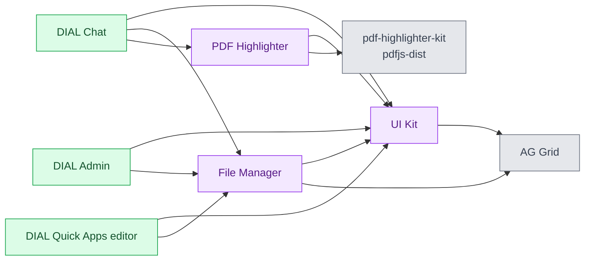

# DIAL UI libraries

The DIAL UI libraries are three React packages that DIAL Chat, DIAL Admin, and the DIAL Quick Apps editor are built from. They are published to npm and compiled into each web interface. None of them runs as a service or reads configuration at runtime. This reference is for frontend developers who build React interfaces on the same components, and it assumes React 19 and npm.

## The three libraries

| Library | npm package | Repository | What it provides |
|---|---|---|---|
| [UI Kit](1.ui-kit.md) | `@epam/ai-dial-ui-kit` | [epam/ai-dial-ui-kit](https://github.com/epam/ai-dial-ui-kit) | The design system: controls, forms, grids, popups, theme tokens, and an MCP server that describes the components to coding agents |
| [File Manager](2.file-manager.md) | `@epam/ai-dial-react-file-manager` | [epam/ai-dial-react-file-manager](https://github.com/epam/ai-dial-react-file-manager) | A file browser with a folders tree, a grid, and upload, copy, move, rename, and delete flows. The host application performs every operation. |
| [PDF Highlighter](3.pdf-highlighter.md) | `@epam/ai-dial-react-pdf-highlighter` | [epam/ai-dial-react-pdf-highlighter](https://github.com/epam/ai-dial-react-pdf-highlighter) | A PDF viewer with highlights, zoom, highlight navigation, and page thumbnails, built on `@epam/pdf-highlighter-kit` |

All three are licensed under Apache 2.0 and declare Node.js 22.2.0 or later and npm 10.7.0 or later in `engines`.

## How they depend on each other

The web interfaces are [DIAL Chat](../../../6.services/2.chat/0.index.md), [DIAL Admin](../../../6.services/8.admin/0.index.md), and the [DIAL Quick Apps](../../../6.services/7.quick-apps/0.index.md) frontend. The libraries are [UI Kit](1.ui-kit.md), [File Manager](2.file-manager.md), and [PDF Highlighter](3.pdf-highlighter.md).

- **UI Kit is a peer.** File Manager and PDF Highlighter render with UI Kit controls and declare it as a peer dependency. A host installs one copy of the kit for all three.
- **AG Grid is a peer of File Manager.** The UI Kit installs AG Grid as a dependency, while File Manager declares it as a peer. The grid engine needs exactly one copy per host.
- **Stylesheets load kit first.** Import `@epam/ai-dial-ui-kit/styles.css` before the stylesheet of any library built on it. DIAL Chat 1.2.0 imports the UI Kit stylesheet and then the File Manager stylesheet in `apps/chat/src/main.tsx`.

## Versions in DIAL releases

The versions below are taken from each web interface's `package.json` at its latest release tag on 2026-11-04.

| Web interface | UI Kit | File Manager | PDF Highlighter |
|---|---|---|---|
| DIAL Chat 1.2.22 | `^0.15.4` | `0.3.5` | `0.2.0` |
| DIAL Admin Frontend 0.22.5 | `0.15.3` | `^0.3.0` | — |
| DIAL Quick Apps Frontend 0.3.1 | `^0.15.4` | `^0.3.5` | — |

DIAL Chat 1.2.0 pins the same versions as 1.2.22. For a 0.x version, a caret range stays within one minor release, so `^0.15.4` never resolves to 0.16.0. No released web interface uses UI Kit 0.16.0, File Manager 0.4.0, or PDF Highlighter 0.3.0 yet.

## Compatibility between the libraries

| Release | UI Kit peer range | Other peers |
|---|---|---|
| File Manager 0.4.0 | `^0.16.0` | `react` and `react-dom` `^19.2.5`, `ag-grid-community` and `ag-grid-react` `^35.2.1` |
| File Manager 0.3.0–0.3.5 | `^0.15.0` | Same as 0.4.0 |
| PDF Highlighter 0.3.0 | 0.15.0 and later | `react` and `react-dom` `>=19.2.5`, `@epam/pdf-highlighter-kit` `>=0.0.19`, `pdfjs-dist` `^5.4.149` |
| PDF Highlighter 0.2.0 | `>=0.14.2` | Same as 0.3.0 |

The exact UI Kit range of PDF Highlighter 0.3.0 is `>=0.15.0-0 || >=0.16.0-0`; its release notes say it is built and tested against UI Kit 0.16.0. File Manager 0.3.x does not accept UI Kit 0.16.0, so upgrade the kit and File Manager together.

## Releases

- [UI Kit 0.16.0](4.releases/1.ui-kit-v0.16.0.md) — Tailwind CSS v4 stylesheet, legacy file manager and unused 1.0 components removed
- [UI Kit 0.15.0](4.releases/2.ui-kit-v0.15.0.md) — legacy theme variables removed, public class names, new 2.0 components, patches through 0.15.4
- [File Manager 0.4.0](4.releases/3.file-manager-v0.4.0.md) — UI Kit 0.16 and Tailwind CSS v4, per-item action restrictions
- [File Manager 0.3.0](4.releases/4.file-manager-v0.3.0.md) — the 2.0 layout, storage tabs in the folders panel, sorting, patches through 0.3.5
- [PDF Highlighter 0.3.0](4.releases/5.pdf-highlighter-v0.3.0.md) — UI Kit 0.15 or later, Tailwind CSS v4 styles
- [PDF Highlighter 0.2.0](4.releases/6.pdf-highlighter-v0.2.0.md) — UI Kit 0.14 tokens, scroll-driven page changes
