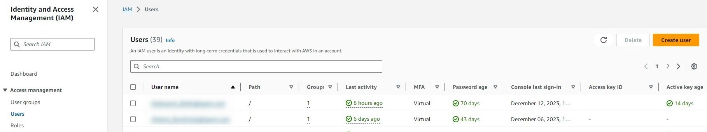

# Deploy Bedrock models

Register an Amazon Bedrock foundation model in DIAL and configure the Bedrock adapter of [DIAL Model Provider](../../6.services/4.model-provider/0.index.md) so DIAL Core can route requests to it. This guide covers both IAM user credentials and IAM Roles for Service Accounts (IRSA) for production Kubernetes deployments.

## Prerequisites

- Active AWS account with admin privileges
- DIAL Core running with DIAL Model Provider

## Step 1: Verify Bedrock model access

Amazon Bedrock provides automatic access to serverless foundation models in your AWS Region. No manual enablement step is required for most providers.

:::note
Anthropic models are enabled by default but still require a one-time usage form before first use. Submit it through the Amazon Bedrock playground in the AWS console, or use the [PutUseCaseForModelAccess API](https://docs.aws.amazon.com/bedrock/latest/APIReference/API_PutUseCaseForModelAccess.html).
:::

## Step 2: Grant IAM access

### Create an IAM policy

Use the AWS-managed **AmazonBedrockFullAccess** policy, or create a custom policy with the minimum required permissions:

- `bedrock:GetFoundationModel`
- `bedrock:ListFoundationModels`
- `bedrock:InvokeModel`
- `bedrock:InvokeModelWithResponseStream`

Some models are available through AWS Marketplace and require a subscription before use. To allow just-in-time subscription on the first call, add this statement to your custom policy:

```json
{
  "Sid": "MarketplaceOperationsFromBedrockFor3pModels",
  "Effect": "Allow",
  "Action": [
    "aws-marketplace:Subscribe",
    "aws-marketplace:ViewSubscriptions"
  ],
  "Resource": "*",
  "Condition": {
    "StringEquals": {
      "aws:CalledViaLast": "bedrock.amazonaws.com"
    }
  }
}
```

### Assign the policy to a user or service account

**IAM user (non-Kubernetes setups)**

1. Navigate to **IAM > Users** in the AWS console and click **Create user**.

   

2. On the **Set Permissions** step, attach the policy.
3. After the user is created, open the **Security credentials** tab and click **Create access key**. Copy the access key ID and secret — you will use them in [Step 3](#configure-dial-model-provider).

**Kubernetes service account (IRSA)**

If your cluster runs on EKS, assign the policy to an IAM role and annotate the Kubernetes service account with the role ARN. Refer to [AWS Documentation — IAM roles for service accounts](https://docs.aws.amazon.com/eks/latest/userguide/iam-roles-for-service-accounts.html) for setup instructions.

## Step 3: Add the model to DIAL

### Add model to DIAL Core config

Add an entry for your model in the `models` section of `config.json`. Its `baseUrl` points at the Bedrock adapter of DIAL Model Provider, and `overrideName` carries the Bedrock model ID that the adapter receives in the request path. Refer to [Models configuration](../../6.services/1.core/1.configuration/4.models.md) for the full field reference.

```json
{
  "models": {
    "claude-sonnet-4-5": {
      "type": "chat",
      "displayName": "Claude Sonnet 4.5 on Bedrock",
      "overrideName": "anthropic.claude-sonnet-4-5-20250929-v1:0",
      "baseUrl": "http://<MODEL_PROVIDER_HOST>:5000/compat/bedrock",
      "interfaces": { "openaiChatCompletions": {} },
      "defaults": { "max_tokens": 4096 }
    }
  }
}
```

### Configure DIAL Model Provider

DIAL Model Provider serves the Bedrock adapter under `/compat/bedrock` and reads its environment variables. Refer to [Bedrock adapter configuration](../../6.services/6.bedrock-adapter/3.configuration.md) for the complete list. The Bedrock adapter in DIAL Model Provider reads the region only from `AWS_DEFAULT_REGION`; see [Region variables](../../6.services/4.model-provider/1.configuration.md#region-variables).

The examples below are [DIAL Extension chart](../../6.services/12.helm/1.configuration/3.dial-extension.md) values for a DIAL Model Provider release.

**Using IAM user credentials**

```yaml
image:
  repository: epam/ai-dial-model-provider
  tag: 0.1.0-rc.0
containerPorts:
  http: 5000
env:
  AWS_DEFAULT_REGION: "<AWS_REGION>"
secrets:
  AWS_ACCESS_KEY_ID: "<AWS_ACCESS_KEY_ID>"
  AWS_SECRET_ACCESS_KEY: "<AWS_SECRET_ACCESS_KEY>"
```

**Using IRSA (EKS service account)**

Configure the role ARN in the service account annotation. The Bedrock adapter picks up credentials automatically from the IRSA token — no access keys needed.

```yaml
env:
  AWS_DEFAULT_REGION: "<AWS_REGION>"
serviceAccount:
  create: true
  annotations:
    eks.amazonaws.com/role-arn: "<AWS_BEDROCK_ROLE_ARN>"
```

## Further reading

- [AWS deployment](../2.cloud-deployment/1.aws-deployment.md) — deploy the full DIAL stack to AWS EKS with Bedrock
- [DIAL Model Provider](../../6.services/4.model-provider/0.index.md) — the service that runs the Bedrock adapter
- [Bedrock adapter configuration](../../6.services/6.bedrock-adapter/3.configuration.md) — full Bedrock adapter environment variable reference
- [Models configuration](../../6.services/1.core/1.configuration/4.models.md) — register additional models in config.json
- [Supported models and providers](../../3.building-with-dial/4.adapters/2.supported-providers.md) — full list of models available through the Bedrock adapter
