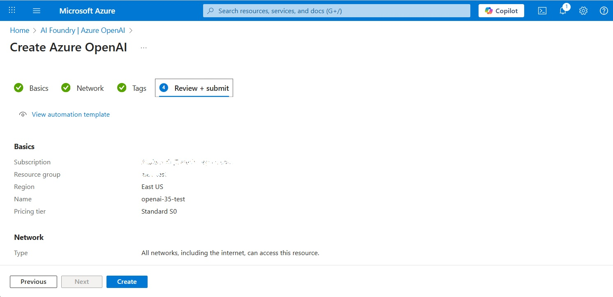
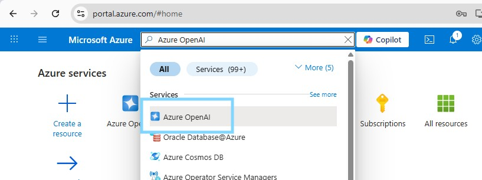
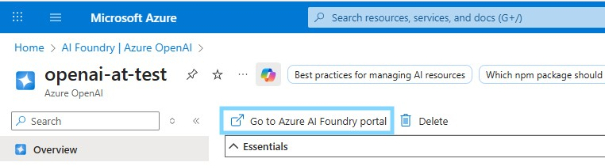
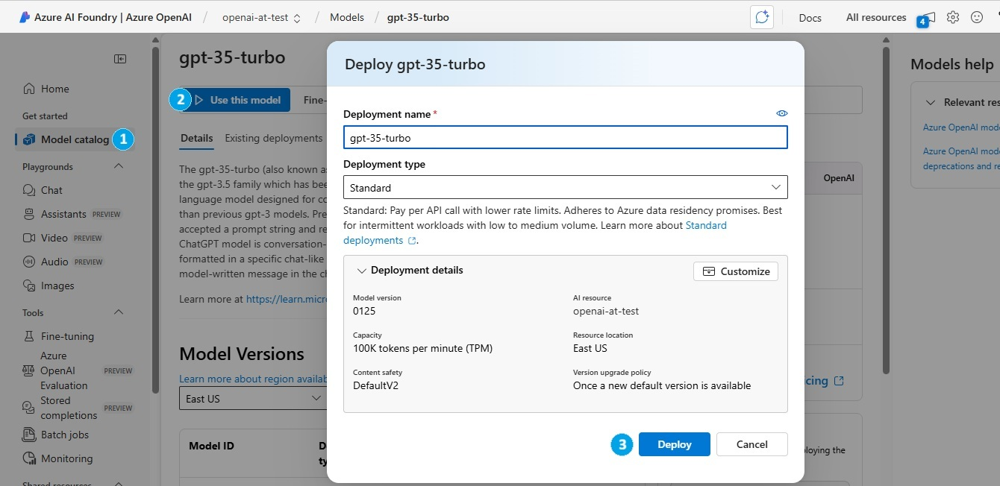
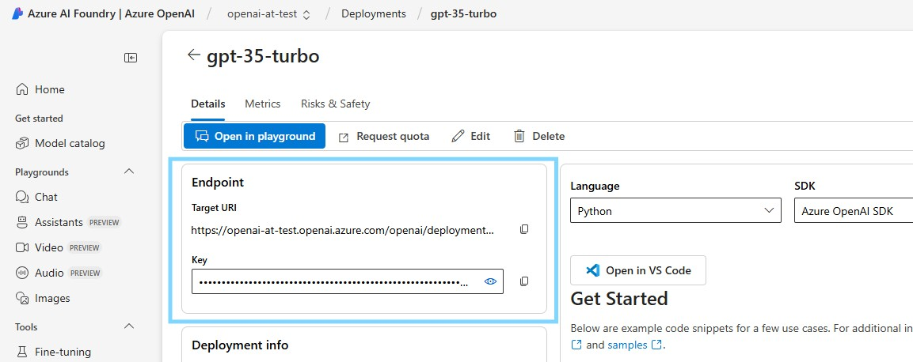
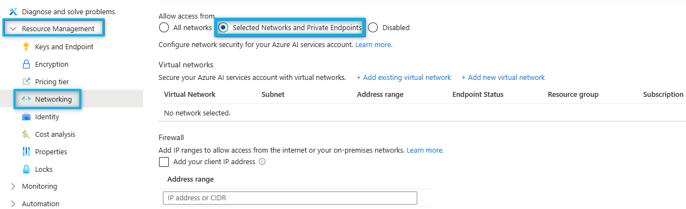

# Deploy Azure OpenAI models

Create an Azure OpenAI model deployment and connect it to DIAL through the OpenAI adapter of [DIAL Model Provider](../../6.services/4.model-provider/0.index.md). This guide covers both API key authentication and passwordless access via Microsoft Entra Workload ID for AKS clusters.

## Prerequisites

- Active Azure account with an Azure OpenAI resource in your subscription

## Step 1: Deploy a model in Azure AI Foundry

### Create an Azure OpenAI resource

1. Sign in to the [Azure portal](https://portal.azure.com/).
2. Navigate to **Azure OpenAI** and click **Create**.
3. Fill in the subscription, resource group, region, and name, then click **Create**.

   

### Create a model deployment

1. Search for **Azure OpenAI** in the portal search bar and click the result to navigate to the **AI Foundry | Azure OpenAI** page.

   

2. Find your Azure OpenAI resource in the list. Click it to open, then click **Go to Azure AI Foundry portal** in the top bar.

   

3. In Azure AI Foundry, click **Model catalog** in the navigation menu. Find your model, open it, and click **Use this model**. Fill in the deployment name and capacity, then click **Deploy**.

   

:::note
Some models are not available in all Azure regions. If a model is unavailable, submit an access request or create the Azure OpenAI resource in a different region.
:::

## Step 2: Get your credentials

### API key and endpoint

1. In Azure AI Foundry, click **Deployments** and open the model you deployed. In the **Endpoint** section, copy the **Target URI** and **Key** — you will supply these in the DIAL Core `config.json` upstreams.

   

### Restrict network access (optional)

Manage default network access rules for your Azure OpenAI resource under **Resource Management > Networking** in the Azure portal.



Refer to [Microsoft Documentation](https://learn.microsoft.com/en-us/azure/ai-services/cognitive-services-virtual-networks) for details.

### Configure Workload Identity (AKS, optional)

For AKS clusters, use Microsoft Entra Workload ID to authenticate DIAL Model Provider without API keys. Refer to [Azure Documentation — Workload Identity with AKS](https://learn.microsoft.com/en-us/azure/aks/workload-identity-overview) for setup instructions.

## Step 3: Add the model to DIAL

### Add model to DIAL Core config

Add an entry for your model in the `models` section of `config.json`, using the Target URI from Step 2 as the upstream endpoint. The model's `baseUrl` points at the OpenAI adapter of DIAL Model Provider. Refer to [Models configuration](../../6.services/1.core/1.configuration/4.models.md) for the full field reference.

```json
{
  "models": {
    "gpt-4o": {
      "type": "chat",
      "displayName": "GPT-4o",
      "overrideName": "gpt-4o",
      "baseUrl": "http://<MODEL_PROVIDER_HOST>:5000/compat/openai",
      "interfaces": { "openaiChatCompletions": {} },
      "upstreams": [
        {
          "id": "azure-gpt-4o",
          "key": "<AZURE_OPENAI_API_KEY>",
          "interfaces": {
            "openaiChatCompletions": {
              "endpoint": "https://<AZURE_OPENAI_RESOURCE>.openai.azure.com/openai/deployments/<DEPLOYMENT_NAME>/chat/completions"
            }
          }
        }
      ]
    }
  }
}
```

### Configure DIAL Model Provider

DIAL Model Provider serves the OpenAI adapter under `/compat/openai` and reads its environment variables. Refer to [OpenAI adapter configuration](../../6.services/5.openai-adapter/3.configuration.md) for the complete list. The examples below are [DIAL Extension chart](../../6.services/12.helm/1.configuration/3.dial-extension.md) values for a DIAL Model Provider release.

**Using Azure OpenAI API key**

API keys are stored in DIAL Core's `config.json` upstreams. No additional configuration is required beyond deploying DIAL Model Provider.

```yaml
image:
  repository: epam/ai-dial-model-provider
  tag: 0.1.0-rc.0
containerPorts:
  http: 5000
```

**Using Managed Identity (Entra Workload ID)**

Authentication happens in DIAL Model Provider. Do not set the Azure OpenAI API key in DIAL Core `config.json` when using this method.

```yaml
podLabels:
  azure.workload.identity/use: "true"
serviceAccount:
  create: true
  annotations:
    azure.workload.identity/client-id: "<AZURE_CLIENT_ID>"
```

## Further reading

- [Azure deployment](../2.cloud-deployment/2.azure-deployment.md) — deploy the full DIAL stack to Azure AKS
- [Local setup with Azure OpenAI](../1.local-setup/4.docker-compose-with-azure-model.md) — run DIAL locally with an Azure OpenAI model
- [DIAL Model Provider](../../6.services/4.model-provider/0.index.md) — the service that runs the OpenAI adapter
- [OpenAI adapter configuration](../../6.services/5.openai-adapter/3.configuration.md) — full OpenAI adapter environment variable reference
- [Models configuration](../../6.services/1.core/1.configuration/4.models.md) — register additional models in config.json
- [Supported models and providers](../../3.building-with-dial/4.adapters/2.supported-providers.md) — full list of models available through the OpenAI adapter
