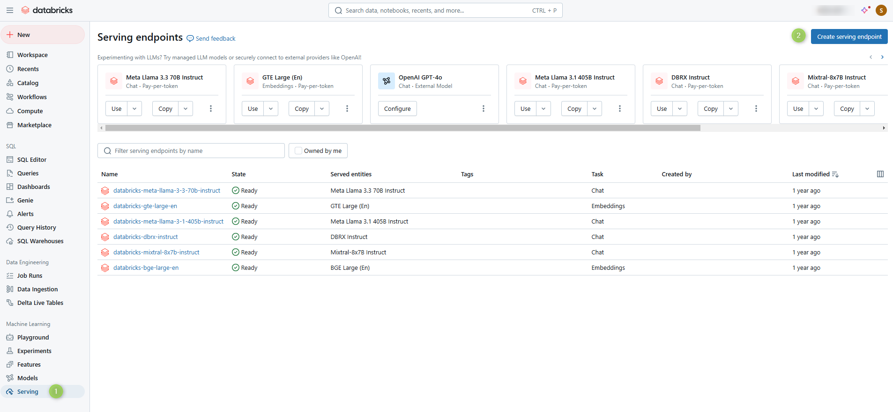
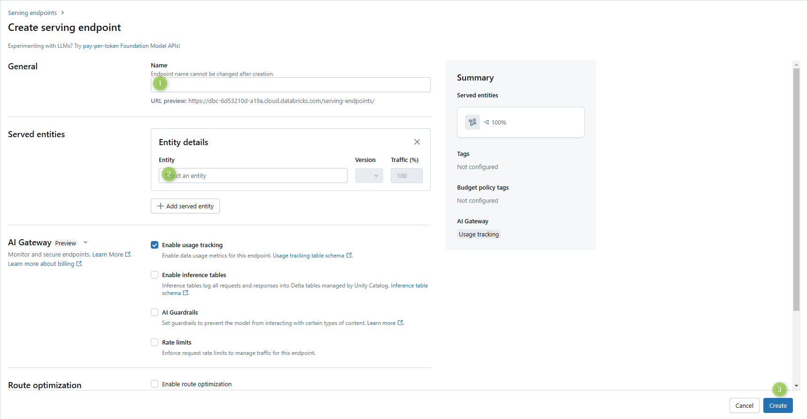
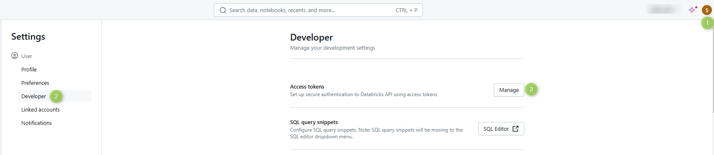

# Deploy Databricks models

Connect a Databricks model serving endpoint to DIAL through the OpenAI adapter of [DIAL Model Provider](../../6.services/4.model-provider/0.index.md). Databricks uses a different authorization flow from OpenAI, which requires declaring the deployment in the `DATABRICKS_DEPLOYMENTS` environment variable on DIAL Model Provider.

## Prerequisites

- Active Databricks account with ML workspace access
- A model serving endpoint, or permission to create one

## Step 1: Create a serving endpoint (optional)

Skip this step if you already have a serving endpoint for the model you want to use.

1. In your Databricks workspace, navigate to the **Machine Learning** section.
2. Open the **Serving** tab and click **Create serving endpoint**.

   

3. Enter a name for the endpoint — you will reference it in [Step 3](#step-3-add-the-model-to-dial) — and select the model to serve.

   

4. Click **Create**.

## Step 2: Create an access token

1. Open your Databricks workspace **Settings**.
2. Navigate to **User Settings > Developer** and generate a new access token.

   

3. Copy the token — you will supply it in [Step 3](#step-3-add-the-model-to-dial).

## Step 3: Add the model to DIAL

### Register the model in DIAL Core config

Add an entry in the `models` section of `config.json`. Refer to [Models configuration](../../6.services/1.core/1.configuration/4.models.md) for the full field reference.

Use the serving endpoint name and access token from the previous steps. The model's `baseUrl` points at the OpenAI adapter of DIAL Model Provider, and `overrideName` carries the Databricks deployment name that the adapter receives in the request path:

```json
"<DIAL_DEPLOYMENT_NAME>": {
  "type": "chat",
  "displayName": "<DISPLAY_NAME>",
  "overrideName": "<DATABRICKS_DEPLOYMENT_NAME>",
  "baseUrl": "http://<MODEL_PROVIDER_HOST>:5000/compat/openai",
  "interfaces": { "openaiChatCompletions": {} },
  "upstreams": [
    {
      "id": "databricks",
      "key": "<ACCESS_TOKEN>",
      "interfaces": {
        "openaiChatCompletions": {
          "endpoint": "<DATABRICKS_ACCOUNT_URL>/serving-endpoints/chat/completions"
        }
      }
    }
  ]
}
```

### Configure DIAL Model Provider

Databricks serving endpoints use a different authorization flow from standard OpenAI deployments. Declare the Databricks deployment name in the `DATABRICKS_DEPLOYMENTS` environment variable of DIAL Model Provider, for example in its [DIAL Extension chart](../../6.services/12.helm/1.configuration/3.dial-extension.md) values:

```yaml
env:
  DATABRICKS_DEPLOYMENTS: "<DATABRICKS_DEPLOYMENT_NAME>"
```

Restart DIAL Model Provider for the change to take effect.

Refer to [OpenAI adapter configuration](../../6.services/5.openai-adapter/3.configuration.md) for the complete list of environment variables.

## Further reading

- [DIAL Model Provider](../../6.services/4.model-provider/0.index.md) — the service that runs the OpenAI adapter
- [OpenAI adapter configuration](../../6.services/5.openai-adapter/3.configuration.md) — full OpenAI adapter environment variable reference, including `DATABRICKS_DEPLOYMENTS`
- [Models configuration](../../6.services/1.core/1.configuration/4.models.md) — model config field reference
- [Supported models and providers](../../3.building-with-dial/4.adapters/2.supported-providers.md) — full list of providers supported through the OpenAI adapter
