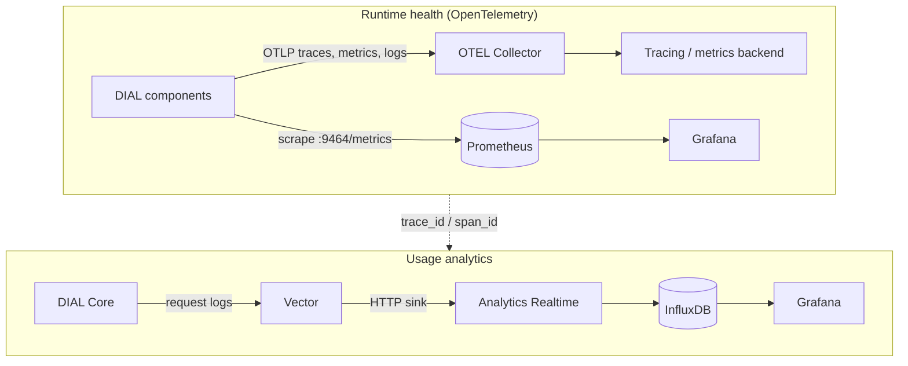

# Observability

This page explains how observability works in DIAL: what the platform emits, how telemetry flows from components to your backends, and the two distinct observability planes you operate. It is for DevOps and platform engineers who want to understand the model before configuring tracing, metrics, logging, or analytics. No setup instructions are here — each how-to in this section covers one task.

## OpenTelemetry as the common layer

DIAL standardizes on [OpenTelemetry](https://opentelemetry.io/) (OTEL), a vendor-agnostic specification for traces, metrics, and logs. Components export telemetry over the OTLP protocol to a collector, which forwards it to whatever backend you run. Because the wire format is standard, you choose the backend — Prometheus, Jaeger, Grafana, and similar tools all consume the same data without DIAL locking you to one vendor.

OTEL gives DIAL three signal types:

- **Traces** — the path of a request as it moves across components, with parent and child spans.
- **Metrics** — numeric time series such as request counts, latency, and JVM or system resource usage.
- **Logs** — structured event records, optionally correlated with traces.

## Two observability planes

DIAL observability splits into two planes that you configure and operate independently. Keeping them separate is the key to reasoning about the platform.

**Runtime health** answers "is the platform healthy?" It is the OTEL plane: components emit traces, metrics, and logs over OTLP, and a collector forwards them to your chosen backend. Prometheus metrics travel a separate, independent path — components also expose a Prometheus-format `/metrics` endpoint that Prometheus scrapes directly, without going through the collector. Use it for latency, error rates, resource pressure, and request flow.

**Usage analytics** answers "how is the platform being used, and what does it cost?" It is a separate pipeline: DIAL Core writes request logs, [Vector](https://vector.dev/) ships them to the [Analytics Realtime](#what-each-component-emits) service, and that service writes usage metrics — token counts, cost, topics, and ratings — to InfluxDB for visualization in Grafana.

The two planes share only one link: the OpenTelemetry `trace_id` and `span_id` that Analytics Realtime records alongside each usage record, so a usage entry can be traced back to its request spans.

## What each component emits

| Component | OTLP (traces, metrics, logs) | Prometheus metrics | How it is instrumented |
|-----------|--------------------------------------|----------------------------------------|------------------------|
| DIAL Core | Yes (JVM and HTTP metrics, structured logs, and spans carrying `trace_id`, `core_span_id`, `core_parent_span_id`, and an `execution_path` call stack) | Yes | OpenTelemetry Java agent attached at the JVM level |
| DIAL Chat | Yes | Yes | OpenTelemetry Node.js SDK |
| [DIAL Admin Frontend](../../6.services/8.admin/0.index.md) | Yes (traces and logs; metrics when configured for OTLP) | Yes, by default | OpenTelemetry Node.js SDK; see [Admin telemetry settings](../../6.services/8.admin/2.configuration/1.frontend.md#opentelemetry) |
| [DIAL Deployment Manager Backend](../../6.services/10.deployment-manager/0.index.md) | Optional; export is off by default | Yes, `/actuator/prometheus` on port `9464` | Spring Boot OpenTelemetry integration; see [Backend observability](../../6.services/10.deployment-manager/1.configuration/1.backend.md#backend-observability). Managed workload metrics use a separate API. |
| Adapters and Applications | Yes, including system CPU and memory metrics | Yes | [DIAL SDK telemetry](../../3.building-with-dial/6.developer-tools/1.sdk-reference/4.telemetry.md) (Python) |
| Analytics Realtime | Usage records: tokens, cost, topics, ratings | — | Consumes Core request logs via Vector |

Other applications built on the DIAL SDK emit the same OTLP and Prometheus signals as any SDK-based adapter or application.

Admin's [Analytics screens](../../5.administering-dial-new/5.analytics/0.index.md) use a separate
data-access service, with optional enrichment processing. They do not read the Analytics Realtime
InfluxDB pipeline shown above. Configure their connection through
[DIAL Admin analytics settings](../../6.services/8.admin/2.configuration/1.frontend.md#analytics).

:::note
DIAL Core is a Java service. It does not instrument itself in application code — its traces and metrics come from the OpenTelemetry Java agent attached to the JVM. The OTEL environment variables documented in this section configure that agent; how the agent jar is attached is set at the image or JVM level, not in `config.json`. Confirm the attachment mechanism against your own deployment.
:::

:::note
Export to your chosen telemetry backend requires configuration on each component. Admin Frontend
initializes its Node.js instrumentation and serves Prometheus metrics by default. The Vector log
sidecar prints to standard output until you configure a sink. Each how-to describes what to connect.
:::

For a Kubernetes example that connects both observability planes, follow [Observability with Grafana and Prometheus](6.providers/1.grafana-prometheus.md).

## Further reading

- [Analytics and observability](../../2.understand-dial/3.capabilities/5.analytics-and-observability.md) — distinguish operational signals from usage and cost analysis
- [SDK telemetry](../../3.building-with-dial/6.developer-tools/1.sdk-reference/4.telemetry.md) — understand the signals emitted by SDK applications and adapters
- [Analytics in DIAL Admin](../../5.administering-dial-new/5.analytics/0.index.md) — see how operators use dashboards, queries, and sessions

## Next steps

- [Configure tracing](1.tracing.md) — enable distributed tracing across components
- [Configure metrics](2.configure-metrics.md) — scrape service metrics with Prometheus
- [Set up Analytics Realtime](5.analytics-realtime-setup.md) — capture request usage and cost
