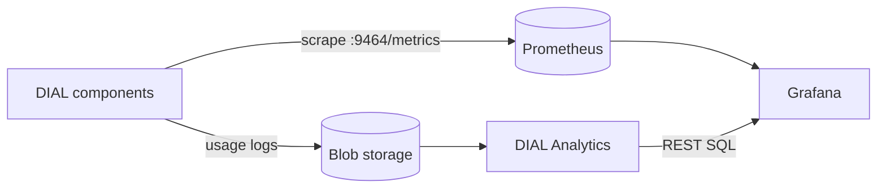

# Observability with Grafana and Prometheus

This guide assembles the default DIAL observability stack on Kubernetes: Prometheus for runtime-health metrics, DIAL Analytics for usage analytics, and Grafana over both. It is for DevOps engineers running DIAL with the Helm chart who want one end-to-end monitoring setup. For the conceptual model, see [Observability](../0.index.md).

## Prerequisites

- DIAL deployed with the `dial-core` Helm chart
- [Prometheus Operator](https://prometheus-operator.dev/) running in the cluster
- Grafana 11.6 or newer, with the Infinity datasource plugin for the usage dashboards
- A running [DIAL Analytics](../../../6.services/20.analytics/0.index.md) that already ingests usage logs; see [Configuration](../../../6.services/20.analytics/1.configuration/0.index.md)

## How the pieces fit

This stack spans both observability planes. Prometheus covers runtime health; DIAL Analytics covers usage analytics; Grafana visualizes both.



## Step 1: Scrape runtime metrics with Prometheus

Enable the metrics service and the `ServiceMonitor` so the Prometheus Operator discovers DIAL automatically:

```yaml
metrics:
  enabled: true
  serviceMonitor:
    enabled: true
    interval: 30s
    path: /metrics
    port: http-metrics
```

DIAL Core and DIAL Chat serve this endpoint without any metrics-exporter variable. For adapters and applications built on the DIAL SDK, set `OTEL_METRICS_EXPORTER=otlp,prometheus` so they serve it too. For the full procedure and the metric-name caveat, see [Configure metrics](../2.configure-metrics.md).

## Step 2: Add usage dashboards with DIAL Analytics

The [DIAL Analytics repository](https://github.com/epam/ai-dial-analytics/tree/0.23.0-rc.1/grafana) ships seven Grafana dashboards over DIAL usage data. Every panel queries DIAL Analytics through `POST /v1/queries/execute-sql`, so Grafana needs one URL and one API key, and no ClickHouse credential.

1. Install the `yesoreyeram-infinity-datasource` plugin. Pin the version: the panels depend on Infinity behavior that an unannounced upgrade could change.
2. Provision a datasource with the uid `adas-rest-sql` from the repository's `grafana/provisioning/datasources/adas.yml`. Supply `ADAS_BASE_URL` and `ADAS_API_KEY`.
3. Load the dashboards from `grafana/dashboards/` by file provisioning or HTTP import.

```bash
ADAS_BASE_URL=http://<ANALYTICS_HOST>:5000
ADAS_API_KEY=<DIAL_API_KEY_WITH_READ_ONLY_ANALYTIC_ROLE>
```

When Analytics runs with `SECURITY_MODE=oidc`, the key must map to the `READ_ONLY_ANALYTIC` bundle or an equivalent that grants `TABLE_READ`. Install `adas-dial-usage` first: it reads only ingested usage logs, so if it draws, the datasource and credential are correct. The other dashboards also read rollup and enrichment tables; a panel whose table is missing fails with `400 bad_request`. Check `GET /v1/queries/entities` for the tables your deployment exposes.

The complete installation, verification, and operating limits, including the 1000-row result maximum, are in the [Grafana dashboards guide](https://github.com/epam/ai-dial-analytics/blob/0.23.0-rc.1/docs/grafana-dashboards.md).

## Step 3: Add Prometheus to Grafana

Add Prometheus as a Grafana datasource for runtime-health metrics such as latency, error rate, and resource usage. The Infinity datasource from Step 2 supplies the usage analytics.

:::note
The DIAL Helm chart ships no prebuilt Grafana dashboard for the Prometheus metrics. Use a community JVM or OpenTelemetry Java agent dashboard for DIAL Core and adapt it to your labels. The Analytics dashboards cover only the usage-analytics plane.
:::

## Result

Grafana shows runtime health from Prometheus and usage analytics from DIAL Analytics, giving one view across both observability planes.

## Further reading

- [Configure metrics](../2.configure-metrics.md) — the Prometheus half in detail
- [DIAL Analytics](../../../6.services/20.analytics/0.index.md) — the usage-analytics half in detail
- [Alerting](../4.alerting.md) — Prometheus alert rules for the common DIAL failure modes
- [Tracing (OpenTelemetry)](../1.tracing.md) — add distributed traces to the stack
