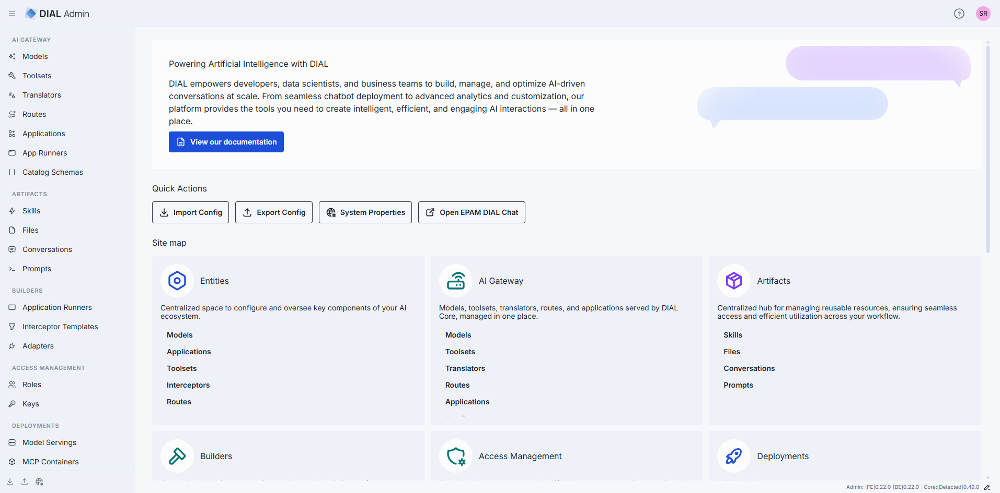

# Admin Panel overview

DIAL Admin is the web interface administrators use to configure, manage, and monitor a DIAL
deployment without editing configuration files by hand. This page explains what the Admin Panel is,
who counts as an administrator, and how its sections map to the day-to-day work of running DIAL. It is
for administrators and governance owners; no prior Admin Panel experience is assumed.

## What the Admin Panel is

DIAL Admin Frontend connects directly to DIAL Core using the signed-in user's token. Core stores
configuration created through the panel alongside its file-defined configuration; Admin does not
rewrite those files. Deployment management, Evaluation, and Analytics use optional service APIs.

For the service architecture, dependencies, and releases, see [Services > DIAL Admin](../6.services/8.admin/0.index.md).
Platform engineers should start with [DIAL Admin configuration](../6.services/8.admin/2.configuration/1.frontend.md)
to connect Core, set up administrator access, and enable optional services. Admin Backend is optional
and supplies additional backend-dependent screens and configuration-transfer workflows.

## Who is an administrator

Your identity provider assigns your roles. DIAL Core recognizes administrators through the static
`access.admin.rules` settings, and the frontend has matching role-claim settings. See
[Authentication and administrator access](../6.services/8.admin/2.configuration/1.frontend.md#authentication-and-administrator-access)
for a complete example. Administrator privileges include:

- `READ` and `WRITE` access to all public system resources — conversations, prompts, files,
  toolsets, and applications.
- The ability to view, approve, and reject publication requests submitted by DIAL users.
- Access to the Core Configuration API; other resources remain subject to their access rules.
- The ability to manage the DIAL Core configuration — models, applications, toolsets, roles, API keys,
  interceptors, and more — through the panel.

For the wider model of identities, roles, and permissions, see
[Authentication and access control](../2.understand-dial/5.security-and-governance/1.authentication-and-access-control.md).

## How the sections map to your work

The Admin Panel groups its features into sections. Each maps to a stage of operating a DIAL
deployment:

- [AI Gateway](./1.ai-gateway/0.index.md) — register and configure the entities that DIAL Core exposes
  through the Unified API: models, applications, toolsets, routes, translators, application runners, and
  catalog schemas.
- [Artifacts](./2.artifacts/0.index.md) — govern the shared content that users publish: skills,
  prompts, files, and conversations.
- [Deployments](./3.deployments/0.index.md) — build and run the container images behind model servings,
  MCP servers, adapters, applications, and interceptors. Requires [DIAL Deployment Manager](../6.services/10.deployment-manager/0.index.md).
- [Evaluation](./4.evaluation/0.index.md) — create test suites, manage datasets, and run evaluations
  against deployed models, applications, and MCP tools.
- [Analytics](./5.analytics/0.index.md) [Preview] — analyze conversation data with queries, dashboards,
  tables, pipelines, and sessions.
- [Governance](./6.governance/1.roles.md) — manage [roles](./6.governance/1.roles.md),
  [API keys](./6.governance/2.keys.md), [folder permissions](./6.governance/3.folders-storage.md),
  [interceptors](./6.governance/4.interceptors.md), and
  [approvals](./6.governance/5.publications-and-review.md) of user publications.

Two cross-cutting tasks have their own pages:
[User management](./6.governance/6.user-management.md) explains how user identities reach DIAL, and
[Usage limits and cost control](./6.governance/7.usage-limits-and-cost-control.md) covers how to cap consumption and
spend.

## Read-only access

Two kinds of read-only apply in the Admin Panel.

**Read-only entities.** Entities defined in the DIAL Core configuration files appear in the **file** root
folder of the AI Gateway. This folder is read-only for every administrator: its entries carry a
**READ ONLY** badge, and you can't create, edit, or delete them in DIAL Admin or through the API. To change
them, edit the configuration file. See
[Where an entity can be defined](./1.ai-gateway/0.index.md#where-an-entity-can-be-defined).

**Read-only accounts with Admin Backend.** When the optional backend supplies account roles, not every administrator account can change configuration. If your account has
read-only permissions, DIAL Admin shows a **Read-only mode access** banner on the home page and a
**READ ONLY** badge in the header that stays visible as you navigate. Controls that modify
configuration — including **Import Config** and **Export Config** — are disabled. Access levels are themselves
mapped by Admin Backend's identity-provider configuration. This account mode is distinct from Core's
administrator rules; see [Optional Admin Backend](../6.services/8.admin/2.configuration/1.frontend.md#optional-admin-backend).

## Further reading

- [Security and governance](../2.understand-dial/5.security-and-governance/0.index.md) — understand identities, permissions, usage limits, and data boundaries
- [DIAL Admin service](../6.services/8.admin/0.index.md) — understand the services behind the interface and its optional features
- [Compliance and legal FAQ](6.governance/8.compliance-and-legal-faq.md) — review data and privacy questions for self-hosted deployments

## Next steps

- [Manage the AI gateway](1.ai-gateway/0.index.md) — configure models, applications, Toolsets, routes, and translators
- [Manage users and their access](6.governance/6.user-management.md) — assign roles and review access to platform resources
- [Manage artifacts](2.artifacts/0.index.md) — maintain published skills, prompts, files, and conversations
- [Back up configuration and set global properties](1.config-backup-and-global-settings.md) — export settings before making administrative changes
