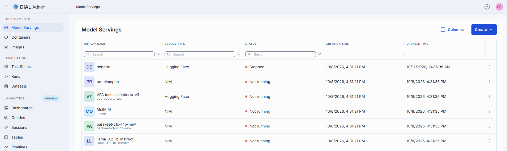
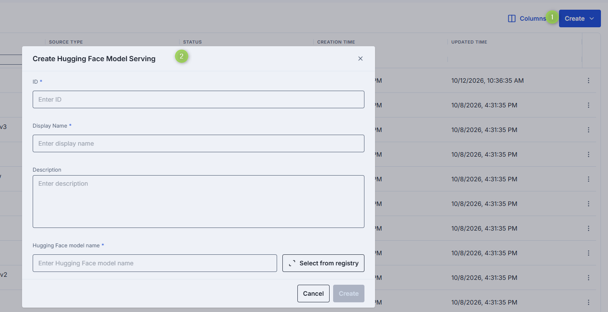
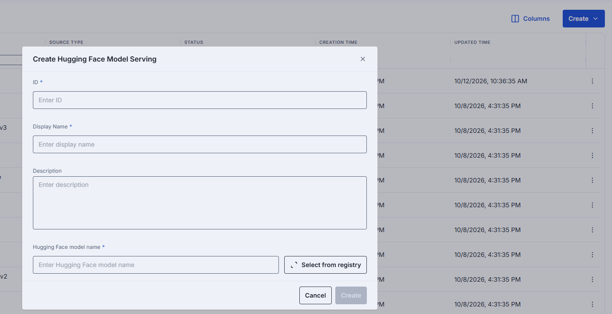
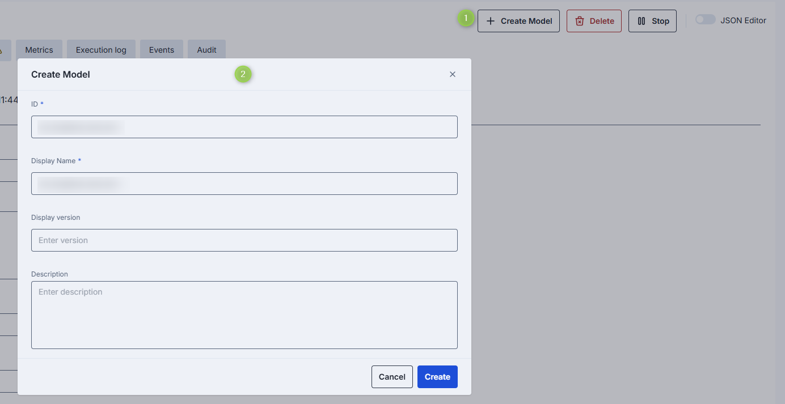
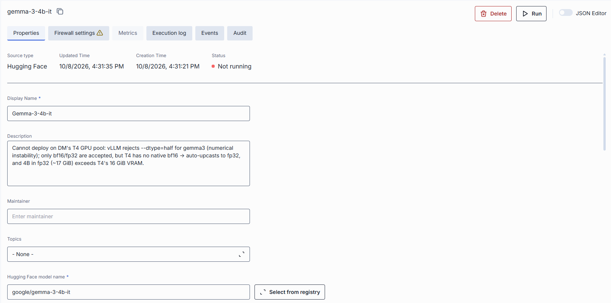

# Model servings

Model serving containers run [Hugging Face](https://huggingface.co/models) models or NVIDIA NIM inference containers within DIAL infrastructure. After a model serving container is running, you can register it as a DIAL model.

> Refer to [Containers](./2.container-management.md) to learn about container properties.

In Model Servings you can find all available model serving containers and add new ones.

The model servings grid includes the standard [container grid columns](./2.container-management.md#container-grid-columns). The **Container URL** column is hidden by default; enable it in the grid column settings.

### Create a model serving container

**Note**
> Model Servings appears when the Hugging Face option (`HF_ENABLED`), the NIM option (`NIM_ENABLED`), or both are enabled in your DIAL Admin deployment; each option adds its own entry to **Create**. See [DIAL Deployment Manager and MCP containers](../../6.services/8.admin/2.configuration/1.frontend.md#deployment-manager-and-mcp-containers). NIM servings also need NIM deployment turned on in the Deployment Manager (`K8S_NIM_ENABLED`, set by `manager.configuration.deploy.nim.enabled` in the `dial/dial-admin` chart) and an NVIDIA enterprise license with NGC credentials.

Click **Create** on the main screen and select **Hugging Face model serving** or **NIM model serving**.

Fill in the form:

- **ID**: Unique identifier for the model serving.
- **Display Name**: Name displayed in the UI.
- **Description**: Brief description.
- **Hugging Face Model Name** (Hugging Face): Start typing to see suggestions, or click **Select from registry** to pick from the modal.
- **Docker Image URI** (NIM): The NIM container image to run.

Click **Create** to submit the form.

### Get the container URL

Click **Run** on the model serving screen. When the status changes to **Running**, the **URL** appears in the screen header next to the status. Click the copy icon to copy it.

The URL is shown only while the container is running.

### Use a model serving in DIAL

A running model serving exposes an OpenAI-compatible API. To make it available to users, create a [model](../1.ai-gateway/1.models.md) from the container.

1. On the screen of the running model serving, click **Create Model**.
2. Fill in the dialog:
   - **ID**: Unique identifier. Auto-populated from the model serving.
   - **Display Name**: Name shown in the UI. Auto-populated from the model serving.
   - **Display Version**: Version of the model.
   - **Description**: Brief description.
3. Click **Create**. Repeat to create additional models.

The model is linked to the container. DIAL Admin pre-populates the endpoint path and sets **Override Name** to the container name, so you don't enter the container URL. The path is `openai/v1/chat/completions` for Hugging Face and `v1/chat/completions` for NIM; for an embeddings model, it ends in `/embeddings` instead.

Once created, the model is available to users and applications according to your permissions configuration.

### Model serving properties

Click any model serving on the main screen to open its properties screen.

In addition to the [shared properties](./2.container-management.md#properties), model serving containers include:

| Property | Required | Editable | Description |
|----------|----------|----------|-------------|
| Hugging Face model name | Yes | Yes | Hugging Face only. Start typing to see suggestions, or click **Select from registry** to pick from the modal. |
| Docker Image URI | Yes | Yes | NIM only. The NIM container image. |
| gRPC Port | No | Yes | NIM only. Shown next to **Port** in the endpoint settings. |
| Autoscaling | No | Yes | Hugging Face only; NIM servings have no autoscaling settings. **Note** > Model servings default to 1 replica for both Min and Max. Existing containers retain their current configuration. |

GPU cards on the **Metrics** tab appear for Hugging Face servings only.

### Model serving actions

Click any model serving container to access the configuration screen. On the configuration screen, you can find several actions you can perform on the selected model serving container.

| Action | Description |
|--------|-------------|
| **Create Model** | Available for running model servings. Creates a new [model entity](../1.ai-gateway/1.models.md) from this container. See [Use a model serving in DIAL](#use-a-model-serving-in-dial). |
| **Run / Stop** | Start or stop the model serving. |
| **Delete** | Remove the model serving. Deleting affects model entities created from it. |

## HuggingFace auto-detection

When creating a Hugging Face model serving container, the Deployment Manager can automatically
detect **text-classification** models and configure the appropriate KServe transformer chain.

| Behavior | Description |
|----------|-------------|
| **Auto-detection** | The Deployment Manager identifies `text-classification` models from HuggingFace metadata and configures the appropriate task type automatically. |
| **KServe transformer chaining** | For detected text-classification models, the system sets up a KServe transformer chain (predictor + transformer), removing the need for manual model task type configuration. The transformer image is configured via the `INFERENCE_TEXT_CLASSIFICATION_TRANSFORMER_IMAGE` environment variable on the Deployment Manager. |

**Note**
> Chained text-classification deployments require a transformer image configured on the backend.
> Platform engineers set its image and resource defaults in [Model integrations and resource limits](../../6.services/10.deployment-manager/1.configuration/1.backend.md#model-integrations-and-resource-limits).

## Further reading

- [Manage deployment images](./3.images.md) — build and version the images that containers are based on
- [Manage MCP containers](./2.container-management.md#mcp-containers) — deploy MCP server containers
- [Manage models](../1.ai-gateway/1.models.md) — register and configure AI models in DIAL
- [DIAL Deployment Manager Backend configuration](../../6.services/10.deployment-manager/1.configuration/1.backend.md) — cluster access, image builds, and workload settings
