# Test suites

A test suite bundles a target (a model, an application, a DIAL Core route or an MCP tool), metrics, a linked [dataset](3.datasets.md), and a request
template into a single evaluation unit. Creating and configuring a test suite is the main setup step
before running an evaluation.

A request can go to any endpoint the target declares, including the **OpenAI Chat Completions**,
**OpenAI Responses** and **Anthropic Messages** APIs, so evaluations can target the same interface used in production.

## Test suites grid

Open **Evaluation > Test Suites** to see all test suites. The grid is sorted by creation time, newest first.

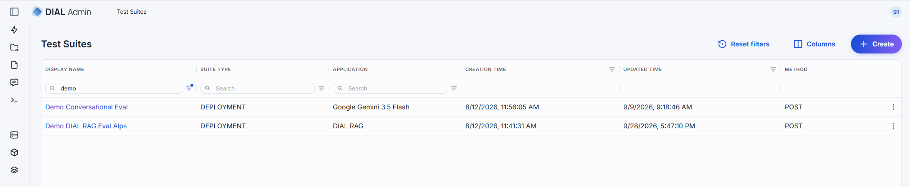

| Column | Description |
|--------|-------------|
| **Display Name** | Display name of the test suite. |
| **Description** | Free-text summary of the test suite's purpose. |
| **ID** | Test suite identifier. |
| **Suite Type** | Evaluation type of the test suite: DEPLOYMENT (for apps and models), ROUTE (for DIAL Core routes) or MCP_TOOL. |
| **Application** | The application, model, route or MCP toolset associated with the test suite. |
| **Creation time** | Timestamp when the test suite was created. |
| **Updated time** | Timestamp of the last update. |
| **Created By** | The user who created the test suite: by default the `sub` claim of their token, or their DIAL Core display name when the framework backend's [`SECURITY_JWT_RESOLVE_USER_NAME`](../../6.services/10.evaluations/1.configuration/1.framework-backend.md#security) is on. |
| **Method** | HTTP method of the request sent to the target. Hidden by default. |
| **URL** | Relative URL pattern of the request endpoint. Hidden by default. |
| **Actions** | Per-row actions: **Open in a new tab**, **Run**, **Duplicate** and **Delete**. |

## Create

To create a test suite, click **Create**. A multi-step wizard guides you through the following steps:

1. **Properties**: define the test suite name and description.
2. **Target**: select a target on the **Applications**, **Models**, **MCP** or **Routes** tab.
3. **Methods**: select a method (an endpoint) supported by the selected deployment or route. For an MCP toolset, this step is called **Tool** and you select a tool of the toolset.

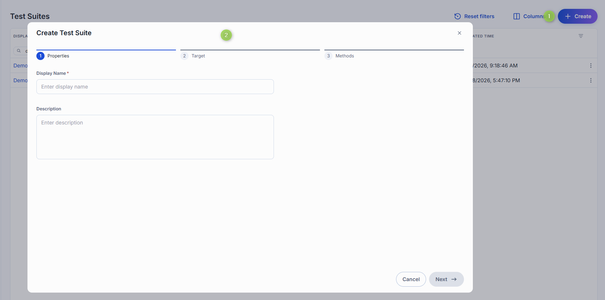

## Details

Click the name of a test suite to open its detail view. At the top it shows the validity badge
(**Valid** or **Invalid**), the name of the test suite, the **Delete** and **Run** buttons, and the
**JSON Editor** switch, which shows the test suite as JSON. **Run** is disabled while the test suite is
invalid. The detail view has six tabs.

### Properties

Basic information about the test suite. If the test suite has validation warnings, its status is shown next to the tab header and the warnings are listed in the status tooltip.

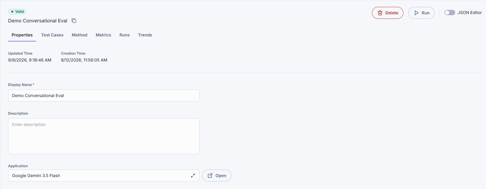

| Field | Required | Editable | Description |
|-------|----------|----------|-------------|
| **Display name** | Yes | Yes | Name of the test suite displayed on the UI. |
| **Description** | No | Yes | Free-text summary of the test suite's purpose. |
| **Application** | Yes | Yes | The model, application, route or MCP toolset this suite evaluates, with its version if any. Click the field to change the target: the **Target** and **Methods** (or **Tool**) wizard steps open. Changing the method significantly affects the test suite, including configuration and results, so existing settings may be updated or reset. Click **Open** next to the field to open the deployment in a new tab. |

A test suite whose request template does not match the selected deployment is marked invalid. For
example, for the Anthropic Messages API, the `model` in the request body must be equal to the ID of the
selected deployment; otherwise the suite gets a `REQUEST_BODY_VALIDATION_ERROR` warning.

### Test cases

A test case is a single row of test data: the input for the target and, optionally, the expected output. Test cases can carry custom schema fields (string, number, integer, boolean, object, array, file, skill) and can define multi-turn conversations for evaluating multi-step interactions.

Test cases can be added manually or by attaching an existing [dataset](3.datasets.md). Without a linked dataset, the tab shows "No dataset linked. Link a dataset to manage test cases and run this suite." and the suite can't be run.

The toolbar has **Configure schema**, **Attach dataset** and **Add**, plus **Delete** when test cases are selected. The **More** menu holds **Publish to a new dataset**, **Import from PC storage** and **Export CSV**. Each
test case row also has actions to try out, duplicate and remove the test case.

#### Add manually

To add test cases manually, click **Add** in the toolbar. A basic test case is added to the grid.


You can add additional fields to the test case by configuring the test case schema. Added fields are displayed in the main grid.

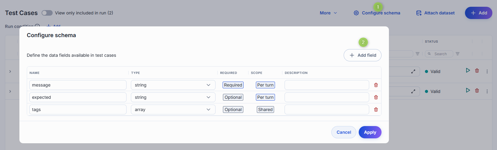

:::note
Test cases added manually are private to the test suite and the grid is marked as private. To share them with other test suites, [publish them to a new dataset](#publish-to-a-dataset) or attach an existing dataset.
:::

#### Attach dataset

The dataset provides the test case schema and data; the test suite consumes them as evaluation inputs.

1. Click **Attach dataset** in the toolbar. The [Dynamic configuration](#dynamic-configuration) of the Method tab must be complete first.
2. Select a dataset among the available ones. Use **Preview Test Cases** to see its content.
3. Confirm.

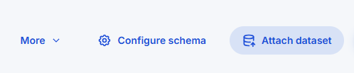

:::warning
Attaching a public dataset permanently removes all test cases that currently exist in the test suite.
:::

When attached, the test cases grid is populated with test cases from the attached dataset and the test case schema is defined by the dataset. A banner above the grid lets you open the dataset (**Open dataset**), switch to another one (**Change dataset**), or detach it (**Detach from dataset**).

:::note
When a public dataset is attached, the test cases and their schema are read-only in the test suite view. To change them, open the dataset page (**Edit on Dataset page**) or detach the dataset. See [Datasets — Manage test cases](3.datasets.md#manage-test-cases) and [Datasets — Test case schema](3.datasets.md#schema).
:::

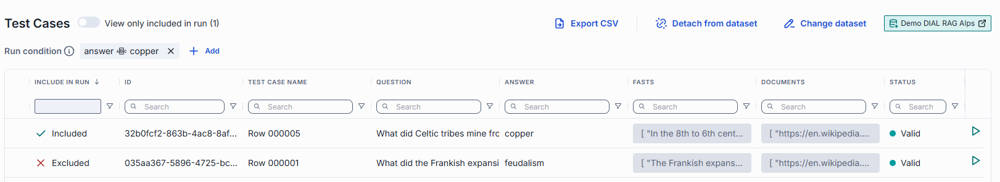

#### Detach dataset

When you click **Detach from dataset**, choose what happens to the test cases:

* **Keep current test cases**: switches the suite to manual mode and keeps the test cases. They become private to the test suite, so you can add, edit, or delete them without restrictions. The original dataset stays unchanged, so other suites using it aren't affected. The test case schema remains as defined by the previously attached dataset, but you can now edit it.
* **Start with empty table**: switches to manual mode and clears the test cases.

#### Publish to a dataset

To share private test cases, click **Publish to a new dataset** in the toolbar, enter the dataset details and click **Create**. The test cases are saved to a new dataset and the test suite is linked to it automatically.

#### Multi-turn test cases

Test cases can define a multi-step conversation instead of a single request/response pair. A
multi-turn test case carries ordered turns, and each turn holds the values of the **Per turn** fields
of the schema, for example the user message and the expected answer of that turn. When a test suite with multi-turn test cases runs, the framework sends
one request per turn, in order, records the result of each turn and evaluates metrics per turn. It
does not keep the conversation history on its own: to pass earlier messages and replies to the next
turn, configure the request template and the extracted response fields. See
[Configure a multi-turn dialog](#configure-a-multi-turn-dialog).

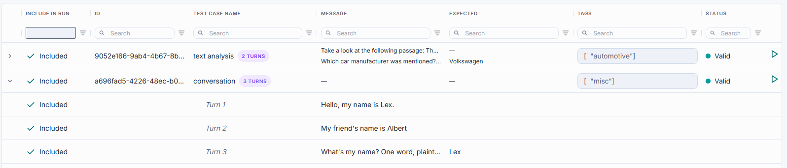

Multi-turn test cases are managed in the [dataset](3.datasets.md#schema): set the **Scope** of
a schema field to **Per turn** so that it has a value in each turn, and add, delete and reorder
the turns of a test case in the test cases grid. Multi-turn test cases can also be imported via CSV. The maximum number of turns per test case is configured on the
evaluation framework backend ([`TEST_CASE_MULTI_TURN_MAX_TURNS`](../../6.services/10.evaluations/1.configuration/1.framework-backend.md#datasets-and-imports), default 30). Test cases exceeding
this limit are saved but marked invalid and excluded from runs.

#### Run conditions

You can define a run condition to select a subset of test cases for evaluation. When a condition is set, only matching test cases are included when the test suite runs. This is useful for running focused evaluations on specific categories or conditions within a large dataset.

The **Run condition** is shown above the test cases grid as filter chips. Click **Add** to define a filter on a test case field, click a chip to edit it, or remove it. The **Include in run** column shows whether each test case is **Included** or **Excluded**, and **View only included in run** limits the grid to the included ones.

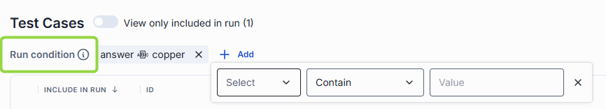

#### Try out a test case

You can run a selected test case against the target without starting a full run.

1. Click **Try out** in the actions of the test case row.
2. In the Try out side panel click **Send Request**.

See [Try out](#try-out) for what the panel shows.

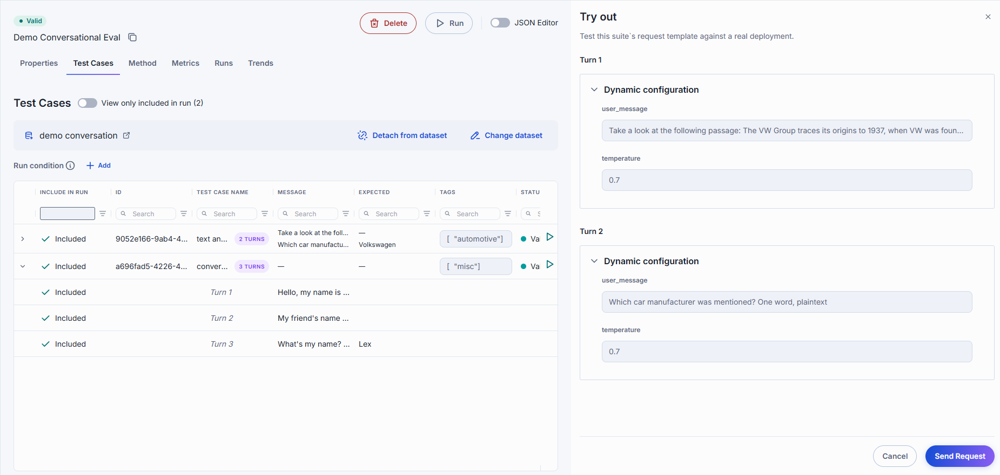

### Method

The Method tab defines the request that the test suite sends to the target for each test case: which
endpoint to call, what the request contains, which values are taken from the test case, and which
values are read from the response. A suite usually sends one request; you can also
[chain several requests](#multi-request-test-suites). The description below applies to models,
applications and routes. For an MCP tool, the tab is different: see [MCP tool suites](#mcp-tool-suites).

The tab has two parts.

* **Requests** sidebar, on the left: the list of requests of the suite (**Request 1**, or the name you
  gave it). Select a request to show its settings on the right. Click **Add** to add a request. Use the
  menu of a request to **Rename** or **Delete** it; the first request can't be deleted. The sidebar can be
  collapsed. See [Multi-request test suites](#multi-request-test-suites).
* Settings of the selected request, on the right:
  * **Endpoint** line: the HTTP method and URL of the request, with the **Edit request** and **Try out**
    buttons. See [Edit request](#edit-request) and [Try out](#try-out).
  * **Dynamic configuration**: where the values of the request come from. See
    [Dynamic configuration](#dynamic-configuration).
  * **Extracted response fields**: which values to read from the response. See
    [Extracted response fields](#extracted-response-fields).

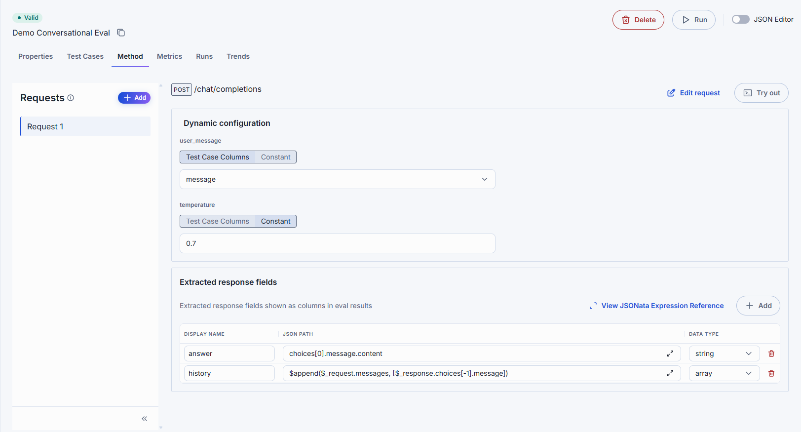

#### Edit request

Click **Edit request** to open a wizard where you choose the endpoint to call and define the request
that is sent to it for each test case. It has two steps.

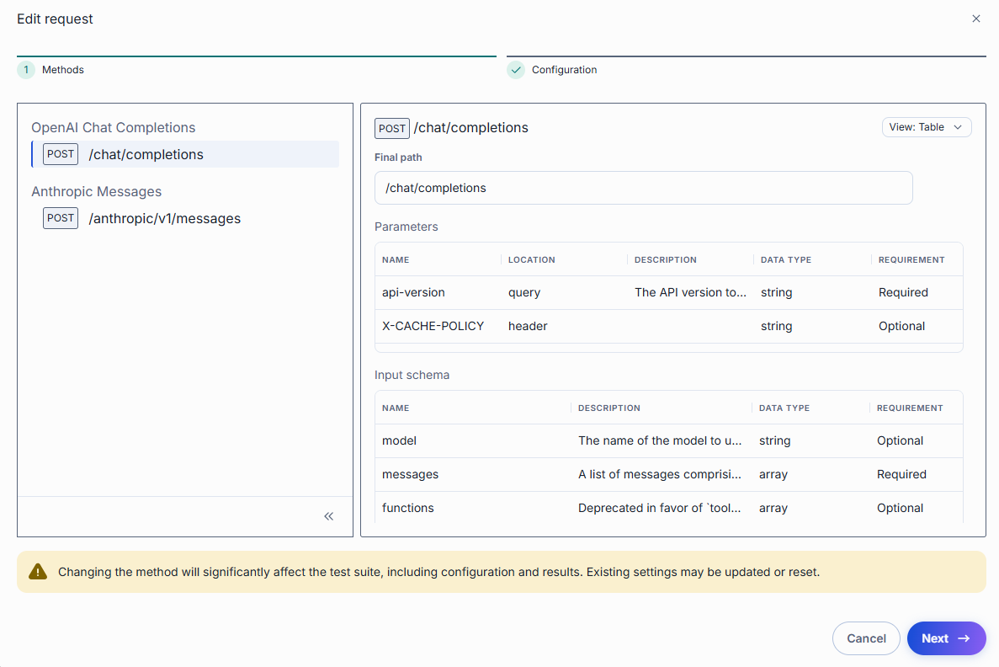

1. **Methods**: select the endpoint of the target to call. Changing the endpoint can reset the settings
   of the request, as the warning in the wizard says. Click **Next** to continue.
2. **Configuration**: define the request in the **Request Template**. Click **Save** to apply the
   changes to the request, or **Cancel** to discard them. Click **Back** to return to the first step.
   If you edited the template, **Reset to default** restores the default request template of the
   endpoint.

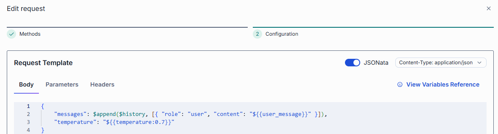

At the top right of the **Request Template** you select the content type of the request body,
`application/json` or `multipart/form-data`. For a JSON body, the **JSONata** toggle lets you build the
body with a JSONata expression instead of a plain JSON template. Use it when the body has to be
computed, for example to include the messages of the previous turns in a
[multi-turn dialog](#configure-a-multi-turn-dialog). The template has three tabs:

* **Body**: the content of the request. For `multipart/form-data`, the body is a table of form parts
  that you add with **Add**.
* **Parameters**: the query parameters of the request. Click **Add** to add a name and a value.
* **Headers**: the HTTP headers of the request. Click **Add** to add a name and a value.

To send a value that changes for each test case, write a variable in the template: `${{name}}`,
`${{name:default}}` (with a default value used when no value is set), `${{name|type}}` (with a type hint
that controls how the value is treated) or `${{name|type:default}}`. The supported types are `string`,
`integer`, `number`, `boolean`, `object`, `array`, `file` and `skill`.

Click **View Variables Reference** on the **Body** tab to open this reference inside the wizard, with
the format, an example and a description for each form of a variable. Each variable that you add shows
up in [Dynamic configuration](#dynamic-configuration), where you define its value.

#### Dynamic configuration

**Dynamic configuration** lists every variable (`${{...}}`) found in the request template, in its URL,
parameters, headers and body. The table is empty (**No Variables**) when the template has none. For each
variable, **Name** is the variable name; set **Type** and **Value** to say where its value comes from:

* **Attribute**: a column of the test case, so each test case sends its own value. The columns come
  from the test case schema of the linked dataset.
* **Constant**: one fixed value that every test case sends.

A variable of type **Attribute** with no column selected is incomplete. While any variable of any request
of the suite is incomplete, you can't [attach a dataset](#attach-dataset): **Attach dataset** shows the
**Incomplete Dynamic Configuration** error, "Complete Dynamic Configuration before attaching a dataset.
Each field needs a constant value or a selected attribute."

#### Extracted response fields

**Extracted response fields** define which values the framework reads from each response. The values
are stored with the result, shown as columns in the run results, and can be used as inputs of metrics
and as variables in the next request of a chain. Click **Add** to add a row and set:

* **Display Name**: the name of the field. It must be unique in the whole test suite, including all
  requests of a chain, and must not contain `::`. A name that is a JSONata built-in function name, or
  `_request` or `_response`, is rejected.
* **JSON Path**: a JSONata expression evaluated on the response. You can pick fields of the endpoint's
  response schema. In a chain, you can also use the outputs of the previous requests.
* **Data type**: the type of the value.

Use the remove icon at the end of a row to delete a field. The test suite can have up to 50 extracted
response fields in total.

**View JSONata Expression Reference** opens a cheat sheet with examples of expressions.

#### MCP tool suites

An MCP tool suite calls one tool of an MCP toolset. Its Method tab has no **Requests** sidebar, request
template or **Dynamic configuration**. It shows:

* The toolset and the tool, with the **Change Tool** and **Try out** buttons. **Change Tool** opens a
  dialog where you select another tool.
* **Tool Arguments**: one row per argument of the tool's input schema, with its **Argument** name,
  **Type** and **Value**. Required arguments are marked with `*`. Enter the value of each argument in
  **Value**; object and array values are shown as JSON. The table shows "No arguments defined" when the
  tool has no arguments.
* **Tool Schema**, with three tabs. **Input Schema** and **Output Schema** show the schemas of the tool
  as a table or as JSON (read-only). **Columns** holds the extracted response fields: the values read
  from the result of the tool call, defined in the same way as
  [Extracted response fields](#extracted-response-fields).

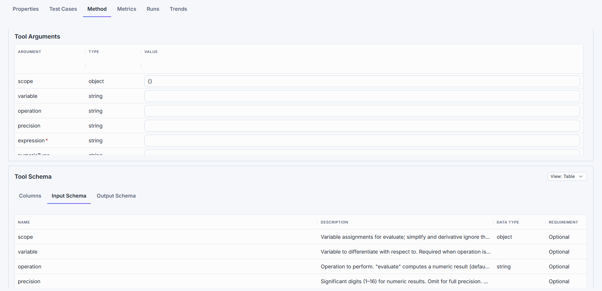

To send a different value for each test case, write a placeholder in **Value**. `${{field}}` is
replaced with the value of the test case field named `field`, and `${{field:default}}` uses `default`
when the test case has no value for it. A required argument that ends up without a value is reported as a
warning. **Try out** shows the **Tool Arguments Preview** and the **Tool Call Preview**, and tells you
whether the tool call succeeded or returned an error.

:::note
MCP tool suites don't support request chains or multi-turn test cases.
:::

#### Configure a multi-turn dialog

The framework does not keep the conversation history between turns. To send the earlier messages with
each turn, accumulate them yourself: extract the history from each turn into a response field, and
read it in the next turn's request body with a JSONata expression. The example below is for a
chat-completions-style body.

1. In the dataset [schema](3.datasets.md#schema), add a field `prompt` and set its **Scope** to **Per turn**.
2. Click **Edit request**, go to the **Configuration** step, turn on the **JSONata** toggle and set the
   body of the request template to:

   ```text
   {"messages": $append($history, [{"role": "user", "content": "${{prompt}}"}])}
   ```

3. In **Dynamic configuration**, bind the `prompt` variable to the `prompt` field of the dataset.
4. In **Extracted response fields**, click **Add**, set the **Display Name** to `history`, the **Data type**
   to `array`, and the **JSON Path** to:

   ```text
   $append($_request.messages, [$_response.choices[0].message])
   ```

A request is sent once per turn only when one of its template variables is bound to a **Per turn**
field (step 3). Otherwise it is sent once per test case, using the shared fields only.

On the first turn `$history` has no value yet, so the request contains only the first user message.
After each turn, `history` holds the messages sent in that request plus the reply, and the next turn
sends them followed by its own `prompt`. `$_request` and `$_response` are the request sent and the
response received in the same turn.

#### Multi-request test suites

A test suite can chain several requests per test case: the first request of the suite followed by
several more, executed strictly in order for each test case. This is useful for evaluating workflows
that need sequential actions, for example creating an item in one request and verifying it in the next.
If a request fails, the following requests are not sent.

Use the **Requests** sidebar of the Method tab to build the chain. Click **Add** to add a request: the
**Edit request** wizard opens so that you select its endpoint and define its template. Use the menu of
a request to **Rename** or **Delete** it. Each request has its own endpoint, request template, dynamic
configuration and extracted response fields.

A request can use the extracted response fields of the previous requests as JSONata variables, for
example `$orderId`. When you select a request after the first one, the tab lists the variables
available from the previous requests. The names of the extracted response fields must be unique across
the whole chain.

Chains are not available for MCP tool suites. To combine a chain with several turns, see
[Configure a multi-turn dialog](#configure-a-multi-turn-dialog): turns and requests are independent.

#### Try out

The **Try out** side panel sends the request of the test suite once, without starting a full run, so
you can check the request template and the extracted response fields. It calls the real target ("Test
this suite's request template against a real deployment"), so the target processes the request as in a
run.

You can open it in two ways:

* From the Method tab, with **Try out** next to the endpoint. Enter the values of the template
  variables; the **Request body preview** shows the request that will be sent.
* From a test case, with the **Try out** action of its row on the Test cases tab. The values come from
  that test case.

Click **Send Request**. When the response arrives, the panel has two tabs:

* **Response**: the response body, which you can copy.
* **Columns**: the result of each extracted response field for this response, with the value or
  the reason why nothing was extracted, for example the HTTP status of a failed request or a response
  stream that did not complete.

**Restart** sends the request again. When you opened the panel from the Method tab, **Change** clears
the response so that you can edit the values and send again.

For a multi-request test suite, the panel has a tab for each request, and the next requests use the
values extracted from the previous ones. For a test case with several turns, the results are grouped by
turn (**Turn 1**, **Turn 2**, and so on).

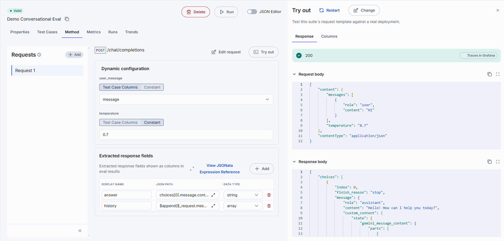

### Metrics

The Metrics tab defines how the answers of the target are scored. It has two parts:

* The list of the metrics attached to the test suite. The header shows the number of metrics
  (**Metrics: 2**) and the **Add** button.
* The **Overall score** panel on the right, which defines how the results of the metrics are combined
  into one score and when a result passes. See [Score settings](#score-settings).

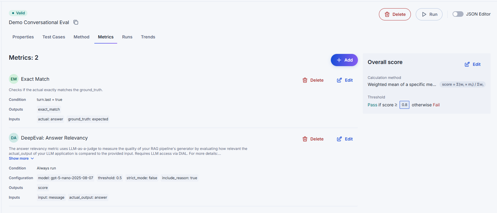

Each metric is a card with:

* The metric name, with the **Edit** and **Delete** buttons. Deleting a metric asks for confirmation.
* The description of the metric. A long description is collapsed; click **Show more** to read it.
* **Condition**: when the metric runs (**Always run** if no condition is set).
* **Configuration**: the parameters of the metric, such as the judge model, as `name: value` chips.
  Metrics without parameters don't show it.
* **Outputs**: the values that the metric produces.
* **Inputs**: what the metric evaluates, as `input: source` chips, for example `actual: answer`. A `-`
  means that the input has no value yet.

#### Add a metric

:::note
**Add** is disabled until a [dataset](3.datasets.md) is linked to the test suite, because input
bindings read the dataset's test case schema.
:::

**To add a metric**:

1. On the Metrics tab, click **Add**.

   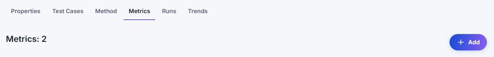

2. In the **Add metric** step, select a metric and click **Next**. The table shows the **Metric**, its
   **Description**, its **Outputs** and its **Provider**. Use the search box under a column header to
   filter the table, and reorder the columns if needed.

   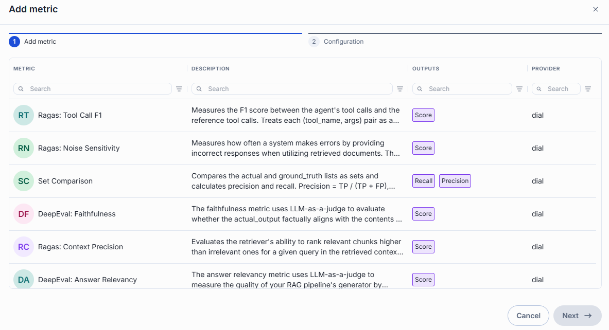

3. In the **Configuration** step, set up the metric (see [Metric settings](#metric-settings)) and click
   **Finish**. Click **Back** to select another metric.

   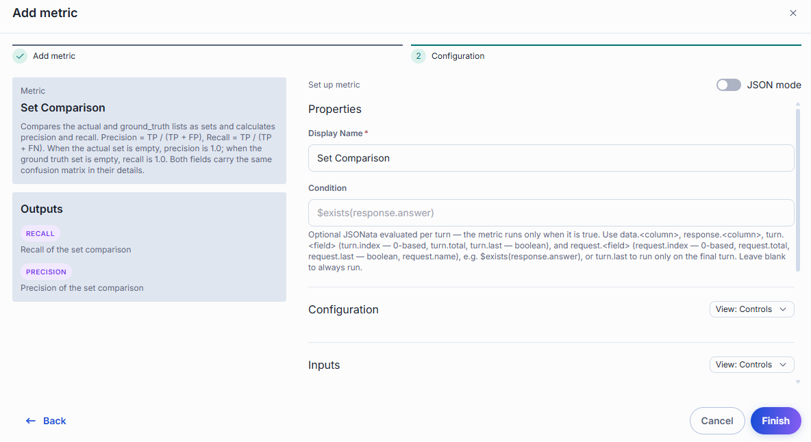

#### Edit a metric

To change the settings of a metric, click **Edit** on its card. The **Edit metric** dialog has the same
form as the **Configuration** step of [Add a metric](#add-a-metric) (see
[Metric settings](#metric-settings)). Click **Confirm** to save the changes or **Cancel** to discard
them.

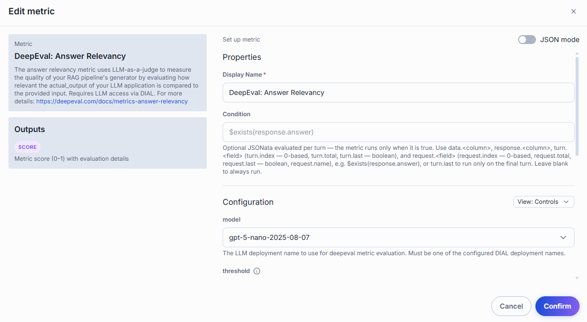

The dialog has no **Add metric** step, so you can't switch a metric to another one. To use another
metric, delete this one and add a new one.

#### Delete a metric

Click **Delete** on the card of the metric and confirm. If the metric is used in the weighted mean of
the [overall score](#score-settings), its row is removed from the score settings.

#### Metric settings

The **Configuration** step of the **Add metric** dialog and the **Edit metric** dialog have the same
layout.

* The left panel shows the selected metric: its name, its description and its **Outputs**, with the
  name and description of each value that the metric produces.
* The right part, **Set up metric**, is the form. It has three sections. The **JSON mode** switch at its
  top right lets you edit all of them as JSON (name, condition, and both binding lists).

| Section | What it contains |
|---------|------------------|
| [Properties](#properties) | The **Display Name** of the metric and its **Condition**. |
| [Configuration](#configuration) | The parameters of the metric, such as the judge model. |
| [Inputs](#inputs) | The data that the metric evaluates, and where each value comes from. |

**Configuration** and **Inputs** each have a **View** list. **Controls** shows the form to edit the
values. **Schema** shows the JSON schema of the section; it is read-only.

**Finish** (or **Confirm**) is enabled when the name is valid, the condition is valid, and every
required parameter and input has a value. In **JSON mode**, the binding check is skipped.

#### Properties

The **Properties** section has two fields.

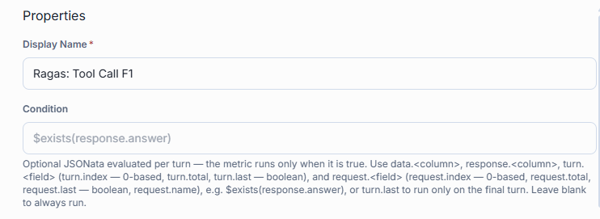

##### Display Name

Required. The name of the metric in this test suite. It defaults to the display name of the metric.
It must not contain `::`.

##### Condition

Optional. The condition is a JSONata expression evaluated per turn. The metric runs only when it is
true. Leave the field blank to run the metric always. The maximum length is 2000 characters.

In the condition, reference values with `data.<column>`, `response.<column>`, `turn.<field>` and
`request.<field>`:

* `turn.index` (0-based), `turn.total`, `turn.last` (boolean).
* `request.index` (0-based), `request.total`, `request.last` (boolean), `request.name`.

For example, `$exists(response.answer)` runs the metric only when the `answer` response column is
present, and `turn.last` runs it only on the final turn of a multi-turn test case.

#### Configuration

The **Configuration** section holds the parameters of the metric. The parameters depend on the metric: each metric
defines its own, and the form shows a description under each field. They are prefilled with the
defaults of the metric, and their values are constants.

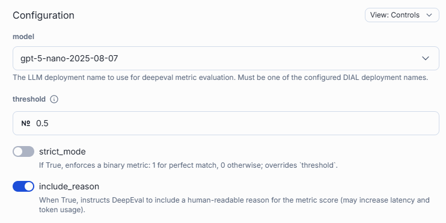

The **DeepEval** metrics share these parameters:

| Parameter | Default | Description |
|-----------|---------|-------------|
| `model` | The default judge model | The language model deployed in DIAL that judges the answer. You select it among the models the metrics service is configured with. See [Available metrics](#available-metrics). |
| `threshold` | `0.5` | A value from 0 to 1. The minimum score for the metric to pass, as defined by DeepEval. The metrics service returns only the score and its details, so whether a test case passes in a run is decided by the [score threshold](#score-settings) of the suite, not by this parameter. |
| `strict_mode` | Off | When on, the metric is binary: the score is 1 for a perfect result and 0 otherwise. It overrides `threshold`. |
| `include_reason` | On | When on, DeepEval adds a human-readable reason for the score to the details of the metric result. It may increase the latency and the token usage. Available for **Answer Relevancy**, **Faithfulness**, **Contextual Precision**, **Contextual Recall** and **Contextual Relevancy**, not for **G-Eval**. |

For the other metrics, see the descriptions in the form and the options listed in
[Available metrics](#available-metrics).

#### Inputs

An input is a piece of data that the metric needs to calculate its score. Each metric defines its own
inputs, and the **Inputs** section of the form lists them with the type of each input. An input marked
with `*` is required. For each input you choose where its value comes from; see
[Input sources](#input-sources).

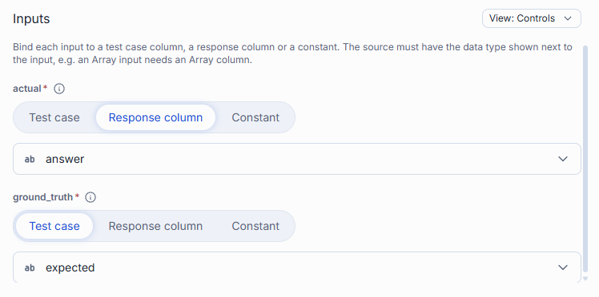

Inputs have fixed names defined by the metric. The most common are:

| Input | Metrics | Meaning |
|-------|---------|---------|
| `actual` | Exact Match, Regex Match, DeepDiff, Set Comparison | The value to evaluate: what the target produced. Bind it to a response column that extracts the answer from the response. |
| `ground_truth` | Exact Match, DeepDiff, Set Comparison | The expected correct value. Bind it to a test case column that holds the expected output. |
| `input` (DeepEval), `user_input` (Ragas) | Most DeepEval and Ragas metrics | The question or prompt sent to the target. Bind it to the test case column that holds the question. |
| `actual_output` (DeepEval), `response` (Ragas) | DeepEval and Ragas metrics that evaluate the answer, such as Answer Relevancy and Faithfulness | The answer that the target produced. Bind it to a response column. |
| `expected_output` (DeepEval), `reference` (Ragas) | DeepEval Contextual Precision and Contextual Recall; Ragas Context Precision, Context Recall and Noise Sensitivity | The expected, ground-truth answer. Bind it to a test case column. |
| `retrieval_context` (DeepEval), `retrieved_contexts` (Ragas) | RAG metrics | The list of context chunks that the RAG application retrieved to answer. Bind it to a response column that extracts the chunks from the response. |

For example, for **Exact Match** in the screenshot of the Metrics tab, `actual` is bound to the response
column `answer` and `ground_truth` to the test case column `expected`.

The other metrics have these inputs. The descriptions come from the metrics themselves.

| Metric | Inputs |
|--------|--------|
| **DeepEval: G-Eval** | `input` and `actual_output` are required. `expected_output`, `context` (background context for the evaluation, a list of text chunks) and `retrieval_context` are optional. Which of them the metric uses depends on the fields that you select in its configuration. |
| **Ragas: Tool Call Accuracy**, **Ragas: Tool Call F1** | `tools_called`: the tool calls made by the agent. `reference_tool_calls`: the expected tool calls that a correct agent should have made. Each tool call is an object with a tool `name` and its `args`. |
| **Set Comparison** | `actual`: the list of items to evaluate. `ground_truth`: the list of expected items. |
| **Multiple Sets Comparison** | `actual`: the actual items, an object that groups lists of items by key. `ground_truth`: the expected items, grouped by key in the same way. |
| **DIAL RAG Eval: Retrieval** | `ground_truth_facts`: the facts that the RAG system should retrieve to produce a correct answer; the ground truth for the retrieval evaluation. `retrieved_context`: the list of text chunks that the RAG system actually retrieved. |
| **DIAL RAG Eval: Generation** | `question`: the question asked to the RAG system. `ground_truth_answer`: the expected answer. `context`: the list of text chunks that the RAG system actually retrieved. `answer`: the answer that the RAG system produced. `documents` (optional): the names of the documents for this question; useful when the dataset contains the same question several times with different sets of documents, or when a document name is needed to answer. |
| **DIAL RAG Eval: NLI** | `premise`: the text from which the hypothesis should be inferred. `hypothesis`: the text to check for entailment. |
| **DIAL RAG Eval: Full Evaluation** | `question`, `ground_truth_answer`, `ground_truth_facts`, `context`, `answer` and the optional `documents`, as described above for the retrieval and generation metrics. |

##### Input sources

Each input is bound to one source, selected with the tabs under the input name: **Test case**,
**Response column** or **Constant**. The source must have the data type shown next to the input; for
example, an array input needs an array column. Changing the source clears the previous value.

| Source | Description |
|--------|-------------|
| **Test case** | A field from the linked dataset's test case schema (for example, `expected_output`). |
| **Response column** | A field extracted from the target's response (**Extracted response fields**), defined in the [Method](#method) tab. For multi-request suites, columns of all requests in the chain are available. |
| **Constant** | A fixed value. The control matches the input type: dropdown (enum), text, number (with min and max), switch, list, or a map of keys to lists. |

#### Available metrics

The metrics come from the evaluation metrics service, so the list in the **Add metric** step is
the list your installation provides. The service ships with the following metrics.

Metrics marked **LLM** use a language model deployed in DIAL as a judge. Their **Configuration** has
a **model** parameter: you choose among the models the [metrics service is configured with](../../6.services/10.evaluations/1.configuration/2.metrics.md#judge-models), and a default
model is preselected. Rule-based metrics need no model.

| Metric | What it measures | Judge |
|--------|------------------|-------|
| **DeepEval: Answer Relevancy** | How relevant the answer is to the input. | LLM |
| **DeepEval: Faithfulness** | Whether the answer is factually supported by the retrieved context. Options: truth extraction limit, penalize ambiguous claims. | LLM |
| **DeepEval: Contextual Precision** | Whether relevant retrieved context items are ranked higher than irrelevant ones. | LLM |
| **DeepEval: Contextual Recall** | How well the retrieved context covers the expected output. | LLM |
| **DeepEval: Contextual Relevancy** | How relevant the retrieved context is to the input overall. | LLM |
| **DeepEval: G-Eval** | Any custom criteria. Give a natural-language criteria description or explicit evaluation steps, the fields it refers to, and optionally a rubric of score bands. | LLM |
| **Ragas: Answer Relevancy** | How well the response addresses the question, without checking factual accuracy. Also needs an [embeddings model](../../6.services/10.evaluations/1.configuration/2.metrics.md#embeddings-model), `text-embedding-ada-002` by default. | LLM |
| **Ragas: Faithfulness** | Whether all claims of the response are supported by the retrieved contexts. | LLM |
| **Ragas: Context Precision** | Whether relevant retrieved chunks are ranked at the top. | LLM |
| **Ragas: Context Recall** | How many of the relevant pieces of information were retrieved. | LLM |
| **Ragas: Noise Sensitivity** | How often the system gives incorrect answers when it uses retrieved documents (relevant or irrelevant, set by the mode). **Lower is better.** | LLM |
| **Ragas: Tool Call Accuracy** | How accurately an agent's tool calls match the reference tool calls: the order (optional strict order) and the arguments. | Rule-based |
| **Ragas: Tool Call F1** | Precision, recall and F1 between the agent's tool calls and the reference tool calls; the order is ignored. | Rule-based |
| **DIAL RAG Eval: Retrieval** | Retrieval quality against ground truth facts: recall, precision, F1 and MRR. The matcher is fuzzy citation matching (default) or exact equality. | Rule-based |
| **DIAL RAG Eval: Generation** | Answer quality with three natural-language-inference scores: ground truth to answer, answer to ground truth, and context to answer. | LLM |
| **DIAL RAG Eval: NLI (Natural Language Inference)** | The proportion of statements in a hypothesis that are entailed by a premise. | LLM |
| **DIAL RAG Eval: Full Evaluation** | The retrieval and generation scores of the two metrics above in one metric. | LLM |
| **Exact Match** | Whether the actual value exactly equals the expected one. | Rule-based |
| **Regex Match** | Whether the actual value matches a regular expression. | Rule-based |
| **DeepDiff** | Whether strings, numbers, lists or nested objects are equal: 1.0 when equal, 0.0 otherwise, with mismatch details. Options: ignore list order, numeric precision and tolerance. | Rule-based |
| **Set Comparison** | Precision and recall of an actual list against an expected list, compared as sets. | Rule-based |
| **Multiple Sets Comparison** | Per-key set comparison of two objects of lists: macro-averaged precision and recall, and a relaxed `precision_soft`. | Rule-based |

#### Score settings

Score settings define how metric results are combined into a run score. They are shown in the
**Overall score** panel of the Metrics tab: the calculation method with its formula, and the threshold
(**Pass** if the score is at or above the value, otherwise **Fail**). Click **Edit** in the panel to
open the **Edit overall score** dialog, change the settings and click **Apply**.

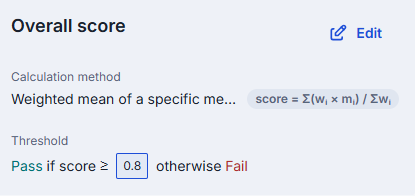

* **Overall score**: how a single score is computed from the metrics. Choose a **Calculation method**:
  * **Mean of all metrics**: `score = mean(m₁, m₂, … mₙ)`.
  * **Weighted mean of a specific metric**: `score = Σ(wᵢ × mᵢ) / Σwᵢ`. Add one row per
    metric output and set its **Weight**. At least one row is required, each weight must be
    greater than 0, and the same metric output can't be added twice. Rows are removed
    automatically when you delete their metric.
  * **Specific function**: currently **roc auc**. Set its **Ground truth** and **Prediction**
    parameters, each bound to a test case column, a response column or a metric output. The
    function is computed for the whole suite only (**Suite-level only**), so the **Test case score**
    setting defines how each test case is scored: by the mean of all metrics or by a weighted mean.
* **Score threshold**: switch on **Enable threshold** and set a value from 0 to 1 (step 0.01). A score
  greater than or equal to the threshold is **Pass**, otherwise **Fail**. Test cases below the
  threshold are counted as **Below threshold** on the [Trends](#trends) tab.

### Runs

The Runs tab lists all runs that have been executed for this test suite. Click the run name to open the run in a new tab. Run statuses update automatically while the tab is open. Use **Columns** to show or hide columns.

| Column | Description |
|--------|-------------|
| **Status** | Execution status: Pending, Running, Completed, Failed, Stopping or Stopped. See [Run statuses](2.runs.md#run-statuses). |
| **Test suite run name** | Run name, with the run ID below it. |
| **Runs** | Number of runs per test case configured when the run was started. |
| **Test cases** | Number of test cases in the run. |
| **Metrics** | Metrics used in the run. |
| **Start Date** | Timestamp when the run began. |
| **End Date** | Timestamp when the run finished. |
| **Duration** | Run duration. |
| **Cost** | Run cost. |
| **Overall score** | Overall score of the run, computed as configured in [Score settings](#score-settings). |
| **Target** | Evaluated deployment. Hidden by default. |
| **Actions** | Per-row actions: **Open in a new tab**, **Export** and **Compare** (completed runs only), **Stop** (pending and running runs only) and **Delete**. See [Run actions](#run-actions). |

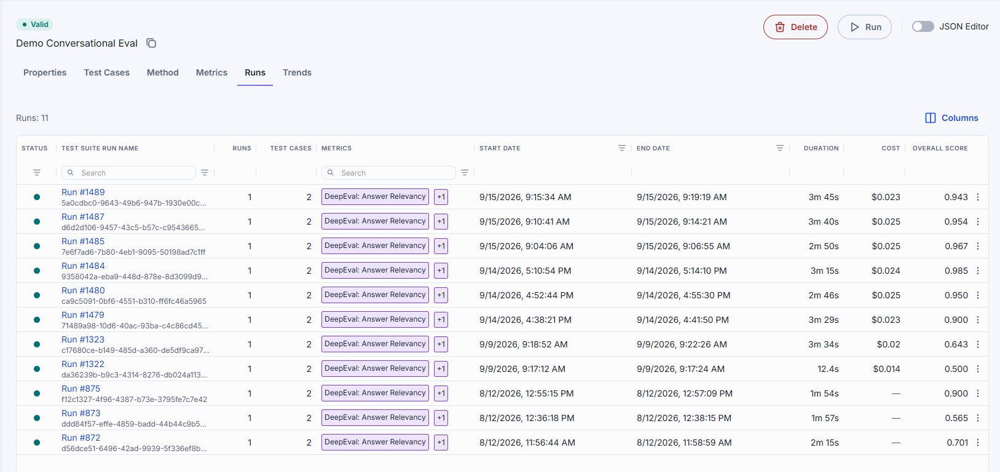

#### Run actions

Open the **Actions** menu of a run to use these actions. They are the same as in the **Evaluation >
Runs** list; see [Runs](2.runs.md) for the details.

| Action | Available for | What it does |
|--------|---------------|--------------|
| **Open in a new tab** | All runs | Opens the run in a new browser tab. |
| **Compare** | Completed runs | Opens the **Compare Against** dialog with the other completed runs of this test suite. Select a run and click **Confirm**. The comparison of the two runs opens in a new browser tab, on the run comparison screen of the Runs section; the run you started from is the baseline. See [Compare runs](2.runs.md#compare-runs). |
| **Export** | Completed runs | Opens the **Export run** popup, where you select the columns and download the results as a CSV file. See [Export to CSV](2.runs.md#export-to-csv). |
| **Stop** | Pending and running runs | After you confirm, the run changes to **Stopping** while the requests in progress complete, and then to **Stopped**. The results collected before the stop are preserved. |
| **Delete** | All runs | Deletes the run after you confirm. |

#### Start run

To start a new run, click the **Run** button in the test suite header. The **Run Test Cases** modal
shows how many test cases will be evaluated (**Selected test cases**, for example `8 out of 10` when a
[run condition](#run-conditions) or invalid test cases exclude some) and lets you set the **Number of runs** per
test case (default 1). When test cases are run more than once, some evaluation results may be
unavailable or displayed differently. **Run** is disabled when no test case is selected.

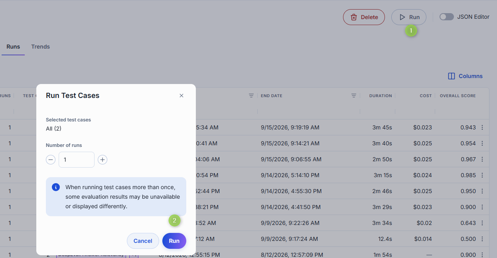

### Trends

The Trends tab shows how the results of the test suite change from run to run, so you can see whether
a change to the application, the prompt or the model made the results better or worse. It covers up to
the 10 most recently computed runs of the suite. The **Preview runs** badge next to the tabs shows how
many runs the tab covers, for example **Last 10 Runs**.

Until the first run completes, the tab shows "No runs yet" with a **Run** button. With a single
run, a trend can't be displayed, and the tab says so.

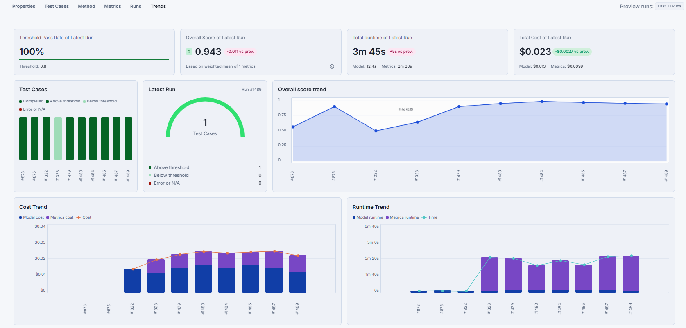

#### Key figures

The cards at the top of the tab show the figures of the latest run. Each card also shows the change
compared with the previous run. The change for **Total Runtime** and **Total Cost** is better when it is
lower.

| Card | What it shows |
|------|---------------|
| **Threshold Pass Rate of Latest Run** | The share of the test cases of the latest run that reached the [score threshold](#score-settings), with the threshold value below. If the suite has no threshold, the card is **Completion Rate of Latest Run** and shows the share of the test cases that completed. |
| **Overall Score of Latest Run** | The overall score of the latest run, calculated as configured in [Score settings](#score-settings). The tooltip tells the calculation method and whether the score is above or below the threshold. |
| **Total Runtime of Latest Run** | The total runtime of the latest run, split into the runtime of the target and the runtime of the metrics. |
| **Total Cost of Latest Run** | The total cost of the latest run, split into the cost of the target and the cost of the metrics. |

#### Dashboards

Below the key figures, the tab has these dashboards. Hover over a run in a dashboard to see its
details in a tooltip.

| Dashboard | What it shows |
|-----------|---------------|
| **Test cases** | For each run, how many test cases fall into each group: above the threshold, below it, or with an error or no result (**Error or N/A**). If the suite has no threshold, the groups are **Completed** and **Error or N/A**. |
| **Latest Run** | The same groups for the latest run only, with the number of test cases in each group. |
| **Overall score trend** | The overall score of each run, with the score threshold. |
| **Cost Trend** | For each run, the cost of the target and the cost of the metrics, and the total cost of the run. |
| **Runtime Trend** | For each run, the runtime of the target and the runtime of the metrics, and the total time of the run. |
| **Metric Trends** | The trend of each metric across the runs. Select a statistic with the switch at the top; the card of each metric shows a line per output of the metric. Use the tags of a card to show or hide a line. |
| **Test Case Stability** | A heat map with a row for each run and a column for each test case. The color of a cell is the score of the test case in that run. The tooltip shows the test case, the run, the score, whether it passed (**Yes**, **No** or **N/A**) and the threshold. Use it to find test cases that pass in some runs and fail in others. |

## Delete

Select **Delete** in the **Actions** column of a test suite row. A confirmation dialog appears.
Deleting a test suite also deletes its runs. A public dataset linked to the test suite is not deleted.
Test cases that are private to the test suite are deleted with it.

## Further reading

- [Runs](./2.runs.md) — read, compare and export results
- [Datasets](./3.datasets.md) — create and manage test cases and their schema
- [Evaluation Framework Backend configuration](../../6.services/10.evaluations/1.configuration/1.framework-backend.md) — settings of the service that stores datasets and runs
- [Evaluation Metrics configuration](../../6.services/10.evaluations/1.configuration/2.metrics.md) — judge models and endpoints of the metrics service
- [Evaluations](../../2.understand-dial/3.capabilities/9.evaluations.md) — how DIAL measures AI quality on your own test cases
