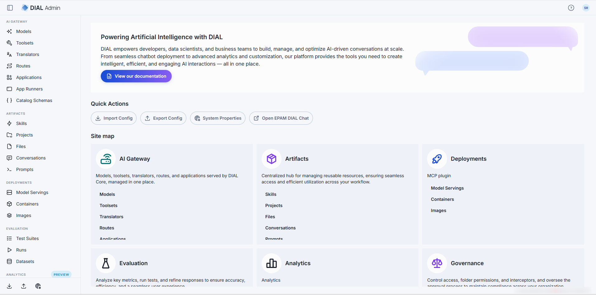

# DIAL Admin overview

DIAL Admin is the web interface for configuring and operating a DIAL deployment. Use it to manage the models and applications DIAL serves, shared content, access settings, and optional services such as deployments, evaluation, and analytics.

This overview is for administrators and governance owners who are new to DIAL Admin. It explains how to navigate the panel, what each section does, and how access affects what you can see and change.

<!-- SCREENSHOT NEEDED: DIAL Admin 0.23.0 home page -->

## How DIAL Admin connects to DIAL

DIAL Admin connects to DIAL Core and, when enabled, optional services such as Deployment Manager, Evaluation, and Analytics. When sign-in is enabled, Admin forwards the signed-in user's token to those services.

In the **AI Gateway**, configurations created through DIAL Admin are stored by DIAL Core alongside configurations supplied in files. Creating or editing a configuration through this path does not rewrite the configuration files. Published applications and Toolsets can also be stored in the public folder. See [Where an entity can be defined](./1.ai-gateway/0.index.md#where-an-entity-can-be-defined).

The optional DIAL Admin Backend provides additional legacy screens and the backend-managed Configuration import/export scope. Deployment and Analytics import/export scopes can be available without it when their services are enabled. See [Back up, restore, and set global properties](./1.config-backup-and-global-settings.md).

For the services and their responsibilities, see [DIAL Admin](../7.services/9.admin/0.index.md).

## Getting around

- **Sidebar:** Open a section such as AI Gateway, Artifacts, or Governance. Use the button in the header to collapse or expand the sidebar.
- **Home page:** Use the site map to find sections and the Quick Actions to open common tasks. Depending on your access and enabled services, Quick Actions can include **Import Config**, **Export Config**, and **System Properties**. A link to DIAL Chat can also be available.
- **Header:** Use the help button to open the configured documentation link and the account menu to access available settings or sign in or out.

The sections and actions available to you depend on your access and on which services and features the platform team enabled. Full administrators see configuration-transfer actions only when at least one supporting service is enabled; System Properties is also a full-administrator action.

## Who can access DIAL Admin

DIAL Core determines administration access using the caller's identity and configured access rules. The panel uses Core's response to decide which sections and controls to offer.

- **Full administrator:** A caller matching Core's administrator rules can manage the platform configuration and administrative resources. Other services can also apply their own authorization checks.
- **Organizational-unit access:** When organizational units are enabled, assigned unit roles can grant read or write access to resources within a unit. For example, a role can allow a user to inspect a unit's applications without editing them. The sidebar shows the sections the caller can read; editing depends on their write permissions for the resource. Membership in a unit alone is not enough to open an Admin section.

Your identity provider supplies the claims used to identify you. Platform administrators configure Core's administrator rules and organizational-unit roles and assignments. For the administrator rules, see [DIAL Core access settings](../7.services/1.core/1.configuration/2.settings/7.access.md). For the broader identity and access model, see [Authentication and access control](../2.understand-dial/5.security-and-governance/1.authentication-and-access-control.md).

:::warning
If sign-in is disabled, DIAL Admin treats the caller as a full administrator for the interface. It also uses that interface mode when Core returns `404` for the role-assignments endpoint, for example when organizational units are disabled. This does not bypass authorization checks enforced by DIAL Core or other services. The platform team must configure and secure access for the environment.
:::

## How the sections map to your work

- [AI Gateway](./1.ai-gateway/0.index.md) — register and configure models, applications, Toolsets, routes, translators, App Runners, and Catalog Schemas that DIAL Core serves.
- [Artifacts](./2.artifacts/0.index.md) — manage shared skills, projects, prompts, files, and conversations.
- [Deployments](./3.deployments/0.index.md) — run model servings and deploy containers for MCP servers, adapters, applications, and interceptors. Requires [DIAL Deployment Manager](../7.services/11.deployment-manager/0.index.md).
- [Evaluation](./4.evaluation/0.index.md) — create test suites, manage datasets, and evaluate models, applications, routes, and MCP tools. Requires the Evaluation service.
- [Analytics](./5.analytics/0.index.md) **[Preview]** — analyze usage and conversations with dashboards, queries, sessions, tables, and pipelines. Requires DIAL Analytics and the corresponding features to be enabled.
- **Governance** — manage [roles](./6.governance/1.roles.md), [API keys](./6.governance/2.keys.md), [folder permissions](./6.governance/3.folders-storage.md), [interceptors](./6.governance/4.interceptors.md), and [approvals](./6.governance/5.publications-and-review.md) of publication requests. When enabled and supported by Core, the preview **Policies** and **Policy Assignments** screens also appear here.

For related administration tasks, see [User management](./6.governance/6.user-management.md) and [Usage limits and cost control](./6.governance/7.usage-limits-and-cost-control.md).

## Read-only access

A read-only screen can reflect the configuration's source or your permissions:

- **File-defined configurations:** Entities loaded from DIAL Core configuration files appear in the **file** folder. They are read-only in DIAL Admin. To change a file-defined entity, update the configuration file. See [Where an entity can be defined](./1.ai-gateway/0.index.md#where-an-entity-can-be-defined).
- **Organizational-unit permissions:** A unit role can grant read access without write access. In that case, you can inspect resources in the permitted scope but cannot change them. A read-only indicator can appear on the resource's screen.

If you cannot see or edit a resource you need, contact your platform administrator to check your access rules and unit-role assignments.
