# Manage AI models

Use **AI Gateway → Models** in DIAL Admin to register and manage model deployments served through DIAL Core. Configure how clients reach a model, its supported features, access, and pricing. You need administrator permissions and a reachable model or adapter endpoint.

A model deployment can connect to:

- **An external model deployment:** a model hosted by a cloud vendor or another provider.
- **A model serving:** a model served by a container running in DIAL.
- **An adapter:** a service that connects DIAL Core to a model provider.

DIAL Core supports OpenAI Chat Completions, OpenAI Responses, Anthropic Messages, and OpenAI Embeddings interfaces. Configure the interfaces your endpoint supports. An [adapter](../../4.building-with-dial/4.adapters/0.index.md) can connect to a provider whose API requires conversion; a [translator](./5.translators.md) converts requests between supported AI APIs. Declaring one interface does not automatically enable the others.

Access checks, limits, interceptors, and logging depend on the interface and your configuration. See [AI Gateway](./0.index.md) for details. You can also define models directly in the [DIAL Core configuration](../../7.services/1.core/1.configuration/4.models.md).

## Main screen

The Models screen lists the model definitions visible in the selected folder. You can view and filter definitions, and create models in the **platform** folder.

Platform models are stored in DIAL Core's platform storage. Once configured and made available to users, they can be called through DIAL clients or the [Unified API](https://dialx.ai/dial_api).

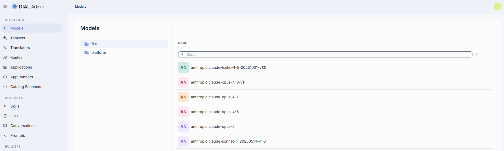

### Grid columns 

Columns differ by bucket. Use the column filters to narrow the list. DIAL Admin remembers column widths, order, sort, and filters in the browser. When a filter is active, click **Reset filters** to clear all filters without changing the column widths, order, or sort.

**File bucket:** a single **Name** column. You can open a model or use **Open in a new tab** to view its read-only configuration.

**Platform bucket grid columns**:

| Field | Description |
|-------|------------|
| **Name** | Model name. |
| **Author** | Author recorded in the model's resource metadata. |
| **Created time** | Entity creation timestamp. |
| **Updated time** | Timestamp of the latest update of the entity. |

### Actions

Open a row's actions menu (**⋮**). The available actions depend on the bucket and your permissions.

**Model actions in the platform bucket**:

| Action | What it does |
|--------|--------------|
| **Open in a new tab** | Opens the model's configuration screen in a new browser tab. |
| **Duplicate** | Copies the model. Enter an ID and display name for the copy, then click **Duplicate**. The new model opens after creation. |
| **Delete** | Permanently removes the model. |

To delete several platform models, select their rows and use the bulk delete action.

### Folders

The left panel shows where each model definition is stored. It has two root folders:

- **file**: models defined in the DIAL Core configuration file. This folder is read-only. Open a model to view its configuration; to change it, edit the DIAL Core config file. The folder is available to users with access to the config-file endpoints.
- **platform**: models stored in DIAL Core platform blob storage. This is where you create, edit and delete models in DIAL Admin.

Select a folder to list its models in the grid. See [AI Gateway](./0.index.md#where-an-entity-can-be-defined) for how DIAL Core combines the two sources.

## Create model

Follow these steps to add a new AI model definition to your DIAL instance:

1. Select the **platform** folder on the Models screen.
2. Click **Create** to open the **Create Model** dialog.
3. Enter the model details:

    | Field | Required | Description |
    |-------|----------|-------------|
    | **ID** | Yes | Unique deployment identifier clients use to call the model through DIAL Core. Set **Override name** in the model configuration if the upstream expects a different model name. |
    | **Display Name** | Yes | Model name shown across the UI (e.g. "GPT-4 Turbo"). |
    | **Display version** | No | Optional tag to track releases when you register multiple variants of the same model (e.g. `2024-07-18`, `v1`). |
    | **Description** | No | Free-text note about the model's purpose or distinguishing traits. |

4. Click **Create**. DIAL Admin creates the model and opens its [configuration screen](#configuration). The new model has no granted roles and is not yet available to end users.
5. Configure the model's [endpoint or interfaces](#endpoints) and any required [upstream credentials](#upstream-configuration).
6. Under [Roles](#roles), add the roles that can use the model or remove the role restriction.
7. Click **Save**. Allow time for the configuration to take effect.
8. Use an authorized credential to send a request through a configured interface and verify the response.

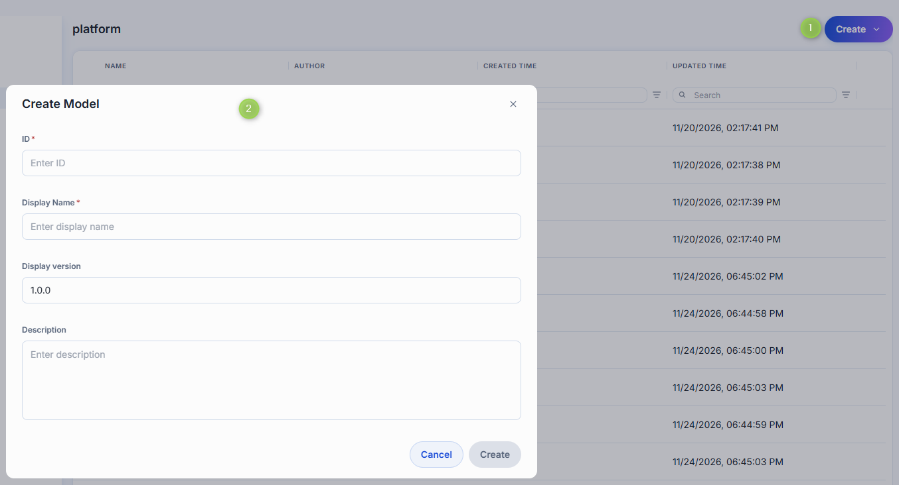

You can also create a DIAL Core model from a running [adapter container](../3.deployments/1.container-management.md#create-a-model-from-a-running-adapter-container) or [text-generation model serving](../3.deployments/2.model-servings.md#create-a-model-from-a-running-serving). The create action fills in the connection settings from the running service.

## Configuration

You can access the model deployment configuration screen by clicking any model deployment on the main screen, or when adding a new model deployment. In this section, you can view and configure all settings for the selected model deployment.

When DIAL Core reports a validity status, the header shows **Valid** or **Invalid**. An invalid model is stored but not served; its Properties screen shows available validation warnings. The **Invalid** badge also provides a tooltip when warning details are available.

- [Properties](#properties): Main definitions and runtime settings.
- [Features](#features): Optional capabilities and custom endpoints.
- [Catalog metadata](#catalog-metadata): Values for the fields of the catalog schema attached to the model.
- [Roles](#roles): Roles that can invoke this model.
- [Interceptors](#interceptors): Custom logic to modify requests or responses.

:::note
A model's **Audit** section appears only when the optional Admin Backend is configured with `DIAL_ADMIN_API_URL` and `dashboard` is not disabled in `DISABLE_MENU_ITEMS`. It contains a model-scoped Dashboard and Traces. Depending on the Analytics configuration, these show DIAL Analytics or legacy telemetry.

For monitoring and conversation investigation, see [Analytics Dashboards](../5.analytics/1.dashboards.md) and [Sessions](../5.analytics/5.sessions.md). These screens have their own [configuration requirements](../../7.services/9.admin/2.configuration/1.frontend.md#analytics).
:::

### Properties

In the **Properties** tab, you can view and edit main definitions and runtime settings for a model deployment.

- [Basic information](#basic-information): Identification and basic information about the model and its author.
- [Endpoints](#endpoints): Model's endpoints.
- [Interfaces](#interfaces): The LLM APIs the model serves (OpenAI Chat Completions, OpenAI Responses, Anthropic Messages, OpenAI Embeddings) and how requests reach them.
- [Personalization](#personalization): Parameters to customize the model's appearance in the UI.
- [Attachments](#attachments): Define attachment types and maximum number of attachments the model can accept.
- [Default parameters](#default-parameters): Set default values for model parameters used in chat/completions and responses requests.
- [Upstream configuration](#upstream-configuration): Define upstream endpoints, authentication keys, weights, and extra data.
- [Advanced options](#advanced-options): Tokenizer model, forward auth token, interaction limits, retry attempts.
- [Cost configuration](#cost-configuration): Set cost unit, prompt price, and completion price for real-time billing.
- [Catalog schema](#catalog-schema): The catalog schema that defines this model's catalog metadata.

#### Basic information

| Field | Required | Editable | Description |
|-------|----------|----------|-------------|
| **ID** | - | No | Unique key DIAL Core uses in the `models` section. It is the model name clients use in requests (e.g. `gpt-4o`, `gpt-4-turbo`). DIAL Core sends the ID to the upstream as the model name, unless you set an [Override name](#personalization). Non-editable after the model is created. |
| **Deployment ID** | - | No | The identifier clients use to call the model. For a model created in DIAL Admin it is the model's name, the same value as **ID**. Shown at the top of the screen, with a copy button. |
| **Updated Time** | - | No | Timestamp of the last update. |
| **Creation Time** | - | No | Model deployment creation timestamp. |
| **Display Name** | Yes | Yes | Model name shown in tables and dropdowns in DIAL clients (e.g. "GPT-4o"). Helps users identify and select models in the UI. |
| **Display version** | No | Yes | Version tag for tracking releases (e.g. `0613`, `v1`). Useful for A/B testing or canary rollouts. |
| **Description** | No | Yes | Text describing the model's features, details, or other relevant information. |
| **Intro** | No | Yes | Introductory or greeting message shown to users in DIAL Chat when they select this model. Up to 2048 characters. |
| **Type** | - | Yes | **Chat** or **Embedding**. For **Embedding**, an embedding dimensions field appears. **Icon**, **Topics** and **Attachments** are shown for **Chat** models only. |

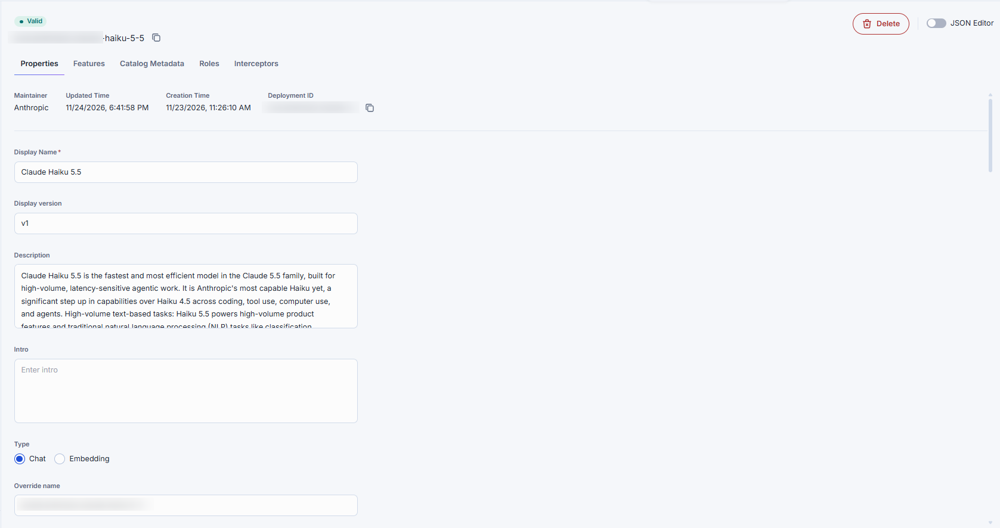

#### Endpoints

| Field | Required | Description |
|-------|----------|-------------|
| **Base URL** | No | Model-level root URL used by passthrough interfaces that do not specify their own base URL. DIAL Core appends the incoming request path or a configured override path. A base URL alone does not declare an interface. |
| **Endpoint** | Conditional | Full URL for chat completions or embeddings, provided by the model deployment or adapter. DIAL Core forwards requests to it as is, without appending the request path. A matching [interface](#interfaces), when declared, takes precedence for that API. |
| **Responses endpoint** | No | Endpoint that supports the OpenAI Responses API. Endpoint of externally deployed model, provided by the running model serving container in DIAL or running adapter container in DIAL. Currently only the OpenAI adapter supports this, served by [DIAL Model Provider](../../7.services/4.model-provider/0.index.md) under `/compat/openai`. When set, DIAL Core routes the Responses API requests (`POST /openai/v1/responses`, and retrieving, deleting and canceling a response) to this endpoint, including background requests. A declared OpenAI Responses interface takes precedence for that API. `previous_response_id`, conversations, prompts, and files are not supported. |

#### Interfaces

An interface declares which AI API the model serves and how DIAL Core routes requests to it. The available types are OpenAI Chat Completions, OpenAI Responses, Anthropic Messages, and OpenAI Embeddings.

For **Passthrough**, Core appends the incoming request path to the interface's base URL, unless an override path is configured. If the interface has no base URL, it uses the model-level **Base URL**. A passthrough interface without either base URL returns HTTP 503. A **Translator** interface uses its selected translator instead of a base URL.

A declared interface takes precedence over a legacy endpoint for the same API. An API not declared in **Interfaces** can still use its corresponding legacy endpoint.

To add an interface:

1. Click **Add interface** and select an available type.
2. Choose **Passthrough** or **Translator** as the mode.
3. For passthrough, enter a base URL or use the model-level **Base URL**. For translator mode, select a translator.
4. Configure any interface-specific settings in the table below, then click **Save**.

| Field | Required | Description |
| --- | --- | --- | 
| Base URL | Conditional | For passthrough, the root URL to which the incoming request path is appended. Required when the model-level **Base URL** is unset. |
| Mode | No | **Passthrough** forwards requests in the shape they arrived in. **Translator** sends them to a service that converts them to an API the model supports. Passthrough is the default. |
| Translator | Conditional | Select the translator that serves the interface. Required in **Translator** mode; not used in **Passthrough** mode. |
| Default Headers | No | Headers applied to requests for this interface only, laid over the model-level Default Headers. |
| Features | No | Feature fields that override [model-level features](#features) for this interface only. Unspecified fields inherit the model-level value, then Core defaults apply. |
| Defaults | No | Body parameters applied to requests for this interface only, replacing whichever model-level [defaults](#default-parameters) would otherwise serve it. They are injected the same way the model-level ones are — a key the request already carries is never replaced. |
| Override Paths | No | Per-operation upstream paths that replace the default "base URL + ingress path" routing for this interface. |

To add an override path, select **Add override path** in a passthrough interface and choose an operation when prompted. The available operations depend on the interface type. Enter the path in the field that appears. Use the delete control to remove an override.

:::warning
Switching an interface to **Translator** mode clears its interface-specific base URL and override paths. Switching back to **Passthrough** clears the selected translator. Switching modes again does not restore the cleared values; re-enter them before saving.
:::

:::note
The translated hop does not charge the caller's token, cost, or request limits; the translator's callback is checked and charged. For Anthropic Messages and OpenAI Responses, DIAL Core can also reject an already exhausted spending cap before forwarding the translated request. See [Limits and usage](../../7.services/1.core/1.configuration/6.translators.md#limits-and-usage).
:::

For routing precedence and interface configuration, see [DIAL Core model routing](../../7.services/1.core/1.configuration/4.models.md#routing).

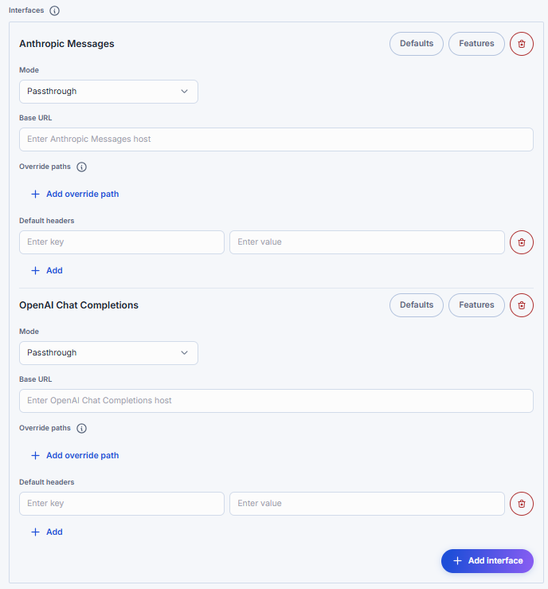

#### Personalization

These parameters help customize how the model is presented in the DIAL UI.

| Field | Required | Description |
|-------|----------|-------------|
| **Override name** | No | The model name DIAL Core sends to the upstream or adapter instead of the model ID. DIAL Core rewrites the `model` field of the outgoing request and the `X-DIAL-OVERRIDE-NAME` header to this value. It does not change how requests are routed or how the model is displayed. |
| **Icon** | No | Icon to visually distinguish model deployments in the UI. |
| **Topics** | No | Semantic tags associated with the model deployment. Click to display a list of available topics. You can add your own custom topics to the list following these rules: - The topic name must not exceed 255 characters. - The topic name must not contain leading or trailing spaces. |

#### Attachments

| Field | Required | Description |
|-------|----------|-------------|
| **Attachment types** | No | Defines the attachment types (images, files, etc.) this model can accept. **No attachments**: Disables all attachment types. **All attachments types**: Allows all types of file attachments. Optionally specify max number of attachments. **Specific attachments types**: Enables the user to define/select specific [MIME types](https://developer.mozilla.org/en-US/docs/Web/HTTP/Guides/MIME_types/Common_types). Start typing to see suggestions or use `<type>/<subtype>` format for a manual entry. |
| **Attachments max number** | No | Maximum number of input attachments. When **unset**, the limit depends on **Attachment types**: if no attachment types are defined, attachments are not allowed; if attachment types are defined, the number is unlimited. |

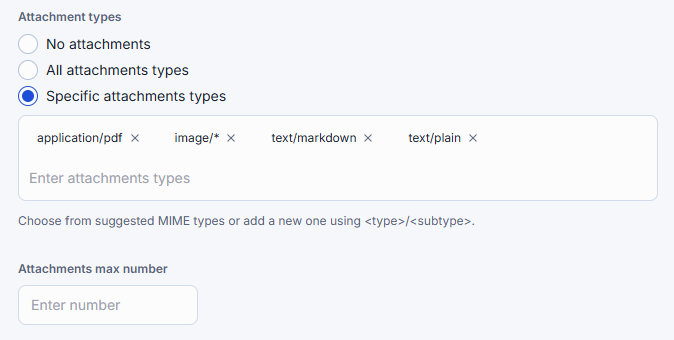

#### Default parameters

Default parameters provide values for Chat Completions, Embeddings, or Responses requests when the request does not supply them.

| Field | Required | Description |
|-------|----------|-------------|
| **Completion Defaults** | No | Default parameters are applied if a request doesn't contain them in an OpenAI `chat/completions` or `embeddings` API call. They are not applied to Responses API or Anthropic Messages requests. |
| **Responses Defaults** | No | Default parameters are applied if a request doesn't contain them in an OpenAI `openai/v1/responses` API call. The editor appears when **Responses endpoint** is set or the OpenAI Responses interface has its own base URL. |
| **Default Headers** | No | HTTP headers DIAL Core adds to a request that doesn't already carry them, for every interface the model serves. A header sent by the client, or set by DIAL Core itself (for example `Api-Key` or `X-UPSTREAM-*`), always takes precedence. Refer to [DIAL Core documentation](https://github.com/epam/ai-dial-core/blob/development/docs/dynamic-settings/models.md#modelsmodel_namedefaultheaders) to learn more about default headers. |

:::note
Defaults set for a specific [interface](#interfaces) replace the model-level defaults for that interface instead of being merged with them. Anthropic Messages requests get defaults only from their own interface.
:::

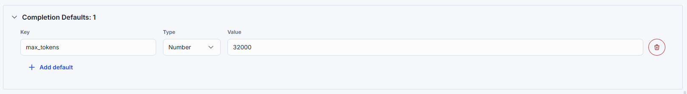

#### Upstream configuration

Upstream entries define provider endpoints and credentials for [load balancing](../../7.services/1.core/1.configuration/5.load-balancing.md). DIAL Core selects an upstream using its tier and weight, then passes the selected endpoint and credentials to the model adapter in request headers. The adapter must support this configuration.

For example, an adapter can use a model container's URI as an upstream. See [Model Servings](../3.deployments/2.model-servings.md) for running models in DIAL.

Expand **Upstream Endpoints** and enter the first upstream's settings. Click **Add Upstream** for additional entries. After configuring them, click **Save**.

| Field | Description |
|-------|-------------|
| **ID** | Identifier of the upstream endpoint. It uniquely identifies this upstream within the model's upstream list, and clients can send it in the `X-UPSTREAM-ID` request header to pin a request to this upstream. Required when the model has a **Responses endpoint** (it routes follow-up Responses API requests to the same upstream) and when the upstream declares interfaces. Otherwise optional. |
| **Upstream Endpoints** | The upstream backend URL for the chat completions API. Passed to the model adapter in the `X-UPSTREAM-ENDPOINT` header. It also serves the embeddings and Anthropic Messages APIs unless they are configured explicitly. |
| **Responses endpoint** | The upstream backend URL for the Responses API. Shown when the model-level **Responses endpoint** is set or the OpenAI Responses interface has its own base URL. Passed to the model adapter in the `X-UPSTREAM-ENDPOINT` header when routing Responses API requests. |
| **Weight** | Numeric [weight](../../7.services/1.core/1.configuration/5.load-balancing.md#tiers-and-weights) for this endpoint in a multi-upstream scenario. Higher = more traffic share. Default: 1. A weight of zero or less excludes the endpoint from routing. |
| **Tier** | Specifies an endpoint group. In a regular scenario, all requests are routed to endpoints with the lowest tier value (the highest priority), but in case of an outage or hitting the limits, the next one in the line helps to handle the load. Default: 0, the highest priority. |

Click the expand chevron on an upstream row to reveal additional fields:

| Field | Description |
|-------|-------------|
| **Base URL** | The provider root URL for this upstream. DIAL Core completes it with the standard path of each interface that declares no endpoint of its own: `/v1/chat/completions`, `/v1/embeddings`, `/v1/responses` or `/v1/messages`. An interface endpoint, when set, takes precedence. |
| **Key** | API key, token, or credential passed to the upstream. Masked — click the eye icon to reveal. DIAL Core never returns a saved key, so the field is empty for an existing upstream. Leave it empty to keep the stored key. |
| **Extra Data** | Free-form JSON or string metadata passed to the model adapter with each request. |
| **Secret Extra Data** | Sensitive key-value metadata passed to the model adapter alongside Extra Data. Values are masked in the UI and in server logs. Use this for credentials or tokens the adapter needs at runtime. |
| **Interfaces** | Per-upstream overrides for individual [interfaces](#interfaces) (OpenAI Chat Completions, OpenAI Responses, Anthropic Messages, OpenAI Embeddings). Click **Add interface** and select a type. Each entry has the fields in the table below. |

Each upstream interface entry overrides that interface for this upstream only. Fields that you leave unset fall back to the upstream's own values.

| Field | Description |
|-------|-------------|
| **Endpoint** | The URL that serves this interface on the upstream. When empty, DIAL Core uses the upstream's **Base URL**. |
| **Key** | Credential for this interface. |
| **Extra Data** | Metadata passed to the model adapter for this interface. |
| **Secret Extra Data** | Sensitive metadata for this interface. Values are masked. |

:::warning
DIAL Core matches stored credentials to an upstream by its endpoint. If you change an existing endpoint and leave the key empty, DIAL Admin warns that the stored credentials cannot carry over. Enter the key and secret extra data again before saving. For an upstream without an endpoint, Core matches the stored credentials by the upstream's position in the list.
:::

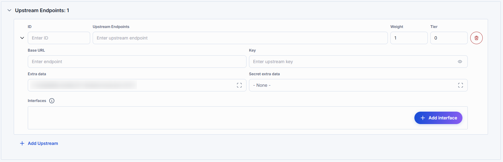

#### Advanced options

| Field | Description |
|-------|-------------|
| **Tokenizer Model** | The model whose tokenization algorithm matches this deployment, entered as text. DIAL Core does not validate it. Leave it empty to leave it unset. This is typically the earliest released model in a series sharing an identical tokenization algorithm. Essential for DIAL clients that reimplement tokenization algorithms on their side, instead of utilizing the tokenize endpoint provided by the model. |
| **Forward auth token** | Determines whether to forward the caller's authorization token to the model endpoint. Open the selector, choose whether to forward the token, and apply the selection. To enable forwarding, enter the model's display name in the confirmation dialog. |
| **Interaction limit** | Ensures that the model does not exceed a specified token limit during interactions. **Available values**: **None**: DIAL does not apply any additional interaction limits beyond limits that your model enforces natively. Ideal for early prototyping or when you trust the LLM's built-in safeguards. **Total number of tokens**: Enforces a single cap on the number of tokens in a completion request and its response combined (`prompt + completion`). **Separately Prompts & Completions**: Two independent limits: one on the number of tokens in a completion request (prompt) and another on the number of tokens in a completion response. |
| **Max retry attempts** | The total number of attempts DIAL Core makes to reach an upstream for one request, including the first one, so `1` means no retry. After a [retriable error](../../7.services/1.core/1.configuration/5.load-balancing.md#retries-and-failover), DIAL Core tries another upstream. The number of attempts is also capped by the number of upstreams. Values 1–5, default 1. |

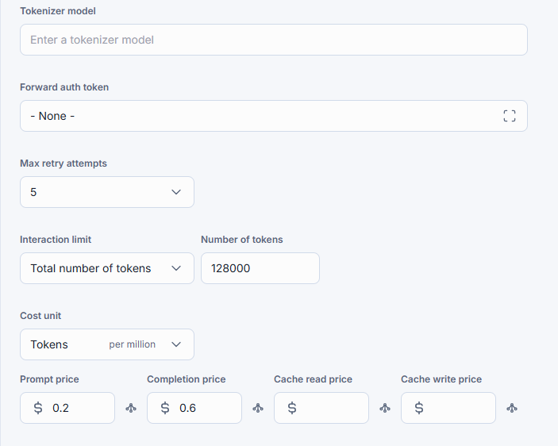

#### Cost configuration

Enables real-time cost estimation and quota enforcement. Powers the monitoring dashboards with per-model spending metrics.

| Field | Required | Description |
|-------|----------|-------------|
| **Cost unit** | No | Select **None**, **Tokens** per million, or **Char without whitespace**. **None** leaves the model without pricing; the character unit counts non-whitespace characters. |
| **Prompt price** | No | Price for prompt usage in the selected unit. |
| **Completion price** | No | Price for completion usage in the selected unit. |
| **Cache read/write price** | No | Prices for cached tokens. These fields are enabled only when the cost unit is **Tokens**. If a cache rate is unset, cached tokens are billed at the prompt rate; an explicit zero sets the rate to zero. |

Each price accepts a flat rate or a conditional rate. Use the conditional control beside a price to define a field, operator, and value, then set the rates for the matching and non-matching branches. The field can be a suggested usage field or a `$`-prefixed JSONPath expression. A branch can contain another condition. For token pricing, the editor displays all rates per million tokens.

:::warning
Changing the cost unit clears the prompt, completion, cache read, and cache write prices. Review and re-enter the rates before saving.
:::

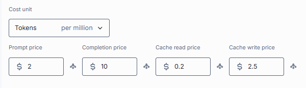

#### Catalog schema

A catalog schema is a structured set of fields defined centrally. You create a schema in [Catalog schemas](./7.catalog-schemas.md) and attach it to a model here. Click the selector to pick a schema, or **Browse** to choose one. The picker filters the available schemas for models by default; you can relax the filter in the browse view. Selecting a schema enables the [Catalog metadata](#catalog-metadata) section.

:::warning
Changing or clearing the schema discards the model's existing catalog values. Switching back before saving does not restore them.
:::

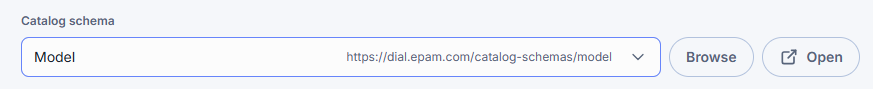

### Features

Use **Features** to tell DIAL Core which optional capabilities the model supports, such as system prompts and tool calls. You can also configure custom endpoints exposed by the model or adapter.

:::tip
Enable only the features you need. Extra toggles can cause errors if the upstream doesn't support them. After setting a custom endpoint, test it via a simple API call to confirm accessibility and authentication.
:::

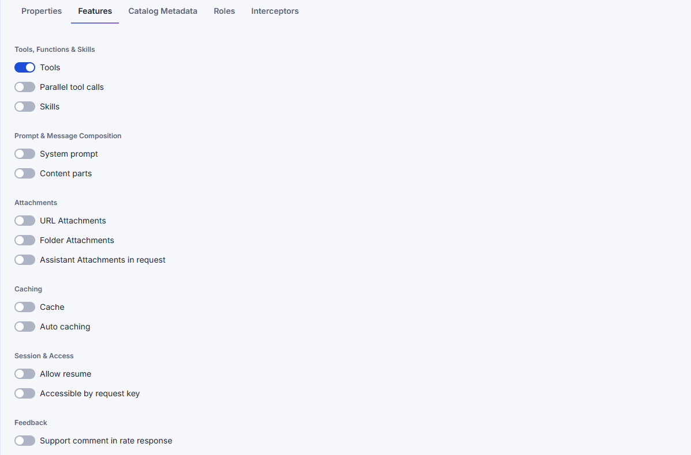

#### Custom endpoints

Some model adapters expose specialized HTTP endpoints for tokenization, rate estimation, prompt truncation, or live configuration. Specify them in this section.

| Field | Description |
|-------|-------------|
| **Rate endpoint** | URL to invoke the model's cost-estimation or billing API. Call an endpoint that returns token counts and credit usage. Override if your adapter supports a dedicated "rate" path. |
| **Tokenize endpoint** | URL to invoke a standalone tokenization service. Use when you need precise token counts before truncation or batching. Models without built-in tokenization require this. |
| **Truncate prompt endpoint** | URL to invoke a prompt-truncation API. Ensures prompts are safely cut to max context length. Useful when working with very long user inputs. |
| **Configuration endpoint** | URL to fetch JSON Schema describing settings of the DIAL model. DIAL Core exposes this endpoint to DIAL clients as `GET v1/deployments/<deployment name>/configuration`. DIAL client must provide a JSON value corresponding to the configuration JSON Schema in a chat completion request in the `custom_fields.configuration` field. |

#### Reasoning

**Reasoning Efforts** defines the reasoning effort levels the model supports (e.g. `low`, `medium`, `high`). When configured, DIAL Chat displays a selector that lets users choose a reasoning effort for each request. Leave empty if the model does not support reasoning effort control.

#### Feature flags (toggles)

Model toggles ensure you don't accidentally send unsupported parameters to a given model.

Each toggle corresponds to a [chat completion feature](../../2.understand-dial/4.architecture/7.ai-api-overview.md#unified-api) that DIAL Core handles. Enable them only if your model and adapter fully support that feature. Toggles are organized into named groups (Sampling & Output Control, Tools, Functions & Skills, Prompt & Message Composition, Attachments, Caching, Session & Access, Feedback).

By default, DIAL Core treats the following features as enabled: **System prompt**, **Parallel tool calls**, **Max tokens**, **Custom temperature**, **Allow resume** and **Accessible by request key**. The **Temperature supported**, **Seed**, **Max completion tokens**, **Tools**, **Content parts**, **URL Attachments**, **Folder Attachments**, **Assistant attachment in request**, **Cache** and **Auto caching** toggles are disabled by default, and no **Reasoning Efforts** are set.

| Toggle | Group | Description |
|--------|-------|-------------|
| **Temperature supported** | Sampling & Output Control | Enables the `temperature` parameter to control randomness in model deployment output. |
| **Custom temperature** | Sampling & Output Control | Allows users to set a custom temperature value in DIAL Chat. When disabled, the model uses its default temperature. |
| **Seed** | Sampling & Output Control | Enables the `seed` parameter for deterministic output. If specified, the system will make a best effort to sample deterministically, such that repeated requests with the same `seed` and parameters should return the same result. Determinism is not guaranteed, and you should refer to the `system_fingerprint` response parameter to monitor changes in the backend. |
| **Max tokens** | Sampling & Output Control | Allows users to set the `max_tokens` parameter to limit the total number of tokens in a response. |
| **Max completion tokens** | Sampling & Output Control | Allows users to set the `max_completion_tokens` parameter to limit completion output length separately from the overall token budget. |
| **Tools** | Tools, Functions & Skills | Enables the `tools` (a.k.a. functions) feature for safe external API calls. Enable if you plan to use DIAL toolsets or function calling. |
| **Parallel tool calls** | Tools, Functions & Skills | Indicates whether the deployment supports `parallel_tool_calls` parameter in a [chat completion request](https://dialx.ai/dial_api#operation/sendChatCompletionRequest), which enables parallel `function` calling when using a `tool`. |
| **Skills** | Tools, Functions & Skills | Marks the model as supporting [skills](../../8.chat-user-guide/3.catalog/4.skills.md). Enable only when the deployment supports them. |
| **System prompt** | Prompt & Message Composition | Allows injecting a system-level message (the "agent's instructions") at the start of every chat. Disable for models that ignore or block system prompts. |
| **Content parts** | Prompt & Message Composition | Indicates whether the model deployment supports requests with content parts. Content parts in a chat completion request allow sending a message consisting of different types of content, such as text, images, or other media, within a single request, which enables richer and more flexible interaction with a model. |
| **URL Attachments** | Attachments | Allows passing URLs as attachments (images, docs) to the model. Can be required for image-based or file-referencing prompts. |
| **Folder Attachments** | Attachments | Enables attaching folders (batching multiple files). |
| **Assistant attachment in request** | Attachments | Indicates whether the model deployment supports `attachments` in [chat completion request](https://dialx.ai/dial_api#operation/sendChatCompletionRequest) `messages` from `role=assistant`. When enabled, DIAL Chat must preserve `attachments` in `messages` from assistants, instead of removing them. This feature is especially useful for models that can generate attachments as well as take attachments as input. A typical example is an image-editing model. |
| **Cache** | Caching | Whether the deployment supports [LLM caching](../../4.building-with-dial/8.prompt-caching/1.how-prompt-caching-works.md). |
| **Auto caching** | Caching | Indicates whether the deployment supports [automatic caching](../../4.building-with-dial/8.prompt-caching/1.how-prompt-caching-works.md), where possible. |
| **Allow resume** | Session & Access | Enables conversation resume for this model. When enabled, users can continue a conversation from the point where it was interrupted or left off, preserving context across sessions. |
| **Accessible by request key** | Session & Access | Indicates whether the deployment is accessible using a [per-request API key](../../4.building-with-dial/7.working-with-dial-resources/5.per-request-keys.md). |
| **Support comment in rate response** | Feedback | Indicates whether the model supports the field `comment` in the rate response payload. |

To override features for one interface, open **Features** on that interface in [Properties](#interfaces). The interface-level controls include **Skills** and do not change the model-level setting.

:::note
An off switch in the interface-level Features dialog can mean either an explicit `false` or an unset override. An unset override inherits the model-level value and then the DIAL Core default. To check whether the field is present, inspect the interface's `features` in the [JSON editor](#json-editor) after saving or discarding your changes.
:::

### Catalog metadata

Catalog metadata holds the values for the fields of the [catalog schema](#catalog-schema) attached to the model. The section is empty until you select a schema in the **Catalog schema** field on [Properties](#properties):

- **No schema selected** — the section shows "Select a catalog schema on the Properties tab to edit its catalog metadata."
- **Schema selected** — the schema's fields render for you to complete. Use the **View** selector to switch between a generated **Form** and raw **JSON**. A banner flags any stored properties the schema does not declare.

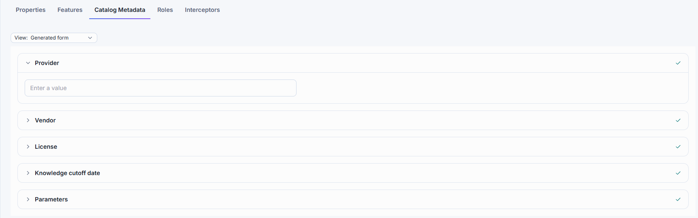

### Roles

Use **Roles** to control which roles can invoke the model. Only full administrators can change this access configuration. Read-only administrators can view it.

Create roles and set their usage limits in [Governance](../6.governance/1.roles.md). For more on access control, see [Access & Cost Control](../../2.understand-dial/5.security-and-governance/4.access-control-reference.md) and the [JWT](../../5.operating-dial/5.auth-and-access-control/2.jwt.md) and [API keys](../../5.operating-dial/5.auth-and-access-control/1.api-keys.md) examples.

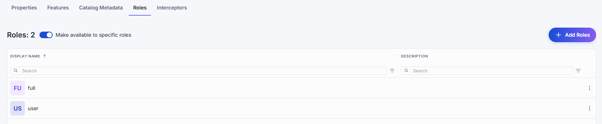

#### Roles grid

| Column | Description |
|--------|-------------|
| **Display Name** | Unique role name displayed in the UI. |
| **Description** | Description of the role's purpose (e.g., "DIAL Prompt Engineering Team"). |

#### Role-specific access

Use the **Make available to specific roles** toggle to define access to the model:

- **Off:** No role restriction is applied by the model. Other access checks still apply. The grid lists all roles and is read-only.
- **On:** Only the roles you add can invoke the model. With no roles in the grid, the model is unavailable to end users, and a notification says so.

Click **Save** to apply changes to the restriction.

:::warning
Turning the restriction off clears the selected role list. If you turn it on again, the list starts empty; add the roles again before saving.
:::

:::note
A newly created model starts with the toggle **On** and no roles, so it is not available to any end user until you add roles or turn the toggle off.
:::

This tab edits role membership only. Usage limits belong to the role; set them in [Governance](../6.governance/1.roles.md).

#### Add a role

You can add a role only if the **Make available to specific roles** toggle is **On**.

1. Click **Add Roles** in the upper-right corner of the Roles grid.
2. Select one or more roles in the dialog. The list of roles is defined in [Governance](../6.governance/1.roles.md).
3. Confirm to add the roles to the table.
4. Click **Save** to apply the changes.

#### Remove a role

You can remove a role only if the **Make available to specific roles** toggle is **On**.

1. Click the actions menu in the role's row.
2. Choose **Remove** in the menu.
3. Click **Save** to apply the changes.

### Interceptors

DIAL uses interceptors to add custom logic to inbound and outbound requests for models and applications, enabling PII obfuscation, guardrails, safety checks, and more.

:::note
Refer to [Interceptors](../../4.building-with-dial/3.interceptors/0.index.md) to learn more.
:::

In the **Interceptors** tab, you can view configured [global interceptors](../1.config-backup-and-global-settings.md#system-properties) and define local interceptors that will be triggered for the selected model. You can define interceptors in the [Governance](../6.governance/4.interceptors.md) section to add them to the processing pipeline of DIAL Core.

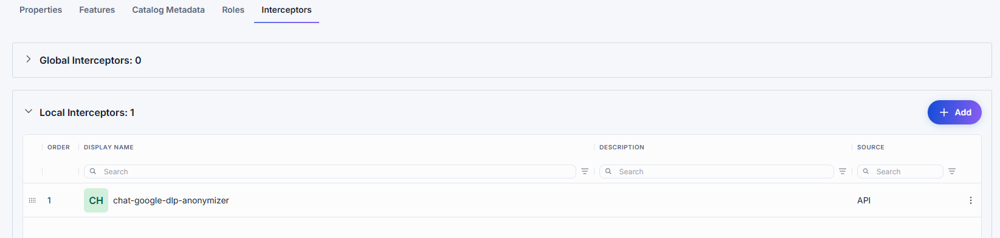

#### Interceptors grid

| Column | Description |
|--------|-------------|
| **Order** | Execution sequence. Interceptors run in ascending order (1 → 2 → 3...). A request will flow through each interceptor in this order. Response interceptors are invoked in reverse order. |
| **Display Name** | Alias of the interceptor, matching the **Name** field in its definition. |
| **Description** | Free-text summary from the interceptor's definition, explaining its purpose. |
| **Source** | The way the interceptor was created: DIAL Core configuration file or via API. |
| **Actions** | Additional actions: open interceptor in a new tab, or [Remove](#remove-interceptor) the selected interceptor from the model's configuration. |

#### Add an interceptor

Follow these steps to attach one or more interceptors to the model's configuration:

1. Click **+ Add** (in the upper-right of the interceptors grid).
2. In the **Add Interceptors** modal, choose one or more from the grid of [defined interceptors](../6.governance/4.interceptors.md).
3. Click **Apply** to append them to the bottom of the list (added in the same order as selected in the modal).

:::tip
If you need a new interceptor, first create it under [Governance](../6.governance/4.interceptors.md) and then revisit this tab to attach it to the model's configuration.
:::

#### Reorder interceptors

1. Drag and drop the handle (⋮⋮⋮⋮) to reassign the order in which interceptors are triggered.
2. Release to reposition; order renumbers automatically.
3. Click **Save** to lock in the new execution sequence.

#### Remove an interceptor {#remove-interceptor}

1. Click the actions menu in the interceptor's row.
2. Choose **Remove** to detach it from this model.
3. Click **Save** to lock in the interceptors list.

### JSON editor

Advanced users with technical expertise can work with the model properties in a JSON editor view mode. It is useful for advanced scenarios of bulk updates, copy/paste between environments, or tweaking settings not exposed in the UI.

:::tip
You can switch between UI and JSON only if there are no unsaved changes.
:::

1. Navigate to **Models**, then select the model you want to edit.
2. Click the **JSON Editor** toggle (top-right). The UI reveals the raw JSON.
3. Make changes and click **Save** to apply them.

### Delete

To permanently remove a model, click **Delete** in the configuration screen toolbar. Review the model details in the confirmation dialog, then click **Delete**.

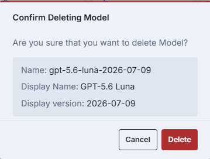

## Further reading

- [Manage applications](./2.applications.md) — configure application deployments that use models
- [DIAL Admin: Translators](./5.translators.md) — add API translators in DIAL Admin
- [Manage roles and access control](../6.governance/1.roles.md) — define who can access each model and at what rate limits
- [Manage interceptors](../6.governance/4.interceptors.md) — create and attach interceptors for content filtering and compliance
- [Supported providers](../../4.building-with-dial/4.adapters/2.supported-providers.md) — which providers and models each DIAL adapter supports
- [Load balancing and upstreams](../../7.services/1.core/1.configuration/5.load-balancing.md) — upstreams, tiers, weights, and retries behind a model
