# Manage applications

An application or agent in DIAL is a service that DIAL Core serves to clients alongside models and toolsets. Clients call it by name. DIAL Core applies the same access control, interceptors, limits, load balancing and logging as for models.

You register an application by telling DIAL Core how to reach it. Common options are:

- **Interfaces.** Declare the OpenAI Chat Completions interface and serve it from a base URL, or use a [translator](./5.translators.md) to adapt another API.
- **Endpoints.** Configure a **Chat endpoint**, an optional **Responses endpoint**, an **MCP endpoint**, or a combination.
- **Application runner.** Select an [application runner](./6.application-runners.md), such as Quick Apps, to create configured application instances.
- **Application container.** Create an application in `platform` or `public` from a running container. See [Application containers](../3.deployments/1.container-management.md#application-containers).

Applications can also be registered in the [DIAL Core configuration](../../7.services/1.core/1.configuration/7.applications.md), through the DIAL Core API, or by user publication. This page describes how to manage them in DIAL Admin.

:::note
For background, see [DIAL-native applications](../../4.building-with-dial/1.apps/0.index.md) and [Register an app](../../4.building-with-dial/1.apps/4.custom-apps/5.register-app.md).
:::

## Main screen

This screen lists application deployments from DIAL Core configuration, DIAL Admin, the DIAL Core API, and user publication. Available folders and actions depend on your access.

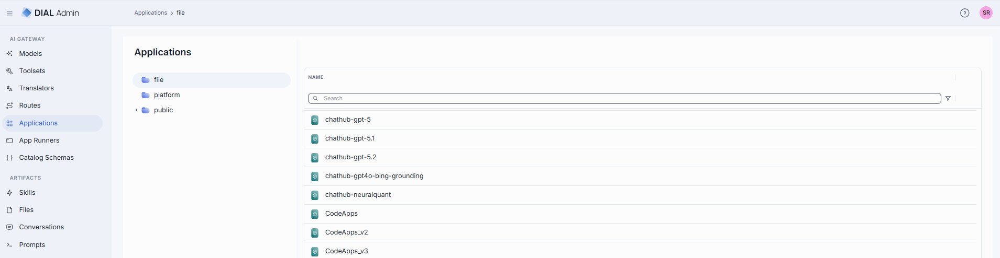

### Folders

The tree can show the following root folders. Click a folder to list its contents. Visibility and available actions depend on your access; in unit mode, `file` and `platform` are hidden.

| Root folder | What it is and how it behaves |
|-------------|------------------------------|
| **file** | Applications defined in DIAL Core configuration files. The list shows names only. Open an application or select **Open in a new tab** to view its read-only configuration. To change it, edit the DIAL Core configuration file. |
| **platform** | Applications stored in DIAL Core platform storage. Authorized administrators can create, edit, duplicate, and delete them. Their configuration includes a [Roles](#roles) section. |
| **public** | Applications in public storage, published by users or added by administrators. Authorized administrators can create and manage them in folders. |

The grid columns, the **Create** menu, and the available row actions all change depending on which bucket you are browsing.

### Grid columns

Columns differ by bucket. Use column filters to narrow the list. DIAL Admin remembers column widths, order, sort, and filters in the browser. When a filter is active, click **Reset filters** to clear filters without changing column widths, order, or sort.

**File bucket:** a single **Name** column. You can open a configuration in the current tab or a new tab.

**Public bucket**

| Column | Description |
|--------|-------------|
| **Name** | Name of the application or folder. Click to open. |
| **Version** | The application's path version. Applications with the same name and different versions appear as separate rows. |
| **Author** | Who created or last updated the application. |
| **Updated time** | Timestamp of the last modification. |

**Platform bucket**

| Column | Description |
|--------|-------------|
| **Name** | Name of the application. Click to open. |
| **Author** | Who created or last updated the application. |
| **Created time** | Creation timestamp. |
| **Updated time** | Timestamp of the last modification. |

### Row actions

Open a row's actions menu (**⋮**). The actions depend on whether the row is an application or a folder, and on the bucket.

**Application (public bucket)**

| Action | What it does |
|--------|--------------|
| **Open in a new tab** | Opens the application's configuration screen in a new browser tab. |
| **Duplicate** | Copies the application. In the public bucket, choose the destination folder, ID, and version for the copy. |
| **Move to** | Moves the application to another folder (platform is excluded as a destination). |
| **Export** | Downloads the application as a DIAL Admin Archive or JSON. |
| **Delete** | Permanently removes the application. |

**Folder (public bucket)**

| Action | What it does |
|--------|--------------|
| **Add sibling** | Creates a new folder next to this one (same parent). |
| **Add child** | Creates a new folder inside this one. |
| **Move to** | Moves the applications in the folder and its nested folders to another folder (`platform` is excluded as a destination). |
| **Export** | Downloads applications in the folder and its nested folders. |
| **Manage permissions** | Opens the folder in [Folders Storage](../6.governance/3.folders-storage.md) in a new browser tab, where you set who can access it. |
| **Rename** | Renames the folder. |
| **Delete** | Deletes the applications in the folder and its nested folders. |

**Application (platform bucket):** **Open in a new tab**, **Duplicate**, **Delete** only.

Select one or more rows to reveal the **bulk-actions** toolbar: **Move to**, **Export**, **Delete** (public) or **Delete** (platform).

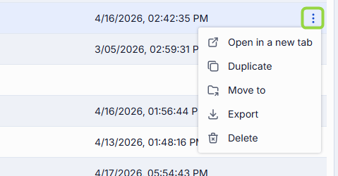

### Create: Folder, Application, or Import

The **Create** dropdown in the header is the single entry point for adding content. Its items depend on the bucket:

- **Public bucket:**
  - **Folder** — adds a new folder in the tree.
  - **Application** — opens the [Create Application modal](#create).
  - **Import** — opens the [Import modal](#import).
- **Platform bucket:** only **Application**.
- **File bucket:** no Create button (read-only).

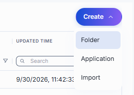

## Create

1. Select the target folder, click **Create**, and select **Application**.
2. Fill in the required form fields:

   | Field | Required | Description |
   |-------|----------|-------------|
   | **ID** | Yes | Application identifier. In the public bucket, the destination folder, ID, and version together identify the application. |
   | **Display Name** | Yes | Name shown on the UI (e.g. "Customer Support Bot"). |
   | **Version** | Public only | A pre-filled text version, such as `1.0.0` or `preview`. Hidden when creating in the platform bucket. |
   | **Description** | No | Free-text description of the application. |

3. Click **Next** to navigate to the **Source Type** screen:

    - **Interfaces** — click **Add interface** to add OpenAI Chat Completions. Choose **Passthrough** and enter a base URL, or choose **Translator** and select a translator.
    - **Endpoints** — select **Chat Endpoint**, **MCP Endpoint**, or both:
        - **Chat Endpoint** → **Completion endpoint** and optional **Responses endpoint** for OpenAI Responses API calls.
        - **MCP Endpoint** → **Endpoint**, **Transport** (HTTP), **Forward per request key** (forwards a [per-request key](../../4.building-with-dial/7.working-with-dial-resources/5.per-request-keys.md)), and **Configuration delivery** (**Header** or **Meta**).
    - **App Runner** — select an [application runner](./6.application-runners.md).
    - **Code App** — available when `CODE_APP_EDITOR_URL` is configured. The **Editor URL** is pre-filled and read-only.

    :::note
    In DIAL Admin 0.23.0, the create dialog requires a valid chat completion endpoint in **Endpoints** mode, even when an MCP endpoint is configured. MCP-only creation is not available in this dialog.
    :::

4. Click **Create**. The dialog closes and the new [application configuration screen](#configuration) opens. The entry appears immediately under the selected folder.

   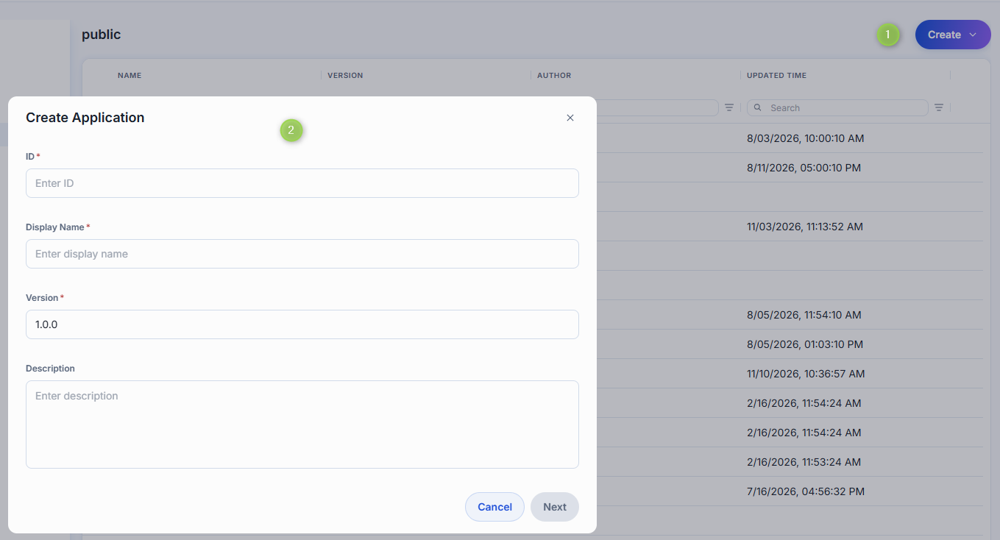

:::tip
To reuse an existing application, select **Duplicate** from its row menu. For a public application, choose the destination folder, ID, and version for the copy.
:::

## Export

You can export individual applications or applications within folders, including nested folders. Folder export from this screen includes applications, not other resource types.

- To export a folder or application, choose **Export** in its row actions menu.
- To export several items at once, select them and use **Export** in the bulk-actions toolbar.
- In the Export dialog, choose the **Format**: **DIAL Admin Archive** or **JSON**.

## Import

Importing lets you migrate, restore, or share application assets between DIAL instances.

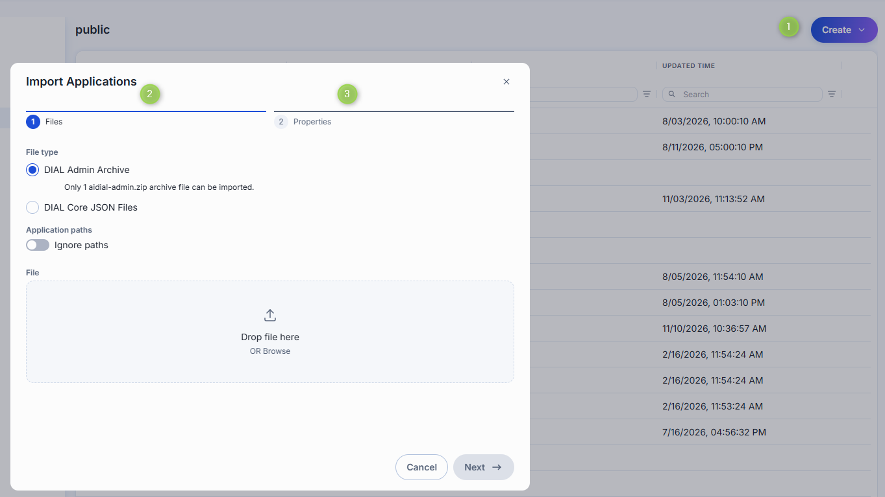

1. Click **Create** and select **Import**.
2. On the **Files** step, choose the file type and add your files (drag and drop or **Browse**):
   - **DIAL Admin Archive** — one ZIP archive at a time, max 4 MB.
   - **DIAL Core JSON Files** — up to 30 JSON files, max 4 MB per file and 64 MB in total.
3. Optionally enable **Ignore paths** to disregard the folder structure stored in the files (everything imports into the current folder).
4. On the **Properties** step, choose a **Conflict resolution** strategy:
   - **Skip** — keep existing applications; add only new ones.
   - **Override** — replace applications at matching destination paths. This is the default.
5. For JSON files, review the preview. It is not an exhaustive check of every destination; ZIP archives do not show an item preview.
6. Click **Finish**. A progress notification remains visible while the import runs, followed by the result. Check the result for errors or skipped items.

:::warning
**Override** can replace existing applications. Select **Skip** if you need to keep them.
:::

## Configuration

Click any application to open its configuration screen. At the top of the **Properties** tab, a header band shows **Updated Time**, **Creation Time**, and **Folder Storage** (the folder path, with a link that opens it in [Folders Storage](../6.governance/3.folders-storage.md) on public applications; `platform` without a link on platform applications).

**Top bar controls**

| Control | Description |
|---------|-------------|
| **Delete** | Delete the selected application. |
| **JSON Editor** (toggle) | Switch between the form UI and the raw [JSON view](#json-editor). |
| **Save** / **Discard** | Appear when there are unsaved changes. **Save** updates the application; **Discard** abandons the changes. |

The screen is organized into sections: Properties, Features, Parameters, Catalog metadata, Interceptors, and App Routes. Conditional sections:

- **Tools Overview** appears when the saved application or its Application Runner has an MCP endpoint.
- **Resource Dependencies** appears for applications in the **public** bucket.
- **Roles** appears for applications in the **platform** and **file** buckets.
- **Audit** appears for public applications when both `ANALYTICS_ENABLED` and `ANALYTICS_USAGE_ENABLED` are enabled. It contains the usage Dashboard only. DIAL Admin 0.23.0 does not show Audit for platform or file applications.

Applications opened from the **file** bucket are read-only (a **READ ONLY** badge appears and the action buttons are hidden).

### Properties

In the **Properties** tab, you can define the application's identity, routing, UI metadata, and other basic runtime controls.

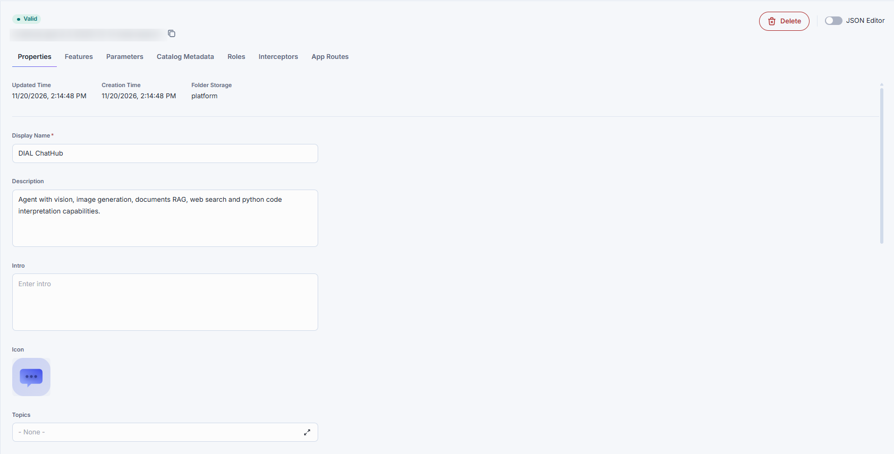

| Field | Required | Description |
|-------|----------|-------------|
| **Display Name** | Yes | Name shown on the UI. |
| **Display version** | No | Public applications only. The version shown to users can be changed independently of the read-only path version. |
| **Description** | No | Free-text summary (e.g. tooling, supported inputs/outputs, SLAs). |
| **Intro** | No | Introductory text shown to users of the application. |
| **Icon** | No | Logo that visually distinguishes the app. |
| **Topics** | No | Semantic labels (e.g. "finance", "support"). Select existing ones or type to add. |
| **Folder Storage** | No | The folder that holds the application. Edit the path or click **Move to** to relocate it (the move is applied on save; the platform bucket is not a valid destination). Hidden for platform-bucket apps. |
| **Source Type** | Yes | **Interfaces**, **Endpoints**, **App Runner**, or **Code App**. The fields below depend on this choice—see [Source Types](#source-types). |
| **Override name** | No | The name DIAL Core sends in the request's `model` field and `X-DIAL-OVERRIDE-NAME` header instead of the application ID. It can also replace the deployment-name segment in an interface's upstream path; it does not change which deployment Core selects. |
| **Base URL** | No | The application-level root URL for passthrough interfaces. An interface without its own base URL falls back to this one. See [Source Types](#source-types). |
| **External Services** | No | External services the application authenticates to. Add each with its ID, display name, description, and authentication settings. DIAL Core's `forwardAuthToken` setting is separate from these credentials. |
| **Attachment types** | No | Which attachments the app accepts: **No attachments**, **All attachments types** (optionally capped), or **Specific attachments types** (choose/add [MIME types](https://developer.mozilla.org/en-US/docs/Web/HTTP/Basics_of_HTTP/MIME_types/Common_types)). |
| **Attachments max number** | No | Maximum number of input attachments. Shown when attachment types are set. When unset, the number is unlimited if attachment types are defined; if no attachment types are defined, attachments are not allowed. |
| **Completion Defaults** | No | Default parameters applied when a request to the OpenAI `chat/completions` API omits them. They are not applied to Responses API or Anthropic Messages requests. Non-empty defaults declared for an [interface](#source-types) replace these for that interface instead of being merged with them. |
| **Responses Defaults** | No | Default parameters for the OpenAI `openai/v1/responses` API. Shown only when the application has a responses endpoint. |
| **Default headers** | No | Key-value HTTP headers DIAL Core adds when the incoming request does not already carry them. They are subject to normal forwarding and header filtering; they do not necessarily reach the application. |
| **Max retry attempts** | No | The total number of attempts DIAL Core makes per request, including the first one, so `1` means no retry. After a [retriable error](../../7.services/1.core/1.configuration/5.load-balancing.md#retries-and-failover), DIAL Core tries another upstream. The number of attempts is also capped by the number of upstreams. Values 1–5, default 1. |
| **Catalog schema** | No | A catalog schema is a structured set of fields defined centrally. You create a schema in [Catalog schemas](./7.catalog-schemas.md) and attach it to the application here. Click the selector to pick a schema, or **Browse** to choose one. Selecting a schema enables the [Catalog metadata](#catalog-metadata) section. |

#### Source Types

:::warning
Changing **Source Type** can leave fields from the previous source in the configuration, even when they are hidden in the form. For example, a configured interface can take precedence over a newly entered endpoint. Review the configuration in the [JSON editor](#json-editor) before switching sources and remove fields you no longer need. Save or discard changes before switching between the form and JSON, and test routing after saving.
:::

**Interfaces**

In DIAL Admin, the interface editor offers OpenAI Chat Completions. To configure the OpenAI Responses API in this editor, use **Responses endpoint** under **Endpoints**. DIAL Core also supports other application interfaces configured outside this editor.

For passthrough mode, DIAL Core uses the interface's base URL, or the application-level **Base URL** when the interface has none. It appends the incoming path, with the deployment name rewritten where applicable; an override path can replace that path. A legacy endpoint can serve a passthrough request when no interface base URL resolves. See [DIAL Core: Application interfaces](../../7.services/1.core/1.configuration/7.applications.md#interfaces).

| Field | Required | Description |
| --- | --- | --- | 
| Base URL | Conditional | Root URL for a passthrough interface. If omitted, the application-level Base URL is used. |
| Mode | No | **Passthrough** (default) forwards the request; **Translator** sends it to a [translator](./5.translators.md). Core does not check or charge role limits on the translated outer request. When the translator calls Core back with the issued per-request key, the callback is checked and usage is attributed to the original caller. |
| Translator | Conditional | Required in translator mode. The translator serves the interface instead of its base URL. |
| Default Headers | No | Headers applied to requests for this interface only, laid over the app-level Default Headers. |
| Features | No | Feature fields that override [app-level features](#features) for this interface only. Unspecified fields inherit the app-level value, then Core defaults apply. |
| Defaults | No | Non-empty body defaults for this interface replace the applicable application-level defaults. Existing request keys are not replaced; an empty map falls back to application defaults. |
| Override Paths | No | Per-operation upstream paths that replace the default path routing for this interface. |

:::warning
Switching an interface to **Translator** clears its interface-level base URL and override paths from the draft. Switching back does not restore them.
:::

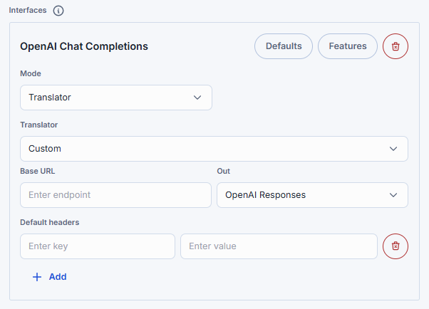

**Endpoints**

Application with this source type is a standalone application. DIAL Core communicates with it via the explicitly-provided chat completion, responses, and/or MCP endpoints.

- **Chat Endpoint** → **Completion endpoint** (required; processes chat completion requests) and **Responses endpoint** (optional; processes OpenAI Responses API calls).
- **MCP Endpoint** → **Endpoint** (required), **Transport** (fixed to HTTP), **Forward per request key** (toggle; forwards a [per-request key](../../4.building-with-dial/7.working-with-dial-resources/5.per-request-keys.md) so the MCP server can reach DIAL storage), **Configuration delivery** (**Header** or **Meta**—how the app's configuration is delivered to the MCP server).
- **Viewer URL** — URL of a custom end-user UI; when set, it overrides the standard DIAL Chat UI for this application.
- **Editor URL** — URL of a custom UI for configuring the application.

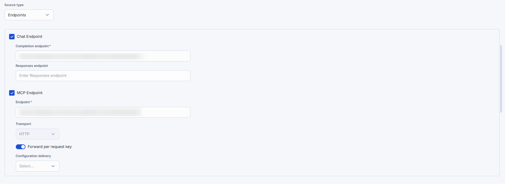

**App Runner**

Application runners can be seen as application factories, allowing users to create logical instances of apps with different configurations. Application runners are based on JSON schemas, which define structure, properties, and endpoints for applications. Select one of the available application runners. If the application is created based on an application runner, DIAL Core will forward all payloads to endpoints defined in the application runner configuration.

**Code App**

A single read-only **Editor URL** (the configured code-app editor).

#### External Services

External services the application authenticates to.

- Service ID: Service identifier.
- Display Name: Service name.
- Description: Service description.
- Authentication parameters: OAuth setting provided by the IDP provider or API key.

> Refer to [Toolsets Authentication](./3.toolsets.md#authentication) for fields description.

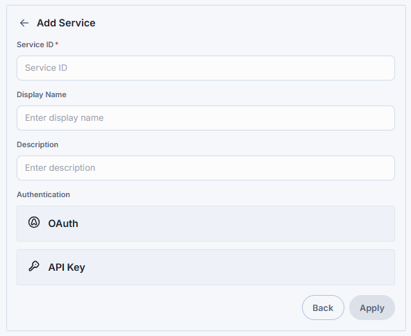

### Tools overview

:::note
This section appears when the saved application has an MCP endpoint, or its Application Runner declares one.
:::

[Tools](https://modelcontextprotocol.io/specification/2025-06-18/server/tools) are functions supported by an MCP server that can be used by clients to perform specific actions. On this screen, you can discover, manage, and try all the available tools.

:::note
See [Toolsets — Tools overview](./3.toolsets.md#tools-overview-tab) for the available controls.
:::

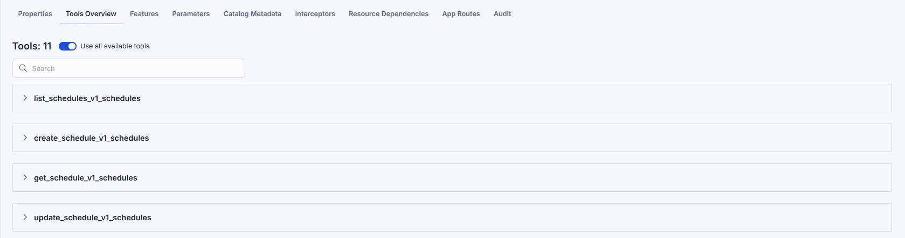

### Features

Configure the application's service endpoints and advertised capabilities. When an Application Runner supplies a rate, tokenize, truncate-prompt, or configuration endpoint, DIAL Admin displays that endpoint as inherited and read-only. The **Assistant Attachments in request** toggle is also read-only when a runner is resolved.

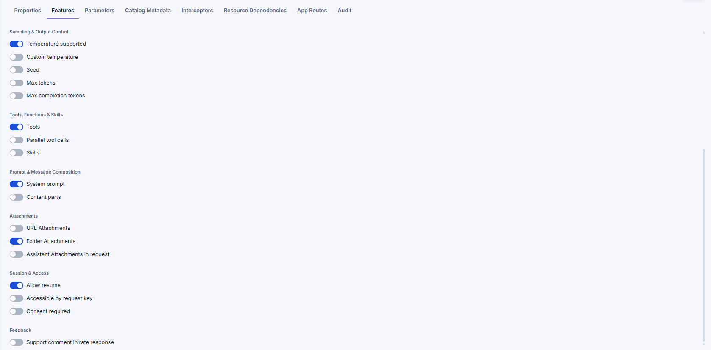

#### Application and model features

Application features describe the application's own capabilities to clients. [Model feature flags](./1.models.md#feature-flags-toggles) describe a model deployment. These declarations do not guarantee that DIAL Core rejects every unsupported parameter or change the behavior of models called by the application.

#### Endpoints

**Service endpoints** — optional URLs that extend the app's runtime behavior:

| Field | Description |
|-------|-------------|
| **Rate endpoint** | Receives response ratings submitted by clients. |
| **Tokenize endpoint** | A custom tokenization service for precise, app-wide token counting. |
| **Truncate prompt endpoint** | Your own prompt-truncation API for advanced context-window management. |
| **Configuration endpoint** | A URL returning a JSON Schema of the application's settings. DIAL Core exposes it as `GET v1/deployments/<deployment name>/configuration`. |

#### Reasoning 

**Reasoning Efforts** defines the reasoning effort levels the apps supports (e.g. `low`, `medium`, `high`). When configured, DIAL Chat displays a selector that lets users choose a reasoning effort for each request. Leave empty if the model does not support reasoning effort control.

#### Other Capabilities

**Capability toggles.** Each toggle declares a supported request parameter or capability to DIAL clients. A declaration does not guarantee that every unsupported parameter is rejected.

By default, DIAL Core treats the following features as enabled: **System prompt**, **Parallel tool calls**, **Max tokens**, **Custom temperature**, **Allow resume** and **Accessible by request key**. The **Temperature supported**, **Seed**, **Max completion tokens**, **Tools**, **Skills**, **Content parts**, **URL Attachments**, **Folder Attachments** and **Assistant Attachments in request** toggles are disabled by default, and no **Reasoning Efforts** are set. The toggles are grouped by purpose:

| Group | Toggle | What it controls |
|-------|--------|------------------|
| **Sampling & Output Control** | Temperature supported | The app accepts `temperature`, which controls output randomness (lower = more deterministic, higher = more varied). Enable only if the underlying model honors it. |
| | Custom temperature | The app allows a custom temperature value instead of forcing a fixed/default one. |
| | Seed | The app declares support for `seed`, which can help with reproducibility but does not guarantee identical output. |
| | Max tokens | The app accepts `max_tokens`, capping the length of the generated completion. |
| | Max completion tokens | The app accepts `max_completion_tokens`, the newer cap on completion length used by reasoning-style models. |
| **Tools / Function Calling** | Tools | The app accepts `tools`/`functions`, letting the model call external functions you define in the request (e.g. calendar lookup, DB fetch). |
| | Parallel tool calls | The app accepts `parallel_tool_calls`, letting the model request several tool calls in one turn. |
| | Skills | The app supports skills. |
| **Prompt & Message Composition** | System prompt | The app accepts a system message that sets the assistant's role and instructions—useful for agent orchestration. |
| | Content parts | The app accepts multi-part message content (e.g. text plus images in one message) rather than plain text only. |
| **Attachments** | URL Attachments | The app accepts attachments referenced by URL instead of uploaded files. |
| | Folder Attachments | The app accepts a whole folder as an attachment, batching its files in one request. |
| | Assistant Attachments in request | DIAL keeps `attachments` on prior `role=assistant` messages when sending the conversation back, so the app can reuse files it generated earlier. See [chat completion requests](https://dialx.ai/dial_api#operation/sendChatCompletionRequest). |
| **Session & Access** | Allow resume | The app supports resuming a previously interrupted generation instead of restarting it. |
| | Accessible by request key | The app can be invoked with a [per-request API key](../../4.building-with-dial/7.working-with-dial-resources/5.per-request-keys.md), which is how one deployment calls another on a user's behalf. |
| | Consent required | Users must grant [consent](https://dialx.ai/dial_api#tag/User-Consent) before they can use the app the first time. |
| **Feedback** | Support comment in rate response | Allows a `comment` in the rating request sent to the rate endpoint. When off, DIAL Core removes the comment. |

### Parameters

Use **Parameters** to view and edit application properties. Available views depend on the application's runner, editor configuration, and your access:

- **Table** — edit properties in a grid with **Key**, **Value**, **Type**, and **Required** columns. Use **Add** to create a property and the row action to remove a user-added property. Schema-defined properties appear in the grid but cannot be removed there.
- **Generated form** — edit properties using fields generated from the resolved application schema. In DIAL Admin 0.23.0, this option is offered when an editor configuration is resolved; if the schema has no properties, the form shows an empty state.
- **Application custom UI** — use the embedded editor configured by the runner or the application's own editor URL, including a Code App editor. Its fields and controls depend on that editor. The option requires a valid editor URL and is not offered to read-only administrators.

When more than one view is available, use the **View** selector to switch. The custom UI is selected initially when available; otherwise the table is selected. If there are unsaved changes, DIAL Admin asks you to **Save** or **Leave without saving** before switching.

:::note
See [Schema-based apps](../../4.building-with-dial/1.apps/0.index.md#schema-based-apps) for application schemas.
:::

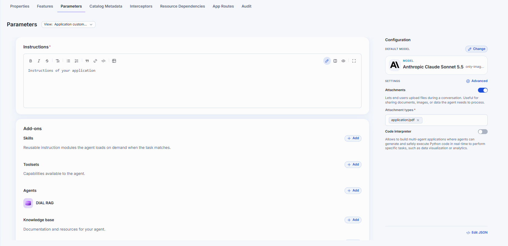

### Catalog metadata

Catalog metadata holds the values for the fields of the [catalog schema](#properties) attached to the application. The section is empty until you select a schema in the **Catalog schema** field on [Properties](#properties):

- **No schema selected** — the section shows "Select a catalog schema on the Properties tab to edit its catalog metadata."
- **Schema selected** — the schema's fields render for you to complete. Use the **View** selector to switch between a generated **Form** and raw **JSON**. A banner flags any stored properties the schema does not declare.

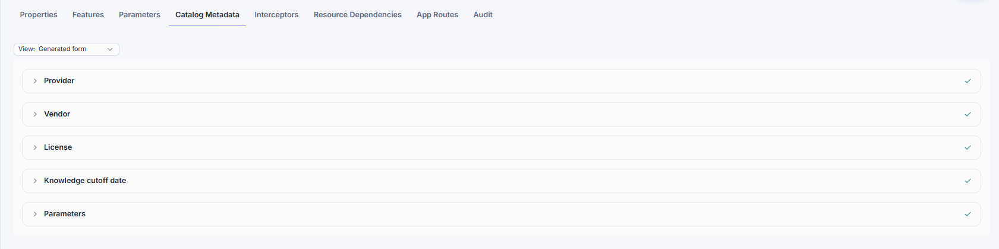

### Roles

Roles tab appears only for applications in the **platform** and **file** buckets.

In the Roles tab, you define which roles can call the application. This tab edits role membership only. Roles and their usage limits are defined in the [Governance](../6.governance/1.roles.md) section.

:::note
See [Access control](../../2.understand-dial/5.security-and-governance/4.access-control-reference.md) and the [JWT](../../5.operating-dial/5.auth-and-access-control/2.jwt.md) and [API key](../../5.operating-dial/5.auth-and-access-control/1.api-keys.md) guides for access and limits.
:::

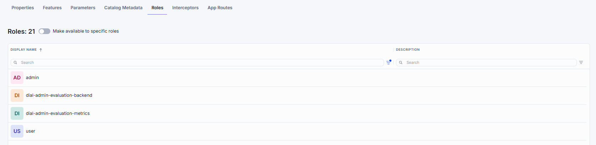

#### Roles grid

| Column | Description |
|--------|-------------|
| **Display Name** | Unique role name displayed on UI. |
| **Description** | Description of the role's purpose (e.g., "DIAL Prompt Engineering Team"). |

#### Role-specific access

Use the **Make available to specific roles** toggle to define access to the application:

- **Off**: The application applies no role restriction. Other access checks still apply. The grid lists all roles and is read-only.
- **On**: Only the roles you add to the grid can call the application. With no roles in the grid, it is unavailable to end users.

:::note
A new platform application starts with the toggle **On** and no granted roles. Add roles or turn the restriction off, then click **Save**.
:::

#### Add a role

You can add a role only if the **Make available to specific roles** toggle is **On**.

1. Click **+ Add** (top-right of the Roles grid).
2. Select one or more roles in the modal. The list of roles is defined in the [Governance](../6.governance/1.roles.md) section.
3. Confirm to add the roles to the table, then click **Save**.

:::warning
Turning the restriction off clears the selected roles. If you turn it on again, the list starts empty; add the roles again before saving.
:::

### Interceptors

DIAL uses interceptors to add custom logic to inbound and outbound requests for models and applications, enabling PII obfuscation, guardrails, safety checks, and more.

You can define interceptors in the [Governance](../6.governance/4.interceptors.md) section to add them to the processing pipeline of DIAL Core.

:::note
See [Interceptors](../../4.building-with-dial/3.interceptors/0.index.md) for how interceptors work.
:::

The section is split into collapsible groups, each showing its count:

- **Global Interceptors** — read-only. Interceptors from [System Properties](../1.config-backup-and-global-settings.md#system-properties) that apply to all deployments.
- **Runner Interceptors** — read-only. Inherited from the application's Application Runner. Shown only when the app has a runner source.
- **Local Interceptors** — editable. The application's own interceptors. Use **+ Add** to attach them, drag to reorder, and remove them from the row menu.

Request interceptors run in the listed order; response interceptors run in reverse. Each group's grid shows **Display Name** and **Description**.

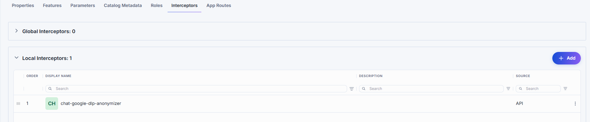

#### The difference between model and application interceptors

**Scope of invocation**

- **Model**: Interceptors are triggered by requests to the model, including model calls made by an application.
- **Application**: Interceptors process application completion requests sent through DIAL Core. They do not necessarily wrap every call in the application's workflow.

**Use cases**

- **Model**: Ideal for prompt pre-processing or response transformations that are specific to each LLM.
- **Application**: Apply cross-cutting logic to application requests, such as logging or policy checks.

#### Interceptors grid

| Column | Description |
|--------|-------------|
| **Order** | Execution sequence. Interceptors run in ascending order (1 → 2 → 3...). A request will flow through each interceptor in this order. Response interceptors are invoked in the reversed order. |
| **Display Name** | The interceptor's alias, matching the **Name** field in its definition. |
| **Description** | Free-text summary from the interceptor's definition, explaining its purpose. |
| **Actions** | Actions depend on the interceptor's origin and whether you can edit it; local interceptors can be [removed](#remove-interceptor). |

#### Add an interceptor

1. Click **+ Add** (in the upper-right of the interceptors grid).
2. In the **Add Interceptors** modal, choose one or more from the grid of [defined interceptors](../6.governance/4.interceptors.md).
3. Click **Apply** to append them to the bottom of the list (added in the same order as selected in the modal).

:::tip
To add a new interceptor, first create it in [Governance](../6.governance/4.interceptors.md), then return to this tab to attach it.
:::

#### Reorder interceptors

1. Drag and drop the handle (⋮⋮⋮⋮) to reassign the order in which interceptors are triggered.
2. Release to reposition; order renumbers automatically.
3. Click **Save** to lock in the new execution sequence.

#### Remove an interceptor {#remove-interceptor}

1. Click the actions menu in the interceptor's row.
2. Choose **Remove** to detach it from this application.
3. Click **Save** to lock in the interceptors list.

### Resource Dependencies

For a public application, use **Resource Dependencies** to declare resource paths the application needs and manage administrator consent for the saved declaration. Platform and file applications do not show this tab in DIAL Admin 0.23.0.

:::note
This tab requires DIAL Core's admin-consent API. If the API is unavailable or your account cannot read it, the tab shows a no-data state. Support for this workflow in DIAL Core 0.50.1 has not been verified.
:::

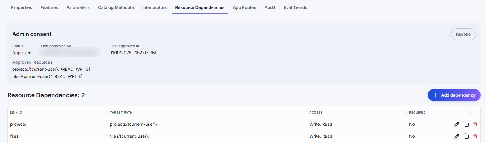

The grid shows the dependency count and these fields. You can declare up to 100 dependencies.

| Field | Description |
|-------|-------------|
| **Link ID** | Identifier used for the dependency. |
| **Target Path** | The resource path the application needs, such as `skills/{current-user}/` or `files/public/folder/`. |
| **Access** | **Read**, or **Read** and **Write**. Selecting Write also selects Read. |
| **Required** | Marks a dependency whose denial or failure to resolve should fail the application call. |
| **Actions** | Edit, duplicate, or remove the dependency. |

To add a dependency:

1. Click **Add dependency**.
2. Enter a unique **Link ID** and a **Target path**.
3. Select the access rights and set **Required** as needed, then click **Add**.
4. Click **Save** in the application header to save the declaration.

The **Admin consent** panel shows the approval status, who last approved it, when, and the approved resources. Review the saved declaration and click **Approve**. If the saved declaration changes and the approval becomes stale, use **Re-Approve**. Use **Revoke** to withdraw consent. Approval applies to the saved declaration, not unsaved changes.

For authorization between applications and models, see [Managing authorization in application ecosystems](../../4.building-with-dial/7.working-with-dial-resources/6.auth-matrix-for-apps.md).

### App Routes

Define routes that clients call through DIAL Core for this application. For an application with its own routes, use **+ Add** and enter a **Display Name**. Routes inherited from an Application Runner are read-only here; configure them on the runner.

Application routes share fields with [global routes](./4.routes.md), but their access and upstream authentication differ.

A client calls an app route through DIAL Core with a request in this form:

```text
{HTTP method} /v1/deployments/{id}/route{route_path}
```

- `{id}` is the application's deployment ID.
- `{route_path}` must match one of the route's **Paths** when the list is not empty; the HTTP method must match its **Methods** when that list is not empty. An empty list matches every path or supported method, respectively. Configure the paths and methods you intend to allow.
- `{route_path}` must not contain the keyword `route`.

Global routes are called differently. See [Calling a route](./4.routes.md#calling-a-route).

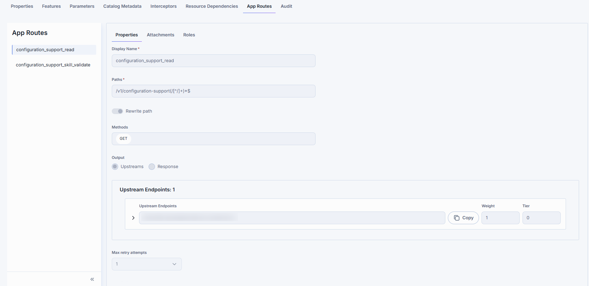

Each route is configured through three sections:

- **Properties** — Display Name, Paths, Rewrite path (toggle), Methods, Output (Upstreams or Response), Upstream Endpoints (with Weight and Tier), Max retry attempts, Permissions, and Order.
- **Attachments** — Request attachment paths and Response attachment paths.
- **Roles** — the **Inherit Application Roles** toggle and a Roles grid (when inheritance is off).

DIAL Core inherits the application's role restriction when a route's `userRoles` is unset; when set, it checks the route's roles instead. Resource-backed applications also have a separate resource-permission check.

Application routes ignore upstream `authType`: Core sends a configured upstream key in `API-KEY`, and the application's `forwardAuthToken` controls forwarding of the caller's `Authorization` header. See [DIAL Core: Application routes](../../7.services/1.core/1.configuration/7.applications.md#application-routes).

### Audit

The **Audit** tab shows the usage Dashboard for a public application when both `ANALYTICS_ENABLED` and `ANALYTICS_USAGE_ENABLED` are enabled. DIAL Admin 0.23.0 does not show this tab for platform or file applications. Dashboard access and data availability depend on the [DIAL Analytics configuration](../../7.services/9.admin/2.configuration/1.frontend.md#analytics).

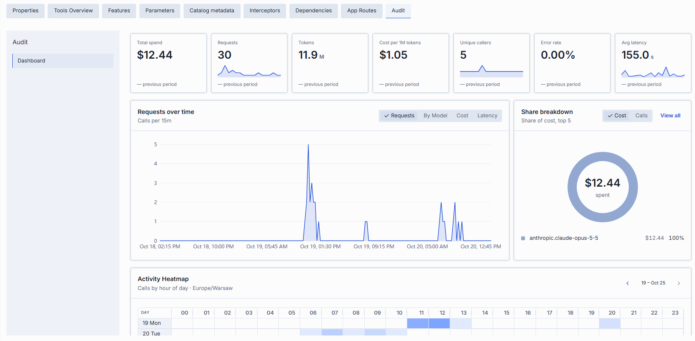

#### Dashboard

The Dashboard presents usage, cost, and performance analytics for the selected application over a chosen time range.

| Control | Description |
|---------|-------------|
| **View by** | Select **LLM**, **MCP**, or, when the application declares routes, **Routes**. The LLM view counts requests to the application; its spend and tokens come from model calls in the application's call tree. MCP shows tool calls. Routes shows calls to the application's routes. |
| **Time Period** | Date range applied to all cards and charts. |
| **Compare** | Shows each metric's change against a previous period: **Off**, **Previous period**, **Previous month** or **Previous year**. |
| **Refresh** | Reloads the dashboard data. |

The metrics, charts and breakdown below are for the **LLM** view.

Each metric card shows the current value, a sparkline, and (when comparison is on) the change versus the previous period:

| Metric | Description |
|--------|-------------|
| **Total spend** | Estimated cost in USD for this application's calls. |
| **Requests** | Number of requests. |
| **Tokens** | Total prompt and completion tokens. |
| **Cost per 1M tokens** | Average cost per million tokens. |
| **Unique callers** | Count of distinct callers when supported identity data is available. |
| **Error rate** | Share of requests that failed. |
| **Avg latency** | Average response time. |

The Dashboard also includes:

- **Requests over time** — time-series chart. Toggle between **Requests**, a split by dimension (**By …**), **Cost**, and **Latency**.
- **Share breakdown** — donut chart of the top 5 contributors; toggle between **Calls** and **Cost**; **View all** opens the full list.
- **Activity Heatmap** — calls by hour of day across the week; toggle **Requests** / **Cost**; navigate week by week; the color scale runs Low → High.
- **Breakdown** — table grouped by the related deployments or projects, with columns Share of calls, Calls, Errors, Avg latency, and Cost.

### JSON editor

Advanced users with technical expertise can work with the application properties in a JSON editor view mode. It is useful for advanced scenarios of bulk updates, copy/paste between environments, or tweaking settings not exposed on UI.

:::tip
You can switch between UI and JSON only when there are no unsaved changes.
:::

1. Navigate to **Applications**, then select the application you want to edit.
2. Click the **JSON Editor** toggle (top-right). The UI reveals the raw JSON.
3. Make changes and click **Save** to apply them.

## Delete

- Click **Delete** on the Configuration screen toolbar.
- Use **Delete** in the application's row actions menu.
- Delete the folder that contains the application from this screen; this removes its application resources.
- Select applications on the main screen and use the bulk-actions **Delete**.

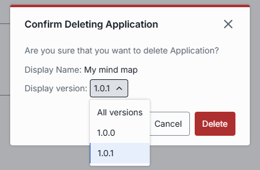

:::warning
Deleting an application is permanent. Applications that depend on it may stop working.
:::

## Further reading

- [Manage AI model deployments](./1.models.md) — configure the AI models your applications rely on
- [DIAL Admin: Toolsets](./3.toolsets.md) — register and configure MCP Toolsets in DIAL Admin
- [Application Runners](./6.application-runners.md) — application factories that let users create configured app instances
- [Manage roles and access control](../6.governance/1.roles.md) — define who can access each application
- [Manage interceptors](../6.governance/4.interceptors.md) — attach interceptors for content filtering and compliance across your application workflows
- [Register an app in DIAL Core](../../4.building-with-dial/1.apps/4.custom-apps/5.register-app.md) — register a Custom App in DIAL Core and the Catalog
