# Manage toolsets

A Toolset is a DIAL configuration that connects to an MCP server and makes its tools available through DIAL Core. Use **AI Gateway → Toolsets** in DIAL Admin to configure the connection, authentication, available tools, and access. You need the appropriate administrator permissions and a reachable MCP server endpoint.

The MCP server can run outside DIAL or in a container deployed through DIAL. You can also create a Toolset from a running text-classification model serving.

Clients can discover and call Toolsets through the [Unified API](https://dialx.ai/dial_api#tag/Toolsets). You can also define Toolsets directly in the [DIAL Core configuration](../../7.services/1.core/1.configuration/11.toolsets.md).

## Use a toolset

A Toolset needs a working MCP connection, any required authentication, and appropriate access permissions before users and applications can use it.

1. **Register the Toolset.** [Create](#create) it in the appropriate bucket and configure its endpoint and transport.
2. **Configure authentication.** If the MCP server requires it, configure [authentication](#authentication), save the Toolset, and sign in at the appropriate credential level.
3. **Control access.** For a platform Toolset, configure [Roles](#roles). A new platform Toolset has no granted roles. For a public Toolset, configure its [folder permissions](../6.governance/3.folders-storage.md).
4. **Check the tools.** Open [Tools Overview](#tools-overview-tab), select the tools to expose, and save any changes. Use **Try out** to call a discovered tool and check the response.
5. **Connect it to applications and clients.**
   - **Quick Apps.** A Quick App references a registered toolset with the `dial-mcp` toolset type and its `dial_id`. Connection details and credentials stay with the administrator. In DIAL Chat, the Quick App wizard has an **Agents & Toolsets** picker for registered toolsets. See [Working with tools and agents](../../7.services/8.quick-apps/2.manifest/2.tool-sets.md) and [What is a Toolset](../../4.building-with-dial/2.toolsets/0.index.md).
   - **Other clients.** Toolsets are served over the MCP Server API of DIAL Core. List them with the [deployment listing API](https://dialx.ai/dial_api#tag/Deployment-listing/operation/getToolSets) and call them with the [MCP Server API](https://dialx.ai/dial_api#tag/Toolsets).

## Main screen

The screen has a **folder tree** on the left and a grid of the selected folder's contents on the right. The **Create** menu is available according to the selected bucket and your permissions.

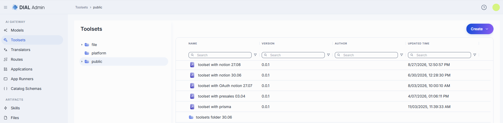

### Folders

The folder tree can show the following root folders, depending on your access. Click a folder to list its contents in the grid.

| Root folder | What it is and how it behaves |
|-------------|------------------------------|
| **file** | Toolsets defined in DIAL Core configuration files. The listing is read-only and shows names only. Open a Toolset or choose **Open in a new tab** to view its read-only configuration. To change it, edit the DIAL Core configuration file. |
| **platform** | Toolsets stored in DIAL Core platform blob storage. This is where you create, edit and delete toolsets in DIAL Admin. It also adds a **Roles** section on the configuration screen. |
| **public** | A public bucket. Toolsets get here when published by users or added by administrators. |

The grid columns, the **Create** menu, and the available row actions all change depending on which bucket you are browsing.

### Grid columns

Columns differ by bucket. There is no separate ID column; row identity is shown in **Name**. Use column filters to narrow the list. DIAL Admin remembers column widths, order, sort, and filters in the browser. When a filter is active, click **Reset filters** to clear all filters without changing the column widths, order, or sort.

**Public bucket**

| Column | Description |
|--------|-------------|
| **Name** | Name of the toolset or folder. Click to open. |
| **Version** | Version from the Toolset's resource path. Each version is a separate row. |
| **Author** | Who created or last updated the toolset. |
| **Updated time** | Timestamp of the last modification. |

**Platform bucket** (platform toolsets have no versions, so there is no Version column)

| Column | Description |
|--------|-------------|
| **Name** | Name of the toolset. Click to open. |
| **Author** | Who created or last updated the toolset. |
| **Created time** | Creation timestamp. |
| **Updated time** | Timestamp of the last modification. |

**File bucket**

A single **Name** column. The available row action is **Open in a new tab**; the Toolset configuration is read-only.

### Row actions

Open a row's actions menu (**⋮**). The actions depend on whether the row is a toolset or a folder, and on the bucket.

**Toolset (public bucket)**

| Action | What it does |
|--------|--------------|
| **Open in a new tab** | Opens the toolset's configuration screen in a new browser tab. |
| **Duplicate** | Copies the selected Toolset. Choose an ID, display name, version, and public destination. See [Duplicate](#duplicate). |
| **Move to** | Moves the toolset to another folder (platform is excluded as a destination). |
| **Export** | Downloads the toolset as a DIAL Admin Archive or JSON. |
| **Delete** | Permanently removes the toolset. |

**Folder (public bucket)**

| Action | What it does |
|--------|--------------|
| **Add sibling** | Creates a new folder next to this one (same parent). |
| **Add child** | Creates a new folder inside this one. |
| **Move to** | Moves the folder and its contents to another folder (platform is excluded as a destination). |
| **Export** | Downloads the folder and everything in it. |
| **Manage permissions** | Opens the folder in [Folders Storage](../6.governance/3.folders-storage.md) in a new browser tab, where you set who can access it. |
| **Rename** | Renames the folder. |
| **Delete** | Deletes the folder and its contents. |

**Toolset (platform bucket):** **Open in a new tab**, **Duplicate**, **Delete** only.

Select one or more rows to reveal the **bulk-actions** toolbar: **Move to**, **Export**, **Delete** (public) or **Delete** only (platform). Actions on public Toolsets apply to the selected resource paths, not automatically to their other versions. Actions on a selected folder include its contents.

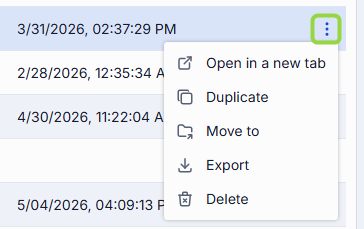

### Create: Folder, Toolset, or Import

The **Create** dropdown in the header is the single entry point for adding content. Its items depend on the bucket:

- **Public bucket:**
  - **Folder** — adds a new folder in the tree.
  - **Toolset** — opens the [Create Toolset modal](#create).
  - **Import** — opens the [Import modal](#import).
- **Platform bucket:** only **Toolset**.
- **File bucket:** no Create button (read-only).

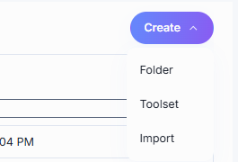

## Create

1. Select the target folder (either in platform or public folder), click **Create**, and select **Toolset**.
2. Fill in the form:

   | Field | Required | Description |
   |-------|----------|-------------|
   | **ID** | Yes | Identifier of the Toolset. For a public Toolset, the combination of destination folder, ID, and version must be unique. Platform Toolsets are identified by their ID without a version. |
   | **Display Name** | Yes | Name displayed on the UI. |
   | **Version** | Public only | Required text version for a public Toolset, such as `1.0.0` or `stable`. Pre-filled with `1.0.0`. Platform Toolsets have no version. |
   | **Description** | No | Description of the toolset. |
   | **External Endpoint** | Yes | Endpoint DIAL Core uses to communicate with the related MCP server. |

   For a public Toolset, the version cannot start with `_` or contain `__`, `/`, braces, quotation marks, or control characters. The combined `ID__version` cannot exceed 255 characters.

3. Click **Create**. The dialog closes and the new [toolset configuration screen](#configuration) opens. The entry appears immediately in the listing.

   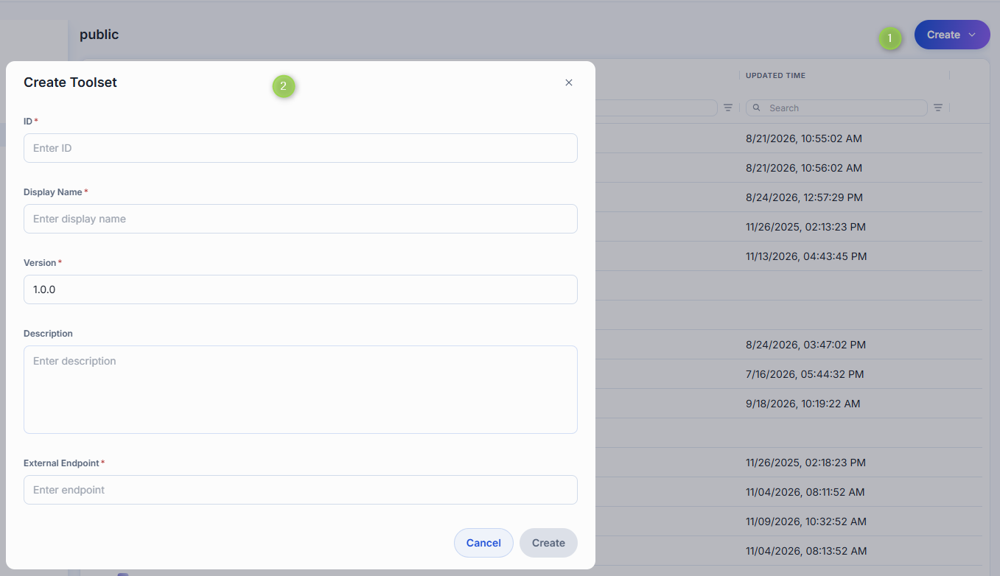

You can also create a Toolset from a running [MCP container](../3.deployments/1.container-management.md#create-a-toolset) or [text-classification model serving](../3.deployments/2.model-servings.md#create-a-toolset-from-a-running-serving). The create action fills in the endpoint and transport.

## Duplicate

Duplicate copies an existing Toolset. Open the row's actions menu and choose **Duplicate**. The dialog differs by bucket:

- **Public:** Enter an **ID**, **Display Name**, **Version**, and **Folder Storage** location. The version is initially taken from the source when available; it is not incremented automatically. A Toolset with the same ID and a different version can exist in the same folder.
- **Platform:** Enter an **ID** and **Display Name**. Platform Toolsets have no version or destination folder.

:::warning
When an OAuth Toolset is duplicated, its authentication is reset to **Without authentication** in both buckets. Configure authentication and sign in again on the copy. For a public Toolset using **API Key**, the dialog includes an **API key header** field; enter the key value when signing in.
:::

Click **Duplicate** to create and open the copy.

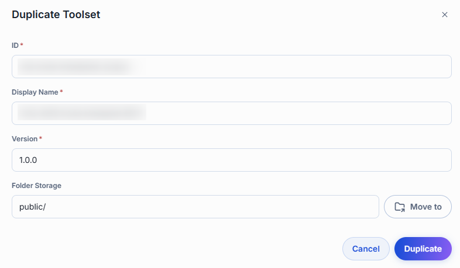

## Export

You can export individual toolsets or whole folders (including nested folders).

- To export a folder or toolset, choose **Export** in its row actions menu.
- To export several items or specific versions, select them and use **Export** in the bulk-actions toolbar.
- In the Export dialog, choose the **Format**: **DIAL Admin Archive** (ZIP) or **JSON**.

<!-- SCREENSHOT OUTDATED: shows version pickers; public versions are now separate rows. -->
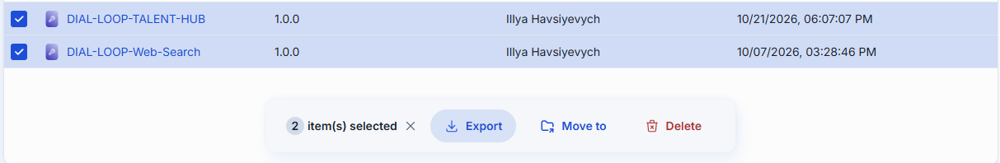

## Import

Importing lets you migrate, restore, or share toolset assets between DIAL instances.

DIAL Core does not return stored OAuth client secrets in Toolset exports. Review authentication after import and supply a secret if needed.

:::warning
If `ENABLE_UNSAFE_TOOLSET_IMPORT` is enabled and a Toolset JSON import contains OAuth entries, the preview offers an editable, masked **Client secret** column. This option is disabled by default and does not apply to ZIP imports.

- If the file omits a row's secret, the field contains `REPLACE_WITH_REAL_SECRET`. Replace it with the real secret during import, or configure the secret on the Toolset afterward. OAuth sign-in cannot succeed with the placeholder.
- With **Override**, leaving the placeholder replaces an existing stored secret and can change dynamic client registration to static credentials. Clear the cell to retain a secret already stored in Core; clearing it cannot create a new Toolset without a secret.
- With **Skip**, a cleared secret is replaced by the placeholder for a new Toolset.
:::

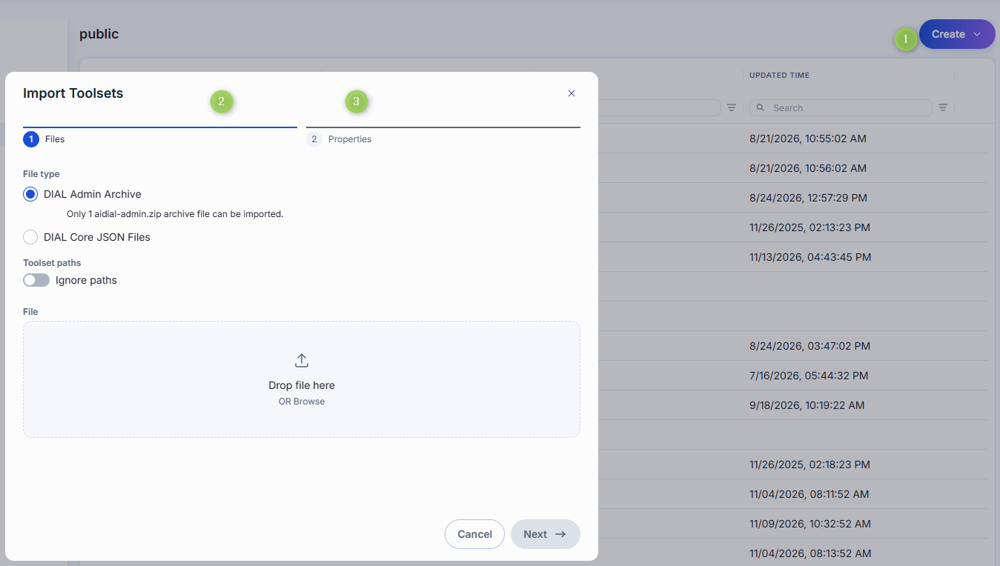

1. Click **Create** and select **Import**.
2. On the **Files** step, choose the file type and add your files (drag and drop or **Browse**):
   - **DIAL Admin Archive** — one ZIP archive, up to 4 MB.
   - **DIAL Core JSON Files** — up to 30 JSON files, each up to 4 MB and 64 MB in total.
3. Optionally enable **Ignore paths** (under **Toolset paths**) to disregard the folder structure stored in the files (everything imports into the current folder).
4. On the **Properties** step, choose a **Conflict resolution** strategy:
   - **Skip** — keep existing toolsets; add only new ones.
   - **Override** — replace toolsets that have the same name and version.
5. Review the preview. Items with validation errors or conflicts are flagged. You can edit a conflicting row's name; its path version is read-only.
6. Click **Finish**.

## Configuration

Click a Toolset to open its configuration. The **Properties** header shows **Updated Time**, **Creation Time**, the **Authentication** status when authentication is configured, and **Folder Storage**. Public Toolsets also show a read-only **Version** from their resource path. The folder path links to [Folders Storage](../6.governance/3.folders-storage.md) for public Toolsets; platform Toolsets show `platform` without a link.

**Top bar controls**

| Control | Description |
|---------|-------------|
| **Log In** / **Log Out** | Sign in to or out of the toolset's MCP server. Shown only when the toolset uses authentication. See [Authentication](#authentication). |
| **Delete** | Delete the selected toolset. |
| **JSON Editor** (toggle) | Switch between the form UI and the raw [JSON view](#json-editor). |
| **Save** / **Discard** | Appear when there are unsaved changes. **Save** updates the Toolset; **Discard** reverts changes after confirmation. |

The screen has **Properties**, **Tools Overview**, and **Catalog metadata** sections. **Roles** appears for Toolsets in the **platform** and **file** buckets. Toolsets opened from **file** are read-only.

:::note
A Toolset's **Audit** section appears only when the optional Admin Backend is configured with `DIAL_ADMIN_API_URL` and `dashboard` is not disabled in `DISABLE_MENU_ITEMS`. It contains a Toolset-scoped Dashboard and Traces. Depending on the Analytics configuration, these show DIAL Analytics or legacy telemetry.

For monitoring and conversation investigation, see [Analytics Dashboards](../5.analytics/1.dashboards.md) and [Sessions](../5.analytics/5.sessions.md). These screens have their own [configuration requirements](../../7.services/9.admin/2.configuration/1.frontend.md#analytics).
:::

### Properties

Preview and modify the toolset's identity, endpoint, and authentication. Fields render in this order:

| Field | Required | Description |
|-------|----------|-------------|
| **Display Name** | Yes | Name displayed in the UI. |
| **Display version** | No | Display label for a public Toolset. Editing it does not change the read-only path version. Not shown for platform Toolsets. |
| **Description** | No | Description of the toolset. |
| **Intro** | No | Introductory text shown to users of the toolset. |
| **Provider** | No | Name of the toolset provider (for example, the service or vendor that hosts the MCP server). |
| **Vendor Website** | No | URL of the provider's website. |
| **Icon** | No | Logo displayed on the UI. Opens a picker with a gallery of built-in icons and a **None** option (not a file upload). |
| **Topics** | No | Semantic labels (e.g. "finance", "support"). Opens a modal with a searchable checkbox list; use **Add Topic** to type a custom one. |
| **Folder Storage** | No | The folder that holds the toolset. Click **Move to** to relocate it. Hidden for platform-bucket toolsets. |
| **External Endpoint** | Yes | Endpoint DIAL Core uses to communicate with the related MCP server. |
| **Transport** | No | The MCP server's transport: **HTTP** or **SSE** (deprecated). Select the transport supported by the server and save it. When the value is unset, the UI displays **SSE**, while DIAL Core defaults to **HTTP**. Check the saved `transport` in the [JSON editor](#json-editor) if needed. |
| **Authentication** | No | The toolset's [authentication method](#authentication). |
| **Forward per request key** | No | Toggle. When on, a [per-request key](../../4.building-with-dial/7.working-with-dial-resources/5.per-request-keys.md) is forwarded to the toolset endpoint so the MCP server can access files in DIAL storage. Disabled when **Authentication** is **API Key**. |
| **Max retry attempts** | No | The total number of attempts DIAL Core makes per call, including the first one, so `1` means no retry. After a [retriable error](../../7.services/1.core/1.configuration/5.load-balancing.md#retries-and-failover), DIAL Core tries another upstream. The number of attempts is also capped by the number of upstreams. Selector with values 1–5, default 1. |
| **Catalog schema** | No | Select a schema from [Catalog schemas](./7.catalog-schemas.md), or click **Browse** to choose one. Selecting a schema enables [Catalog metadata](#catalog-metadata). |

:::warning
Changing or clearing the catalog schema discards the Toolset's existing catalog values. Switching back before saving does not restore them.
:::

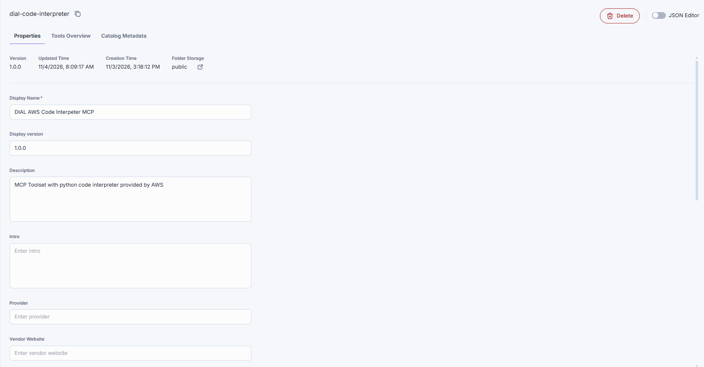

### Authentication

If the toolset requires authentication at the related MCP server, configure the method here, then sign in. A toolset can be published with organization credentials—in that case it may already show **Logged in (Organization)**; you can add personal credentials on top, and both levels remain active, showing **Logged in**.

:::note
OAuth client configuration fields are locked while the Toolset is signed in at either credential level. Sign out at both levels before editing those fields. See [Toolset authentication](../../7.services/1.core/1.configuration/11.toolsets.md#authentication) for details.
:::

**Step 1: Select and configure the authentication method**

Choose one of the method cards:

- **OAuth** — authenticate via OAuth 2.0 with an external identity provider. Choose one of two sub-modes:
  - **With login** — shows no client-configuration fields. With no existing client ID or secret, DIAL Core can register a client dynamically. The authorization server and DIAL Core's allowed redirect URIs must support the flow.
  - **With login & configuration** — static registration. Populate the form with values from your identity provider:

    | Field | Required | Description |
    |-------|----------|-------------|
    | **Client Registration Type** | No | Registration mode. Currently **Existing client**. |
    | **Token Endpoint Authentication Method** | No | How the client authenticates at the token endpoint: **Client secret (HTTP Basic)** (default), **Client secret (POST body)**, or **None**. |
    | **Client ID** | Yes | Unique identifier of the client requesting access. |
    | **Client Secret** | Yes | Secret for the existing OAuth client. A newly entered value must have at least eight characters. For a saved secret, leave the masked field empty to keep the existing value. |
    | **Scopes Supported** | No | Access-level scopes. Use **Add field** to list them. |
    | **Default authorization endpoint** | Yes | URL for performing authorization. |
    | **Default token endpoint** | Yes | URL where the client exchanges an authorization code for an access token. |
    | **Resource** | No | HTTP(S) URL sent as the OAuth resource indicator. When empty, DIAL Core uses the resource advertised by the MCP server, if available. |
    | **PKCE method** | No | Proof Key for Code Exchange method: **- None -**, **plain**, or **S256**. |

- **API Key** — authenticate using an API key. Enter the **API key header** (the header name); the key value is entered at sign-in.
- **Without authentication** — no authentication required.

:::note
Switching between **With login** and **With login & configuration** changes the displayed fields but does not clear existing OAuth client settings. Selecting **With login** alone does not convert an existing client to dynamic registration.
:::

Click **Save** after changing the authentication configuration.

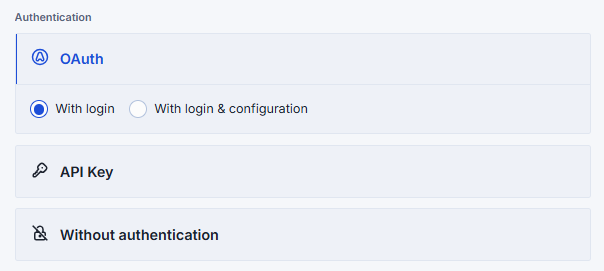

**Step 2: Sign in and choose the level**

Click **Log In** and select the levels (checkboxes):

- **Personal** — stores credentials for your user. Status becomes **Logged in (Personal)**.
- **Organization** — stores organization-level credentials for the Toolset. Status becomes **Logged in (Organization)**; Toolset access still depends on its permissions.
- Select **both** to authenticate at both levels; the status shows **Logged in**. For OAuth, each level requires a separate authorization flow.

For API Key authentication, you are prompted for the **API key value** at this step. OAuth redirects you through the provider's sign-in flow.

To sign out, click **Log Out**. When you are signed in at both levels, a **Select logout levels** dialog lets you choose which to sign out from; with a single level, it signs out directly.

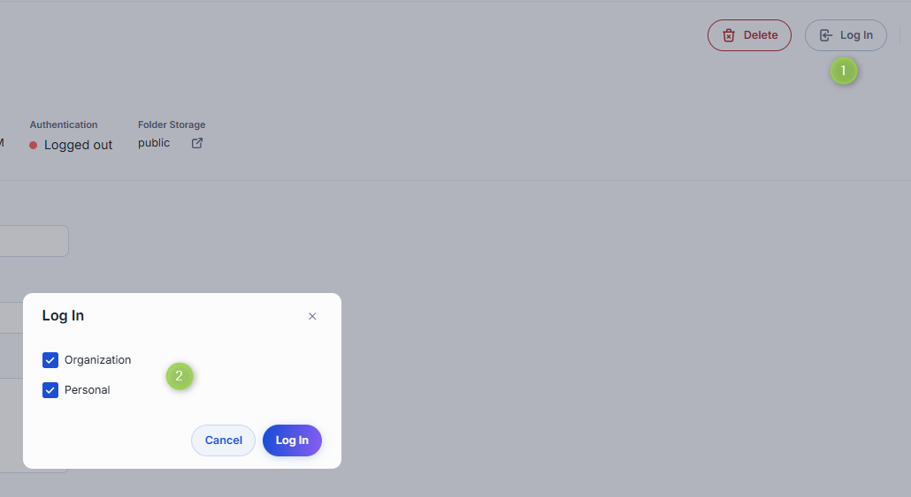

### Tools Overview {#tools-overview-tab}

[Tools](https://modelcontextprotocol.io/specification/2025-06-18/server/tools) are functions supported by an MCP server. Here you discover, manage, and test all tools the related MCP server exposes.

DIAL Core discovers tools through the Toolset's saved MCP endpoint. If you change the endpoint, click **Save** before checking the auto-detected tools.

**Use all available tools**

Enable **Use all available tools** to automatically include every tool the MCP server supports. When on, tools cannot be added or removed manually and the filter and manage controls are hidden. Click **Save** to apply the change.

:::warning
Changing this switch clears the current explicit tool selection. If you turn it off again, select the tools to expose before saving.
:::

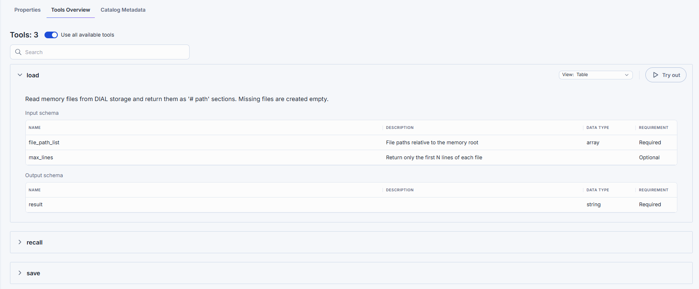

**Manage tools**

Disable **Use all available tools** to switch to manual management. This reveals:

- A **Filter** dropdown with **All tools**, **Auto-detected**, and **Added manually**.
- A **Manage tool** button that opens the **Manage tools** modal.

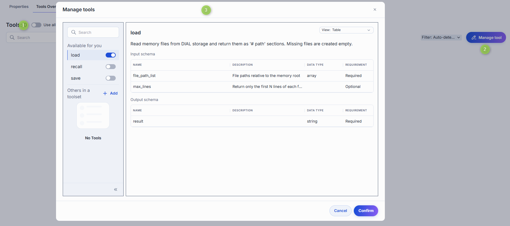

In the **Manage tools** modal:

- **Available for you** lists the auto-detected tools, each with an on/off toggle.
- **Others in a toolset** lets you **Add** a tool by exact name—useful for tools the MCP server supports but that are not visible to your user (they are labeled accordingly on the Tools Overview screen).
- Click **Confirm** to update the selection, then click **Save** on the Toolset configuration screen.

**Inspect a tool**

Click any tool to expand its details. Use the **View** selector (**Table** or **JSON**) to switch presentation. In Table view it shows:

- **Input schema** — a table of **Name**, **Description**, **Data type**, and **Requirement**.
- **Annotations** — a table of **Annotation** and **Value**.
- **Output schema** — a table with the same columns as the input schema.

**Try tools**

Click **Try out** on an auto-detected tool to open the request sidebar. The action is not offered for manually added tools or read-only users.

:::warning
**Try out** calls the MCP server. The tool can perform real actions or change data, depending on its implementation.
:::

1. If the tool has inputs, populate the **Request body** using the **Generated form** or switch to **JSON**. If the sidebar shows **No inputs**, continue without entering a body.
2. Click **Send Request**.
3. The server's reply appears in the **Response body**.

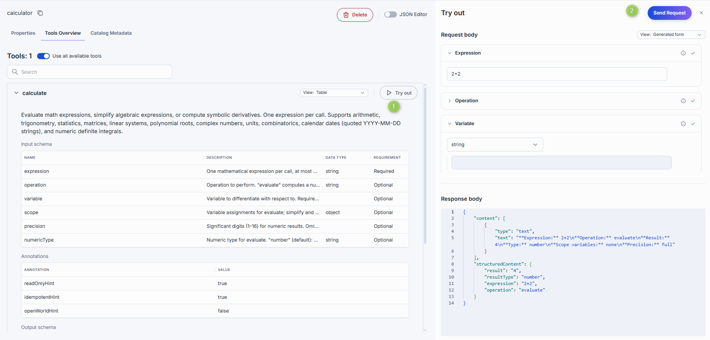

### Catalog metadata

Catalog metadata holds the values for the fields of the [catalog schema](#properties) attached to the toolset. The section is empty until you select a schema in the **Catalog schema** field on [Properties](#properties):

- **No schema selected** — the section shows "Select a catalog schema on the Properties tab to edit its catalog metadata."
- **Schema selected** — the schema's fields render for you to complete. Use the **View** selector to switch between a generated **Form** and raw **JSON**. A banner flags any stored properties the schema does not declare.

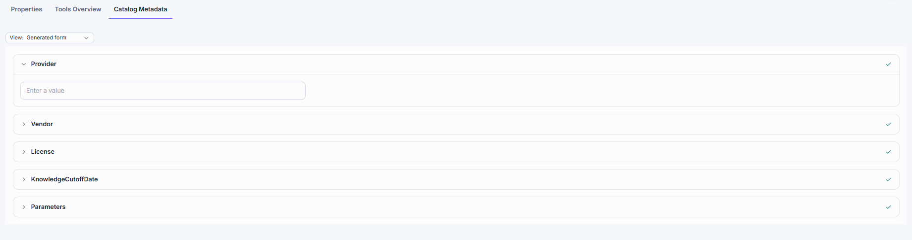

### Roles

The **Roles** section appears for Toolsets in the **platform** and **file** buckets; file-defined Toolsets are read-only. Only full administrators can change platform Toolset roles. Public Toolsets use [folder permissions](../6.governance/3.folders-storage.md) instead.

Use **Make available to specific roles** to control access:

- **Off** — the Toolset applies no role restriction. Other access checks still apply. The grid lists all roles and is read-only.
- **On** — only the roles you add can use the Toolset. An empty list makes it unavailable to end users.

:::note
A new platform Toolset starts with the toggle **On** and no granted roles. Add roles or turn the restriction off, then click **Save**.
:::

:::warning
Turning the restriction off clears the selected role list. If you turn it on again, the list starts empty; add the roles again before saving.
:::

To add roles, click **Add Roles**, select them, and confirm. To remove a role, open its row menu and choose **Remove**. Click **Save** to apply either change. The grid shows **Display Name** and **Description**; manage roles and usage limits in [Governance](../6.governance/1.roles.md).

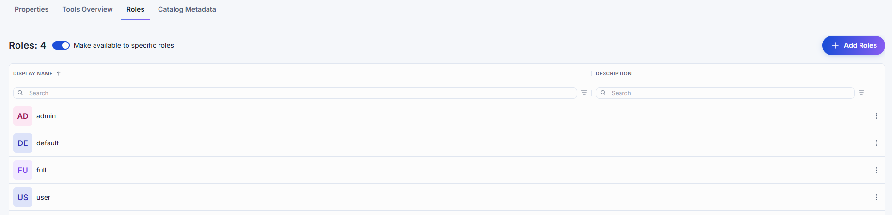

### JSON editor

Advanced users can work with the toolset's raw JSON—useful for bulk updates or editing settings not exposed in the form UI.

:::tip
You can switch between the form UI and JSON only if there are no unsaved changes.
:::

1. Navigate to **Toolsets** and select the toolset you want to edit.
2. Click the **JSON Editor** toggle (top-right). The raw JSON is revealed.
3. Make changes and click **Save** to apply them. Click **Discard** to revert the changes.

:::note
Saving is blocked while the JSON contains errors. For a Toolset in the **file** bucket, the editor is read-only.
:::

## Delete

:::warning
Deleting a Toolset is permanent and can break workflows that rely on it.
:::

- Click **Delete** on the Configuration screen toolbar.
- Use **Delete** in the toolset's row actions menu.
- Delete the folder that contains the toolset.
- Select toolsets on the main screen and use the bulk-actions **Delete**.

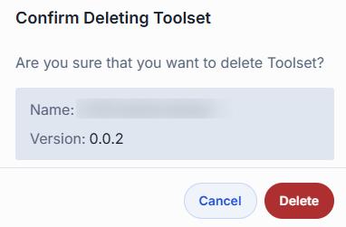

## Further reading

- [What is a Toolset](../../4.building-with-dial/2.toolsets/0.index.md) — what a Toolset is and how it connects to apps
- [Manage applications](./2.applications.md) — configure application deployments that use toolsets via MCP
- [Manage roles and access control](../6.governance/1.roles.md) — define who can access each toolset
- [Manage MCP containers](../3.deployments/1.container-management.md#mcp-containers) — deploy and manage the MCP containers that power your toolsets
- [Quick Apps: Toolsets](../../7.services/8.quick-apps/2.manifest/2.tool-sets.md) — fields of each Toolset type and authorization type
