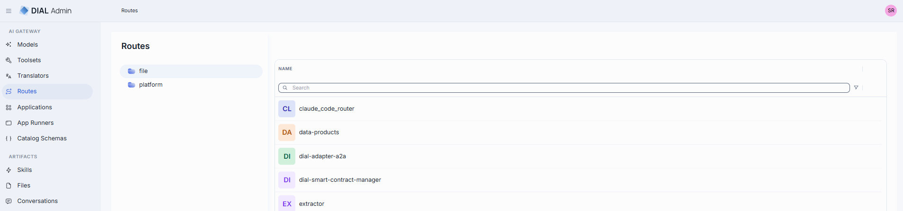
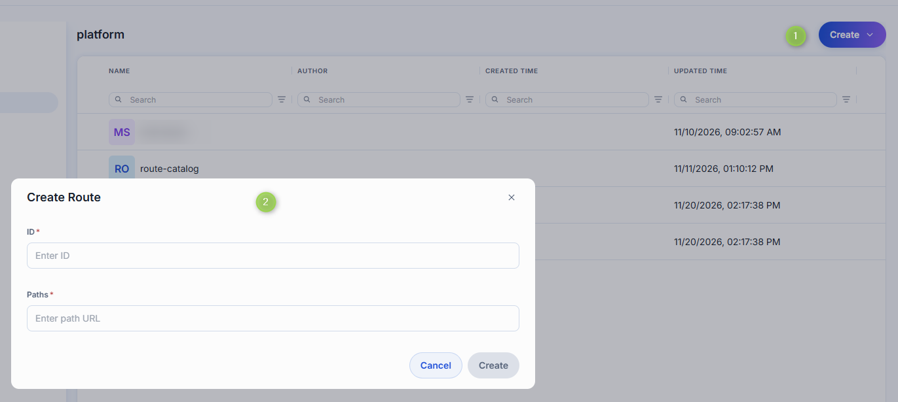
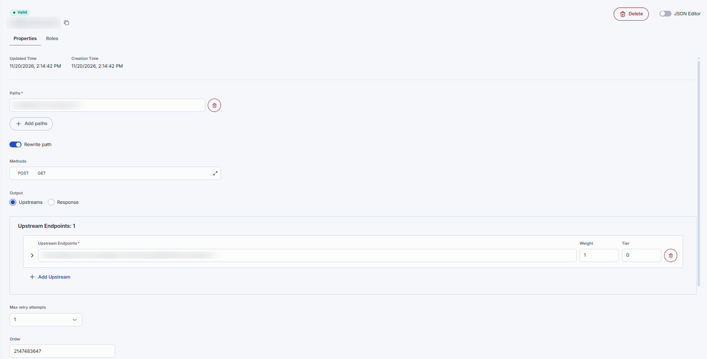
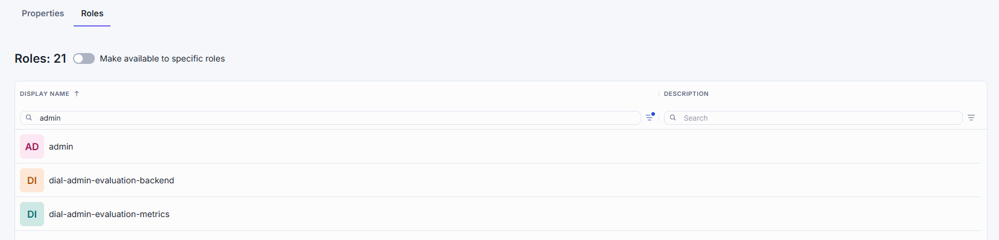

# Manage routes

Use **AI Gateway → Routes** in DIAL Admin to configure global routes in DIAL Core. A route matches an HTTP or WebSocket request by path and method, then forwards it to an upstream or returns a configured response. You need permission to manage routes in DIAL Admin.

DIAL Core authenticates and authorizes callers, applies configured limits, and can balance requests across upstreams. The route configuration does not deploy the upstream service.

### Global and application routes

This page covers **global routes**, which apply across DIAL Core. Routes attached to a single application are configured separately; see [Applications](./2.applications.md#app-routes) and [Application Runners](./6.application-runners.md#app-routes).

### Example

A common use is to forward requests to an external service. For example, a route that matches the path `/v1/chat/completions` for `POST` requests and sends them to an external LLM provider lets a client call that provider through DIAL Core — DIAL Core attaches the provider's API key, so the client never handles it.

Other typical uses:

- **Return a static response.** Match a path such as `/v1/rate` and return a fixed payload (for example, status `200` with body `OK`) without contacting any backend — useful for health checks. See [Response configuration](#response-configuration).
- **Load-balance across endpoints.** Point one route at several upstreams to spread traffic and, when retries are configured, fail over. See [Upstream configuration](#upstream-configuration).

### Calling a route

A client calls a global route by sending a request to DIAL Core with the route's own path:

```text
{HTTP method} {path}
```

- `{path}` is the request path on the DIAL Core host. When **Paths** is not empty, the path must match one of its entries in full. When **Methods** is not empty, the HTTP method must match one of its entries.
- In Core configuration, an empty `paths` list matches every path and an empty `methods` list matches every method that reaches the global route handler. Built-in DIAL Core endpoints are selected before global routes. The DIAL Admin create form requires an initial path; explicitly select the methods you intend to allow.
- If several routes match, DIAL Core selects the one with the lowest **Order**. Access is checked on that route; a forbidden request does not fall through to another route. See [Order and route priority](#order-and-route-priority).

Routes defined under an application are called differently. See [App Routes](./2.applications.md#app-routes).

For configuration examples, see [DIAL Core: Routes](../../7.services/1.core/1.configuration/10.routes.md).

## Main screen

The screen lists routes in the selected folder. Available folders and actions depend on your permissions.



The platform grid shows the following columns. Use column filters to narrow the list. DIAL Admin remembers column widths, order, sort, and filters in the browser. When a filter is active, click **Reset filters** to clear filters without changing the column widths, order, or sort:

| Field | Description |
|-------|------------|
| **Name** | Route name. |
| **Author** | Author recorded in the route's resource metadata. |
| **Created time** | Entity creation timestamp. |
| **Updated time** | Timestamp of the latest update of the entity. |

### Folders

The left panel shows the available sources, depending on your access:

- **file:** Routes defined in DIAL Core configuration files. The list shows names only. Open a route or choose **Open in a new tab** to view its read-only configuration. To change it, edit the DIAL Core configuration file.
- **platform:** Routes stored in DIAL Core platform storage. Authorized administrators can create, edit, duplicate, and delete them in DIAL Admin.

File and platform routes with the same name can both be active. They do not replace each other; matching paths and **Order** determine which route handles a request. See [DIAL Core: Routes](../../7.services/1.core/1.configuration/10.routes.md#where-routes-are-defined).

### Actions

The actions menu (**⋮**) at the end of each row in the platform bucket lets you work with an individual route.

:::warning
A duplicate retains the source route's paths, methods, order, and role configuration. It can match the same requests as the source as soon as the copy is created. Review its paths and **Order** to avoid unintended overlap.
:::

| Action | What it does |
|--------|--------------|
| **Open in a new tab** | Opens the route's configuration screen in a new browser tab. |
| **Duplicate** | Copies the route under a new ID and opens the copy. The dialog requires a replacement key for each **Bearer** or **Custom header** upstream. Stored keys and secret extra data are not copied. |
| **Delete** | Permanently removes the route. |

For an **API key** upstream, the duplicate dialog does not request a replacement key. If the upstream needs one, configure it on the copy. To delete several platform routes, select their rows and use the bulk **Delete** action.


## Create

Follow these steps to add a new route in the platform folder:

1. Select the **platform** folder, click **Create**, and choose **Route**.
2. Fill in the required fields:

    | Field | Description |
    |-------|-------------|
    | **ID** | Name of the route. Use 2–255 characters without spaces or `%`, `/`, `\`, and `;`. The ID cannot be changed after creation. |
    | **Paths** | One initial request path or regular expression, for example `/v1/route-health`. You can add more paths later. |

3. Click **Create**. DIAL Admin creates the route and opens its [configuration](#configuration). A new route has no granted roles and cannot be called by end users yet.
4. In **Properties**, select the methods and configure either [upstreams](#upstream-configuration) or a [static response](#response-configuration).
5. In **Roles**, add authorized roles or turn off the role restriction, then click **Save**. Allow time for the configuration to take effect.
6. Test the route using a credential that has access.



### Verify a static route

For a route configured with path `/v1/route-health`, method `GET`, and a static response of status `200` and body `OK`, replace the placeholders and call:

```bash
curl -i "https://<YOUR_DIAL_HOST>/v1/route-health" \
  -H "Api-Key: <DIAL_API_KEY>"
```

Use a path that is not already handled by another route. A successful call returns HTTP 200 and `OK`. If the request is forbidden, check the credential and route roles; if the route is not found, check its path and method.

## Configuration

Click any route on the main screen to open the configuration section.

### Properties

A route has **Properties** and **Roles** sections; it has no Audit section. In **Properties**, configure the route's matching and output. If DIAL Core reports a validity status, the header shows **Valid** or **Invalid**; an invalid badge can include a hint with validation details.

Edit the fields, then click **Save**. Use **Discard** to abandon unsaved changes. File-defined routes are read-only.



#### Basic identification

| Field | Required | Editable | Description |
|-------|----------|----------|-------------|
| **ID** | - | No | Route identifier. The ID is set at creation and cannot be edited in the configuration screen. |
| **Updated Time** | - | No | Date and time when the route's configuration was last updated. |
| **Creation Time** | - | No | Date and time when the route's configuration was created. |

#### Request matching: paths and methods

| Field | Required | Editable | Description |
|-------|----------|----------|-------------|
| **Paths** | Flagged if empty | Yes | Request paths the route matches. Core treats each path as a regular expression and matches the entire request path. For example, `/v1/route-health` matches that path, and `/v1/vector_store(/[^/]+)*$` also matches nested paths. Escape regular-expression characters such as `.` when they must be literal. Click **Add paths** to add another path. |
| **Rewrite path** | No | Yes | When off, Core sends the request to the upstream endpoint URL as configured. When on, Core replaces the upstream URL's path with the incoming route path. |
| **Methods** | No in Core | Yes | Select the methods to allow and click **Apply**. The editor flags an empty selection, but Core treats an empty list as matching every method. Available choices: GET, POST, PUT, PATCH, DELETE, and HEAD. |

For example, with upstream `https://<UPSTREAM_HOST>/service` and incoming path `/v1/route-health`, **Rewrite path** off uses `/service`; on uses `/v1/route-health`. The DIAL Admin path editor validates expressions as JavaScript regular expressions; DIAL Core evaluates them as Java regular expressions. The editor flags empty or invalid paths, but these errors alone do not prevent saving.

#### Output mode

Use the output mode to define the response of a route.

| Option | Description |
|--------|-------------|
| **Upstreams** | One or more backend URLs (e.g., `http://`, `https://`, `ws://`, `wss://`) to which requests are sent. Supports HTTP and WebSocket protocols. When multiple endpoints are provided, DIAL Core balances traffic among them by weight and falls back to the next tier when a tier is unavailable. Refer to [Upstream configuration](#upstream-configuration). |
| **Response** | Return a configured status and body without contacting an upstream. Caller access and rate-limit checks still apply. See [Response configuration](#response-configuration). |

:::warning
Switching output modes clears the current upstream list or static response from the draft. Switching back does not restore it. Use **Discard** before saving to restore the last saved configuration.
:::

#### Upstream configuration

A list of upstream servers with their parameters. Each upstream row has the main fields below; click the expand chevron on a row to reveal additional per-upstream fields.

| Field | Required | Editable | Description |
|-------|----------|----------|-------------|
| **Upstream Endpoints** | Yes | Yes | Full HTTP or WebSocket URL of the service that receives the routed request. |
| **Weight** | No | Yes | Relative traffic share within a tier. Default `1`; a value of zero or less excludes the endpoint from routing. |
| **Tier** | No | Yes | Priority group. Core uses the lowest available tier first; the default is `0`. See [load balancing](../../7.services/1.core/1.configuration/5.load-balancing.md). |
| **Base URL** | No | Yes | Optional root URL field shown when the row is expanded. See the Core 0.50.1 note below. |
| **Authentication type** | No | Yes | How Core sends the upstream key: **API key**, **Bearer**, or **Custom header**. The default is **API key**. See [Upstream authentication](#upstream-authentication). |
| **Header name** | Conditional | Yes | Required for **Custom header**. Enter a valid HTTP header name. |
| **Key** | Conditional | Yes | Credential for the selected authentication type. Values entered in the editor are masked. Core does not return a saved key; leave it empty to retain the stored key when the endpoint and authentication remain unchanged. |
| **Extra Data** | No | Yes | Optional string or JSON metadata. See the Core 0.50.1 note below. |
| **Secret Extra Data** | No | Yes | Optional sensitive string or JSON metadata. Core stores it encrypted and does not return the saved value. See the Core 0.50.1 note below. |
| **Add Upstream** | - | - | Adds another upstream for load balancing or failover. |

:::note
In DIAL Core 0.50.1, the global Route proxy uses **Upstream Endpoints** for the destination. It does not use **Base URL** to construct that URL or forward the configured **Extra Data** and **Secret Extra Data** to the upstream. These fields remain visible in DIAL Admin.
:::

:::warning
Core matches stored upstream secrets by endpoint. If you change an endpoint, re-enter any key or secret extra data that the upstream needs before saving; saved values cannot be carried over to the new endpoint.
:::

#### Upstream authentication

Expand an upstream row and select its **Authentication type**:

| Type | How Core sends the configured key |
|------|-----------------------------------|
| **API key** | In the `API-KEY` header. This is the default when the type is unset. |
| **Bearer** | In the `Authorization: Bearer <key>` header. |
| **Custom header** | In the named header as `<Header name>: <key>`. Enter a valid HTTP header name. |

A new **Bearer** or **Custom header** upstream needs a key. When changing an existing upstream to either type, or changing a custom header name, enter a key if the field is empty. An unchanged upstream can retain its stored key without displaying it. Switching to **API key** does not require a new key in the editor; enter one if the upstream requires a different credential.

For a proxied request with no configured upstream key, Core sends a generated [per-request DIAL key](../../4.building-with-dial/7.working-with-dial-resources/5.per-request-keys.md) in the `API-KEY` header.

:::warning
With **API key** or a custom header other than `Authorization`, the caller's incoming `Authorization` header can also be forwarded to the upstream by default. **Bearer**, or a custom `Authorization` header, replaces it with the configured upstream key. Verify that the upstream can be trusted with forwarded credentials. The platform team can configure [Core header filtering](../../7.services/1.core/1.configuration/2.settings/1.server-and-client.md#proxying); this setting affects other proxied traffic too.
:::

These authentication types apply to global routes. Application routes handle upstream authentication differently; see [Application routes](./2.applications.md#app-routes).

#### Response configuration

Define the status and body for a pre-configured route response. When you select **Response**, the editor flags the initially empty fields. DIAL Core defaults an omitted status to `200` and an omitted body to an empty string.

| Field | Required | Editable | Description |
|-------|----------|----------|-------------|
| **Status** | Flagged if empty | Yes | HTTP status code your route will return (e.g. `200`, `404`, `503`). |
| **Body** | Flagged if empty | Yes | Exact payload to send in the response body. You can enter plain text or raw JSON. |

#### Additional parameters

| Field | Required | Editable | Description |
|-------|----------|----------|-------------|
| **Order** | No | Yes | Priority among global routes. A lower value is checked first. See [Order and route priority](#order-and-route-priority). The value cannot be a negative integer. The default value is 2^31-1. |
| **Max retry attempts** | No | Yes | The total number of attempts per request, including the first one, so `1` means no retry. For HTTP routes, Core can retry a `429` response or a connection or send failure. For WebSocket routes, it can retry a connection failure. The number of attempts is also capped by the number of upstreams. Values 1–5, default 1. |
| **Request attachment paths** | No | Yes | JSON paths in the request body. Click **Add paths** to add another. See the note below. |
| **Response attachment paths** | No | Yes | JSON paths in the response body. Click **Add paths** to add another. See the note below. |

:::note
DIAL Admin displays these attachment-path fields for global routes, but DIAL Core 0.50.1 does not use them for attachment processing on global routes. Attachment paths are used for [application routes](./2.applications.md#app-routes).
:::

##### Order and route priority

A request can match the **Paths** of more than one global route. **Order** decides which route wins: DIAL Core evaluates global routes from the lowest **Order** value to the highest and uses the first route whose path (and method) matches the request.

- A **lower** value means **higher** priority — it is checked earlier.
- Leave the default (2^31-1) unless a route must be evaluated before others. For example, give a specific route such as `/v1/chat/completions/special` a lower **Order** than a broad catch-all route such as `/v1/chat/completions/.*` so the specific route is matched first.
- Application routes also use **Order**, but are scoped to their own application and are not ranked against global routes.

### Roles

Use **Roles** to control which roles can call the route. Only full administrators can edit this access configuration; file-defined routes are read-only. This section edits role membership only. Set usage limits in [Governance](../6.governance/1.roles.md).



#### Roles grid

| Column | Description |
|--------|-------------|
| **Display Name** | Name of the role displayed in the UI. |
| **Description** | Description of the role (e.g., "Admin, Prompt Engineer, Developer"). |

#### Role-specific access

Use the **Make available to specific roles** toggle to define access to the route:

- **Off:** The route applies no role restriction. Other access checks still apply. The grid lists all roles and is read-only.
- **On:** Only the roles you add can call the route. With no roles in the grid, the route is unavailable to end users and a notification appears.

To add roles, click **Add Roles**, select them, and confirm. To remove a role, use its row actions menu. Click **Save** to apply changes.

:::note
A new route starts with the toggle **On** and no granted roles. Add roles or turn the restriction off, then click **Save**.
:::

:::warning
Turning the restriction off clears the selected role list. If you turn it on again, the list starts empty; add the roles again before saving.
:::

### JSON editor

Advanced users with technical expertise can work with the route properties in a JSON editor view mode. It is useful for advanced scenarios of bulk updates, copy/paste between environments, or tweaking settings not exposed on UI.

:::tip
You can switch between the form and JSON only if there are no unsaved changes. File-defined routes are read-only in the JSON editor.
:::

1. Navigate to **Routes**, then select the route you want to edit.
2. Click the **JSON Editor** toggle (top-right). The UI reveals the raw JSON.
3. Make changes and click **Save** to apply them.

### Delete

:::warning
Deleting a route can interrupt clients that depend on its path. Another matching route can handle requests if its path and method match.
:::

To permanently remove a platform route, click **Delete** in the configuration screen toolbar or the row actions menu, then confirm. To remove a file-defined route, edit the DIAL Core configuration file.

## Further reading

- [Manage applications](./2.applications.md) — define app-level routes for individual application deployments
- [Manage application runners](./6.application-runners.md) — define app-level routes for applications created from a runner
- [Manage roles and access control](../6.governance/1.roles.md) — control which roles can invoke each route
- [DIAL Core configuration: Routes](../../7.services/1.core/1.configuration/10.routes.md) — publish your own HTTP or WebSocket API through Core
- [Request flow](../../2.understand-dial/4.architecture/2.request-flow.md) — how a request travels from DIAL Core to models, apps, and tools
