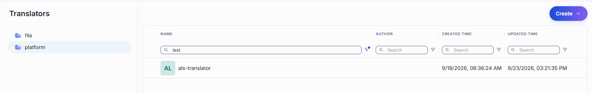
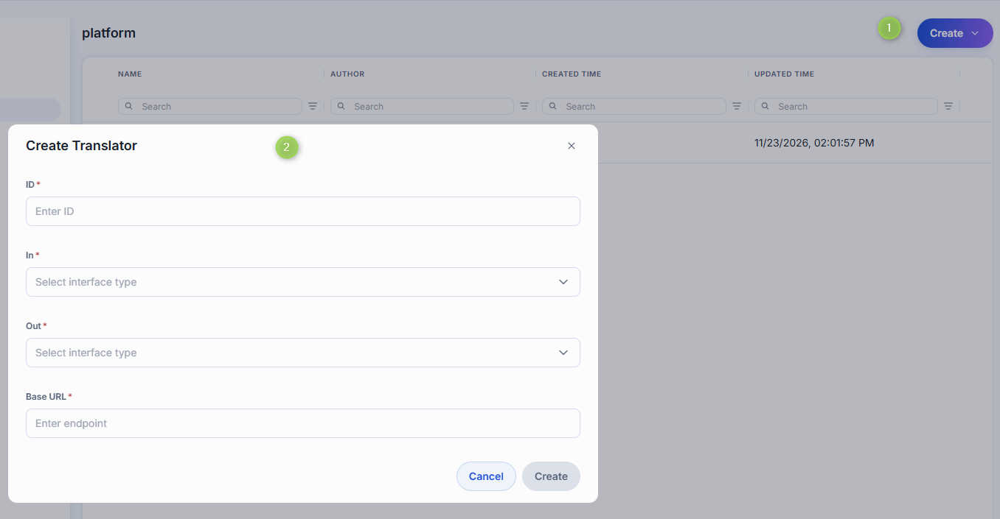
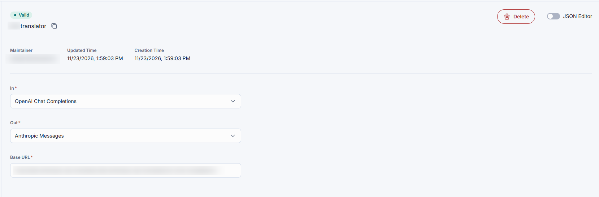

# Manage translators

A translator service converts requests between AI APIs, allowing a deployment to serve an API it does not speak directly. Use **AI Gateway → Translators** in DIAL Admin to register and manage reusable translator configurations.

DIAL Core forwards a request to the translator. The translator converts it, calls DIAL Core back on an API the deployment serves, and converts the response for the client. For example, a translator can expose an OpenAI Chat Completions model through Anthropic Messages.

Before creating a translator configuration, identify a service that implements the conversion and obtain its base URL. The service can already be part of your deployment; for example, DIAL Model Provider's Bedrock adapter includes an Anthropic Messages-to-OpenAI Chat Completions translator.

DIAL Admin registers the configuration; it does not start the translator service. You need permission to create translators in DIAL Admin. DIAL Core must be able to reach the service, and the service must be configured to call DIAL Core back. Enter the service's base URL, not a complete request URL—DIAL Core appends the incoming API path. See the [Model Provider example](#example-dial-model-provider).

## Supported interfaces

A translator converts between two of these interface types. Both **In** and **Out** use the same list:

| Interface | Deployment interface offered in DIAL Admin for |
|-----------|-----------------------------------------------|
| **OpenAI Chat Completions** | Models and applications |
| **OpenAI Responses** | Models |
| **Anthropic Messages** | Models |
| **OpenAI Embeddings** | Models |

This table describes the deployment interfaces available in DIAL Admin, not the conversions a particular service implements. For an application, select **Interfaces** under **Source type** to reveal the interface editor; it offers OpenAI Chat Completions only.

Choose a pair that your translator service implements. For a model configuration to use the translator, **In** must match the model interface that references it, **Out** must differ from **In**, and the model must serve **Out** without another translator. Core validates these conditions for the model configuration; the standalone create form does not check every reference.

## Main screen

Navigate to **AI Gateway → Translators** to view translator definitions in the available folders.



### Folders

The left panel shows the available sources, depending on your access:

- **file:** Translators defined in DIAL Core configuration files. This folder is read-only and lists translator names. Open a translator or choose **Open in a new tab** to view its read-only configuration. To change it, edit the DIAL Core configuration file.
- **platform:** Translators stored in DIAL Core platform storage. Authorized administrators can create, edit, duplicate, and delete them in DIAL Admin.

See [AI Gateway](./0.index.md#where-an-entity-can-be-defined) for how DIAL Core combines the sources.

### Grid columns

Columns differ by source. Use column filters to narrow the platform list. DIAL Admin remembers column widths, order, sort, and filters in the browser. When a filter is active, click **Reset filters** to clear all filters without changing the column widths, order, or sort.

**File source:** a single **Name** column and the **Open in a new tab** action. The configuration is read-only.

**Platform bucket**

| Column | Description |
|--------|-------------|
| **Name** | Name of the translator. Click to open. |
| **Author** | Author recorded in the translator's resource metadata. |
| **Created time** | Creation timestamp. |
| **Updated time** | Timestamp of the last modification. |

### Row actions

Open a row's actions menu (**⋮**). The available actions depend on the source and your permissions.

**Translator actions in the platform bucket**:

| Action | What it does |
|--------|--------------|
| **Open in a new tab** | Opens the translator's configuration screen in a new browser tab. |
| **Duplicate** | Copies the translator. Enter a new **ID**, then click **Duplicate**. The copy opens after creation. |
| **Delete** | Permanently removes the translator. |

To delete several platform translators, select their rows and use the bulk **Delete** action.

## Create 

1. Select the **platform** folder, click **Create**, and choose **Translator**.
2. Fill in the required fields:

   | Field | Description |
   |-------|-------------|
   | **ID** | Name used to reference this translator from a deployment. In DIAL Admin, use 2–255 characters without spaces or `%`, `/`, `\`, and `;`. The ID cannot be changed after creation. |
   | **In** | API accepted from the client. |
   | **Out** | API the translator calls back on. Choose a different type from **In** and one the deployment serves without another translator. |
   | **Base URL** | HTTP(S) root URL of the translator service. Core appends the incoming request path to this URL and normalizes a trailing slash. |

3. Click **Create**. DIAL Admin creates the configuration and opens its properties screen. Creation does not verify that the service is reachable; [test it with a model](#use-a-translator) after configuring the model.



### Example: DIAL Model Provider

The Bedrock adapter in [DIAL Model Provider](../../7.services/4.model-provider/0.index.md) provides an Anthropic Messages-to-OpenAI Chat Completions translator. If Model Provider is reachable at `<MODEL_PROVIDER_URL>`, configure:

| Field | Value |
|-------|-------|
| **In** | **Anthropic Messages** |
| **Out** | **OpenAI Chat Completions** |
| **Base URL** | `<MODEL_PROVIDER_URL>/compat/bedrock/openaiChatCompletions` |

The Bedrock adapter needs `DIAL_URL` configured to call DIAL Core back. See [Anthropic Messages to Chat Completions](../../7.services/6.bedrock-adapter/2.capabilities.md#anthropic-messages-to-chat-completions-translator).

## Use a translator

A model or application uses a translator from its **Interfaces** section. The steps below use a model. Each interface operates in **Passthrough** or **Translator** mode.

:::warning
Switching an interface to **Translator** mode clears its interface-specific base URL and override paths. Switching back to **Passthrough** clears the selected translator. Re-enter cleared values if you need them.
:::

1. Open the model's [Interfaces](./1.models.md#interfaces) and add the interface clients will call, for example **Anthropic Messages**.
2. Set **Mode** to **Translator**.
3. In **Translator**, select a registered platform translator whose **In** matches this interface. The selector shows names, so check **In** and **Out** in the translator's properties. Alternatively, select **Custom** and provide the inline translator's **Base URL** and **Out** type.
4. Make sure the model serves **Out** without another translator. Use a passthrough interface or a compatible legacy endpoint. The model's **Endpoint** can serve Chat Completions or Embeddings; **Responses endpoint** can serve Responses. Anthropic Messages requires a passthrough interface.
5. Click **Save**, then [verify the translated request](#verify-a-translated-request).

### Verify a translated request

For the Anthropic Messages-to-Chat Completions example, replace the placeholders with your DIAL host, an authorized API key, and the model's deployment ID:

```bash
curl -i "https://<YOUR_DIAL_HOST>/anthropic/v1/messages" \
  -H "Api-Key: <DIAL_API_KEY>" \
  -H "anthropic-version: 2023-06-01" \
  -H "Content-Type: application/json" \
  -d '{"model":"<MODEL_DEPLOYMENT_ID>","max_tokens":100,"messages":[{"role":"user","content":"Hello"}]}'
```

A successful request returns HTTP 200 and a Messages response. If the translated interface returns HTTP 503, check that the referenced translator name is registered. For other failures, check the translator service, target interface, and credentials.

:::note
The selector lists platform translators. A translator defined only in the **file** folder is not listed. To reference one by name, save or discard any changes and open the model's [JSON editor](./1.models.md#json-editor). If necessary, add an entry under `interfaces` for the client-facing API, such as `anthropicMessages`. In that entry, set `mode` to `translator` and `translator` to the file-defined translator's name. Remove any interface-specific `base_url` or `baseUrl` and `overridePaths` or `override_paths` from that entry, then save.
:::

If a referenced name is not registered, that interface answers `503` until the translator exists; other interfaces remain available. Editing a translator affects every deployment that references it as soon as the change is loaded.

### Limits and translated requests

A translated request reaches DIAL Core twice. The translator's callback is checked and charged for token, cost, and request limits, so the translated hop does not charge the caller twice. For Anthropic Messages and OpenAI Responses, an already exhausted spending cap can be rejected before Core forwards the translated request. The request log records both hops, so summing usage across log entries double counts a translated request. See [DIAL Core: Limits and usage](../../7.services/1.core/1.configuration/6.translators.md#limits-and-usage).

## Properties

Click a translator row to open its properties. A translator has only **Properties**; it has no Roles or Audit section and no per-translator role settings. When available, the header shows the author and creation and update times. If DIAL Core reports a validity status, the header shows **Valid** or **Invalid**. An invalid badge includes a hint when validation details are available; the badge does not test service connectivity.

Edit the [translator fields](#create), then click **Save**. Click **Discard** and confirm to abandon unsaved changes. Editing a shared translator affects all deployments that reference it after the change is loaded.

:::tip
Use **JSON Editor** to view or edit the raw configuration. Save or discard changes before switching views. For a translator in the **file** folder, the editor is read-only.
:::



## Delete

:::warning
Deleting a translator can affect every deployment that references it. If no other translator with that name remains, the translated interface returns HTTP 503 until the name is registered again. Other interfaces remain available.
:::

To delete a platform translator, choose **Delete** from its row menu or its properties screen, then confirm. File-defined translators must be removed from the DIAL Core configuration file.

## Further reading

- [DIAL Admin: Models](./1.models.md) — configure translator mode on model interfaces
- [DIAL Admin: Applications](./2.applications.md) — add and configure applications
- [DIAL Core configuration: Translators](../../7.services/1.core/1.configuration/6.translators.md) — convert requests between AI APIs for a deployment
