# Back up, restore, and set global properties

This guide explains how full administrators use the DIAL Admin home page to transfer deployment and
Analytics configuration and set global properties. For an orientation to the panel, start with the
[Admin Panel overview](0.index.md).

The Deployments and Analytics transfer scopes require their respective services to be enabled. See
[Optional services](../7.services/9.admin/2.configuration/1.frontend.md#optional-services) for the
required connections.

:::caution
These transfers cover the selected service configurations, not a complete DIAL backup. For Core
resources, see the [Configuration API export](../7.services/1.core/1.configuration/1.configuration-api.md#export-the-configuration).
For a broader backup strategy, see [Backup and restore](../5.operating-dial/7.production-readiness/4.backup-and-restore.md).
:::

## Export configuration

Use **Export Config** to download deployment or Analytics configuration for backup or migration.
When more than one scope is enabled, select it under **Components**. Otherwise, the available scope
opens without a component selector.

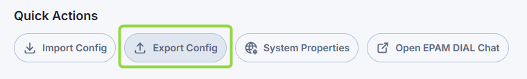

### Export deployments

Export selected model servings, MCP containers, interceptor containers, adapter containers,
application containers, and images.

1. Click **Export Config** and, if shown, select **Deployments** under **Components**.
2. Select a deployment type, click its **Add** button, and select the resources to export. Repeat for
   other deployment types. To remove a resource from the selection, use its actions menu.
3. Click **Export** to open the **Export File Preview** window.
   - Enable **Include secrets** to include secret values, such as keys and passwords.
   - Enable **Include global firewall** to include the
     [global domain whitelist](./3.deployments/3.images.md#global-firewall).
4. Click **Prepare file** to download a `.zip` archive.

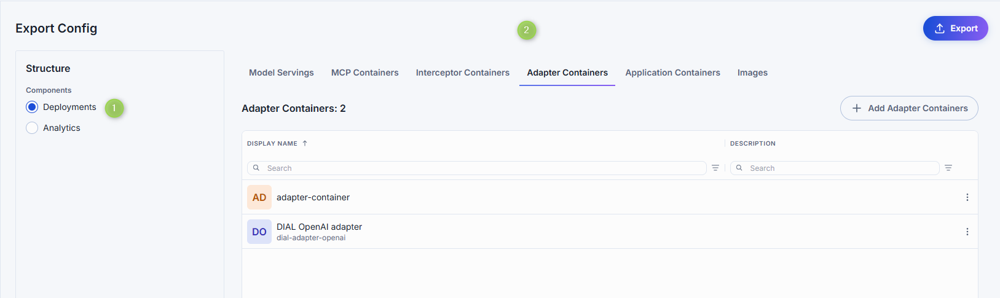

### Export analytics

Export Analytics table definitions, schemas, and pipelines as a JSON bundle. The bundle does not
contain table data or access grants. Required table and pipeline dependencies are included automatically.
System tables are listed by name and must already exist in the target environment.

1. Click **Export Config** and, if shown, select **Analytics** under **Components**.
2. Select **Full config** to export all exportable resources, or **Custom** to select resources.
   For a custom export, open **Tables** or **Pipelines**, click its **Add** button, and select
   resources. Use a resource's actions menu to remove it from the selection.
3. Click **Export** and review the preview:
   - **Objects**: selected objects and their included dependencies, with reasons for inclusion.
   - **Required system tables**: system tables that must exist in the target environment.
   - **Skipped**: objects excluded from the export and the reasons.
4. Click **Export** to download the JSON bundle. The export button becomes available after the
   service accepts the preview.

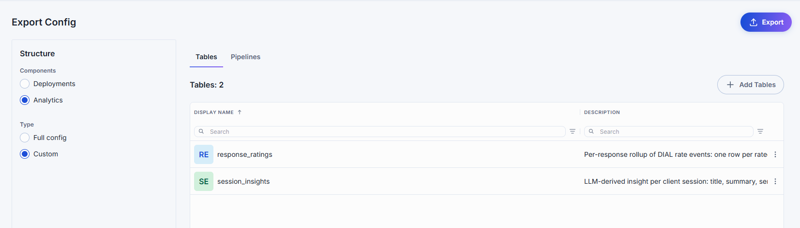

## Import configuration

Use **Import Config** to restore or migrate deployment or Analytics configuration. If more than one
scope is enabled, choose it under **Components**. Otherwise, the available scope opens directly.

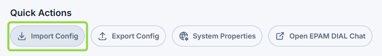

:::note
Import and export require full administrator access and at least one enabled supporting service.
:::

### Import deployments

1. Click **Import Config** and, if shown, select **Deployments** under **Components**.
2. Choose a **Conflict resolution** strategy:
   - **Override** replaces matching resources with the imported versions.
   - **Skip** retains matching resources in the target environment.
3. Add one deployment `.zip` archive and click **Next**.
4. Review the resources and their validation state in **Configuration**. Validation errors block the
   import. If the archive includes global firewall settings, errors are grouped by domain.

   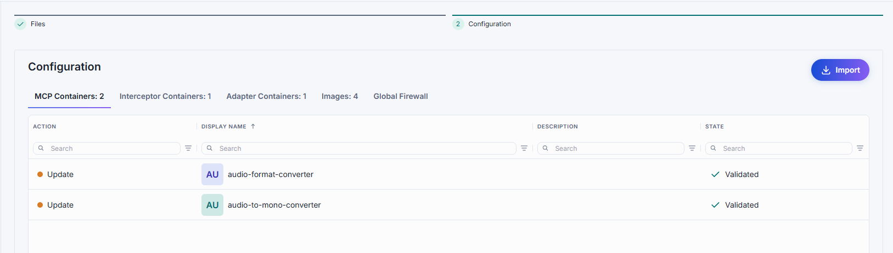

5. For an archive containing a global firewall, open **Global Firewall** and click **Compare changes**
   to compare the imported and current domain lists.

   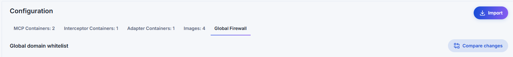

6. Click **Import**.

### Import analytics

1. Click **Import Config** and, if shown, select **Analytics** under **Components**.
2. Choose a **Conflict resolution** strategy:
   - **Fail if exists** blocks the import when a bundled user table or pipeline already exists.
   - **Skip if exists** retains existing user tables and pipelines instead of replacing them. Other
     validation errors can still block the import.
3. Add one Analytics `.json` bundle and click **Next**.

   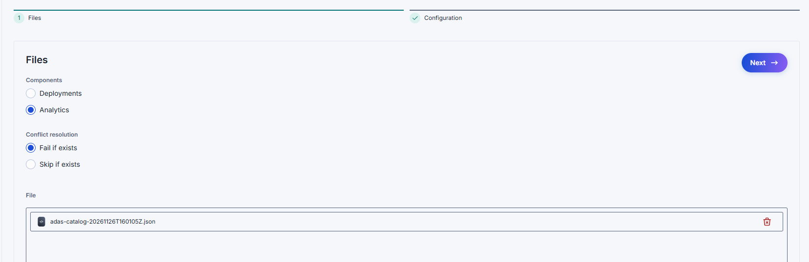

4. Review **Tables**, **Pipelines**, and **Required system tables** in the preview. Review validation
   errors, conflicts, and values copied from the source environment. Where an existing object is
   available, use **Compare changes** in its actions menu.
5. Resolve errors before importing. If pipeline names were previously used in the target environment,
   confirm whether to import them.
6. Click **Import** and check the result:
   - On success, imported pipelines are disabled and imported tables have no access grants. Enable
     the pipelines and configure access in the target environment.
   - If an import fails, the result can report a rollback or that some created objects could not be
     removed.

## Set global properties {#system-properties}

Click **System Properties** in **Quick Actions** on the home page, or the **Globe** icon in the
footer. The screen contains Global Interceptors, Rate Limit Schedule, and Spending Limits.

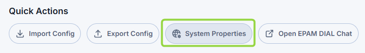

**Save** and **Discard** appear after you change a setting. **Discard** opens a confirmation before
removing unsaved changes. **Save** is disabled while a schedule or spending-limits field is invalid,
even if the invalid field is on another tab.

:::warning
Before saving System Properties for the first time, check whether global settings are defined in
DIAL Core's configuration files. If no API-managed global settings exist, this screen does not load
those file-defined values. Saving creates an API-managed record that takes precedence over all four
file-defined global settings: interceptors, retriable error codes, the rate limit schedule, and
spending limits. Omitted values use defaults, which can change the behavior of the deployment.

Ask the platform team to check `GET /v1/settings/platform/global`. A `404` means no API-managed record
exists. The file-defined values are available through `GET /v1/admin/config/file/settings/global`.
Before saving, coordinate with the platform team to preserve the required values through the
Configuration API, including retriable error codes, which this screen cannot edit. See
[Global settings](../7.services/1.core/1.configuration/14.global-settings.md#where-global-settings-are-defined).
:::

### Global interceptors

Global interceptors apply to every application and model deployment in DIAL. They process requests
before local interceptors and responses after local interceptors.

1. Select **Global Interceptors** and click **+ Add**.
2. Select existing [interceptors](./6.governance/4.interceptors.md) and click **Apply**.
3. Drag interceptors to set their order, or remove an interceptor from its actions menu. Requests run
   through the list in ascending order; responses run in reverse order.
4. Click **Save** to apply the changes, or **Discard** to cancel them.

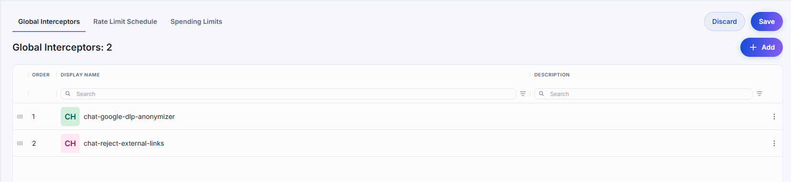

Global interceptors are also listed in the interceptor configuration of each application or model.

### Rate limit schedule

The schedule sets calendar boundaries for role-based daily, weekly, and monthly limits.

1. Select **Rate Limit Schedule**.
2. Select a **Timezone**; the list is searchable. Select the **Week start day** and enter a
   **Reset time**, or use the time picker. The defaults are UTC, Monday, and `00:00`. The reset time
   uses 24-hour `HH:mm` format.
3. Click **Save** to apply the changes, or **Discard** and confirm to cancel them.

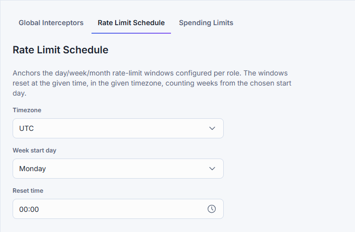

### Spending limits

Spending limits determine whether Core uses role cost limits or budgets for model calls by users
signed in through an identity provider. API-key callers continue to use role cost limits.

1. Select **Spending Limits** and choose a **Mode**:
   - **Off**: use role cost limits.
   - **Shadow**: check and charge budgets without rejecting calls on budget grounds; role cost limits
     still apply.
   - **Enforce**: use budgets instead of role cost limits for identity-based model calls. A call is
     rejected if no budget can pay for it.
2. Set the **Default cost object** used when a call does not specify a project. The default is `ORG`.
3. Click **Save** to apply the changes, or **Discard** to cancel them.

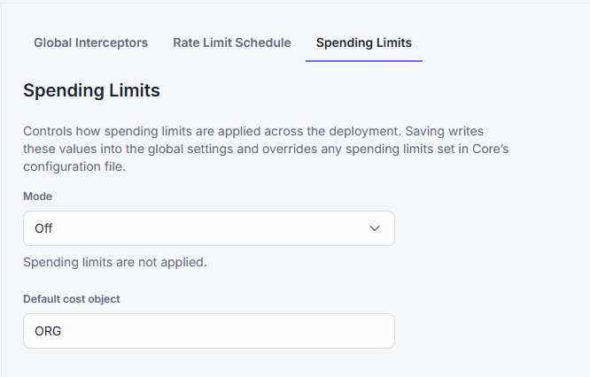

See [Spending limits](../7.services/1.core/1.configuration/14.global-settings.md#spending-limits) for
mode behavior and configuration details.

## Change user settings

Click your avatar in the top-right corner to open the profile menu. When themes are available, select
**Settings**, choose a theme, and click **Save**. When authentication is enabled, the menu also offers
sign-in or sign-out.

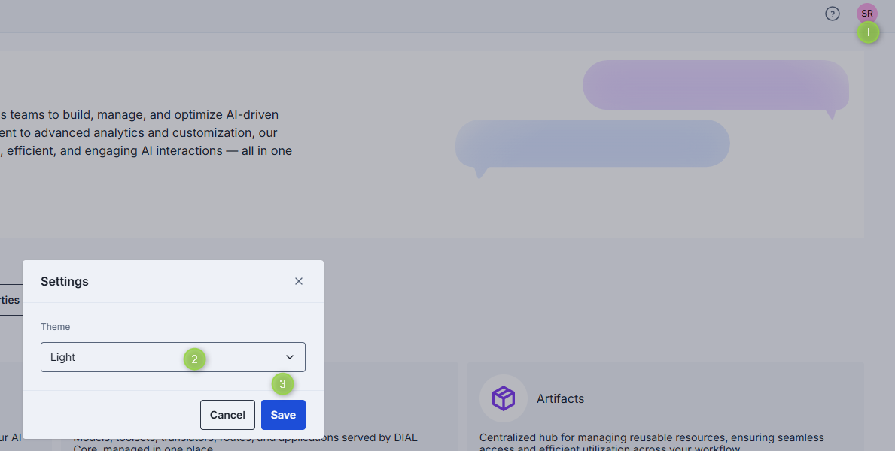

## Further reading

- [Global settings](../7.services/1.core/1.configuration/14.global-settings.md) — Core configuration, precedence, schedules, and spending limits
- [Manage interceptors](./6.governance/4.interceptors.md) — register interceptors and attach them in DIAL Admin
- [Configuration API](../7.services/1.core/1.configuration/1.configuration-api.md) — manage Core configuration entities while Core runs
- [Admin Frontend configuration](../7.services/9.admin/2.configuration/1.frontend.md) — environment variables of the Admin Frontend server
- [Manage deployment images](./3.deployments/3.images.md) — add and configure the images that containers are built from
