# Manage containers

Use **Containers** in DIAL Admin to deploy and configure MCP servers, model adapters, applications, and interceptors. After starting a container, create the corresponding DIAL configuration to make the service usable through DIAL. This page assumes your platform team has configured [DIAL Deployment Manager](../../7.services/11.deployment-manager/0.index.md).

For deployment locations and prerequisites, see [Deployments overview](./0.index.md). Hugging Face models use the separate [Model Servings](./2.model-servings.md) screen.

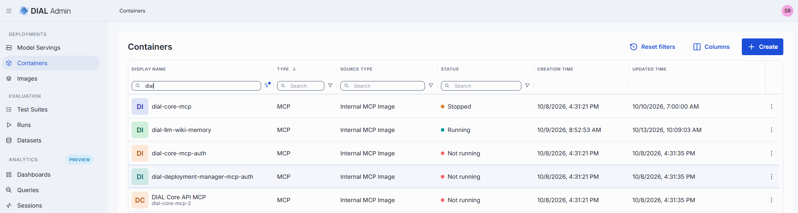

## Use a container in DIAL

Creating a container does not start it or register it in DIAL. The usual workflow is:

1. [Create the container](#create-a-container).
2. Configure its properties, save changes, and click **Run**. Wait for **Running**.
3. Create a model, application, interceptor, or Toolset using the action appropriate to the container.
4. Configure access and any additional settings on the new DIAL configuration.

| Container | Create action | Result | Pre-populated connection |
|-----------|---------------|--------|--------------------------|
| [Adapter](#adapter-containers) | **Create Model** | A model backed by the adapter. | Container base URL and an OpenAI Chat Completions interface. |
| [Application](#application-containers) | **Create Application** | An application in a public or available platform destination. | Container base URL and an OpenAI Chat Completions interface. |
| [Interceptor](#interceptor-containers) | **Create Interceptor** | An interceptor in the platform destination. | Container base URL and an OpenAI Chat Completions interface. |
| [MCP](#mcp-containers) | **Create Toolset** | A Toolset in a public or available platform destination. | Container endpoint and transport. |

:::note
The actions above create configurations directly in DIAL Core. When the optional legacy Admin Backend is connected, the header can show a **Create** dropdown with additional legacy options. Legacy adapter creation produces an adapter configuration, not a model. See [Where an entity can be defined](../1.ai-gateway/0.index.md#where-an-entity-can-be-defined).
:::

## Container lifecycle and shared settings

Creation steps on this page apply to adapter, application, interceptor, and MCP containers. Model servings use their own [creation flow](./2.model-servings.md#create-a-model-serving-container).

Containers and model servings share **Properties**, **Firewall settings**, **Metrics**, **Execution log**, and **Events**. MCP containers also have **Tools Overview**, **Resources**, and **Prompts**. Model-serving-specific differences are described on the [Model Servings](./2.model-servings.md) page.

### Container grid columns

Click **Columns** to choose which columns the grid displays. Container URL and resource columns are hidden by default.

| Column | Description |
|--------|-------------|
| Display Name | Name of the container. |
| Description | Description of the service or its deployment. |
| Status | Current deployment state, such as Running or Stopped. |
| Type | Adapter, Application, Interceptor, or MCP. |
| Source type | Internal image or Docker image reference. |
| Source Name | Name or reference of the container's source image. |
| Container URL | Endpoint of the running container. |
| Author | Email address of the creator. |
| Creation Time | When the container was created. |
| Updated Time | When its configuration was last updated. |
| Topics | Labels used to organize containers. |
| CPU request / CPU limit | Requested and maximum CPU resources. |
| Memory request / Memory limit | Requested and maximum memory resources. |
| Actions | Open in a new tab, Duplicate, Run/Stop, and Delete. Read-only administrators have Open in a new tab only. |

Use **Duplicate** in a row's action menu to create another container with a new ID and display name. Open the copy to review its settings before running it.

### Create a container

1. Click **Create** and choose **Adapter**, **Application**, **Interceptor**, or **MCP**.
2. Choose a source option and click **Next**:

   | Source | Description |
   |--------|-------------|
   | **From Internal \<Type\> Image** | Uses an installed version of a [deployment image](./3.images.md) of the matching type. |
   | **From Docker Image Reference** | Uses an external Docker image. |
   | **From MCP Registry** | Available for MCP containers when registry integration is enabled. Uses a server's OCI image package supporting HTTP or SSE. See [Create an MCP container](#create-an-mcp-container). |

3. Provide the source details in the dialog that opens. For an internal image, select the image and installed version, then continue to its properties step. For a Docker image, enter its reference; for MCP Registry, select the server.
4. Enter the required **ID** and **Display Name**, and optionally a **Description**.
5. Click **Finish** or **Create**, depending on the selected source flow.

The configuration screen opens. Review its settings before clicking **Run**. An internal image must have an installed version before its container can run.

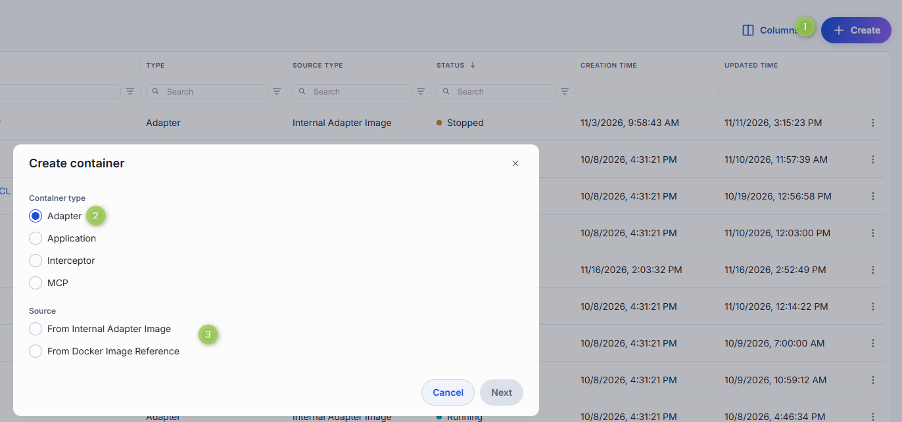

### Container actions

| Action | Purpose |
|--------|---------|
| **Create Model / Application / Interceptor / Toolset** | Creates the corresponding DIAL configuration from a running container. See the per-type instructions below. |
| **Run** | Starts the container. Unavailable when its internal image is not installed. |
| **Stop** | Stops a running, starting, or failed deployment. |
| **Save** | Saves configuration changes. |
| **Save & redeploy** | Appears when changes to a running container's runtime configuration require redeployment. |
| **Discard** | Restores the last saved configuration without applying edits. |
| **Delete** | Removes the container. Configurations that depend on its endpoint can no longer use that service. |
| **JSON Editor** | Switches to editing the container configuration as JSON. Available unless disabled by the deployment configuration. |

When changes are unsaved, the header shows save/discard controls instead of the run and create actions. Source, port, environment-variable, compute, command, argument, scaling, and node-pool changes can require redeployment of a running container. Metadata edits such as Display Name or Description do not require it.

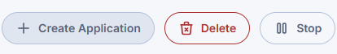

:::note
Configuration controls are disabled for read-only administrators and while a container is pending or stopping. Some source-specific fields have additional restrictions, described below.
:::

### Get the container URL

The URL identifies the service exposed by the container. Use it when configuring a service endpoint manually; you do not need to copy it for the create actions above.

When the container is **Running**, its URL appears beside the status on the Properties screen. Click the copy icon to copy it. The URL is not shown for a container that is not running.

The grid's **Container URL** column is hidden by default; enable it with **Columns**.

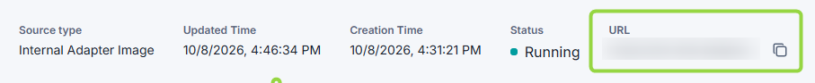

### Create an entity from a running container

The create action fills in the container's ID, display name, and connection settings. Follow the steps for [creating a model](#create-a-model-from-a-running-adapter-container), [application](#create-an-application-from-a-running-container), [interceptor](#create-an-interceptor-from-a-running-container), or [Toolset](#create-a-toolset), then review the new configuration's access settings.

### Properties

The Properties screen separates read-only deployment information from editable configuration sections. The container ID appears in the header.

| Read-only information | Meaning |
|-----------------------|---------|
| ID | Unique identifier entered at creation. Required, 2–36 characters, using lowercase letters, digits, and hyphens. |
| Source type | Source chosen at creation. Model-serving sources are assigned by their creation flow. |
| Creation Time / Updated Time | Creation and last-update timestamps. |
| Status | Current deployment state. |
| URL | Service endpoint, shown while running. |
| Restarts | Sum of pod restart counts, shown when nonzero. Use the Execution log for per-pod details. |

| Editable setting | Purpose |
|------------------|---------|
| Display Name | Required display name, 2–255 characters. |
| Description | Optional description of the service or its deployment. |
| Maintainer | Contact for the person or team responsible for the container. |
| Topics | Labels for organization, such as `finance` or `support`. Custom labels have a maximum of 255 characters and no leading or trailing spaces. |
| Source image | The matching internal image, external Docker reference, or MCP Registry server. Only the field for the active source is shown. |
| Endpoint Configuration | Port on which the service listens. |
| Autoscaling | Replica range, scale-to-zero delay, and scale-up threshold. |
| Environment Variables | Service settings supplied as values or files, with ordinary or secure mount modes. |
| Compute | CPU and memory resources, and the node pool. GPU requests are available for model servings. |
| Configuration | Command and arguments used to start the container. |
| Startup probe | Optional checks that verify whether the service has started successfully. |

The sections below explain how to configure these settings.

### Change the source image

For an internal image, open the **Adapter Image**, **Application Image**, **Interceptor Image**, or **MCP Image** picker. Select an image and installed version, then click **Apply**. Applying an image change updates the container directly; a running container is restarted.

For an external Docker image, edit **Docker Image Reference** and save the change. Source type is not changed by editing the reference.

For a container created from MCP Registry, use **MCP server name** to select its registry entry. This field is disabled while the container is running. Registry source details are described under [MCP containers](#mcp-containers).

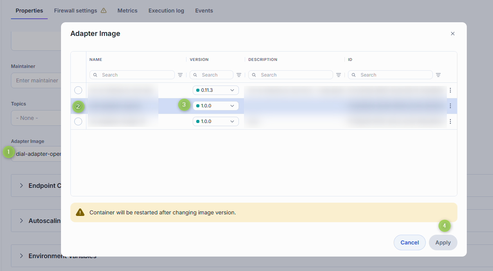

### Endpoint configuration

Set the port on which the service listens.

| Field | Purpose and input |
|-------|-------------------|
| Port | Container's listening port. Optional; when provided, an integer from 1 to 65535. |

Save changes before using the updated connection. A running container's port changes require redeployment.

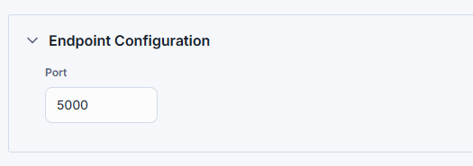

### Autoscaling

Configure how many replicas may run and whether idle replicas can scale down to zero.

| Field | Purpose |
|-------|---------|
| Automatic scale-to-zero | Choose never, or after 5 minutes, 15 minutes, 30 minutes, or 1 hour without activity. |
| Min replicas | Minimum replica count. Enabling scale-to-zero sets it to 0 and disables this input. Choosing never sets it to 1 initially; you can then increase it. |
| Max replicas | Maximum replica count. Must be at least 1 and not less than Min replicas. |
| Pending requests to trigger autoscaling | Scale-up threshold. Shown when Max replicas exceeds Min replicas and is greater than 1. Its default when a strategy is initialized is 2. |

New adapter, application, interceptor, and MCP containers default to a five-minute scale-to-zero delay and a replica range of 0 to 1. Model servings have [different defaults](./2.model-servings.md#model-serving-properties).

:::note
Changing defaults after an upgrade does not replace existing containers' scaling configuration.
:::

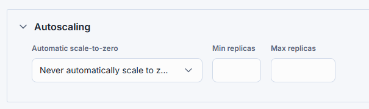

### Environment variables

Use environment variables for service-specific settings and credentials. Click **Add variable** to add a row, then choose its value and mount mode.

| Field | Purpose |
|-------|---------|
| Variable Name | Required unique name, 1–253 characters. Letters, digits, `.`, `-`, and `_` are allowed. |
| Description | Optional explanation of the variable's purpose. |
| Value | Enter text or use the upload control to supply a file. The variable-name character restrictions do not apply to text values. |
| Mount type | **Content**, **Secure content**, or **Secure file**. New rows default to Content. |

- **Content** supplies the value directly as an environment variable for ordinary configuration.
- **Secure content** supplies the value as an environment variable backed by a Kubernetes Secret. Use it for credentials the application reads directly, such as an API key. Text is masked in the editor.
- **Secure file** mounts the sensitive value as a read-only file backed by a Kubernetes Secret. The environment variable contains the file's path, not its contents. Use it when the application expects a file path, such as a certificate or credential file. Text values are masked in the editor.

Uploading a file replaces the text value but does not change its mount type. Choose the mount mode appropriate to the application. Click an uploaded filename to download it; clear the file to return to a text value. Uploaded filenames, when nonempty, follow the same length and character restrictions as variable names.

Remove a row with its remove action. On desktop, use the drag handle to reorder rows; on tablet, expand a row to edit its details. Save the configuration when finished.

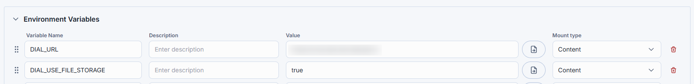

### Compute

Use **Compute** to choose workload placement and configure CPU and memory resources.

#### Node pool selection

A node pool represents placement rules configured by the platform team, for example a CPU or GPU pool. The current selection shows its name, ID, and description when available.

1. Click **Select node pool**, or **Change** for an existing selection.
2. Search by pool name, ID, or description and select a pool. Choose **Any node pool** to let the platform select placement automatically.
3. Click **Apply**, then save the container configuration. A running container's node-pool change requires redeployment.

Selection is unavailable when no pools are configured. If the UI reports an unknown pool, select another pool to correct the configuration.

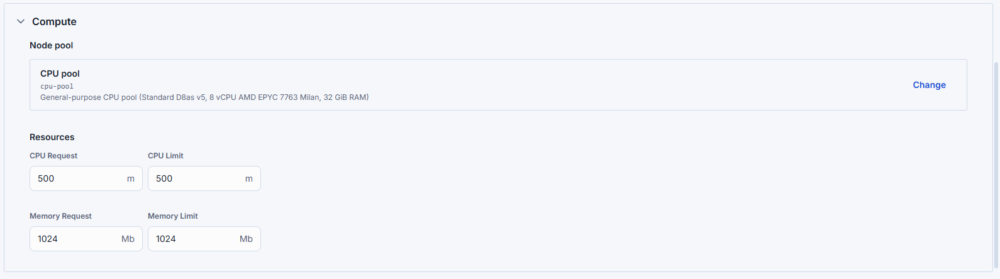

Platform engineers define pools and creation-time defaults in [Deployment Manager node-pool settings](../../7.services/11.deployment-manager/1.configuration/1.backend.md#node-pools). Changing those defaults does not move existing containers to another pool.

#### Resources

Configure CPU and memory resources according to the service's requirements.

| Field | Purpose and unit |
|-------|------------------|
| CPU Request | CPU reserved for scheduling, in millicores (`m`). For example, `500` is half a CPU core. |
| CPU Limit | Maximum CPU allowance, in millicores. |
| Memory Request | Memory reserved for scheduling, in mebibytes (MiB), displayed as `Mb` in the UI. For example, `1024` is 1 GiB. |
| Memory Limit | Maximum memory allowance, using the same unit as Memory Request. |

CPU inputs must be at least 1 millicore; memory inputs must be greater than zero. A supplied limit must not be less than its request. The backend also enforces configured resource ceilings; see [Model integrations and resource limits](../../7.services/11.deployment-manager/1.configuration/1.backend.md#model-integrations-and-resource-limits).

GPU requests are a [model-serving](./2.model-servings.md) setting, not a field on ordinary container forms.

### Configuration

| Field | Purpose |
|-------|---------|
| Command | Executable command used to launch the container, for example `/path/to/executable`. |
| Arguments | Arguments supplied to the startup process, for example `--option value`. |

Review the image's startup requirements before changing these fields. Save changes; changes to a running container require redeployment.

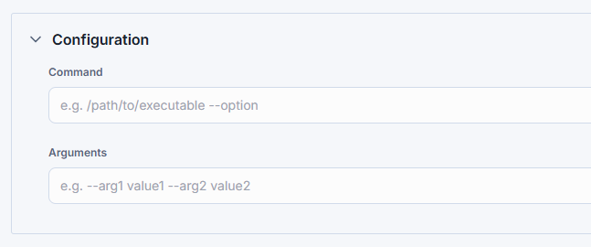

### Startup probe

Turn on **Enable startup probe** to configure a custom startup check using TCP or HTTP. A startup probe verifies that the application has started; it is not a readiness check that runs throughout the service's lifetime.

Under **Endpoint**, choose the probe type and enter its connection settings:

| Field | Purpose |
|-------|---------|
| Type | **TCP** checks a connection; **HTTP GET** checks an HTTP endpoint. Newly enabled probes default to TCP. |
| Port | Required port checked inside the container, an integer from 1 to 65535. Enter the port used by the startup check. |
| Path | Required for HTTP GET. Enter the service's startup-check endpoint, for example `/health`. |

Expand **Advanced timing** to adjust the optional timing fields. These values are initialized when enabling a probe without an existing configuration:

| Field | Purpose | Initial value | UI range |
|-------|---------|---------------|----------|
| Initial delay seconds | Time after container start before the first check. | 1 | 1–6000 |
| Period seconds | Time between checks. | 10 | 1–600 |
| Timeout seconds | Time allowed for a check before it times out. | 1 | 1–12000 |
| Failure threshold | Failed checks before startup is marked failed. | 3 | 1–100 |

Save the configuration when finished. Turning the switch off hides the custom settings and stops overriding the deployment template. Any startup probe configured in that template still applies.

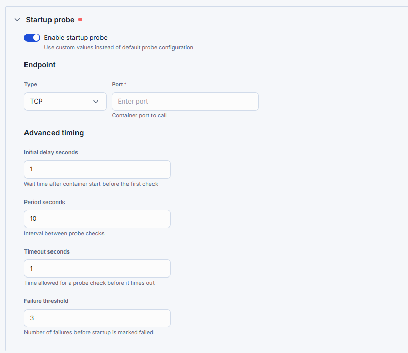

### Firewall settings

The firewall controls which external domains a running container can contact. Under **Domain access policy**, select:

- **All domains** to allow any domain. DIAL Admin shows a security warning.
- **Specific domains (recommended)** to restrict access. Click **Add domain** to add allowed domains and remove entries you no longer need.

Container rules are separate from [image-build firewall rules](./3.images.md#firewall-settings). Enforcement requires the deployment's [network policy](../../7.services/11.deployment-manager/1.configuration/1.backend.md#network-policy) to be configured.

Enter a domain without a protocol prefix, for example `github.com`. Domain names must be 4–253 characters and contain at least one dot. Labels allow letters, digits, and hyphens; each is 1–63 characters and cannot start or end with a hyphen. The top-level domain must contain at least two letters.

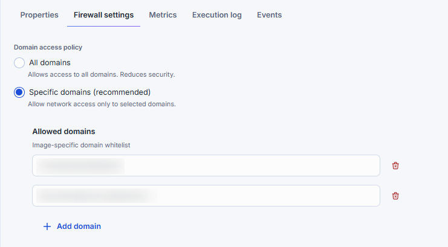

### Execution log

The **Execution log** streams logs from the selected pod. Use it to inspect startup output and service errors. If there are multiple pods, select one from the collapsible **Pods** sidebar; its entry also shows a nonzero restart count.

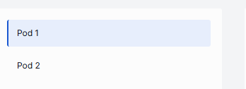

When available, the selected pod shows these diagnostic details:

| Indicator | Meaning |
|-----------|---------|
| Restarts | Pod restart count; repeated restarts can indicate a crash loop. |
| Last restarted at | Timestamp of the last recorded termination. |
| Last reason | Recorded termination reason. |
| Termination message | Details from the last termination, for example an out-of-memory or application error. Hover over the message to read the full text. |

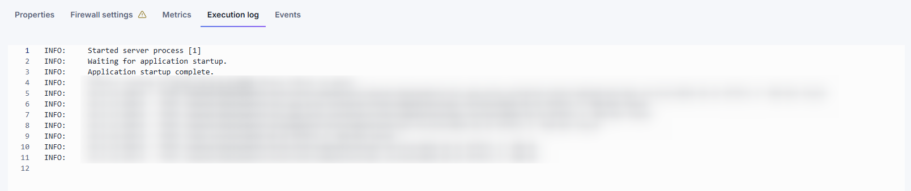

### Events

The **Events** tab shows Kubernetes diagnostic events for the deployment, rather than a history of every Admin configuration edit. Warning events mark the tab with an error indicator. New events are added while the screen is open.

| Column | Meaning |
|--------|---------|
| Type | Normal or Warning event. |
| Message | Kubernetes event details. |
| Time | Event timestamp. |
| Pod | Name of the affected pod when the event concerns a pod. Hidden by default; enable it with Columns. |

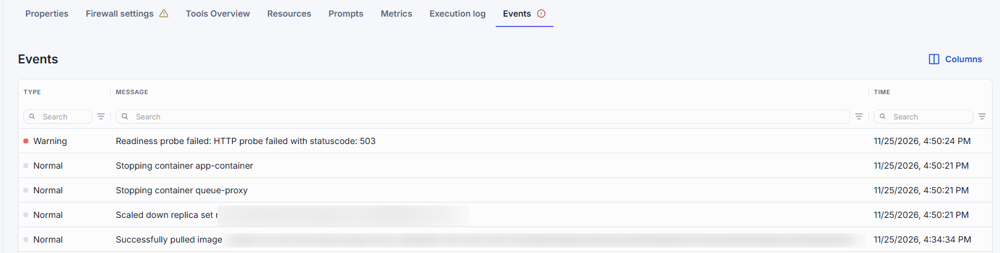

### Metrics

The **Metrics** tab displays a snapshot of replica readiness and resource usage for a running container. It is disabled when the container is not Running.

| Section / metric | What it measures | How to read it |
|------------------|------------------|----------------|
| Scale & Health → Ready replicas | Ready replicas relative to the total replica count. | `1/2` means one of two replicas is ready. Use this to check whether all replicas have become ready. |
| Compute → CPU | Current CPU usage in millicores (`m`), summed across the returned pod readings. | `500m` equals half a CPU core. This is measured usage, not the configured CPU request or limit. |
| Compute → Memory | Current memory consumption, summed across the returned pod readings and displayed in byte units appropriate to the value. | Use it to monitor memory consumption. With multiple pods, this is aggregate usage; memory requests and limits are configured per replica. |

Click **Refresh** to request a new snapshot. **No Data** means no value was returned for that metric; it does not mean usage is zero. CPU and memory readings require metrics-server, configured by the platform team in [Workload metrics](../../7.services/11.deployment-manager/1.configuration/1.backend.md#workload-metrics). Additional inference metrics are described under [Model serving metrics](./2.model-servings.md#model-serving-metrics).

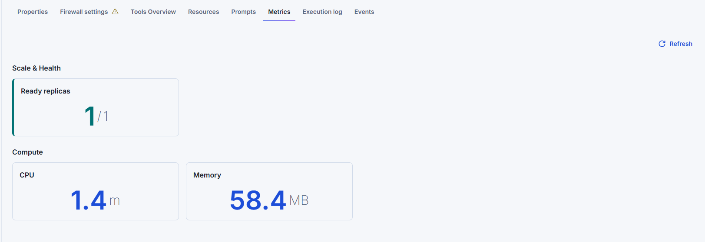

## Adapter containers

An adapter container runs a service that connects DIAL to a model-provider API. Create a model backed by that service; deploying an adapter does not deploy the provider's model locally. See [What are adapters](../../4.building-with-dial/4.adapters/0.index.md).

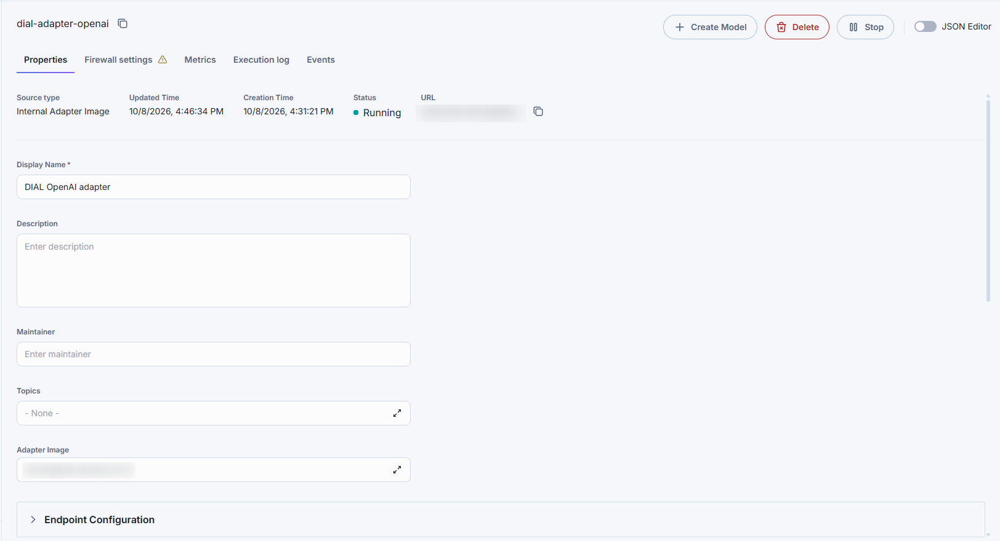

### Create an adapter container

Follow [Create a container](#create-a-container), choosing Adapter and an internal adapter image or Docker image reference.

### Create a model from a running adapter container

1. Configure and run the adapter container.
2. Click **Create Model**.
3. Review the required **ID** and **Display Name**, and optionally set **Display Version** and **Description**.
4. Click **Create**. Then configure model access, upstreams, and any provider-specific connection settings in [Models](../1.ai-gateway/1.models.md).

The generated model uses the container's base URL and an OpenAI Chat Completions interface. If the service requires a path prefix, such as DIAL Model Provider's `/compat/<adapter>`, adjust the model connection accordingly. See [DIAL Model Provider migration](../../7.services/4.model-provider/2.migration.md).

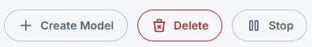

### Adapter-specific properties

The source field is **Adapter Image** for an internal image or **Docker Image Reference** for an external image. Only the active source field is shown. Use [Change the source image](#change-the-source-image) to update it; other settings use the shared sections above.

## Application containers

Application containers run custom application logic. After starting the container, create an application in a public or available platform destination so it can be used through DIAL.

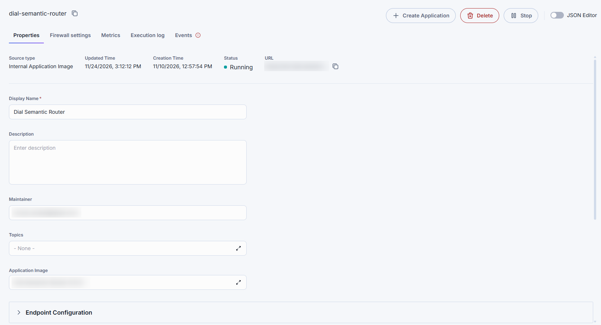

### Create an application container

Follow [Create a container](#create-a-container), choosing Application and an internal application image or Docker image reference.

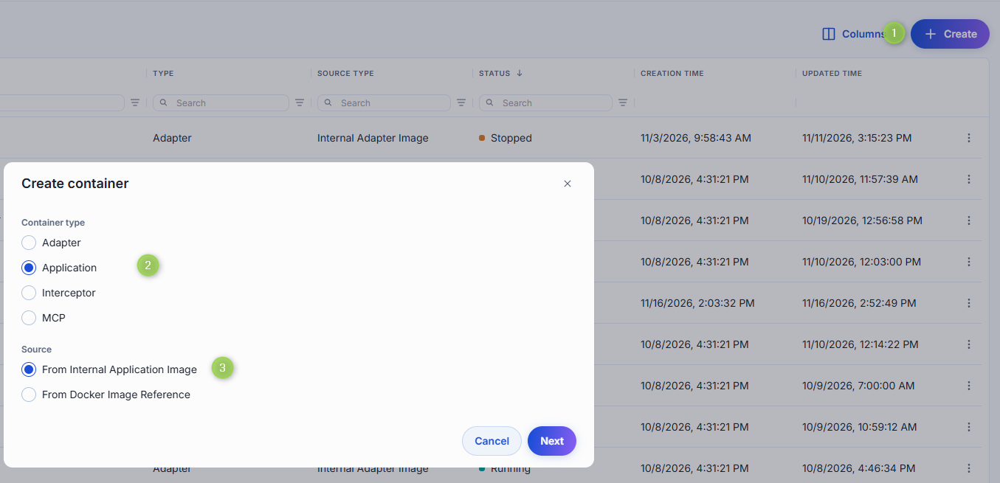

### Create an application from a running container

1. Configure and run the container, then click **Create Application**.
2. Choose a destination under **public** or, when available, **platform**.
3. Review the required **ID** and **Display Name**, and optionally enter a **Description**. Public applications also require a **Version**; platform applications are unversioned.
4. Click **Create**, then review access and application settings in [Applications](../1.ai-gateway/2.applications.md).

The container base URL and an OpenAI Chat Completions interface are filled in automatically.

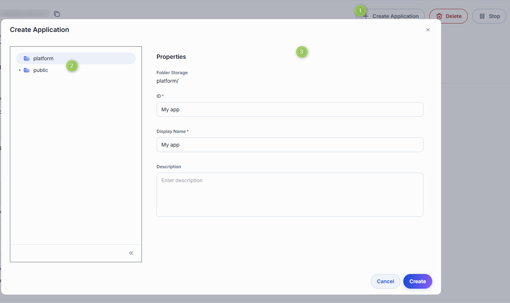

### Application-specific properties

The source field is **Application Image** or **Docker Image Reference**, according to how the container was created. Use [Change the source image](#change-the-source-image) to update it. Scaling defaults and all other configuration sections are shared with ordinary containers.

## Interceptor containers

Interceptor containers run middleware that processes requests or responses, for example guardrails or sensitive-data filtering. Creating an interceptor configuration does not assign it to a model or application automatically.

You can also register an externally deployed interceptor directly; see [Manage interceptors](../6.governance/4.interceptors.md).

:::tip
Use the [Interceptors SDK](https://github.com/epam/ai-dial-interceptors-sdk) to implement custom interceptors.
:::

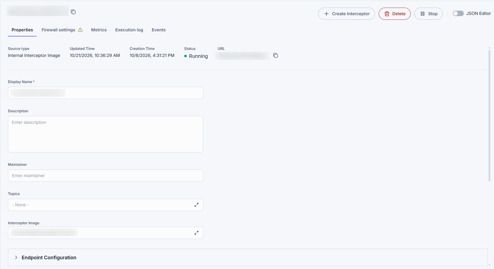

### Create an interceptor container

Follow [Create a container](#create-a-container), choosing Interceptor and an internal interceptor image or Docker image reference.

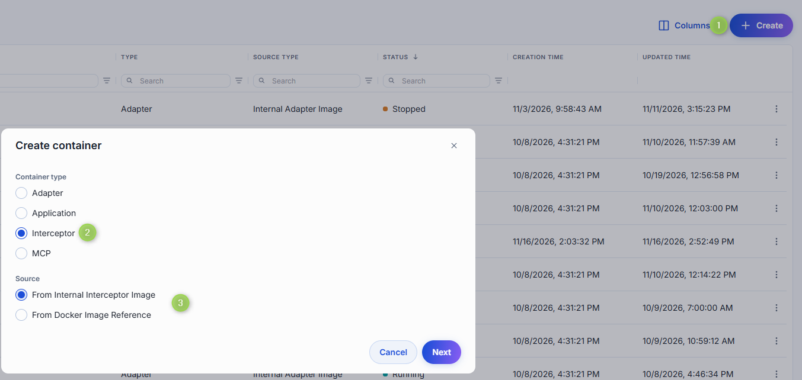

### Create an interceptor from a running container

1. Configure and run the container, then click **Create Interceptor**.
2. Review the required **ID** and **Display Name**, and optionally enter a **Description**.
3. Click **Create**. The interceptor is configured with the container base URL and an OpenAI Chat Completions interface.
4. Assign the interceptor using [Manage interceptors](../6.governance/4.interceptors.md), or configure it as a [global interceptor](../1.config-backup-and-global-settings.md).

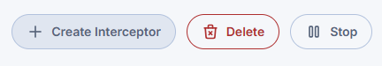

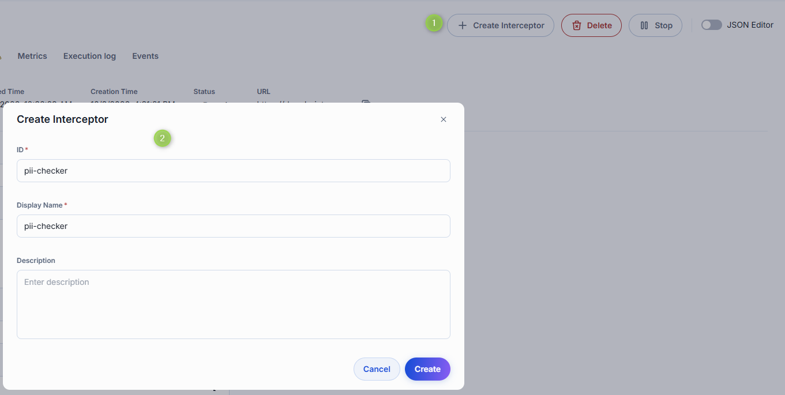

### Interceptor-specific properties

The active source field is **Interceptor Image** or **Docker Image Reference**. Use [Change the source image](#change-the-source-image) to update it. The remaining settings use the shared sections above.

## MCP containers

MCP containers run servers that expose tools, resources, and prompts. Create a Toolset from a running container to make its tools available through DIAL.

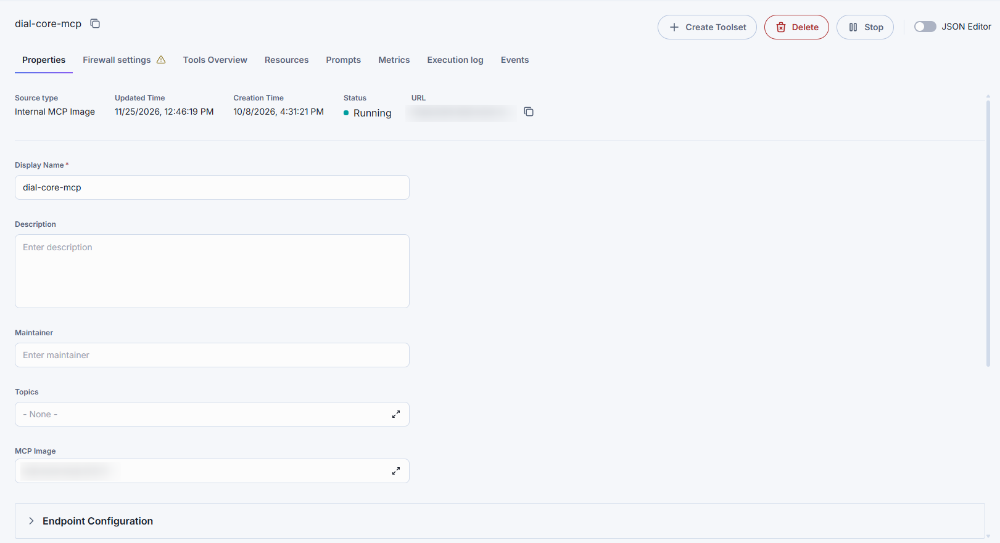

### Create an MCP container

Follow [Create a container](#create-a-container), choosing MCP. The source options are:

- **Internal MCP Image:** Select an installed version of an MCP deployment image.
- **Docker Image Reference:** Enter the external image reference.
- **MCP Registry:** Available when registry integration is enabled. Start typing a server name or click **Select from registry** to browse entries. Selection supplies the OCI image reference and transport.

:::warning
Direct container creation from MCP Registry requires an OCI package supporting remote HTTP (`streamable-http`) or SSE transport. For other source/build options, see [Add an image from MCP Registry](./3.images.md#add-an-image-from-mcp-registry).
:::

Enter the required ID and Display Name, optionally add a Description, and complete creation. Configure the [MCP endpoint](#mcp-endpoint-configuration) to match the server before running the container.

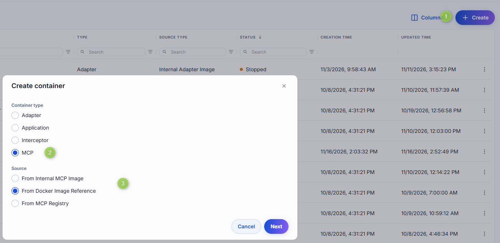

### Create a Toolset from a running MCP container {#create-a-toolset}

**Create Toolset** is available for a running container. Toolsets created this way can be used by applications, including Quick Apps workflows.

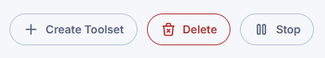

1. On the running MCP container's screen, click **Create Toolset**.
2. Select a public or available platform destination. For a public Toolset, choose the target folder.
3. Review **ID**, **Display Name**, **External Endpoint**, and optional **Description**. Public Toolsets also require a Version; platform Toolsets are unversioned.
4. Click **Create**, then review the Toolset's [connection and access settings](../1.ai-gateway/3.toolsets.md).

The endpoint and transport are filled in automatically from the container, so you do not need to copy the URL.

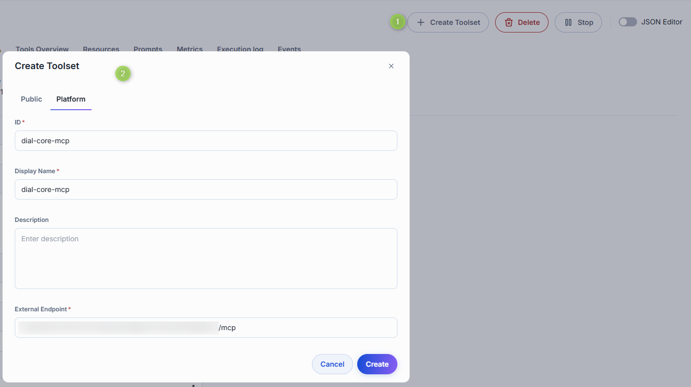

### MCP-specific properties

The active source field is **MCP Image**, **Docker Image Reference**, or **MCP server name** for a registry-selected server. Registry server names can be searched or selected with **Select from registry**, but cannot be changed while the container is running.

Other settings use the shared sections above.

#### MCP Endpoint Configuration {#mcp-endpoint-configuration}

In **Endpoint Configuration**, set the [Port](#endpoint-configuration) on which the MCP server listens and configure its protocol and endpoint path:

| Field | Purpose and input |
|-------|-------------------|
| Transport | Required **HTTP** or **SSE**; HTTP is the default and SSE is deprecated. Choose the protocol the server supports. |
| Container endpoint path | Path of the MCP endpoint, for example `/mcp`. Set it to match the server. |

Save changes before using the updated connection.

### Tools overview

The **Tools Overview** tab is available while the container is running. It lists tools discovered from the MCP server; it does not configure which tools an individual Toolset allows.

Use search to find tools by name, description, input-schema properties, or annotations. Expand a tool to inspect its description, **Input Schema**, **Output Schema**, and **Annotations**, when supplied by the server. Switch between table and read-only JSON views.

For tool-access configuration, use [Toolsets: Tools Overview](../1.ai-gateway/3.toolsets.md#tools-overview-tab).

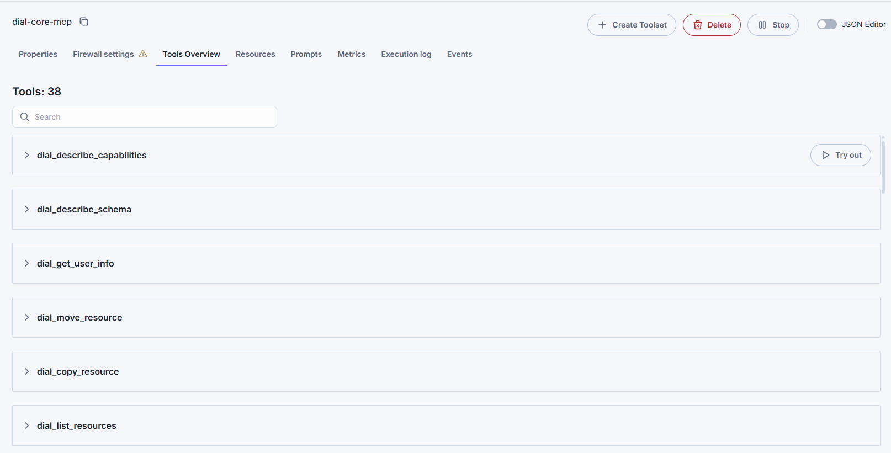

### Try a tool

Use **Try out** to test an MCP tool. It sends a real request to the server; review the tool's purpose and inputs before invoking it.

1. Expand a tool or hover over its header, then click **Try out**.
2. Fill the **Request body** in the table or JSON view.
3. Click **Send Request** and inspect the **Response body**.

Read-only administrators cannot use the try-out action.

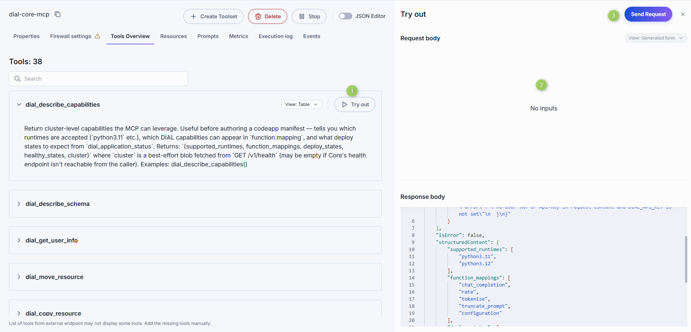

### Resources

The **Resources** tab is available while running. It lists resources exposed by the MCP server, not Kubernetes compute resources.

| Column | Meaning |
|--------|---------|
| Name | Resource name reported by the server. |
| Description | Description of the resource. |
| URI | MCP identifier used to address the resource. |
| MIME Type | Content type reported by the server. |

The list is for inspection; resources are defined by the MCP server.

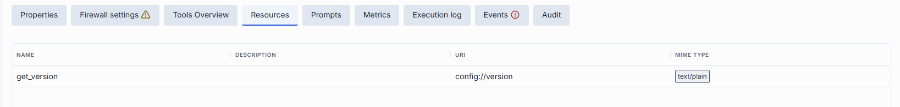

### Prompts

The **Prompts** tab is available while running. It lists prompt templates defined by the MCP server. Expand a prompt to read its description and arguments, including each argument's Name, Description, and Required indicator. These are server-defined templates, not prompts created in DIAL Admin's Artifacts section.

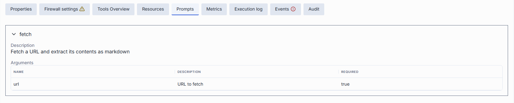

## Further reading

- [Manage deployment images](./3.images.md) — build and version images used by containers
- [Model Servings](./2.model-servings.md) — configure Hugging Face model workloads and inference metrics
- [DIAL Deployment Manager](../../7.services/11.deployment-manager/0.index.md) — deployment infrastructure and component responsibilities
- [Deployment Manager Backend configuration](../../7.services/11.deployment-manager/1.configuration/1.backend.md) — cluster access, image builds, and workload settings
- [DIAL Admin: Toolsets](../1.ai-gateway/3.toolsets.md) — configure MCP connections, tool access, and authentication
- [Manage interceptors](../6.governance/4.interceptors.md) — configure where interceptors apply
