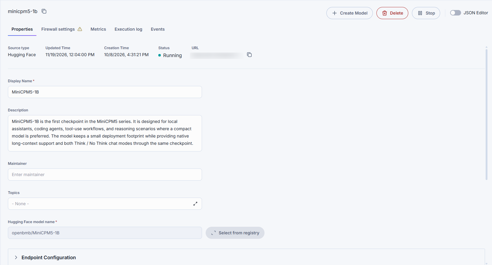
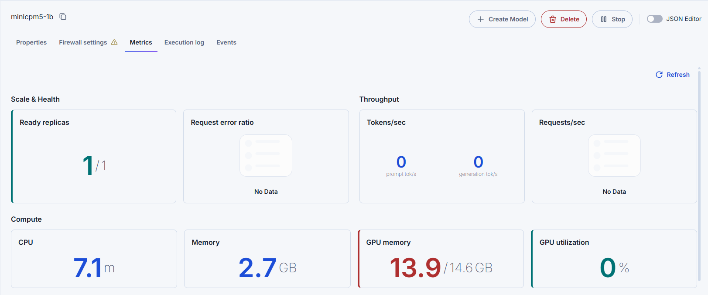

# Model servings

Model Servings lets you run [Hugging Face](https://huggingface.co/models) models in your cluster. Depending on the model's task, you can create a DIAL model or Toolset from a running serving.

Model servings share settings and tabs with containers. For properties, firewall, metrics, logs, events, and audit, see [shared container settings](./1.container-management.md#container-lifecycle-and-shared-settings). This page describes the model-serving-specific options.

In Model Servings you can find all available model servings and add new ones.

The Model Servings grid shares most [container grid columns](./1.container-management.md#container-grid-columns). It shows the model-serving source in **Source type** and does not include the **Type** or **Source Name** columns. The **Container URL** column is hidden by default; enable it in the grid column settings.

### Create a model serving container

:::note
Model Servings appears when the Hugging Face option (`HF_ENABLED`) is enabled in your DIAL Admin deployment. See [DIAL Deployment Manager and MCP containers](../../7.services/9.admin/2.configuration/1.frontend.md#deployment-manager-and-mcp-containers).
:::

1. Click **Create** on the main screen and select **Hugging Face model serving**.
2. Fill in the form:
   - **ID**: Required unique identifier for the model serving.
   - **Display Name**: Required display name.
   - **Description**: Optional description.
   - **Hugging Face Model Name**: Required model name. Start typing to see suggestions, or click **Select from registry** to pick from the modal.
3. Click **Create**.

### Configure and run a model serving

After creation, review the model serving's settings and configure them as needed. For example, review its compute resources and firewall settings. See [shared container settings](./1.container-management.md#properties) and [model serving properties](#model-serving-properties).

If you changed any settings, click **Save**. Then click **Run** and wait for the status to change to **Running**.

### Automatic task detection

The Deployment Manager detects `text-classification` models from Hugging Face metadata and configures a KServe predictor and transformer chain automatically. The transformer image is set through `INFERENCE_TEXT_CLASSIFICATION_TRANSFORMER_IMAGE` on the Deployment Manager.

:::note
A transformer image must be configured for chained text-classification deployments. Platform engineers set the image and resource defaults in [Model integrations and resource limits](../../7.services/11.deployment-manager/1.configuration/1.backend.md#model-integrations-and-resource-limits).
:::

### Use a model serving in DIAL

The available create action depends on the serving's detected task. A text-generation serving can create a [model](../1.ai-gateway/1.models.md); a text-classification serving can create a [Toolset](../1.ai-gateway/3.toolsets.md). A serving with no supported capability has no create action.

#### Create a model

1. On the screen of the running text-generation serving, click **Create Model**. If a **Create** dropdown is shown, choose the model option.
2. Review the pre-populated values and complete the dialog, including the model's **ID**, **Display Name**, optional **Display Version**, and **Description**.
3. Click **Create**. Repeat to create additional models.

DIAL Admin pre-populates the endpoint and sets **Override Name** to the container name, so you don't need to copy the container URL. The chat completions path is `openai/v1/chat/completions`; for an embeddings model, it ends in `/embeddings` instead.

Once created, the model is available to users and applications according to your permissions configuration.

#### Create a Toolset

For a running text-classification serving, click **Create Toolset**, select a folder under **public** or, when available, **platform**, and complete the dialog. DIAL Admin pre-populates the serving's `/mcp` endpoint and HTTP transport. The Toolset is available according to its access configuration.

### Get the container URL

The container URL is the serving's base address. You can use it to configure an endpoint manually, adding the path for the serving's API. You don't need to copy it when you create a model or Toolset from the serving in DIAL Admin.

When the model serving is **Running**, its **URL** appears in the screen header next to the status. Click the copy icon to copy it. The URL is shown only while the serving is running and may be cluster-internal, depending on the deployment configuration.

### Model serving properties

Click any model serving on the main screen to open its configuration screen. In addition to the [shared properties](./1.container-management.md#properties), model servings include:

| Property | Required | Editable | Description |
|----------|----------|----------|-------------|
| Hugging Face model name | Yes | Yes | Start typing to see suggestions, or click **Select from registry** to pick from the modal. |
| Autoscaling | No | Yes | Model servings default to 1 replica for both Min and Max. Existing containers retain their current configuration. |

### Model serving metrics

The **Metrics** tab includes the [shared container metrics](./1.container-management.md#metrics) and additional model-serving metrics. Available cards depend on the inference task and the metrics returned by the deployment.

| Section | Additional metrics |
|---------|--------------------|
| **Scale & Health** | Request error ratio for text-generation inference tasks. |
| **Throughput** | Tokens per second (prompt and generation), requests per second. |
| **Compute** | GPU memory usage and GPU utilization percentage. GPU cards appear for Hugging Face model servings when GPU metrics are available. |
| **Latency** | Time to first token (TTFT), inter-token latency, end-to-end latency, and request latency for text-classification tasks, shown as p50/p95/p99 distributions. |
| **Load** | Running requests, queue depth, and KV-cache usage as a gauge with color-coded zones. |

:::note
GPU metrics need the NVIDIA DCGM exporter. Platform engineers configure it in [Workload metrics](../../7.services/11.deployment-manager/1.configuration/1.backend.md#workload-metrics).
:::

### Model serving actions

Click any model serving container to access the configuration screen. On the configuration screen, you can find several actions you can perform on the selected model serving container.

| Action | Description |
|--------|-------------|
| **Create Model / Create Toolset** | Available for a running model serving when its detected task supports creating a model or Toolset. Some configurations show a **Create** dropdown instead. See [Use a model serving in DIAL](#use-a-model-serving-in-dial). |
| **Run / Stop** | Start or stop the model serving. |
| **Delete** | Remove the model serving. Deleting affects model entities created from it. |

## Further reading

- [Manage deployment images](./3.images.md) — build and version the images that containers are based on
- [Manage MCP containers](./1.container-management.md#mcp-containers) — deploy MCP server containers
- [Manage models](../1.ai-gateway/1.models.md) — register and configure AI models in DIAL
- [Manage Toolsets](../1.ai-gateway/3.toolsets.md) — configure Toolsets and their access
- [DIAL Deployment Manager Backend configuration](../../7.services/11.deployment-manager/1.configuration/1.backend.md) — cluster access, image builds, and workload settings
