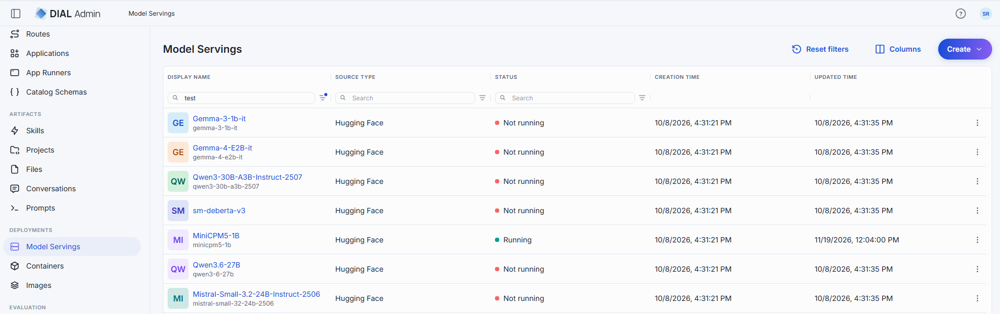
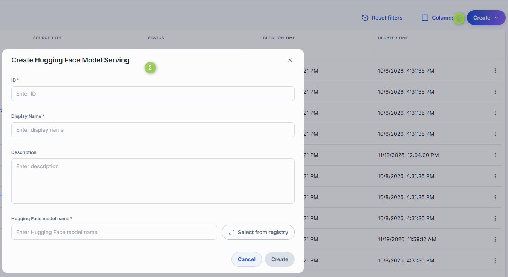
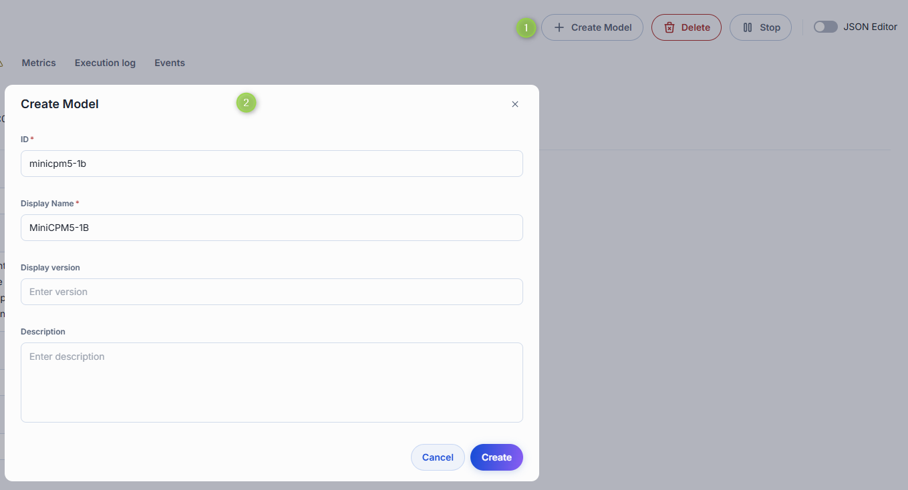

# Model servings

Use **Model Servings** to run [Hugging Face](https://huggingface.co/models) models in your cluster. Create a DIAL model from a running text-generation serving, or a Toolset from a text-classification serving.

For common configuration, logs, events, and runtime controls, see [shared container settings](./1.container-management.md#container-lifecycle-and-shared-settings). This page explains model selection, task detection, and model-serving-specific settings. Deployment locations and infrastructure prerequisites are described in [Deployments overview](./0.index.md).

## Model Servings grid

The grid lists existing servings and their status. It shares most [container grid columns](./1.container-management.md#container-grid-columns), but shows **Hugging Face** in **Source type** and has no **Type** or **Source Name** column. Use **Columns** to show hidden fields, including **Container URL** and **GPU Request**.

## Create a model serving container

:::note
Model Servings appears when the frontend's Hugging Face option (`HF_ENABLED`) is enabled. The platform team must also enable and configure KServe in Deployment Manager. See [DIAL Admin deployment settings](../../7.services/9.admin/2.configuration/1.frontend.md#deployment-manager-and-mcp-containers) and [Workload deployment](../../7.services/11.deployment-manager/1.configuration/1.backend.md#workload-deployment).
:::

Click **Create** and select **Hugging Face model serving** to open the form.

| Field | Purpose |
|-------|---------|
| ID | Required unique identifier for this serving in DIAL Admin. It is separate from the Hugging Face source name. See [container identifiers](./1.container-management.md#properties) for its format. |
| Display Name | Required name displayed in DIAL Admin. |
| Description | Optional description of the serving's purpose or deployment requirements. |
| Hugging Face model name | Required source identifier, in the format `<owner>/<model>`. Enter it directly, choose a suggestion, or use **Select from registry**. |

### Select a model from the registry

Click **Select from registry** to browse models without entering the identifier manually.

1. Search by model name. Use the displayed Libraries, Parameters, Likes, and Downloads to compare entries; **Columns** offers additional metadata.
2. Click a row's details icon to read its model card and check its requirements.
3. Select the model and click **Confirm** to fill in the source name.

For manual entry, the owner part allows letters, digits, and hyphens, up to 42 characters. The model part also allows underscores and periods, up to 96 characters. Names cannot begin or end with a hyphen; model names also cannot begin or end with a period. Double hyphens, double periods in the model part, and model-name endings `.git` or `.ipynb` are rejected.

### Automatic task detection

Deployment Manager reads the Hugging Face model metadata and configuration when creating or updating the serving and when preparing its deployment. Choose a model with a supported task if you intend to register it through DIAL Admin.

| Detected task | Runtime behavior | DIAL registration |
|---------------|------------------|-------------------|
| Text generation | Runs the model predictor. | **Create Model** creates a Chat model. |
| Text classification | Runs a KServe predictor and a transformer that exposes the classification service through MCP. | **Create Toolset** creates a Toolset using the serving's `/mcp` endpoint. |
| No recognized task | Uses a predictor-only deployment. | No automatic model or Toolset create action. Choose a model with a recognized task to use the registration actions above. |

For classification, the predictor runs the model and the transformer adapts its outputs for the MCP interface. Deployment Manager configures this chain automatically; administrators do not create a separate MCP container for it.

:::note
Classification deployments require a transformer image configured through `INFERENCE_TEXT_CLASSIFICATION_TRANSFORMER_IMAGE` on Deployment Manager. The platform team supplies its image and resource defaults in [Model integrations and resource limits](../../7.services/11.deployment-manager/1.configuration/1.backend.md#model-integrations-and-resource-limits).
:::

The classification model's `config.json` must contain a usable `id2label` mapping: numeric output IDs mapped to label text. IDs must form a complete sequence starting at 0, and label values cannot be empty or consist entirely of placeholders such as `LABEL_0`. Choose a model with meaningful labels; invalid metadata can prevent creation or update before the serving starts.

### Submit the form

After selecting the model and completing the required fields, click **Create**. The Properties screen opens; the serving is not started yet. If creation fails, see [Troubleshoot creation and startup](#troubleshoot-creation-and-startup).

## Configure and run a model serving

Configure the serving on its Properties screen before running it. Common fields, such as Display Name, Description, Maintainer, and Topics, are described in [container properties](./1.container-management.md#properties).

### Model-specific settings {#model-serving-properties}

| Setting | Purpose and behavior |
|---------|----------------------|
| Hugging Face model name | Selects the source model. Use direct entry, suggestions, or **Select from registry**. The field and registry button are disabled while Running; stop the serving before changing the model. |
| Autoscaling | New servings default to Min replicas = 1 and Max replicas = 1. They do not start with ordinary containers' scale-to-zero defaults. Existing servings retain their configuration. See [autoscaling controls](./1.container-management.md#autoscaling). |
| Compute → GPU Request | GPU count requested for each model replica. Editing it sets the GPU request and limit to the same count. Initial values come from [DIAL Admin's deployment-resource settings](../../7.services/9.admin/2.configuration/1.frontend.md#deployment-manager-and-mcp-containers). |

Use [Compute](./1.container-management.md#compute) for CPU and memory configuration. Under Compute, [select a node pool](./1.container-management.md#node-pool-selection) with the capacity the model requires. Setting GPU Request does not provision GPU nodes; the platform team must provide them and configure resource ceilings in [Model integrations and resource limits](../../7.services/11.deployment-manager/1.configuration/1.backend.md#model-integrations-and-resource-limits).

### Environment variables and firewall

The shared [environment-variable controls](./1.container-management.md#environment-variables) and [firewall controls](./1.container-management.md#firewall-settings) are used for model servings, with these release-specific differences:

:::warning
Deployment Manager Backend 0.23.0 applies **Content** and **Secure content** environment variables to inference workloads, but does not mount **Secure file** values into their runtime. Do not rely on that mode for a model serving, even though the shared editor offers it.
:::

For Hugging Face sources, the effective allowed-domain list also includes the backend's `HUGGINGFACE_DEFAULT_ALLOWED_DOMAINS`. This allows model downloads when network policies are enforced. The platform team configures those defaults in [Model integrations and resource limits](../../7.services/11.deployment-manager/1.configuration/1.backend.md#model-integrations-and-resource-limits).

### Save and run

1. Click **Save** if you changed the configuration.
2. Click **Run** and wait for **Running**. Use the [Execution log](./1.container-management.md#execution-log) and [Events](./1.container-management.md#events) to investigate startup failures.
3. Create a model or Toolset using the steps below.

For later edits, use the shared [container actions](./1.container-management.md#container-actions), including Save & redeploy, Discard, Stop, Delete, and JSON Editor.

## Use a model serving in DIAL

After the serving becomes **Running**, use the create action for its detected task to register it in DIAL.

:::note
The instructions below describe creating configurations directly in DIAL Core. With the optional legacy Admin Backend connected, the header can show a **Create** dropdown with additional legacy options. See [Where an entity can be defined](../1.ai-gateway/0.index.md#where-an-entity-can-be-defined).
:::

### Create a model from a running serving

1. On the running text-generation serving's screen, click **Create Model**.
2. Review the required **ID** and **Display Name**, and optionally set **Display Version** and **Description**.
3. Click **Create**, then configure the model's access and any additional settings in [Models](../1.ai-gateway/1.models.md).

DIAL Admin fills in the Chat model endpoint using the serving URL and `/openai/v1/chat/completions`. It sets **Override Name** to the serving's container ID; this specifies the model name sent to the runtime. You do not need to copy the URL manually.

You can repeat creation with another ID to register additional DIAL models for the same serving. Availability depends on each model's access configuration.

### Create a Toolset from a running serving

1. On the running text-classification serving's screen, click **Create Toolset**.
2. Select a destination under **public** or, when available, **platform**.
3. Review the required **ID**, **Display Name**, and **External Endpoint**, and optionally enter a **Description**. Public Toolsets also require a **Version**; platform Toolsets have no version.
4. Click **Create**, then review the Toolset's [connection and access settings](../1.ai-gateway/3.toolsets.md).

The `/mcp` endpoint and HTTP transport are filled in from the serving. The resulting Toolset's availability depends on its destination and access configuration.

### Get the container URL

The URL is the serving's base address. Use it when configuring a connection manually, adding `/openai/v1/chat/completions` for text generation or `/mcp` for classification. The create actions above fill in these endpoints automatically.

When the serving is **Running**, its URL appears beside the status on the Properties screen. Click the copy icon to copy it. The URL is shown only while running and may be cluster-internal, depending on the deployment configuration.

## Model serving metrics

The **Metrics** tab is available while Running. Click **Refresh** to request a new snapshot. A card showing **No Data** has no returned value for that metric; this is different from a measured zero.

Ready replicas, CPU usage, and memory usage are described under [shared container metrics](./1.container-management.md#metrics). The additional cards below appear according to the detected task and available telemetry:

| Section / metric | Task | What it measures |
|------------------|------|------------------|
| Scale & Health → Request error ratio | Text generation | Percentage of requests reported as errors. |
| Throughput → Tokens/sec | Text generation | Prompt and generated tokens processed per second, displayed separately. |
| Throughput → Requests/sec | Generation or classification | Requests processed per second. |
| Compute → GPU memory | Both | GPU memory used relative to total GPU memory reported for the serving. |
| Compute → GPU utilization | Both | Reported GPU utilization percentage, averaged across returned pod values. |
| Latency → Time to first token | Text generation | Time until the first generated token, abbreviated TTFT. |
| Latency → Inter-token latency | Text generation | Time between generated tokens. |
| Latency → E2E latency | Both | End-to-end request duration. |
| Latency → Request latency | Text classification | Inference-request duration reported for classification. |
| Load → Running requests | Text generation | Requests currently being processed. |
| Load → Queue depth | Text generation | Requests waiting to be processed. |
| Load → KV-cache usage | Text generation | Fraction of the model's attention key/value cache capacity in use during inference. |

Latency cards show p50, p95, and p99: the durations at or below which 50%, 95%, and 99% of observations fall. GPU cards appear when GPU telemetry is available. The KV-cache gauge uses colored zones to indicate cache usage.

:::note
GPU metrics require the NVIDIA DCGM exporter; CPU and memory metrics require metrics-server. The platform team configures these in [Workload metrics](../../7.services/11.deployment-manager/1.configuration/1.backend.md#workload-metrics).
:::

## Troubleshoot creation and startup

| Problem | What to check |
|---------|---------------|
| Serving creation reports model not found or access denied | Verify the Hugging Face source identifier and access to its metadata. For private models, the platform team may need to configure `HUGGINGFACE_API_TOKEN`; see [model integration settings](../../7.services/11.deployment-manager/1.configuration/1.backend.md#model-integrations-and-resource-limits). |
| Hugging Face metadata is unavailable | Retry when the upstream is reachable. Metadata retrieval failures can prevent creation, update, or deployment preparation. |
| Classification metadata is rejected | Check `config.json` for a complete `id2label` mapping with usable labels. Choose another model or have its owner correct the mapping. |
| Classification deployment fails because the transformer is not configured | Ask the platform team to supply the transformer image and its required configuration. |
| Serving does not become Running | Inspect the [Execution log](./1.container-management.md#execution-log) and [Events](./1.container-management.md#events). Check compute capacity, model access, and startup configuration. |
| Running serving has no create action | Check whether its task was recognized as text generation or text classification. |
| Metrics show No Data | Check telemetry availability with the platform team; the serving's status alone does not guarantee every metric is available. |

## Further reading

- [Manage containers](./1.container-management.md) — shared runtime configuration, logs, and events
- [Manage models](../1.ai-gateway/1.models.md) — model connection and access settings
- [Manage Toolsets](../1.ai-gateway/3.toolsets.md) — Toolset connections, access, and authentication
- [Deployment Manager Backend configuration](../../7.services/11.deployment-manager/1.configuration/1.backend.md) — KServe, model integrations, and telemetry prerequisites
