# Manage deployment images

Use **Images** in DIAL Admin to prepare versioned images for MCP server, adapter, application, and interceptor containers. An image definition records its source and build settings. **Add** creates that definition; **Install** builds or copies the runnable image. Neither action starts a container.

This page assumes the platform team has configured [DIAL Deployment Manager](../../7.services/11.deployment-manager/0.index.md), registry access, and build infrastructure. For deployment locations and responsibilities, see [Deployments overview](./0.index.md).

The usual workflow is **add → configure → save → install → create or link containers**. For a service that can run directly from an external Docker reference, you can also [create a container without a deployment image](./1.container-management.md#create-a-container).

## Images grid

The grid shows the newest version for each image name and type. Open an image and use its version selector to inspect another version. Versions are ordered newest first using semantic-version comparison.

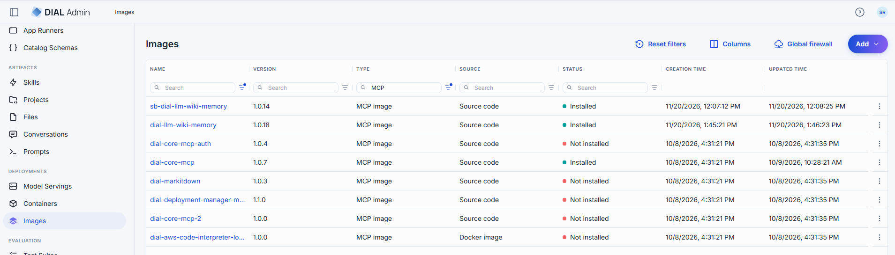

Use **Columns** to choose which fields to display. Source and Transport type are hidden by default.

| Column | Meaning |
|--------|---------|
| ID | Identifier of the displayed image version. |
| Name / Version | Image name and version. |
| Type | MCP, Adapter, Application, or Interceptor image. |
| Source | Docker image, source code, or MCP Registry origin. |
| Status | Current installation state. |
| Description | Description of the image's purpose. |
| Author | Contact value edited through Maintainer on the Properties screen. |
| Topics | Labels for organization. |
| Creation Time / Updated Time | Creation and last-update timestamps. |
| Transport type | Local or Remote for MCP images. |
| Actions | Open in a new tab, Duplicate, and Delete. Read-only administrators have Open in a new tab only. |

## Add an image

1. Click **Add**. If it opens a menu, select **Add Image**.
2. Fill in the form:

   | Field | Purpose |
   |-------|---------|
   | Name | Required image name, 2–255 characters. Letters, digits, spaces, underscores, and hyphens are allowed. |
   | Version | Required semantic version, initially `1.0.0`. The same type, name, and version cannot already exist. This version is separate from any tag in the source Docker reference. |
   | Description | Optional description of the service or build requirements. |
   | Type | MCP, Adapter, Application, or Interceptor. The initial choice is MCP; select the type of container that will use the image. |
   | Source type | **Docker image** for an existing image, or **Source code** for a repository containing a Dockerfile. |
   | Docker Image URI | Required for a Docker source. Enter the source image reference, including its tag or digest as appropriate. |
   | Repo URL | Required for a source-code image. Enter the Git repository URL. |
   | Branch name | Optional source-code branch. |
   | SHA | Optional Git commit identifier to pin the source revision. |

3. Click **Add**. The Properties screen opens with status **Not installed**.

Adding an image whose name already exists does not automatically select an unused version. Enter a valid version for that name and type before submitting.

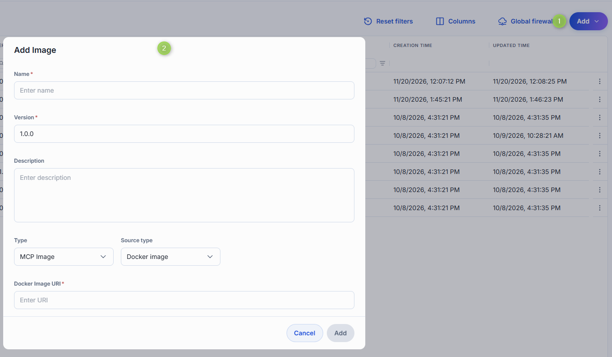

## Add an image from MCP Registry

Use the [MCP Registry](https://registry.modelcontextprotocol.io/) to choose an MCP server and derive its source settings. This option requires registry integration to be enabled.

1. Click **Add → From MCP Registry**.
2. Enter Name, Version, and optional Description as described under [Add an image](#add-an-image).
3. In **MCP server name**, start typing to search or click **Select from registry** to browse server entries and details. Select the server you intend to deploy.
4. Review the source choice. A repository is selected by default when available; otherwise the OCI image package is used. When both exist, choose **Source code** or **Docker image**.
5. For a source-code image, optionally set Branch name and SHA.
6. Click **Add**.

The server name is required. Registry selection supplies the repository URL or Docker image URI; those fields cannot be edited directly while the registry reference is present. The source selector is restricted when the selected entry offers only one source type.

Review the server's source, transport, and startup requirements before [installing](#install-an-image). Source-code builds require a usable Dockerfile and access to build dependencies. Docker sources use the existing image and do not require a repository Dockerfile.

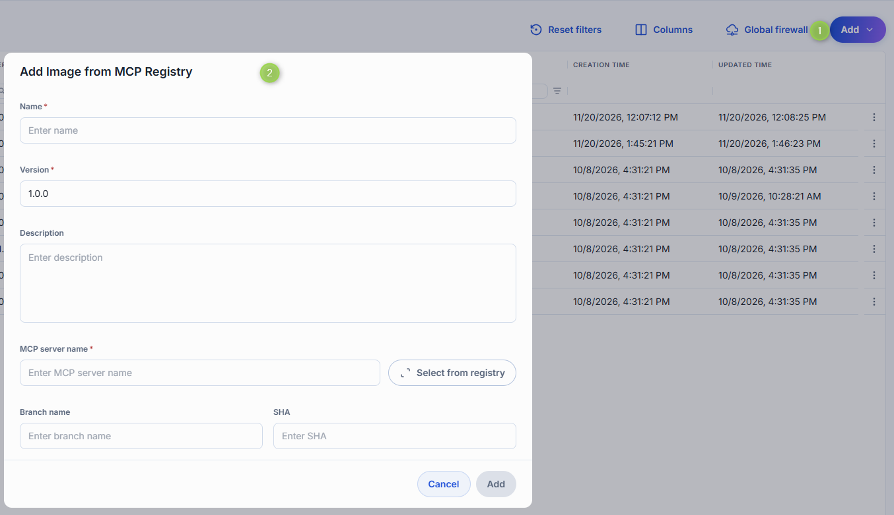

## Image configuration

Open an image to configure the selected version. Its ID, Type, creation/update timestamps, Source type, and Status are shown as deployment information. Type is chosen at creation; Source type also has an editable selector in the configuration form.

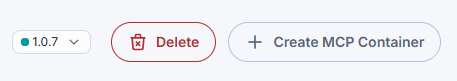

### Properties

| Setting | Purpose |
|---------|---------|
| Name | Image name. Renaming changes the save options; see [Save changes](#save-changes). |
| Description | Description of the image or build requirements. |
| Maintainer | Contact for the person or team responsible for the image; also displayed in the grid's Author column. |
| Topics | Organizational labels. Custom topics are limited to 255 characters with no leading or trailing spaces. |
| Build privileges | Rootless or Root builder choice. See [Build privileges](#build-privileges). |
| Source type | Docker image or Source code. Changes are subject to the rules for saving the selected version and any registry restrictions. |

The version selector in the header switches between versions and offers **Create** for a new version. The selected version controls which settings, installation log, and related containers you inspect.

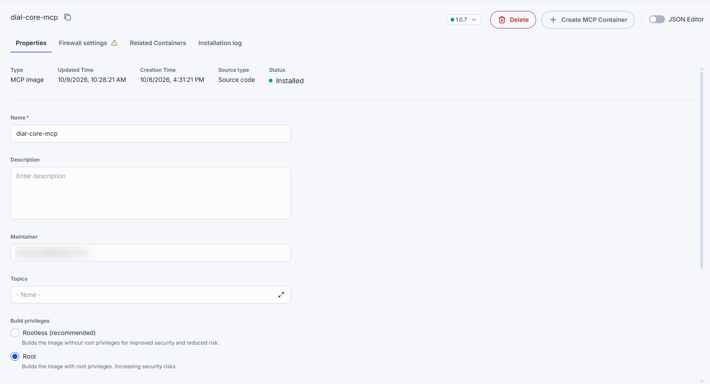

:::note
Configuration editing and management actions require write access. When available, **JSON Editor** lets you edit configuration as JSON; it can be disabled in the deployment. Saving restrictions apply to the selected version regardless of the editor used.
:::

### Source settings

Changing Source type changes the fields used to identify the build source. Review and complete the new source settings before saving.

| Field | When shown | Purpose |
|-------|------------|---------|
| Docker image URI | Docker source | Required source image reference. Registry-derived references are read-only. |
| Repo URL | Source code | Required Git repository URL. Registry-derived URLs are read-only. |
| Branch name | Source code | Optional branch to build from. |
| SHA | Source code | Optional commit identifier for the build. A full Git commit SHA is a 40-character hexadecimal value. |
| Base directory | Source-code Properties screen | Optional repository path containing the Dockerfile, for example when the build source is in a subdirectory. It must not begin or end with `/`. |
| MCP server name | Registry-derived image | Selects the registry server; use search or **Select from registry** to change the selection. |

Docker references and repository URLs must not begin or end with `/`. Private Git access requires credentials configured by the platform team; see [Private Git repositories](../../7.services/11.deployment-manager/1.configuration/1.backend.md#private-git-repositories).

### MCP transport

For MCP images, choose the server's transport mode on Properties before installing:

| Mode | Purpose |
|------|---------|
| **Local** | The MCP server communicates over standard input/output (stdio). Installation adds a wrapper that exposes it over Streamable HTTP. This is the initial mode for manually added MCP images. |
| **Remote** | The server already exposes a remote MCP interface, such as HTTP or SSE. No stdio wrapper is needed. |

Registry selection can supply the transport mode from its package metadata. Review it against the server you selected. HTTP/SSE connection settings for the running service are configured on the [MCP container](./1.container-management.md#mcp-endpoint-configuration), not through this Local/Remote selector.

For the wrapper's role and configuration, see [MCP proxy images](../../7.services/11.deployment-manager/1.configuration/2.mcp-proxy.md).

### Build privileges

Choose the builder under **Build privileges** on Properties; this setting is not in the Add Image form.

- **Rootless (recommended)** builds without root privileges and is the default.
- **Root** builds with root privileges and carries greater security risk. Use it only for trusted build sources when required.

The choice affects image builds, not the privileges of containers created from the image. A plain Docker-image copy does not use the builder. Platform engineers configure the builder images in [Image builds and registries](../../7.services/11.deployment-manager/1.configuration/1.backend.md#image-builds-and-registries).

### Firewall settings

The image firewall controls outbound domain access during image preparation, for example when downloading build dependencies. It does not configure the running container's firewall.

Under **Domain access policy**, choose:

- **All domains** to allow unrestricted domain access. DIAL Admin displays a security warning.
- **Specific domains (recommended)** to restrict access to the global and per-image allowed-domain lists.

With Specific domains, **Global domain whitelist** is read-only and shown when the global list contains entries. Use [Global firewall](#global-firewall) to change it. Under **Image domain whitelist**, click **Add domain** or remove entries to maintain this image's additional domains.

Enforcement requires configured [network-policy integration](../../7.services/11.deployment-manager/1.configuration/1.backend.md#network-policy). Use separate [container firewall settings](./1.container-management.md#firewall-settings) for runtime access.

Enter domains without a protocol, for example `github.com`. Names must be 4–253 characters and contain a dot. Each label allows letters, digits, and hyphens, is 1–63 characters, and cannot begin or end with a hyphen. The top-level domain must contain at least two letters.

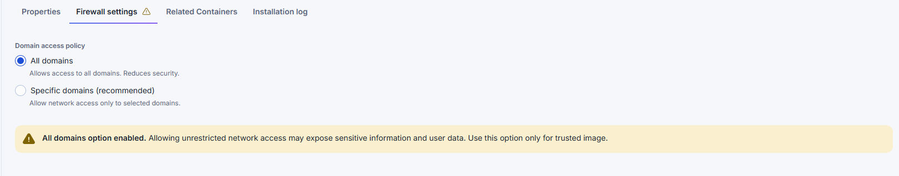

## Global firewall

Use **Global firewall** on the Images grid to maintain domains shared by all image builds. These entries extend the allowed domains of images using Specific domains; they do not become container runtime rules.

Add or remove entries and click **Apply**. Read-only administrators can inspect the list but cannot change it. Domain formatting follows [Firewall settings](#firewall-settings).

The dialog also offers **View in Activity Audit** to inspect global-firewall changes. That audit view uses the optional legacy Admin Backend.

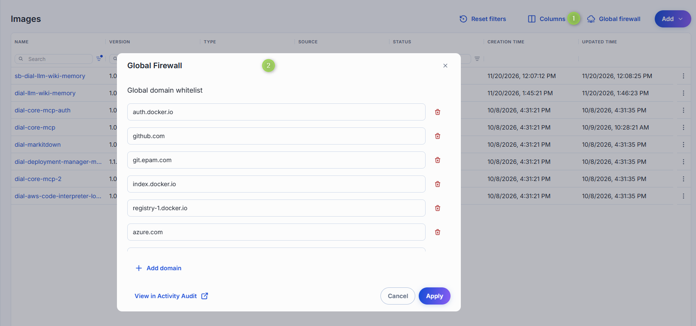

## Save changes

Editing the form does not immediately apply changes. The header shows **Discard**, the permitted **Save** action, and **Save as new version** or **Save as new image**.

| Action | When to use it |
|--------|----------------|
| **Save** | Update the current version. For Not installed, Installation failed, or Build stopped, configuration changes can be saved in place. For Installed, only Description, Maintainer, and Topics can be saved. Save is unavailable during Installing or if a renamed image conflicts with an existing name/version. |
| **Save as new version** | The name is unchanged. Save the edited configuration as another version of the same image. The dialog suggests a patch increment from the highest existing version. |
| **Save as new image** | The name was changed. Save the edited configuration under that name. The dialog initially uses `1.0.0` for a new name, or suggests the next patch version when that name already has versions. |
| **Discard** | Restore the selected version's saved configuration without applying edits. |

An installed version's build-affecting settings cannot be overwritten in place. Edit them and save a new version or image instead. All new definitions start as **Not installed** and must be installed separately. Existing containers remain linked to their selected version until you change the link.

### Create a new version

To copy the selected configuration without editing it first, open the version selector and click **Create**. Enter an unused semantic version and confirm. Its initial suggestion is a patch increment from the highest existing version for that image name and type.

DIAL Admin opens the new definition. Review and install it before moving containers to it.

## Install an image

1. Review the source, build settings, and firewall. Ensure the platform team has configured access to private repositories or registries when needed.
2. [Save configuration changes](#save-changes).
3. Click **Install** and confirm the selected version in the dialog.
4. Inspect the **Installation log** while the status is **Installing...**. Wait for **Installed** before creating or linking containers.

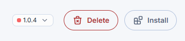

Installation prepares the runnable image in the configured registry:

- A source-code image is built from its repository and Dockerfile.
- A Docker source is copied for adapter, application, interceptor, or Remote MCP images.
- A Local MCP image additionally goes through wrapper preparation so the stdio server can be reached over HTTP.

Use **Stop** during installation and confirm to interrupt the process. Retry with Install after a failed or stopped build, correcting the cause first.

### Image statuses

| Status | Meaning | Next action |
|--------|---------|-------------|
| **Not installed** | The definition has not been prepared. | Configure and save it, then Install. Related Containers and Installation log are disabled. |
| **Installing...** | Image preparation is running. | Inspect the log or Stop. In-place Save is unavailable. |
| **Installed** | Preparation succeeded. | Create or link containers. For changes, follow [Save changes](#save-changes). |
| **Installation failed** | Preparation failed. | Read the log, correct the configuration or environment, and retry Install. |
| **Build stopped** | Preparation was interrupted. | Review the configuration and retry Install when ready. |

### Installation log

The **Installation log** streams output from the image-preparation process, including build or copy steps, warnings, and errors. It is disabled only for Not installed; it remains available during installation and after successful, failed, or stopped builds.

Use the log to diagnose failures before retrying. The log belongs to the selected version, not every version with the same name.

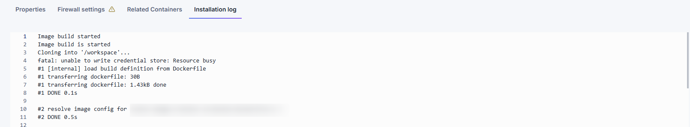

## Create a container from an image

1. Open an **Installed** image version and click **Create MCP / Adapter / Application / Interceptor Container**, according to its type.
2. Enter the required **ID** and **Display Name**, and optionally a **Description**.
3. Click **Create**.

The container is linked to that image version automatically. Its configuration screen opens; review its settings, save changes, and run it. Creating the container does not start it or register its service in DIAL. Follow [Manage containers](./1.container-management.md) for the appropriate model, application, interceptor, or Toolset creation flow.

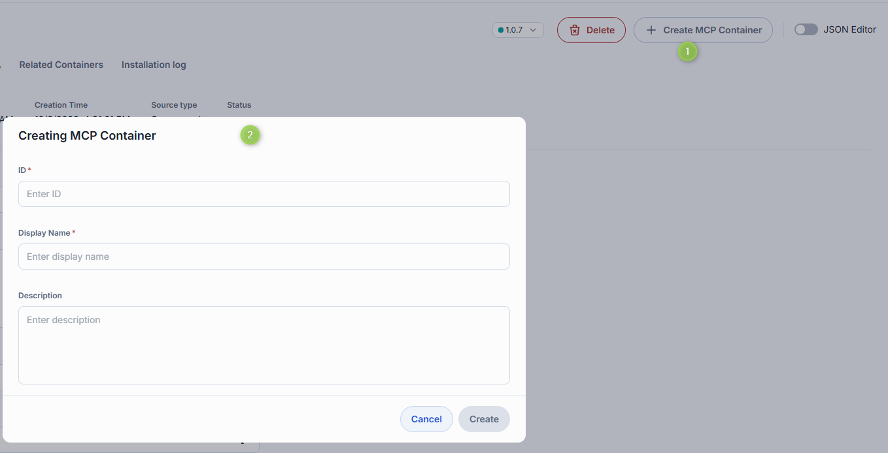

## Related containers

The **Related Containers** tab lists containers linked to the selected version. It is disabled only for Not installed. **Add** is available only for Installed images and administrators with write access.

Use Add to move existing containers to this image version; it does not create new containers.

1. Click **Add**.
2. Choose the list with **Show containers related to this image**:
   - **On** initially shows containers linked to other versions of this image.
   - **Off** shows same-type containers not linked to the selected version, including those using other images.
3. Select containers and click **Apply**.

:::warning
Running containers are restarted when their image version changes. Review the selection before applying it.
:::

Use the row action to open a related container in a new tab. To move a container to another image version, open the destination image and version, then use its **Related Containers → Add** action. Alternatively, use [Change the source image](./1.container-management.md#change-the-source-image) on the container's Properties screen.

This tab has no detach action. Containers using external Docker references can exist without an internal image link.

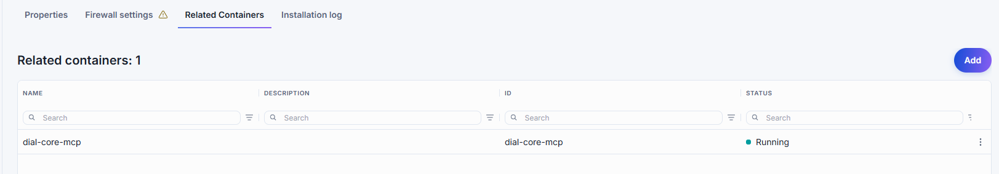

## Duplicate an image

Duplicate creates another definition from the selected image's settings.

1. In the grid's row menu, choose **Duplicate**.
2. Choose the **Duplication type**:
   - **New Version** keeps the name and initially increments the selected version's patch number.
   - **New Image** suggests a new name and resets Version to `1.0.0`.
3. Review Name and Version, then click **Duplicate**.

The selected-version increment can conflict with an existing version. Enter a valid unused version for the same name and type when needed. The copy opens as Not installed; configure and install it before using it for containers.

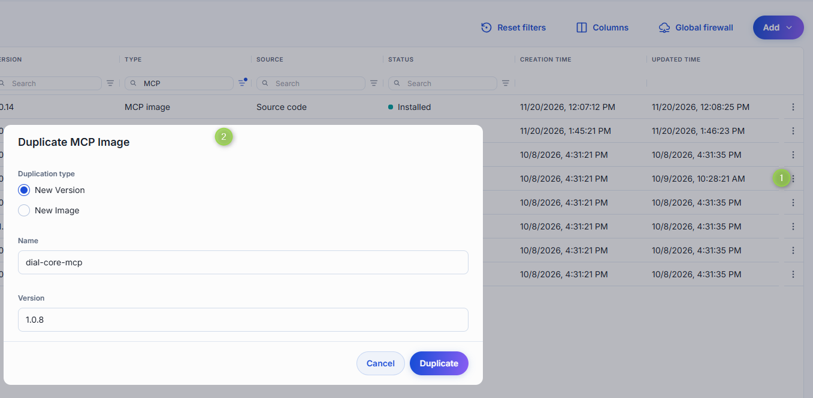

## Delete an image

1. Click **Delete** in the grid's row menu or on the selected image screen.
2. Review the selected version. When multiple versions exist, the dialog offers individual versions and **All versions**.
3. Review the listed related containers and confirm only the intended scope.

:::warning
Deleting an image definition also deletes container deployments that reference it. Selecting All versions extends deletion to each version and its dependent containers. DIAL configurations using those services can stop working. Move containers you intend to keep to another installed image version before deleting.
:::

## Further reading

- [Manage containers](./1.container-management.md) — configure, run, and register services from installed images
- [MCP proxy images](../../7.services/11.deployment-manager/1.configuration/2.mcp-proxy.md) — stdio wrapper behavior and build-time configuration
- [DIAL Deployment Manager](../../7.services/11.deployment-manager/0.index.md) — image preparation and workload responsibilities
- [Deployment Manager Backend configuration](../../7.services/11.deployment-manager/1.configuration/1.backend.md) — registry access, private repositories, and build settings
