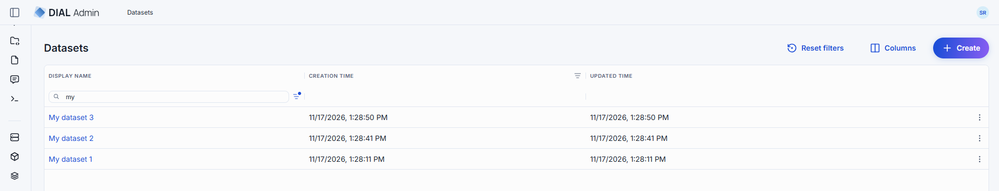
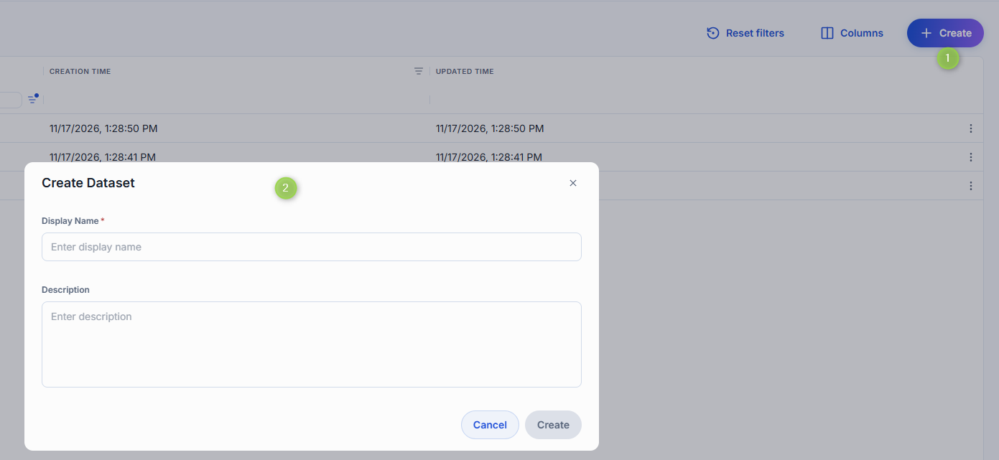
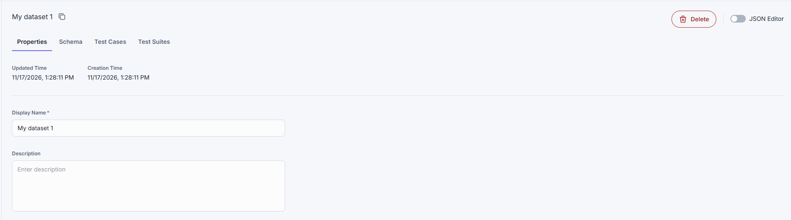
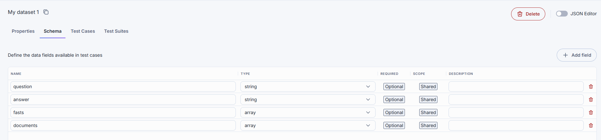
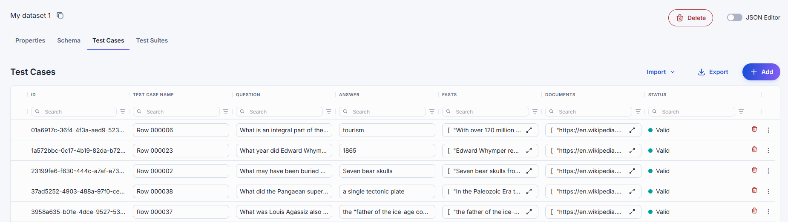
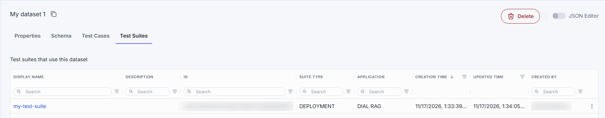

# Datasets

A dataset is a reusable collection of test cases with a defined schema. The dataset owns the schema
and the test case data; a [test suite](1.test-suites.md) only consumes them as evaluation inputs.
This decoupling lets you maintain test data separately from evaluation logic, reuse the same dataset
across different test suites, and update test cases without modifying the test suites that reference
them. See the [Evaluation overview](0.index.md) for how datasets, test suites and runs fit together.

## How datasets are used

1. [Create a dataset](#create).
2. Define its [schema](#schema): the fields each test case has, for example `question` and
   `expected_answer`.
3. Add [test cases](#test-cases) manually or [import](#import) them from a file.
4. Click **Save**. See [Save changes](#save-changes).
5. In a test suite, [attach the dataset](1.test-suites.md#attach-dataset). The test suite then
   uses the dataset's schema to bind test case fields to the request template and to metric inputs.
6. Start the test suite. Each [run](2.runs.md) evaluates the test cases of the dataset.

:::tip
A test suite can run only when a dataset is attached.
:::

## Public and private datasets

The datasets in the **Evaluation > Datasets** grid are **public**: any test suite can use them, and you
edit them on the Datasets page. In a test suite that uses a public dataset, its test cases and schema
are read-only.

Test cases that you add manually in a test suite, without a dataset, are **private** to that test
suite. They are stored in a private dataset that is bound to this one test suite. It does not appear
in the Datasets grid and other test suites can't use it. The **Test Cases** tab of the test suite shows a
**Private** label for them. To share them, [publish them to a new dataset](1.test-suites.md#publish-to-a-dataset)
from the test suite. The new public dataset appears in the Datasets grid and the test suite is linked to it.

## Datasets grid

Open **Evaluation > Datasets** to see all public datasets. Click the dataset name to open its detail
view. Use the filters under the column headers to find a dataset, **Reset filters** to clear them and
**Columns** to show or hide columns.

| Column | Description |
|--------|-------------|
| **Display Name** | Display name of the dataset. It is a link to the detail view. |
| **Description** | Description of the dataset. |
| **Creation time** | Timestamp when the dataset was created. |
| **Updated time** | Timestamp of the last update. |

The actions menu (⋮) at the end of each row has **Open in a new tab**, **Duplicate** and **Delete**.

## Create

To create a dataset, click **Create**. A dialog prompts you to enter the dataset name and description.
The name is required and must be unique. A new dataset is public and has no schema or test cases yet.

## Details

Click the dataset name to open its detail view. The header has the dataset name with a copy icon,
**Delete** and the **JSON Editor** switch. The view has four tabs: [Properties](#properties),
[Schema](#schema), [Test Cases](#test-cases) and [Test Suites](#test-suites).

Changes on the **Properties**, **Schema** and **Test Cases** tabs are saved together; see
[Save changes](#save-changes).

### Properties

Basic information about the dataset, with the update and creation timestamps.

| Field | Required | Editable | Description |
|-------|----------|----------|-------------|
| **Display name** | Yes | Yes | Name of the dataset displayed on the UI. Must be unique across all datasets. |
| **Description** | No | Yes | Free-text summary of the dataset's purpose. |

### Schema

The **Schema** tab defines the data fields of the test cases. Every test case in the dataset has these
fields, and the test suites that use the dataset see them as the available input for the request template and
for metric bindings. The fields are edited directly in the grid.

Each field has these properties:

| Property | Description |
|----------|-------------|
| **Name** | Field name. Must be unique within the schema (case-insensitive); a duplicate name is reported above the grid. |
| **Type** | string, number, integer, boolean, object, array, file or skill. A **file** field refers to a file stored with the dataset. A **skill** field refers to a DIAL skill. |
| **Required** / **Optional** | A test case that misses a required field is invalid. |
| **Scope** | **Shared**: one value for the test case. **Per turn**: a separate value in each turn of a multi-turn test case. See [Multi-turn test cases](1.test-suites.md#multi-turn-test-cases). |
| **Description** | Free-text description of the field. |

| Action | Description |
|--------|-------------|
| **Add field** | Adds a row to the grid. Specify the name and type, and optionally the other properties. |
| **Edit a field** | Change any property in its row, including the name. Renaming a field renames it in all test cases. |
| **Remove a field** | Click the trash icon in the row. The values of the field are removed from the test cases. |

When you change the schema and save, the test cases are revalidated in the background. A notification
says "Schema updated. Test cases are being revalidated, please refresh shortly." Test cases that no
longer match the schema become invalid.

#### Schema of a dataset used by test suites

While a public dataset is used by at least one test suite, the Schema tab is **read-only**: a warning
says "This schema cannot be modified because test suites use this dataset", and **Add field**, the field
controls and the **JSON Editor** switch are disabled. Changing fields could break the test cases of those
test suites. To change the schema, first detach the dataset from every test suite listed on the
[Test Suites](#test-suites) tab.

:::note
The backend enforces this rule: it rejects renaming or removing fields of such a dataset, for example in an
API call or an [import](#import), with an error.
:::

### Test cases

The **Test Cases** tab lists the test cases of the dataset. Each row is one test case. Columns are
defined by the dataset's schema.

| Column | Description |
|--------|-------------|
| **Expander** | For a multi-turn test case, expands or collapses its turns. |
| **ID** | Test case identifier. |
| **Test case name** | Test case name. Used to match test cases on import and in run comparisons. |
| **Schema fields** | One column per field of the schema. Click a cell to edit it. |
| **Status** | Shows whether the test case is valid. For an invalid test case, point to the icon to see the error. Invalid test cases are excluded when a linked test suite runs. |

A test case can be invalid because it does not match the schema, for example when a required field is
empty, or because it has more turns than the allowed maximum ([`TEST_CASE_MULTI_TURN_MAX_TURNS`](../../7.services/10.evaluations/1.configuration/1.framework-backend.md#datasets-and-imports),
configured on the evaluation framework backend, default 30).

Test cases are edited in the grid. New and changed test cases are not stored until you
[save the dataset](#save-changes). Which test cases take part in a run is controlled in the test suite with a
[run condition](1.test-suites.md#run-conditions).

#### Manage test cases

| Action | Description |
|--------|-------------|
| **Add** | Add a new test case row and fill in its fields. |
| **Import** | Bulk-import test cases from a file. See [Import](#import). |
| **Export** | Download the test cases. See [Export](#export). |
| **Delete** | Click the trash icon of a row to remove that test case. To remove several, select them in the grid and click **Delete** in the toolbar. A confirmation dialog appears before deletion. A new row that is not saved yet is removed immediately. |
| **Row actions (⋮)** | For a multi-turn test case, add, delete and reorder its turns, and duplicate a turn. |

#### Import

Click **Import > From PC** to import test cases from a CSV or ZIP file. The import wizard has two steps.

1. **File**: select the file. A preview of the test cases and a list of warnings are shown.
2. **Options**: choose how the data is applied.

| Option | Value | Description |
|--------|-------|-------------|
| **Import mode** | **Override** | Replaces all existing test cases. The schema is replaced with the columns of the file. |
| | **Append** | Adds the test cases to the existing ones. The current schema is kept; file columns that are not in the schema are discarded. If the dataset has no schema yet, the schema is built from the columns of the file. |
| | **Merge** | Adds the test cases to the existing ones. The schema is expanded with the new columns of the file. |
| **On name collision** | **Fail** (default) | Rejects the whole import at the first test case whose name already exists. |
| | **Skip** | Skips test cases whose name already exists; the existing test case is kept. |
| | **Override** | Replaces the existing test case with the imported one. |

A CSV file has one row per test case, or one row per turn for a multi-turn test case. A ZIP file is used
for datasets with **file** fields: it contains `test-cases.csv`, the files in a `files/` folder and,
optionally, a `manifest.json` that describes the schema. The files are stored with the dataset, and a
file with the same name replaces the existing one.

:::note
**Override** can remove fields from the schema. For a public dataset attached to a test suite, such an
import is rejected, because fields of a dataset that test suites use can't be removed.
:::

After the import, the test case list refreshes automatically.

#### Export

Click **Export** to download the test cases. For a dataset without **file** fields the result is a CSV
file; the schema is not included. For a dataset with **file** fields the result is a ZIP file with
`test-cases.csv`, the files and a `manifest.json` that includes the schema. You can import both back.

### Test suites

The **Test Suites** tab lists the test suites that use this dataset. Use it to see what a change to the
dataset affects, and to find the test suites to detach when you need to change a locked
[schema](#schema-of-a-dataset-used-by-test-suites).

The grid shows the **Display Name** of the test suite (a link that opens it), **Description**, **ID**,
**Suite type**, **Application**, **Creation time**, **Updated time** and **Created by**. Use the filters
under the headers to find a test suite. The actions menu (⋮) of a row has **Open in a new tab**.

### Save changes

The dataset header has **Save** and **Discard**, which become active when you change anything on the
**Properties**, **Schema** or **Test Cases** tab. **Save** stores the properties, the schema and the test case
changes in one operation. Before saving a new name, the UI checks that the name is not already used. If
the dataset was changed by someone else in the meantime, the save fails and you need to reload it.

The **JSON Editor** switch shows the definition of the dataset (properties and schema) as JSON, so you
can edit it as text. Test cases are always edited on the **Test Cases** tab. The switch is disabled while
the schema is read-only.

## Duplicate

You can duplicate an existing dataset to create a copy with the same schema, test cases and files.
The copy is a new public dataset that is not attached to any test suite.

1. Open the actions menu (⋮) of a dataset row and select **Duplicate**.
2. Change the name, which is pre-filled from the original, and, optionally, the description.
3. Click **Duplicate**. The new dataset appears in the grid.

## Delete

Select **Delete** in the actions menu (⋮) of a dataset row, or use **Delete** in the detail view. A
confirmation dialog shows the **Related Test Suites** that use this dataset.

:::warning
The dataset and all its test cases are permanently deleted. Test suites that use it are not deleted:
they are unlinked from the dataset, have no test cases, and can't run until you attach another dataset.
:::

## Further reading

- [Evaluation overview](./0.index.md) — how datasets, test suites and runs fit together
- [Test suites](./1.test-suites.md) — link a dataset to a test suite and configure evaluation bindings
- [Runs](./2.runs.md) — review the results of test suite runs that use the dataset
- [Evaluation Framework Backend configuration](../../7.services/10.evaluations/1.configuration/1.framework-backend.md) — settings of the service that stores datasets and runs
