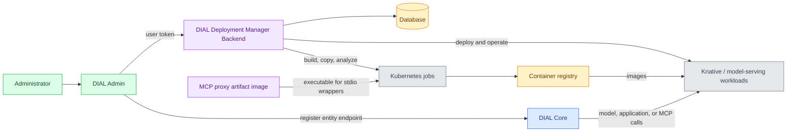

# DIAL Deployment Manager

Deployment Manager builds container images and manages workloads in Kubernetes for DIAL Admin's Deployments section. The backend manages images, containers, and model servings; its MCP proxy images let it run stdio MCP servers behind an HTTP endpoint. This reference is for platform engineers who deploy these components next to [DIAL Admin](../8.admin/0.index.md). For the screens and workflows, see [Deployments overview](../../5.administering-dial-new/3.deployments/0.index.md).

:::info

| Component | Repository | Releases | Image tags |
|---|---|---|---|
| Backend | [GitHub](https://github.com/epam/ai-dial-admin-deployment-manager-backend) | [Releases](https://github.com/epam/ai-dial-admin-deployment-manager-backend/releases) | [Docker Hub](https://hub.docker.com/r/epam/ai-dial-admin-deployment-manager-backend/tags) |
| MCP proxy | [GitHub](https://github.com/epam/ai-dial-deployment-manager-mcp-proxy) | [Releases](https://github.com/epam/ai-dial-deployment-manager-mcp-proxy/releases) | [Docker Hub](https://hub.docker.com/r/epam/ai-dial-deployment-manager-mcp-proxy/tags) |

:::

## The two components

| Component | Repository | Image | What it does |
|---|---|---|---|
| Deployment Manager Backend | [ai-dial-admin-deployment-manager-backend](https://github.com/epam/ai-dial-admin-deployment-manager-backend) | `epam/ai-dial-admin-deployment-manager-backend` | A Java / Spring Boot service that stores image definitions and deployments, runs Kubernetes build jobs, and operates Knative services and model servings. |
| MCP proxy images | [ai-dial-deployment-manager-mcp-proxy](https://github.com/epam/ai-dial-deployment-manager-mcp-proxy) | `ghcr.io/epam/ai-dial-deployment-manager-mcp-proxy` | Alpine and Debian artifact images containing a proxy executable. The backend copies the executable into stdio MCP workload images; these images are not another API service to deploy alongside the backend. |

## How the components fit together

1. **DIAL Admin calls the backend.** Admin's server sends the signed-in user's token to `DIAL_DEPLOYMENTS_API_URL`. Deployment Manager validates the token and maps the provider's roles to `FULL_ADMIN` or `READ_ONLY_ADMIN`.
2. **The backend stores desired state.** Its database holds image definitions, deployments, and audit history. Kubernetes holds the jobs, services, pods, secrets, and other resources created from those definitions.
3. **Build jobs prepare images.** BuildKit builds source images; Syft analyzes images; Skopeo copies images into the configured registry. Private Git and registry credentials are configured on the backend.
4. **Workloads run in Kubernetes.** Knative serves containers; KServe serves Hugging Face models. Released backend 0.22.0 also supports NVIDIA NIM. See [Version scope](1.configuration/1.backend.md#version-scope) before using development documentation for NIM.
5. **DIAL entities point at the workloads.** Admin registers the running endpoint in DIAL Core as a model, application, interceptor, or toolset. Creating a container and registering its DIAL entity are separate operations.

For a stdio MCP server, the build pipeline adds the [MCP proxy](1.configuration/2.mcp-proxy.md), which exposes Streamable HTTP on port `8080` and launches the original server as a subprocess. An MCP server that already serves HTTP does not need this stdio wrapper.

## Capabilities

| Capability | What it provides | User guide |
|---|---|---|
| Image management | Version image definitions, build from Git, copy existing images, select rootless or root BuildKit, and inspect build status and logs. | [Images](../../5.administering-dial-new/3.deployments/3.images.md) |
| Container lifecycle | Start, stop, update, and scale MCP servers, adapters, applications, and interceptors; set resources, environment variables, and probes. | [Containers](../../5.administering-dial-new/3.deployments/2.container-management.md) |
| Model serving | Operate Hugging Face models through KServe, including text-classification transformer chains; 0.22.0 also supports NIM. | [Model servings](../../5.administering-dial-new/3.deployments/1.model-servings.md) |
| MCP discovery and inspection | Discover MCP Registry entries, build their servers, and inspect tools, resources, and prompts on running MCP containers. | [MCP containers](../../5.administering-dial-new/3.deployments/2.container-management.md#mcp-containers) |
| Scheduling and network controls | Apply node-pool scheduling presets; enforce domain rules when Cilium integration is enabled and configured in the cluster. | [Node pools](1.configuration/1.backend.md#node-pools), [Network policy](1.configuration/1.backend.md#network-policy) |
| Operations | Stream status, pod logs, and events; inspect resource and serving metrics; review revisions and roll back; import/export deployment definitions. | [Deployments](../../5.administering-dial-new/3.deployments/0.index.md) |

## Dependencies

| Dependency | Purpose |
|---|---|
| Kubernetes | Runs build jobs and managed workloads. The backend needs a kubeconfig or token and scoped RBAC in the build and deployment namespaces. |
| Knative Serving | Container deployment and autoscaling; enabled by default in the backend. |
| KServe, optional | Hugging Face model serving; disabled by default. NIM in 0.22.0 additionally requires the NVIDIA operator and NGC credentials. |
| PostgreSQL or SQL Server | Persistent backend configuration and audit state in production. H2 is intended for development and testing. |
| Container registry | Stores built and copied images; target nodes must be able to pull them. |
| Identity provider | Issues the user tokens forwarded by Admin; configure matching issuer, audience, and role mappings on the backend. |
| DIAL Core | Serves the entities registered from running workloads. Also validates API keys when optional backend API-key authentication is enabled. |
| metrics-server / NVIDIA DCGM exporter, optional | Pod CPU/memory and GPU metrics, respectively. |
| Cilium, optional | Enforces the configured network policies for builds and workloads. |

The backend can run in a trusted cluster and manage workloads in a separate cluster. The upstream [security-model deployment guide](https://github.com/epam/ai-dial-admin-deployment-manager-backend/blob/0.22.0/docs/deployment_guide_full_security_model.md) describes this topology and its RBAC.

## Deployment and API

The [DIAL Admin Helm chart](../11.helm/1.configuration/4.dial-admin.md) includes the backend behind `manager.enabled`. The MCP proxy artifact images are pulled during stdio wrapper builds. See [Configuration](1.configuration/0.index.md) for the installation settings and Admin connection.

| Interface | Default location |
|---|---|
| REST API | Port `8080`, under `/api/v1`; includes `/images/definitions`, `/images/builds`, `/deployments`, and `/deployments/mcp` |
| Backend health | `GET /api/v1/health`, returning `{"status":"UP"}` |
| Workload metrics snapshot | `GET /api/v1/deployments/{id}/metrics` |
| Backend Prometheus metrics | Port `9464`, `/actuator/prometheus`; independent of workload metrics |

The upstream [Postman collection](https://github.com/epam/ai-dial-admin-deployment-manager-backend/blob/0.22.0/docs/rest-collection/dm_postman_collection.json) contains API request examples. The [development guide](https://github.com/epam/ai-dial-admin-deployment-manager-backend/blob/0.22.0/docs/Development.md) describes the API and build pipeline.

## Further reading

- [Deployments in DIAL Admin](../../5.administering-dial-new/3.deployments/0.index.md) — understand images, containers, and model servings
- [Application hosting and lifecycle](../../2.understand-dial/4.architecture/6.application-server.md) — compare managed workloads with other hosting paths

## Next steps

- [Configure Deployment Manager](1.configuration/0.index.md) — connect the manager, Kubernetes, and DIAL Admin
- [Configure the backend](1.configuration/1.backend.md) — set builds, storage, scheduling, authentication, and telemetry
- [Manage containers](../../5.administering-dial-new/3.deployments/2.container-management.md) — create and run a workload through DIAL Admin
