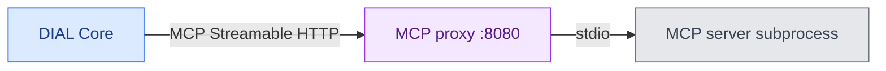

# DIAL Deployment Manager MCP proxy configuration

The MCP proxy bridges Streamable HTTP requests to a stdio MCP server inside a managed container. Deployment Manager uses the [MCP proxy artifact images](https://github.com/epam/ai-dial-deployment-manager-mcp-proxy) during image builds; there is no separate proxy deployment or proxy URL on Admin Frontend. This reference is for platform engineers who configure [DIAL Deployment Manager Backend](1.backend.md).

## What is in the images

The [Alpine Dockerfile](https://github.com/epam/ai-dial-deployment-manager-mcp-proxy/blob/v0.1.0/alpine/Dockerfile) and [Debian Dockerfile](https://github.com/epam/ai-dial-deployment-manager-mcp-proxy/blob/v0.1.0/debian/Dockerfile) build a standalone executable with PyInstaller from Python package `mcp-proxy==0.10.0`. The final artifact image contains that executable at `/mcp_proxy`.

Deployment Manager analyzes the MCP server's base image to choose the Alpine or Debian executable. Other distributions are not supported: for them, the backend stops with `Unsupported distro id` and builds no wrapper. Its [wrapper Dockerfile](https://github.com/epam/ai-dial-admin-deployment-manager-backend/blob/0.22.0/src/main/resources/build/mcp_wrapper.Dockerfile) copies it into the server image at `/usr/local/bin/mcp-proxy` and uses it as the entrypoint. The original server command becomes the subprocess command after `--`.



## Backend image settings

These environment variables are set on **Deployment Manager Backend**:

| Variable | Spring property | Default |
|---|---|---|
| `MCP_PROXY_EXECUTABLE_IMAGE_ALPINE` | `app.build.mcp-proxy.images.alpine` | `ghcr.io/epam/ai-dial-deployment-manager-mcp-proxy:0.1.0-alpine` |
| `MCP_PROXY_EXECUTABLE_IMAGE_DEBIAN` | `app.build.mcp-proxy.images.debian` | `ghcr.io/epam/ai-dial-deployment-manager-mcp-proxy:0.1.0-debian` |

Defaults come from the backend's [0.22.0 application configuration](https://github.com/epam/ai-dial-admin-deployment-manager-backend/blob/0.22.0/src/main/resources/application.yml). For a mirrored registry, replace both references with the corresponding artifact images containing `/mcp_proxy`. The upstream [MCP proxy configuration](https://github.com/epam/ai-dial-admin-deployment-manager-backend/blob/development/docs/configuration.md#mcp-proxy-configuration) documents the same properties.

## Runtime behavior

The backend's wrapper starts the executable with these options:

```text
mcp-proxy --port 8080 --host 0.0.0.0 --pass-environment --transport streamablehttp --stateless -- <original server command>
```

- The HTTP listener binds to all container interfaces on port `8080`.
- `--pass-environment` passes the container's environment to the stdio server. Application-specific environment variables and secrets are configured on the managed MCP container, not on the artifact image.
- `--stateless` selects the wrapper's stateless transport mode; it does not make the server's own application state stateless.
- The executable is added at image-build time. Changing the backend's image variables affects subsequent wrapper builds; it does not replace the executable in an image already built.

The 0.1.0 artifact Dockerfiles use `x86_64` Python build images. They are not evidence of ARM support for the wrapped executable, even though the backend itself publishes ARM64 images. Verify the artifact and workload architecture together before scheduling stdio wrappers on ARM nodes.

For the container creation workflow, see [MCP containers](../../../5.administering-dial-new/3.deployments/2.container-management.md#mcp-containers). An HTTP-native MCP server does not require these executable images.

## Next steps

- [Backend build settings](1.backend.md#image-builds-and-registries) — registry access and build jobs
