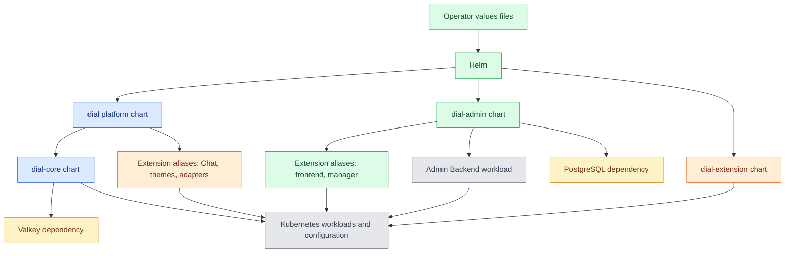

# DIAL Helm

DIAL Helm packages DIAL services as Kubernetes charts. The [ai-dial-helm repository](https://github.com/epam/ai-dial-helm) provides the platform assembly, standalone Core, a reusable workload chart, and the Admin chart. This reference is for platform engineers who select, configure, and upgrade those charts. It assumes familiarity with Kubernetes and Helm; provider-specific installation steps remain in [Cloud deployment](../../4.operating-dial/2.cloud-deployment/0.index.md).

:::info

- [Repository](https://github.com/epam/ai-dial-helm)
- [Releases](https://github.com/epam/ai-dial-helm/releases)
- [Chart repository](https://charts.dialx.ai)

:::

## The four charts

| Chart | Reference release | Purpose | Configuration |
|---|---|---|---|
| `dial/dial` | `8.1.0` | Platform assembly: Core, Chat, themes, and optional model adapters. Core brings the optional bundled Valkey dependency. | [Platform chart](1.configuration/1.dial.md) |
| `dial/dial-core` | `6.0.0` | Core's Kubernetes workload, storage, encryption Secret, optional Vector logger, and optional Valkey. | [Core chart](1.configuration/2.dial-core.md) |
| `dial/dial-extension` | `3.1.1` | Reusable Deployment, Service, and optional networking/storage/metrics resources for a container. Used by the other charts and for standalone applications and adapters. | [Extension chart](1.configuration/3.dial-extension.md) |
| `dial/dial-admin` | `0.20.0` | Admin Frontend, optional Admin Backend and PostgreSQL, and optional Deployment Manager. | [Admin chart](1.configuration/4.dial-admin.md) |

These are the latest published releases checked on this page's verification date. Each chart has its own version. The `dial` chart's `appVersion: 1.49.0` identifies a platform assembly, not a container image tag. The chart's dependency versions and its service image tags are separate settings.

## How the charts fit together



Helm renders Kubernetes resources and records the release. DIAL services then read the environment variables, Secrets, and mounted files those resources provide. Helm values configure deployment; the services' own references define the meaning of their runtime settings.

## Capabilities

- **Choose the deployment scope.** Install the platform assembly, Core alone, an extension, or Admin. Enable only the required chart dependencies.
- **Configure workload operations.** Set images, resources, replicas, probes, service accounts, scheduling, storage, ingress or Gateway API routes, network policies, and metrics discovery.
- **Provide runtime configuration.** Pass plain environment values, generated Secrets, existing Secrets/ConfigMaps, or mounted configuration files to the selected service.
- **Use provider examples.** The platform chart includes AWS, Azure, GCP, and generic Kubernetes examples. The Admin chart has separate Admin examples.
- **Pin and review upgrades.** Select a chart version and inspect its rendered resources and bundled service versions before applying it.

## Requirements and boundaries

The chart metadata declares Kubernetes `>=1.23.0-0` for `dial`, `dial-core`, and `dial-extension`, and `>=1.25.0-0` for `dial-admin`. The chart READMEs specify Helm `>=3.8.0`. These are declared minimums; the chosen images, storage drivers, operators, and ingress implementation have their own requirements.

The charts configure DIAL workloads; cloud object stores, identity providers, model-provider credentials, and external cache/database services must be supplied separately when selected. Ingress and Gateway API resources need their controllers, and ServiceMonitor/PrometheusRule resources need the Prometheus Operator CRDs. Deployment Manager also needs its workload operators and permissions; see [DIAL Deployment Manager](../10.deployment-manager/0.index.md).

The platform chart does not include Admin. The Admin chart does not include the [evaluation services](../9.evaluations/0.index.md). Setting a frontend URL or feature switch connects to a service; it does not install that service.

## Chart repository

The published chart repository is `https://charts.dialx.ai`:

```bash
helm repo add dial https://charts.dialx.ai
helm repo update
helm search repo dial --versions
```

The older `https://charts.epam-rail.com` address is retired in the upstream [repository guidance](https://github.com/epam/ai-dial-helm#epam-ai-dial-helm-repository). Update existing local repository registrations to the current address.

## Further reading

- [Deployment profiles](../../2.understand-dial/4.architecture/3.deployment-profiles.md) — choose the capabilities and services to deploy
- [Changelog](../../8.reference/changelog/index.md) — find the chart and component versions each platform release pins

## Next steps

- [Configure Helm charts](1.configuration/0.index.md) — understand value scopes and runtime configuration sources
- [Install DIAL Admin](../../4.operating-dial/2.cloud-deployment/8.admin-installation.md) — deploy the separate Admin chart
- [Upgrade DIAL](../../4.operating-dial/7.production-readiness/5.upgrade-procedure.md) — plan a release change and rollback
