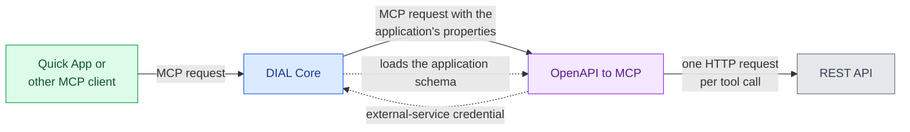

# DIAL OpenAPI to MCP

DIAL OpenAPI to MCP is a bridge that turns a REST API into MCP tools, one tool per operation in the API's OpenAPI 3.x document. It runs as an application type: each application of the type holds one API's document and address, and DIAL Core sends them to the bridge with every MCP request. This reference is for platform engineers who deploy the bridge next to [DIAL Core](../1.core/0.index.md). For the screens where the type and its applications are created, see [Application runners](../../5.administering-dial-new/1.ai-gateway/6.application-runners.md).

:::info

- [Repository](https://github.com/epam/ai-dial-openapi-to-mcp)
- [Releases](https://github.com/epam/ai-dial-openapi-to-mcp/releases)
- [Docker Hub image tags](https://hub.docker.com/r/epam/ai-dial-openapi-to-mcp/tags)

:::

## How it works

The client is usually a [Quick App](../7.quick-apps/0.index.md). The bridge asks [DIAL Core](../1.core/0.index.md) for a credential only when the application names an external service.

1. **Core loads the schema.** The type's registration points `dial:applicationTypeSchemaEndpoint` at the bridge's `/v1/configuration-support/application-schema`. The schema declares the four [application properties](1.configuration/0.index.md#application-properties).
2. **A client calls an application over MCP.** Core serves `POST /v1/deployments/<application>/mcp` and forwards the message to the bridge's `/mcp`. It adds the application's properties to `params._meta.ai_dial_config`, the application ID in `X-DIAL-APPLICATION-ID`, and a per-request key in `API-KEY`.
3. **The bridge builds the tools.** It reads the document and the base URL, creates the tools with FastMCP, and caches them per document and base URL.
4. **A tool call becomes an HTTP request.** The bridge calls the operation with the tool's arguments and returns the response as the tool result. When the application sets `external_service`, the bridge first gets the caller's credential from Core and adds it as a header.

Core reports `features.mcp` for applications of the type, so a Quick App's [`dial-app` Toolset](../7.quick-apps/2.manifest/2.tool-sets.md#dial-app) calls them over MCP. To set up an application, see [Expose a REST API as MCP tools](../../3.building-with-dial/2.toolsets/2.rest-api-as-mcp-tools.md).

## Tools

- **One tool per operation.** A tool is named after its operation's `operationId`. In the upstream example, the operation `listTodos` becomes the tool `listTodos`.
- **OpenAPI 3.x only.** The bridge rejects a Swagger 2.0 document, and any `openapi` version other than 3.x.
- **`x-mcp` overrides.** On an operation, `x-mcp.name` renames the tool, which needs an `operationId`. `x-mcp.description` replaces the tool's description, and `x-mcp.parameters.<name>.description` replaces a parameter's description. Release 0.2.1 reads no other `x-mcp` keys, so the `inputSchema`, `outputSchema`, and `tags` in the upstream `*-extended.json` samples have no effect.
- **Utility tools.** When a request carries no document, or a `null` or empty one, the bridge offers two tools of its own:
  - `openapi_verify(spec)` checks that a document parses, is OpenAPI 3.x, has `info.title`, `info.version`, and `paths`, and that FastMCP can build tools from it. When FastMCP fails, it checks each path of a document with up to 50 paths and reports which ones fail.
  - `openapi_convert(spec)` converts a Swagger 2.0 document to OpenAPI 3.0, and returns an OpenAPI 3.x document unchanged.

## Dependencies

| Dependency | Purpose |
|---|---|
| DIAL Core | Registers the application type, sends MCP requests to the bridge, and stores external-service credentials. DIAL 1.47, the first platform release with the bridge, pairs it with DIAL Core 0.47.0. |
| REST APIs | The destinations of tool calls. The bridge needs network access to each API's base URL. |
| OpenTelemetry collector or Prometheus, optional | Receives traces, metrics, and logs when an exporter is set. See [Observability](1.configuration/1.environment-variables.md#observability). |

## Deployment

| Item | Value |
|---|---|
| Image | `ghcr.io/epam/ai-dial-openapi-to-mcp:0.2.1`, Python 3.13 on Alpine, running as the non-root user `appuser` (UID `1001`) |
| MCP endpoint | Streamable HTTP at `/mcp`, port `8080` (`MCP_PORT`) |
| Schema endpoint | `GET /v1/configuration-support/application-schema` |
| Liveness | `GET /health` returns `200` and `{"status": "ok"}` |
| Readiness | `GET /ready` returns `200` and `{"status": "ready"}` after startup, and `503` before |
| Metrics | Port `9464`, when `OTEL_METRICS_EXPORTER` includes `prometheus` |
| Helm | Not part of the `dial` chart. Deploy it with the [`dial-extension` chart](../11.helm/1.configuration/3.dial-extension.md); see the [example](1.configuration/0.index.md#example-helm-values). |

The DIAL 1.47 and 1.48 platform releases pin 0.2.1. See [Upgrade to DIAL 1.47](../../8.reference/changelog/upgrade-to-1.47.md), where the bridge first appears.

**Warning**
> The bridge doesn't authenticate its clients and calls any destination a request names. In 0.2.1, it also passes the per-request key that DIAL Core sends on to the API. Read [Secure the bridge](1.configuration/0.index.md#secure-the-bridge) before you expose it.

## Next steps

- [Configuration](1.configuration/0.index.md) — register the type, set application properties, and secure the bridge
- [Environment variables](1.configuration/1.environment-variables.md) — server, cache, header, credential, and telemetry settings
- [Expose a REST API as MCP tools](../../3.building-with-dial/2.toolsets/2.rest-api-as-mcp-tools.md) — create an application and use it in a Quick App
