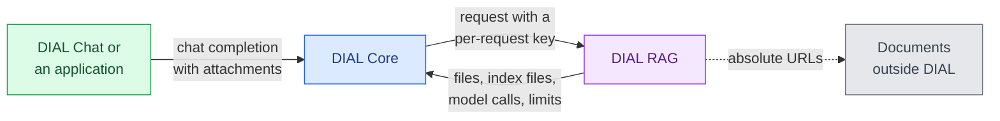

# DIAL RAG

DIAL RAG is an application that answers questions about the documents attached to a request. It indexes each document on first use, stores the index, and reuses it on later requests. This reference is for platform engineers who deploy DIAL RAG next to [DIAL Core](../1.core/0.index.md). To compare it with [DIAL Generic RAG](../15.generic-rag/0.index.md), see [DIAL RAG or Generic RAG](../../2.understand-dial/3.capabilities/6.tools-and-enterprise-data.md#dial-rag-or-generic-rag).

:::info

- [Repository](https://github.com/epam/ai-dial-rag)
- [Releases](https://github.com/epam/ai-dial-rag/releases)
- [Docker Hub image tags](https://hub.docker.com/r/epam/ai-dial-rag/tags)

:::

## How it works

1. **A request names documents.** Documents are the attachments of every user message in the conversation, as DIAL file links or absolute URLs. A `/attach <url>` line in a message adds one more. DIAL Core forwards the request with a [per-request key](../../3.building-with-dial/8.working-with-dial-resources/5.per-request-keys.md).
2. **DIAL RAG checks access.** For a DIAL file, it reads the file's metadata through DIAL Core, which fails when the caller has no access. For an absolute URL, it sends a `HEAD` request.
3. **It loads or builds the index.** It reuses a stored index when its settings match and the document hasn't changed. Otherwise it indexes the document and stores the new index. See [Index storage](#index-storage).
4. **It forms the search query.** In a conversation with more than one user message, the query model rewrites the latest question into a standalone one. Otherwise the latest message is the query.
5. **It retrieves chunks.** When all chunks of the documents fit in about 12,000 characters, it uses all of them. Otherwise each [retriever](#retrievers) returns its 7 best chunks, and an equal-weight ensemble merges the lists.
6. **It answers.** It sends the chunks and up to 4 page images to the chat model and streams the answer. Each cited chunk is attached to the response, with a page link for PDF documents.

DIAL RAG reports each step as a [stage](../../3.building-with-dial/6.developer-tools/2.chat-customization/1.custom-content.md#stages) of the response. A request can also stop after indexing or after retrieval; see [DIAL RAG API](2.api.md).

## Retrievers

| Retriever, as its stage is named | What it searches | When it runs |
|---|---|---|
| Keywords search | Chunk text, with BM25 | Always |
| Embeddings search | Chunk text, embedded with `epam/bge-small-en` inside the container | Always |
| Page image search | Descriptions of page images, written by a vision model and embedded with `epam/bge-small-en` | When `description_index` is set, which is the default |
| Multimodal search | Page images, embedded with a multimodal embeddings model | When `multimodal_index` is set. It's unset by default. |

The vision model and the multimodal embeddings model are deployments in DIAL Core. DIAL RAG plans their calls against the caller's token limits for that model. It reserves the expected tokens from the daily limit and paces requests to the minute limit. See [Indexing](1.configuration/1.environment-variables.md#indexing).

## Documents

| Input | How DIAL RAG reads it |
|---|---|
| PDF | Text, split into chunks of up to 1,000 characters by the `unstructured` library, and the page images |
| DOC, DOCX, ODT, PPT, PPTX, PPTM, ODP | Converted to PDF with LibreOffice first, then read as PDF |
| Images (`image/*`) | No text. The image is searched by the image retrievers and passed to the chat model. |
| Text formats, such as plain text and code files | Text only, through `unstructured` |

A PDF page without a text layer has no text chunks, because DIAL RAG doesn't run OCR. The image retrievers can still find it. A document whose extracted text exceeds 5 MiB is rejected (`max_document_text_size`).

## Index storage

Each index is one file of MIME type `application/x.aidial-rag.index.v0`. By default it goes to `files/<DIAL RAG bucket>/dial-rag-index/<path>/index.bin`. The path is the SHA-256 hash of the document's link, split into 8-character folders.

| `DIAL_RAG__INDEX_STORAGE__USE_DIAL_FILE_STORAGE` | Where indexes live |
|---|---|
| `False`, the image's default | Only in an in-memory cache of 128 MiB per process. Indexes are lost on restart and not shared between replicas. |
| `True` | In DIAL file storage, with the in-memory cache in front |

DIAL RAG reuses a stored index only when all of these hold:

- **Same index settings.** The chunk size and the multimodal embeddings model are the same. The same image retrievers are turned on.
- **Same document.** A DIAL file has the same ETag. A document outside DIAL has the same ETag and `Last-Modified` header.
- **Supported format.** DIAL RAG migrates an older index format and saves it back, unless a request turns that off.

A client can also choose where an index is stored, for example in its own `appdata` folder. See [Index attachments](2.api.md#index-attachments).

## Dependencies

| Dependency | Purpose |
|---|---|
| DIAL Core | Routes requests to DIAL RAG, issues per-request keys, stores documents and index files, and serves the models |
| A chat model | Writes the answer. With page images in use, it must accept images. |
| A query model | Rewrites follow-up questions. It must support tool calling while `use_history` is on. |
| A vision model or a multimodal embeddings model | Indexes page images, for the image retrievers |

DIAL Core must let the callers of DIAL RAG use these models, because DIAL RAG calls them with the caller's per-request key.

## Deployment

| Item | Value |
|---|---|
| Image | `epam/ai-dial-rag:0.43.0` on Docker Hub, or `ghcr.io/epam/ai-dial-rag:0.43.0`. Ubuntu 24.04 and Python 3.11, running as `appuser` (UID `1001`). |
| Port | `5000` |
| Chat completions | `POST /openai/deployments/dial-rag/chat/completions` |
| Configuration schema | `GET /openai/deployments/dial-rag/configuration` returns the JSON schema of the [per-request configuration](2.api.md#configuration) |
| Health | `GET /health` returns `{"status": "ok"}` |
| Bundled in the image | LibreOffice, the `epam/bge-small-en` model, and the NLTK data for keyword search |
| Default profile | `/config/azure_description.yaml`; see [Profiles](1.configuration/0.index.md#profiles) |
| Helm | Not part of the `dial` chart. Deploy it with the [`dial-extension` chart](../12.helm/1.configuration/3.dial-extension.md); see the [example](1.configuration/0.index.md#example-helm-values). |

The DIAL 1.47 and 1.48 platform releases pin 0.43.0.

**Warning**
> DIAL RAG downloads every absolute URL that a request attaches or names with `/attach`, from inside your network and without credentials. Limit its egress when internal endpoints must stay unreachable.
