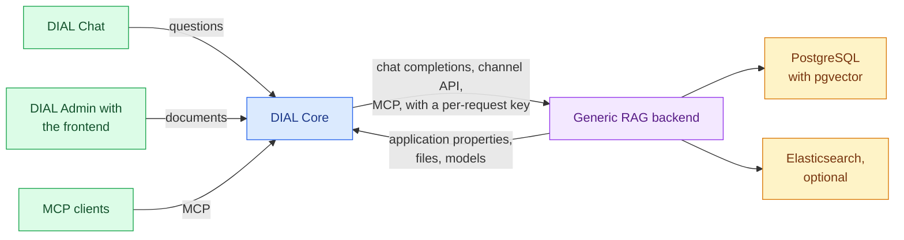

# DIAL Generic RAG

DIAL Generic RAG answers questions over a collection of documents that is uploaded and indexed in advance. It runs as an application type: each application of the type has its own documents, indexes, and pipeline settings. This reference is for platform engineers who deploy its backend and frontend next to [DIAL Core](../1.core/0.index.md). To compare it with [DIAL RAG](../14.rag/0.index.md), see [DIAL RAG or Generic RAG](../14.rag/0.index.md#dial-rag-or-generic-rag).

:::info

| Component | Repository | Releases | Image tags |
|---|---|---|---|
| Backend | [GitHub](https://github.com/epam/ai-dial-generic-rag-backend) | [Releases](https://github.com/epam/ai-dial-generic-rag-backend/releases) | [Docker Hub](https://hub.docker.com/r/epam/ai-dial-generic-rag-backend/tags) |
| Frontend | [GitHub](https://github.com/epam/ai-dial-generic-rag-frontend) | [Releases](https://github.com/epam/ai-dial-generic-rag-frontend/releases) | [Docker Hub](https://hub.docker.com/r/epam/ai-dial-generic-rag-frontend/tags) |

:::

## How it works

- **One backend, many applications.** The backend calls each application a *channel*. A channel's documents, chunks, and indexes are kept apart by a channel key. The key is the SHA-1 hash of the application ID, saved as the `channel_key` file in the application's bucket on first use.
- **Settings from application properties.** For every request, the backend reads the application's properties from DIAL Core with the request's per-request key. It validates them against the type's schema. See [Channel configuration](1.channel-configuration.md).
- **The application ID from DIAL Core.** DIAL Core names the application in the `X-DIAL-APPLICATION-ID` header. A chat completion request without it fails with `403`.

## Document lifecycle

Documents are uploaded and managed through the [channel API](2.channel-api.md), usually from the frontend in DIAL Admin.

1. **Upload.** The backend stores the file in the application's bucket, at `documents/<folder>/<hash><extension>`. The hash is the SHA-1 of the file name, lowercased and without its extension. It records the document in PostgreSQL with the status `created`.
2. **Processing** (`processing`, then `processed`). Each configured [parser](1.channel-configuration.md#parsers) that accepts the document's MIME type extracts chunks. The parser's transforms run on the chunks. Chunks are recorded in PostgreSQL, and the images of image chunks go to the application's bucket under `images/`.
3. **Indexing** (`indexing`, then `ready`). Each chunk index indexes the chunks, and each document index indexes the document's fields. A failure in either step sets the status to `error`.

A replaced file or a forced reindex runs processing again. A reindex of chosen indexes rebuilds only those. Any change to the documents deletes the channel's export archive.

**Background jobs**
> When `DIAL_API_KEY` is set and that key can reach the application's channel API, indexing runs as a background job. An upload then returns at once with the status `created`. Without such a key, the upload request waits until indexing ends. Channel export and import always need background jobs. See [Background jobs](4.configuration/0.index.md#background-jobs).

## Answers

A chat completion request answers the text of its last message. The backend doesn't send earlier messages to the model.

1. **Settings.** The application's `retriever` and `generation` properties are merged with the request's `custom_fields.configuration`.
2. **Document selection.** The [document selector](1.channel-configuration.md#document-selectors) narrows the search to some documents, or keeps all of them.
3. **Search.** Each chunk index is searched, up to its result limit. Reciprocal rank fusion merges the lists with equal weights.
4. **Answer.** The `default` generator sends the results to the LLM, which cites them. The `retrieval_only` generator returns the results as citations, with no LLM call.
5. **Citations.** The backend copies each cited document to the user's `appdata` folder, so the user can open it. A citation is an annotation for DIAL Chat or an attachment; see [`ENABLE_ANNOTATIONS`](4.configuration/1.backend.md#chat-responses).

With debug stages turned on, the response also shows the channel's configuration, each index's results, the raw LLM output, and token usage.

## Interfaces

| Interface | On the backend | Through DIAL Core |
|---|---|---|
| Chat completions | `POST /openai/deployments/generic-rag/chat/completions` | `POST /openai/deployments/<application>/chat/completions` |
| Request configuration schema | `GET /openai/deployments/generic-rag/configuration` | `GET /v1/deployments/<application>/configuration` |
| [Channel API](2.channel-api.md) | `/channel/...` | `/v1/deployments/<application>/route/channel/...` |
| [MCP server](3.mcp-server.md) | `/mcp/streamable-http` | `POST /v1/deployments/<application>/mcp` |
| Built-in embeddings | `POST /openai/deployments/generic-rag-embeddings/embeddings` | As an embedding model registered in DIAL Core |
| Application schema | `GET /application-type-schema` | Read by DIAL Core |
| Channel API docs | `GET /docs`, Swagger UI of `GET /openapi/channel` | Not routed |
| Job dashboard | `/dashboard` | Not routed |
| Health | `GET /health` returns `{"status": "ok"}` | Not routed |

`<application>` is the application's ID: its name for an application in the DIAL Core configuration, or `applications/<bucket>/<name>` for one in a bucket.

The built-in embeddings endpoint serves the `epam/bge-small-en` model from inside the container. Register it in DIAL Core as an embedding model to use it in a `text_embeddings` index, as the upstream example does.

## Dependencies

| Dependency | Purpose |
|---|---|
| DIAL Core | Registers the type, routes requests, issues per-request keys, stores application properties and files, and serves the models. The upstream README requires DIAL Core 0.44.0 or later. |
| PostgreSQL with the `pgvector` extension | Documents, chunks, `pgvector` indexes, and the job queue. The backend applies its migrations at startup. |
| Elasticsearch, optional | Text indexes whose storage backend is `elastic` |
| Models in DIAL Core | The LLM of the `default` generator, and the embeddings, vision, and multimodal models that indexes use |
| DIAL Admin, optional | Hosts the frontend in an application's **Parameters** tab |

## Deployment

| Item | Backend | Frontend |
|---|---|---|
| Image | `epam/ai-dial-generic-rag-backend:0.3.3`, Python 3.13, running as `appuser` (UID `1001`) | `epam/ai-dial-generic-rag-frontend:0.1.0`, Node.js 24, running as `nextjs` (UID `1001`) |
| Port | `5000` | `3000` |
| Health | `GET /health` | None. `GET /` redirects to `/en`. |
| Bundled in the image | The `epam/bge-small-en` model, and the English and Ukrainian spaCy models | — |
| Configuration | [Backend environment variables](4.configuration/1.backend.md) | [Frontend environment variables](4.configuration/2.frontend.md) |
| Helm | Not part of the `dial` chart. Deploy it with the [`dial-extension` chart](../12.helm/1.configuration/3.dial-extension.md); see the [example](4.configuration/0.index.md#example-helm-values). | The same chart |

No DIAL platform release pins Generic RAG yet. Backend 0.3.3 is from 2026-10-22, and frontend 0.1.0 from 2026-10-29.

**Warning**
> The backend trusts the `X-DIAL-APPLICATION-ID` header that DIAL Core sets, and serves `/dashboard` and `/docs` without authentication. The dashboard can cancel and requeue jobs. Let only DIAL Core reach the backend; see [Secure the backend](4.configuration/0.index.md#secure-the-backend).
