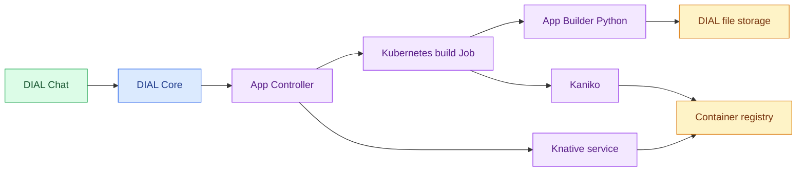

# DIAL App Controller

DIAL App Controller builds Python application images and manages their Kubernetes workloads for DIAL Core. It deploys Code Apps as Knative services and creates pods for Code Interpreter sessions. This reference covers **0.5.1** for platform engineers familiar with Kubernetes. For authoring, see [Code Apps](../../3.building-with-dial/1.apps/3.code-apps/0.index.md).

:::info

- [Repository](https://github.com/epam/ai-dial-app-controller)
- [Releases](https://github.com/epam/ai-dial-app-controller/releases)
- [Docker Hub image tags](https://hub.docker.com/r/epam/ai-dial-app-controller/tags)

:::

## Responsibilities

| Workload | Controller responsibility | Related component |
|---|---|---|
| Code App build | Creates a Kubernetes Job that downloads and validates source files, then builds and pushes an image | [App Builder Python](../17.app-builder-python/0.index.md) prepares the files; Kaniko builds the image |
| Code App deployment | Creates a Knative service from the image, supplies application environment variables, and retrieves pod logs | [DIAL Core](../1.core/0.index.md) exposes the application to callers |
| Code Interpreter session | Creates and deletes a pod, or uses the Knative deployment API when Core selects that mode | [Code Interpreter](../18.code-interpreter/0.index.md) executes Python in the session |

App Controller is separate from [Deployment Manager](../11.deployment-manager/0.index.md), which powers DIAL Admin's Deployments screens. The controller's callers and operations are defined in [Core's ApplicationOperatorService](https://github.com/epam/ai-dial-core/blob/0.49.4/server/src/main/java/com/epam/aidial/core/server/service/ApplicationOperatorService.java#L39-L132).

## How a Code App is built and deployed

[DIAL Core](../1.core/0.index.md) requests the build and deployment. [App Builder Python](../17.app-builder-python/0.index.md) reads source files through Core's file API. The resulting service runs the Code App.

1. **Prepare the source.** The build Job's init container receives the source folder, runtime profile, and DIAL credentials. It downloads the files and validates the Python project.
2. **Build the image.** Kaniko consumes the shared source and Dockerfile directories, builds the selected runtime image, and pushes it to the configured registry.
3. **Deploy the image.** The controller creates a Knative service with the application's environment variables and configured resource and scaling settings.
4. **Manage the lifecycle.** Core requests logs, undeployment, or image cleanup through the controller's API.

The implementation is in [BuildService](https://github.com/epam/ai-dial-app-controller/blob/0.5.1/src/main/java/com/epam/aidial/service/BuildService.java#L36-L65), [ConfigService](https://github.com/epam/ai-dial-app-controller/blob/0.5.1/src/main/java/com/epam/aidial/service/ConfigService.java#L92-L143), and [DeployService](https://github.com/epam/ai-dial-app-controller/blob/0.5.1/src/main/java/com/epam/aidial/service/DeployService.java#L34-L62).

## Dependencies

| Dependency | Purpose |
|---|---|
| DIAL Core | Sends lifecycle requests and serves application source files to the builder |
| Kubernetes access | Creates build Jobs, authentication Secrets, session pods, and application workloads in the selected namespaces |
| Knative Serving | Required for Code App deployments and the Knative mode of interpreter sessions |
| Container registry | Stores built application images; registry deletion support is used by image cleanup |
| App Builder Python image | Runs the source preparation and validation phase of each Code App build |
| Image builder | Kaniko is the configured default; its container definition and arguments are configurable |
| Code Interpreter image | Required only when Core uses the controller to create interpreter sessions |

Build and deployment clients read a kubeconfig file. They can select different contexts and namespaces. The released implementation does not fall back to an in-cluster service account when the kubeconfig file is missing; see [Kubernetes client creation](https://github.com/epam/ai-dial-app-controller/blob/0.5.1/src/main/java/com/epam/aidial/util/KubernetesUtils.java#L141-L149).

## Deployment

The published image is `epam/ai-dial-app-controller:0.5.1`. The container runs as user `1001`, exposes HTTP on port `8080`, and checks `GET /health`. The health endpoint returns an empty successful response; it does not test Kubernetes or registry connectivity. See the [Dockerfile](https://github.com/epam/ai-dial-app-controller/blob/0.5.1/Dockerfile#L20-L42) and [health handler](https://github.com/epam/ai-dial-app-controller/blob/0.5.1/src/main/java/com/epam/aidial/controller/HealthController.java#L10-L16).

The controller needs its registry, DIAL URL, builder image, and readable kubeconfig configured before it can build applications. Core connects through `applications.controllerEndpoint`; see [Configuration](1.configuration.md#connect-dial-core).

No DIAL platform release pins 0.5.1 yet; DIAL 1.41 to 1.48 pin 0.4.0. Version 0.5.1 is from 2026-11-02.

The DIAL platform chart **8.1.0** has no App Controller dependency. Deployment of the controller, Knative, registry, and workload permissions is separate; see [Platform chart configuration](../12.helm/1.configuration/1.dial.md#application-build-and-execution-services).

**Warning**
> Controller requests can build images, deploy code, and delete workloads. Keep the API private to the control plane and restrict its Kubernetes credentials. Application networking and isolation require deployment controls; the build-time package allowlist does not establish a network boundary.
