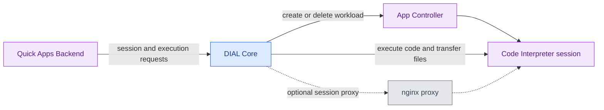

# DIAL Code Interpreter

DIAL Code Interpreter executes Python in a Jupyter kernel for calculations, data analysis, and visualizations. Quick Apps uses it as a tool through DIAL Core's session API. This reference covers **0.2.0** for platform engineers familiar with [App Controller](../15.app-controller/0.index.md) and Core configuration.

:::info

- [Repository](https://github.com/epam/ai-dial-code-interpreter)
- [Releases](https://github.com/epam/ai-dial-code-interpreter/releases)
- [Docker Hub image tags](https://hub.docker.com/r/epam/ai-dial-code-interpreter/tags)

:::

## Capabilities

| Capability | Behavior |
|---|---|
| Python execution | Executes code in one persistent Python 3 kernel per interpreter process |
| Calculations and data analysis | The image includes NumPy, pandas with spreadsheet support, SciPy, and scikit-learn |
| Visualization | Collects display output from libraries including Plotly, Matplotlib, and seaborn |
| File exchange | Uploads, downloads, and lists files in the configured working directory |
| Session reuse | Core and Quick Apps reuse the selected session across tool calls until it is closed or expires |

The dependencies are declared in [pyproject.toml](https://github.com/epam/ai-dial-code-interpreter/blob/0.2.0/pyproject.toml#L17-L34). The [interpreter implementation](https://github.com/epam/ai-dial-code-interpreter/blob/0.2.0/aidial_code_interpreter/interpreter.py#L21-L44) starts `python3` through `jupyter_client`. The service serializes execution calls with a lock; separate sessions require separate interpreter processes.

This service executes tool-supplied code in a session. It does not build or deploy a [Code App](../../3.building-with-dial/1.apps/3.code-apps/0.index.md); that workflow uses [App Builder Python](../16.app-builder-python/0.index.md) and App Controller's image and deployment operations.

## How Quick Apps reaches the interpreter

[Quick Apps Backend](../7.quick-apps/0.index.md) calls [DIAL Core](../1.core/0.index.md). [App Controller](../15.app-controller/0.index.md) manages the interpreter workload. The optional proxy is selected by Core's `codeInterpreter.sessionProxyUrl` setting.

1. **Request the tool.** The model selects the predefined `py_interpreter` tool. Quick Apps obtains or opens a Core interpreter session.
2. **Prepare files.** Quick Apps transfers the attachments named by the tool into the session.
3. **Execute.** Core forwards Python to the session's execution endpoint and returns stdout, stderr, result, and display data.
4. **Return the result.** Quick Apps processes the outputs and attachments for the conversation, then the model continues its answer.
5. **Expire idle work.** Core tracks session use and deletes expired workloads. The kernel's variables and session files are temporary.

Sources: [Quick Apps tool](https://github.com/epam/ai-dial-quickapps-backend/blob/0.13.2/src/quickapp/internal_tooling/py_interpreter_tooling/_py_interpreter_tool.py#L110-L144), [Core workload selection](https://github.com/epam/ai-dial-core/blob/0.49.4/server/src/main/java/com/epam/aidial/core/server/service/codeinterpreter/CodeInterpreterService.java#L359-L378), and [session expiry](https://github.com/epam/ai-dial-core/blob/0.49.4/server/src/main/java/com/epam/aidial/core/server/service/codeinterpreter/CodeInterpreterService.java#L80-L121).

## Dependencies and deployment modes

| Component | Responsibility |
|---|---|
| DIAL Core | Authentication, role checks, session metadata, expiry, and transfers to or from DIAL file storage |
| App Controller | Starts and removes interpreter workloads in Kubernetes |
| Interpreter image | Runs the HTTP API and Python kernel |
| Knative Serving | Required when Core's `sessionProxyUrl` is unset and sessions use the deployment API |
| Session proxy | Required when `sessionProxyUrl` is set; Core creates plain session pods and sends interpreter requests through the proxy |
| Quick Apps Backend | Exposes the Python execution tool to an agent; not required for direct use of Core's session API |

The interpreter can run alone for internal diagnostics, but its four operation endpoints do not implement Core's public session API. Quick Apps expects that public API; pointing it directly at the interpreter container does not supply session management.

## Image and health

The image is `epam/ai-dial-code-interpreter:0.2.0`. It runs as UID `1001`, listens on port `8080`, and uses `/mnt/data` as its working directory. `GET /health` returns `{"status":"HEALTHY"}`. See the [Dockerfile](https://github.com/epam/ai-dial-code-interpreter/blob/0.2.0/Dockerfile#L26-L42) and [health endpoint](https://github.com/epam/ai-dial-code-interpreter/blob/0.2.0/aidial_code_interpreter/app.py#L32-L34).

The DIAL 1.38 to 1.48 platform releases pin 0.2.0. See [Upgrade to DIAL 1.48](../../8.reference/changelog/upgrade-to-1.48.md).

The DIAL platform chart **8.1.0** does not deploy this session infrastructure as a chart dependency. Core is configured with the interpreter image and the App Controller endpoint; see [Configuration](1.configuration.md).

**Warning**
> The service executes arbitrary Python and can access resources available to its container. Keep interpreter endpoints private and apply workload resource limits, network restrictions, and filesystem permissions. `SESSION_ID` checks request routing; it does not establish user authorization or a complete sandbox.
