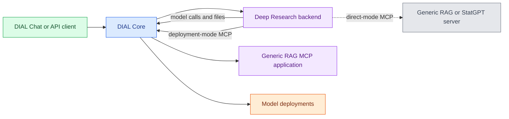

# DIAL Deep Research

DIAL Deep Research prepares a research plan, searches configured sources, and produces a report with citations. This reference covers backend **0.4.0** for platform engineers familiar with [DIAL Core](../1.core/0.index.md) and application types. Each application instance has its own sources, prompts, and research limits.

:::info

- [Repository](https://github.com/epam/ai-dial-deep-research-backend)
- [Releases](https://github.com/epam/ai-dial-deep-research-backend/releases)
- [Docker Hub image tags](https://hub.docker.com/r/epam/ai-dial-deep-research-backend/tags)

:::

## Research workflow

| Phase | Behavior |
|---|---|
| Preparation | Clarifies the question, prepares a plan, and waits for approval before starting research |
| Retrieval | Calls tools from the configured MCP servers and reviews gaps in the findings |
| Report | Writes a report, reviews it, and revises it within the configured version budget |
| Citations | Resolves document, dataset, and data-query citations and appends a References section |
| Progress | Streams work and review progress through DIAL stages |

The [preparation tools](https://github.com/epam/ai-dial-deep-research-backend/blob/0.4.0/src/dial_deep_research/app/preparation/tools.py#L224-L242) require an approved plan. The [research graph](https://github.com/epam/ai-dial-deep-research-backend/blob/0.4.0/src/dial_deep_research/app/research/graph.py#L97-L177) then runs retrieval, research review, report writing, and report review within the same turn.

The application retrieves evidence from its configured sources. Its [prompt rules](https://github.com/epam/ai-dial-deep-research-backend/blob/0.4.0/src/dial_deep_research/app/research/prompts.py#L461-L465) prohibit deriving figures through calculations. For Python calculations in a Quick App, see [Code Interpreter](../17.code-interpreter/0.index.md).

## How the service fits into DIAL

[DIAL Core](../1.core/0.index.md) routes requests to Deep Research. [Generic RAG's MCP interface](../14.generic-rag/3.mcp-server.md) supplies document retrieval and citation tools. Each MCP connection uses either a Core deployment ID or a direct URL/key bundle; see [Connection modes](1.configuration/2.application-properties.md#connection-modes).

The supported retrieval types are `generic_rag` for documents and `statgpt` for datasets. At least one server is required, with at most one server of each type. Arbitrary MCP servers are not interchangeable here: citation formats depend on the supported retrieval types. See the [server types](https://github.com/epam/ai-dial-deep-research-backend/blob/0.4.0/src/dial_deep_research/app_properties.py#L83-L102) and [uniqueness checks](https://github.com/epam/ai-dial-deep-research-backend/blob/0.4.0/src/dial_deep_research/app_properties.py#L1013-L1055).

## Dependencies and deployment

| Component | Responsibility |
|---|---|
| DIAL Core | Routes application requests, stores application properties, and provides model and file APIs. The backend's schema integration requires Core 0.41.0 or later. |
| Model deployment | Runs preparation, retrieval orchestration, and report generation. Deployment IDs can be remapped through environment variables. |
| Retrieval server | Provides the configured Generic RAG document tools, StatGPT dataset tools, or both. |
| DIAL Chat or API client | Preserves conversation state and presents the plan, progress, report, and citations. |

The [application configuration model](https://github.com/epam/ai-dial-deep-research-backend/blob/0.4.0/src/dial_deep_research/app_properties.py#L1-L8) states the Core version requirement. Model defaults and overrides come from [the model configuration](https://github.com/epam/ai-dial-deep-research-backend/blob/0.4.0/src/dial_deep_research/utils/llm.py#L89-L134).

The published image is `epam/ai-dial-deep-research-backend:0.4.0`. It runs as UID `1001` and exposes port `5000`; see the [Dockerfile](https://github.com/epam/ai-dial-deep-research-backend/blob/0.4.0/Dockerfile#L50-L62). Deployment settings and Core registration are described in [Configuration](1.configuration/0.index.md).

No DIAL platform release through 1.48 pins Deep Research. Version 0.4.0 is from 2026-10-27, and the DIAL platform chart **8.1.0** has no Deep Research dependency. See [Upgrade to DIAL 1.48](../../8.reference/changelog/upgrade-to-1.48.md).

Preparation state travels in DIAL conversation messages rather than a server-side checkpointer. The backend can therefore run with multiple workers or replicas, provided the client preserves that state. See the [startup implementation](https://github.com/epam/ai-dial-deep-research-backend/blob/0.4.0/src/dial_deep_research/__main__.py#L32-L40) and [API state contract](2.api.md#conversation-state).

## Further reading

- [Application types](../1.core/1.configuration/8.application-type-schemas.md) — Core's schema and endpoint registration fields
- [Application runners in DIAL Admin](../../5.administering-dial-new/1.ai-gateway/6.application-runners.md) — manage application types and instances through the UI
- [Generic RAG MCP server](../14.generic-rag/3.mcp-server.md) — document tools, metadata resources, and client connections

## Next steps

- [Configuration](1.configuration/0.index.md) — deploy the backend and register a research application
- [Application properties](1.configuration/2.application-properties.md) — connect sources and control research and report behavior
- [API and request flow](2.api.md) — call the application and preserve its conversation state
