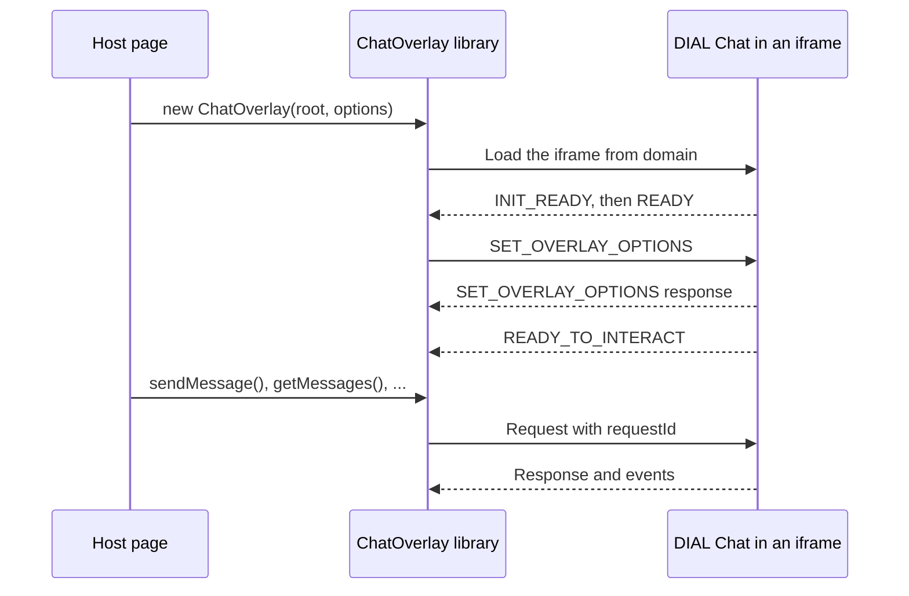

# Chat Overlay

Chat Overlay embeds a running DIAL Chat in another web application, such as a portal or an internal tool. The host page loads Chat in an iframe through the `@epam/ai-dial-chat-overlay` library, then drives it over a `postMessage` protocol: it can send messages, read the conversation, switch the model or theme, and react to events. This page explains how the overlay works and what Chat needs to allow it. It is for developers and platform engineers who integrate Chat; it applies to DIAL Chat 1.x.

## How it works



- **Two classes.** `ChatOverlay` mounts one iframe in an element you own. `ChatOverlayManager` adds ready-made floating widgets, the "chat bubble in the corner" pattern, with toggle, close, and fullscreen buttons.
- **No framework.** The library is plain DOM and TypeScript, so it works with any frontend stack.
- **Exact origins.** After the handshake, the library sends data only to Chat's origin, and Chat accepts requests only from the origin that completed it. Only the two payload-free bootstrap events go to `'*'`.
- **Readiness.** `await overlay.ready()` resolves after `READY_TO_INTERACT`. Calls made earlier are queued.

## What DIAL Chat needs

On the Chat deployment, set both:

```bash
OVERLAY_ENABLED=true
ALLOWED_IFRAME_ORIGINS=https://portal.example.com
```

| Variable | Default | Description |
|---|---|---|
| `OVERLAY_ENABLED` | `false` | Turns on overlay mode. It has no effect unless `ALLOWED_IFRAME_ORIGINS` lists a host origin. |
| `ALLOWED_IFRAME_ORIGINS` | — | The exact origins of the host applications, comma-separated, without paths. Chat's CSP `frame-ancestors` denies every other origin, and overlay messages are checked against the same list. See [Iframe origins](../1.configuration/6.security-and-embedding.md#iframe-origins). |
| `OVERLAY_SANDBOX_ENABLED` | `false` | Serves the overlay sandbox, a test host page with one case per integration scenario, at `/overlay-sandbox/`. For development and test environments only. |

Do not use `*` in `ALLOWED_IFRAME_ORIGINS` in production.

## Sign-in inside the iframe

By default, an unauthenticated overlay shows a **Log in** button that opens the login flow in a new tab; the iframe detects the new session without reloading.

- **Cross-site HTTPS.** Keep `AUTH_COOKIE_SECURE=true`, so the session cookie is `SameSite=None; Secure` and the iframe can send it.
- **Local HTTP.** With `AUTH_COOKIE_SECURE=false` the cookie stays `SameSite=Lax`, so the host and Chat must run in a compatible same-site localhost setup.
- **Same-window login.** A host can map a provider to `OverlayAuthUiMode.SameWindow` so its login runs inside the iframe, and can start it automatically with `auth.autoSignInProvider`. Verify that the provider allows its pages in an iframe first; if it does not, Chat cannot recover the iframe. See [Authentication options](2.overlay-api.md#authentication-options).

The host cannot pass a token into the iframe: the session lives in Chat's `HttpOnly` cookie, and the access token never reaches the browser.

## Iframe permissions

The library owns the iframe and its security attributes; they are not configurable:

```text
sandbox = allow-same-origin allow-scripts allow-modals allow-forms
          allow-popups allow-downloads allow-popups-to-escape-sandbox
allow   = clipboard-write
          + microphone   when voice-input is in enabledFeatures
          + fullscreen   after allowFullscreen() is called
```

Popups let the external login open in a real tab, and downloads let users save attachments. The `allow` list only delegates permissions the host page holds: if the host's `Permissions-Policy` does not grant `microphone` or `fullscreen` to the Chat origin, those features stay blocked.

## Moving from the legacy overlay

The legacy package, `@epam/ai-dial-overlay`, and the legacy `IS_IFRAME` variable belong to Chat 0.x. Chat 1.x uses `@epam/ai-dial-chat-overlay` and `OVERLAY_ENABLED`. The integration model is the same, but option names, feature keys, and some methods changed; follow the [Chat Overlay Migration Guide](https://github.com/epam/ai-dial-chat/blob/development/docs/chat-overlay-migration-guide.md).

## Next steps

- [Embed DIAL Chat in a web page](1.embed-dial-chat.md) — a working host page in a few steps
- [Chat Overlay API](2.overlay-api.md) — options, methods, events, and feature keys
- [Security and embedding](../1.configuration/6.security-and-embedding.md) — CSP and iframe origins
