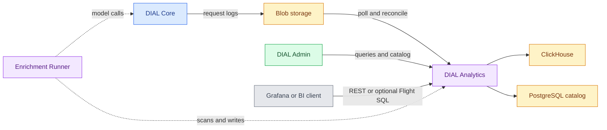

# DIAL Analytics

DIAL Analytics provides the Analytics Data Access Service (ADAS), which ingests usage logs and serves governed queries over analytics data. This reference is for platform engineers familiar with [DIAL Core](../1.core/0.index.md) and its request logs. For the interface, see [Analytics in DIAL Admin](../../5.administering-dial-new/5.analytics/0.index.md).

:::info

- [Repository](https://github.com/epam/ai-dial-analytics)
- [Releases](https://github.com/epam/ai-dial-analytics/releases)
- [Docker Hub image tags](https://hub.docker.com/r/epam/ai-dial-analytics/tags)

:::

Analytics and the [Enrichment Runner](../21.analytics-enrichment-runner/0.index.md) must run matching versions and be upgraded together; see the [paired deployment order](../21.analytics-enrichment-runner/1.configuration/0.index.md#paired-deployment-order).

## How the service fits into DIAL

[Core request logging](../1.core/1.configuration/2.settings/11.analytics-and-tracing.md) supplies usage events through the configured log pipeline. Analytics reads the blob store, writes ClickHouse data, and keeps table definitions and access metadata in PostgreSQL. The optional [Enrichment Runner](../21.analytics-enrichment-runner/0.index.md) computes derived values; aggregate pipelines execute inside Analytics.

This separation follows the [upstream architecture](https://github.com/epam/ai-dial-analytics/blob/0.23.0-rc.1/docs/architecture.md). How the log files reach blob storage is described in [Send usage logs to blob storage](../../4.operating-dial/6.observability/3.logging.md#send-usage-logs-to-blob-storage).

[DIAL Log Parser](../22.log-parser/0.index.md) provides a separate batch path from raw logs to Parquet for offline analysis and evaluation. Analytics ingestion does not require its output.

## Capabilities

| Surface | Responsibility |
|---|---|
| Ingestion | Polls Azure Blob Storage or AWS S3, reconciles one past day per daily run, backfills a bounded date range on request, and records failures for retry |
| Table catalog | Defines queryable source and enrichment tables, including rollup tables that aggregate pipelines write as source tables; manages schemas and table access |
| Queries | Executes structured queries and SQL, exports CSV, and optionally serves Arrow Flight SQL |
| Pipelines | Stores enrichment definitions and runs scheduled aggregate rollups |
| Saved analysis | Stores saved queries and dashboards, with audit history for catalog changes |
| Telemetry sinks | Accepts OTLP logs, traces, and metrics into queryable tables |
| Access control | Validates identity, combines privileges and table grants, and applies sensitivity and row policies |

The upstream architecture also describes two components outside this service: `adas-mcp`, an MCP server that exposes schema discovery, query translation, and query execution as tools and is registered in DIAL Core as a toolset, and the AI Query Helper, an application that uses those tools to turn a question into a query. Admin's Queries view reaches the helper through its `DIAL_QUERY_ASSISTANT_DEPLOYMENT` setting; see [DIAL Admin analytics settings](../9.admin/2.configuration/1.frontend.md#analytics).

The [configuration reference](1.configuration/1.environment-variables.md) documents ingestion, limits, and optional surfaces. The [SQL reference](https://github.com/epam/ai-dial-analytics/blob/0.23.0-rc.1/docs/sql-reference.md) specifies the query language. Further upstream guides cover [Grafana dashboards](https://github.com/epam/ai-dial-analytics/blob/0.23.0-rc.1/docs/grafana-dashboards.md), [Kubernetes exposure](https://github.com/epam/ai-dial-analytics/blob/0.23.0-rc.1/docs/kubernetes-exposure.md), [catalog promotion](https://github.com/epam/ai-dial-analytics/blob/0.23.0-rc.1/docs/catalog-promotion.md), [AWS S3 access](https://github.com/epam/ai-dial-analytics/blob/0.23.0-rc.1/docs/aws-s3-access.md), [column mapping](https://github.com/epam/ai-dial-analytics/blob/0.23.0-rc.1/docs/column-mapping.md), [heavy and sensitive columns](https://github.com/epam/ai-dial-analytics/blob/0.23.0-rc.1/docs/heavy-columns.md), [row-level security](https://github.com/epam/ai-dial-analytics/blob/0.23.0-rc.1/docs/row-level-security.md), and the [upgrade guide](https://github.com/epam/ai-dial-analytics/blob/0.23.0-rc.1/docs/release-0.23.0-upgrade.md).

## Dependencies and deployment

| Dependency | Purpose |
|---|---|
| ClickHouse | Stores ingested and derived rows; takes separate reader and writer credentials (both default to `default`, and the service does not enforce distinct users), DDL grants, and payload encryption configuration |
| PostgreSQL | Stores the catalog and its history; migrations run at startup by default |
| Azure Blob Storage or AWS S3 | Supplies DIAL usage logs; Analytics needs read access and a matching blob layout |
| Identity provider | Required for `SECURITY_MODE=oidc`; DIAL API-key validation additionally connects to Core |
| Enrichment Runner | Optional for querying ingested data; required to execute SQL or LLM enrichment pipelines |

The image is `epam/ai-dial-analytics`. Its [Dockerfile](https://github.com/epam/ai-dial-analytics/blob/0.23.0-rc.1/Dockerfile#L17-L37) runs as user `appuser`, UID `1001`. The API defaults to port `5000`; Flight SQL is disabled and uses port `32010` when enabled.

The [configuration](https://github.com/epam/ai-dial-analytics/blob/0.23.0-rc.1/src/main/resources/application.yml#L36-L50) serves actuator endpoints on the API port unless `MANAGEMENT_SERVER_PORT` is set. Liveness checks process state; readiness includes PostgreSQL. ClickHouse is not a readiness contributor, although migrations and schema validation can fail startup when it is unavailable.

Deployment prerequisites, a Compose fragment, catalog initialization, and verification are in [Configuration](1.configuration/0.index.md). The HTTP OpenAPI document is available at `/v3/api-docs` and Swagger at `/swagger-ui.html`, subject to the configured authentication.

**Warning**
> Authentication defaults to `none`, which also disables sensitive-column protections. The shipped payload target captures raw request and response content.
> Configure authentication, encryption, access, and retention before collecting production logs; see [Security and observability](1.configuration/2.security-and-observability.md).
