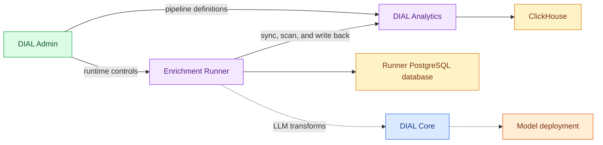

# DIAL Analytics Enrichment Runner

DIAL Analytics Enrichment Runner executes pipelines that add computed values to analytics rows or groups of rows. This reference is for platform engineers operating [DIAL Analytics](../20.analytics/0.index.md). Pipeline creation and the interface are covered in [DIAL Admin: Pipelines](../../5.administering-dial-new/5.analytics/3.pipelines.md).

:::info

- [Repository](https://github.com/epam/ai-dial-analytics-enrichment-runner)
- [Releases](https://github.com/epam/ai-dial-analytics-enrichment-runner/releases)
- [Docker Hub image tags](https://hub.docker.com/r/epam/ai-dial-analytics-enrichment-runner/tags)

:::

It requires a matching [DIAL Analytics](../20.analytics/0.index.md) version: the two services check a shared contract, and earlier counterparts are incompatible. The [upgrade guide](https://github.com/epam/ai-dial-analytics-enrichment-runner/blob/0.23.0-rc.1/docs/release-0.23.0-upgrade.md) describes the contract change.

## How enrichment runs

[Analytics](../20.analytics/0.index.md) owns pipeline definitions and all ClickHouse access. The runner synchronizes those definitions, schedules work, and persists cursors, jobs, run history, failures, and spend counters in its PostgreSQL database. Its [configuration](1.configuration/0.index.md) connects it to Analytics and, for LLM transforms, [DIAL Core](../1.core/0.index.md).

| Execution path | Behavior | Model calls |
|---|---|---|
| Row SQL enrichment | Asks Analytics to materialize computed values inside ClickHouse | No |
| Row LLM enrichment | Scans new rows, calls a model through Core, validates outputs, and writes enrichment rows through Analytics | Yes |
| Group LLM enrichment | Tracks changing groups, assembles their members, and computes group-level outputs through Core | Yes |

Execution is at least once; duplicate writes collapse in the enrichment table. Retries can still repeat model calls and incur cost. The [runtime reference](https://github.com/epam/ai-dial-analytics-enrichment-runner/blob/0.23.0-rc.1/docs/configuration.md#pipeline-execution) covers limits, retries, and spend tracking. Aggregate rollups run inside Analytics and do not use this scheduler.

## Dependencies and deployment

| Dependency | Purpose |
|---|---|
| Matching DIAL Analytics | Provides pipeline definitions, governed source reads, SQL materialization, and write-back |
| PostgreSQL | Persists runtime state in a database separate from the Analytics catalog; both databases can share a server |
| DIAL Core and a model deployment | Required for LLM transforms; SQL enrichment does not call a model |
| Identity provider | Required for inbound `oidc` authentication; API-key authentication also connects to Core |

The image is `epam/ai-dial-analytics-enrichment-runner`. The [Dockerfile](https://github.com/epam/ai-dial-analytics-enrichment-runner/blob/0.23.0-rc.1/Dockerfile#L17-L42) runs as UID `1001` and exposes port `5000`. A read-only root filesystem requires writable `/tmp`; persistent state stays in PostgreSQL.

The [health configuration](https://github.com/epam/ai-dial-analytics-enrichment-runner/blob/0.23.0-rc.1/src/main/resources/application.yml#L23-L37) separates process liveness from readiness. Readiness requires PostgreSQL and the first successful Analytics pipeline sync. Startup probes need time for the initial sync delay and a polling interval.

**Warning**
> Inbound authentication defaults to `none`, so reachable callers can trigger work that spends money.
> Use `SECURITY_MODE=oidc`, grant operator access through `FULL_ADMIN`, and keep the control plane internal.
> Outgoing `ADAS_API_KEY` and `DIAL_API_KEY` values do not protect incoming requests.

Connection examples, paired deployment order, and troubleshooting are in [Configuration](1.configuration/0.index.md). Spending, retries, and scheduling are described in [Environment variables](1.configuration/1.environment-variables.md).

## Pipeline controls

Analytics' `enabled` flag is the deliberate run control. Setting it to `false` stops execution while preserving queued work. `POST /v1/pipelines/{name}/pause` is removed and answers `404`; `POST /v1/pipelines/{name}/resume` lifts only a circuit-breaker pause and answers `409` for any other pipeline. Backfills keep their own pause and resume endpoints. DIAL Admin 0.22.5 still [calls the pipeline pause and resume endpoints](https://github.com/epam/ai-dial-admin-frontend/blob/0.22.5/apps/ai-dial-admin/src/server/analytics/analytics-runner-api.ts#L17-L18), so its pause control fails against this runner. See the [upgrade guide](https://github.com/epam/ai-dial-analytics-enrichment-runner/blob/0.23.0-rc.1/docs/release-0.23.0-upgrade.md).
