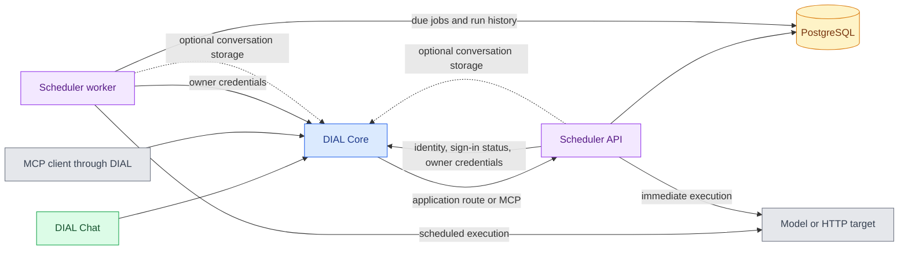

# DIAL Scheduler

DIAL Scheduler runs chat completions, Responses API calls, REST requests, and Server-Sent Events (SSE) targets on recurring or one-time schedules. It stores schedules and run history in PostgreSQL and executes each run with its owner's delegated credentials. This reference is for platform engineers familiar with [DIAL Core](../1.core/0.index.md) configuration.

For the user workflow, see [Scheduled tasks](../../7.chat-user-guide/2.scheduled-tasks.md). Service setup and Chat integration are described in [Configuration](1.configuration.md); the HTTP and MCP interfaces are described in [API](2.api.md).

:::info

- [Repository](https://github.com/epam/ai-dial-scheduler)
- [Releases](https://github.com/epam/ai-dial-scheduler/releases)
- [Docker Hub image tags](https://hub.docker.com/r/epam/ai-dial-scheduler/tags)

:::

## Capabilities

| Capability | Behavior |
|---|---|
| Recurring and one-time triggers | UTC cron fields or a single date and time |
| Model targets | Chat Completions and Responses API requests, with optional streaming |
| HTTP targets | REST requests and SSE streams using `GET`, `POST`, or `PUT` |
| Schedule management | Create, replace, list, inspect, pause, resume, and delete owner-scoped schedules |
| Immediate execution | Run the saved definition without moving its next scheduled fire |
| Run history | Persist status, timestamps, results, and the executed configuration snapshot |
| Conversation storage | Optionally save successful chat-completion runs as conversations in the owner's DIAL storage |
| MCP tools | Expose schedule, run, and sign-in operations through the API process |

Target and trigger validation is defined in the [schedule schemas](https://github.com/epam/ai-dial-scheduler/blob/0.3.1/src/lib/schemas/schedule.py#L12-L199). Immediate execution runs in the API process; timed execution runs in the worker.

## How Scheduler fits together

[DIAL Chat](../2.chat/0.index.md) reaches Scheduler through a [Core application route](../1.core/1.configuration/7.applications.md#application-routes). Model targets normally point back to Core's model API.

1. **Authenticate and save.** The API resolves the caller through Core, checks external-service sign-in status, and persists the schedule and job.
2. **Dispatch.** The worker polls the shared job store and executes due jobs. The API's own scheduler stays paused.
3. **Delegate identity.** Before dispatch, the executing process requests on-behalf-of (OBO) credentials for the schedule's owner and `service_id`.
4. **Record the result.** The process applies the target's timeout and retry policy, stores the outcome, and optionally creates a DIAL conversation.

Timed runs execute in the worker; [immediate runs](https://github.com/epam/ai-dial-scheduler/blob/0.3.1/src/lib/services/run_launcher.py#L48-L66) execute the same run path in the API process, including credential lookup and conversation storage. Sources: [API lifecycle](https://github.com/epam/ai-dial-scheduler/blob/0.3.1/src/api/app.py#L23-L69), [worker](https://github.com/epam/ai-dial-scheduler/blob/0.3.1/src/worker/app.py#L26-L109), and [run execution](https://github.com/epam/ai-dial-scheduler/blob/0.3.1/src/worker/jobs.py#L108-L273).

## Dependencies and deployment

| Dependency | Purpose |
|---|---|
| PostgreSQL | Shared persistent schedules, APScheduler jobs, and run history; the upstream Compose sample uses PostgreSQL 16 |
| DIAL Core | Caller identity, application routing, external-service consent, offline delegation, and optional conversation storage |
| Scheduler application and project key | An application identity authorized to request the owner's OBO credentials |
| Target service | A reachable model deployment or HTTP endpoint compatible with the selected target type |
| DIAL Chat | Optional user interface for scheduled tasks and offline sign-in |

One image provides three modes, selected by `SERVICE`: `migrations` applies Alembic migrations and exits; `api` serves HTTP and MCP; `worker` executes timed jobs. Apply migrations before starting the API and worker. The [entrypoint](https://github.com/epam/ai-dial-scheduler/blob/0.3.1/entrypoint.sh#L1-L33) also supports migrations on startup.

The [Dockerfile](https://github.com/epam/ai-dial-scheduler/blob/0.3.1/Dockerfile#L1-L47) targets `linux/amd64`, uses Python 3.14 on Alpine, and runs as UID `1001`.

**Warning**
> Run exactly one worker against a shared job store. Multiple workers can execute jobs more than once because there is no leader election. Avoid overlapping workers during upgrades; use a recreate deployment strategy.

This constraint is documented in the [upstream deployment instructions](https://github.com/epam/ai-dial-scheduler/blob/0.3.1/documentation/deployment/deployment.md#L74-L109). The [configuration reference](1.configuration.md#worker-and-job-settings) distinguishes worker defaults from the job defaults stored by the API.

## Health and readiness

| Process | Probe | Meaning |
|---|---|---|
| API | `GET /health` | SDK-provided liveness endpoint |
| API | `GET /ready` | `200` with `{"status":"ready","database":"ok"}` when PostgreSQL is reachable; otherwise `503` |
| Worker | `<WORKER_HEALTH_DIR>/started` | Startup completed |
| Worker | `<WORKER_HEALTH_DIR>/heartbeat` | Its modification time must stay within the liveness probe's staleness threshold; the upstream probe uses 180 seconds |
| Worker | `<WORKER_HEALTH_DIR>/ready` | Present after startup while the latest database readiness check succeeds |

The API listens on `0.0.0.0:5000` by default. The worker serves no HTTP API; it opens a port only for the Prometheus metrics exporter, when `OTEL_METRICS_EXPORTER=prometheus`. See [API startup](https://github.com/epam/ai-dial-scheduler/blob/0.3.1/src/api/app.py#L84-L140), [readiness](https://github.com/epam/ai-dial-scheduler/blob/0.3.1/src/api/v1/endpoints/health.py#L16-L28), [worker health markers](https://github.com/epam/ai-dial-scheduler/blob/0.3.1/src/worker/health.py), and the [SDK metrics server](https://github.com/epam/ai-dial-sdk/blob/0.37.0/aidial_sdk/telemetry/init.py#L120-L121).
