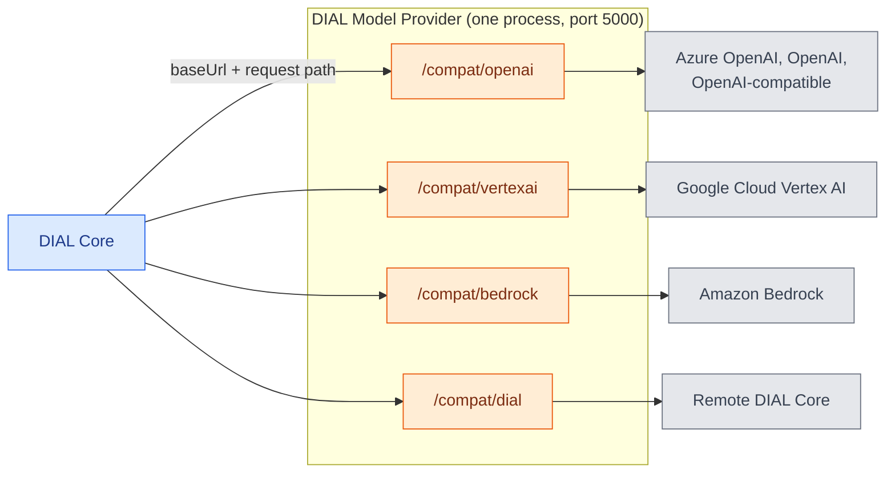

# DIAL Model Provider

DIAL Model Provider runs the DIAL model adapters in one service. The OpenAI, Vertex AI, Bedrock, and DIAL-to-DIAL adapters share one image and one process, each under its own path prefix. It replaces the standalone [OpenAI](../5.openai-adapter/0.index.md), [Bedrock](../6.bedrock-adapter/0.index.md), and [Vertex AI](../7.vertex-ai-adapter/0.index.md) adapters, which will be deprecated. This page is for platform engineers who connect models to [DIAL Core](../1.core/0.index.md); it assumes you know how Core [routes a model](../1.core/1.configuration/4.models.md#routing).

:::info

- [Repository](https://github.com/epam/ai-dial-model-provider)
- [Releases](https://github.com/epam/ai-dial-model-provider/releases)
- [Docker Hub image tags](https://hub.docker.com/r/epam/ai-dial-model-provider/tags)

:::

**Note**
> DIAL Model Provider is in active development and testing. The first release, `0.1.0-rc.0`, is a pre-release. This page is checked against it.

## Served paths

| Path prefix | Adapter | Models |
|---|---|---|
| `/compat/openai/…` | OpenAI | Azure OpenAI, the OpenAI Platform, and any OpenAI-compatible upstream. See [Supported upstreams](../5.openai-adapter/1.supported-upstreams.md). |
| `/compat/vertexai/…` | Vertex AI | Google Cloud Vertex AI. See [Supported models](../7.vertex-ai-adapter/1.supported-models.md). |
| `/compat/bedrock/…` | Bedrock | Amazon Bedrock. See [Supported models](../6.bedrock-adapter/1.supported-models.md). |
| `/compat/dial/…` | DIAL-to-DIAL | Another DIAL Core instance. See [DIAL-to-DIAL adapter](../../4.operating-dial/1.local-setup/5.dial-to-dial-adapter.md). |
| `/health` | The process | Liveness of the whole container. |

The adapter sources are vendored from the adapter repositories, so the models, settings, and DIAL APIs each one serves are those documented on its adapter pages. The repository README calls them unchanged; the one difference found in the code is the Bedrock region variable, described in [Region variables](1.configuration.md#region-variables).

## Compatibility mode

One process serves every adapter, so a segment of the URL names the adapter: `/compat/<adapter>/…`. The rest of the path is the adapter's own DIAL API, unchanged; only the prefix is new.

| Adapter | Example path under DIAL Model Provider |
|---|---|
| OpenAI | `/compat/openai/openai/deployments/<id>/chat/completions`, `/compat/openai/openai/v1/responses`, `/compat/openai/anthropic/v1/messages` |
| Bedrock | `/compat/bedrock/openai/deployments/<id>/chat/completions`, `/compat/bedrock/anthropic/v1/messages`, `/compat/bedrock/openaiChatCompletions/anthropic/v1/messages` |
| Vertex AI | `/compat/vertexai/openai/deployments/<id>/chat/completions`, `/compat/vertexai/anthropic/v1/messages` |
| DIAL-to-DIAL | `/compat/dial/openai/deployments/<id>/chat/completions` |

The prefix names the **adapter**, not the cloud. OpenAI models hosted on Amazon Bedrock are served by `/compat/openai`, and Claude is reachable through both `/compat/vertexai` and `/compat/bedrock`.

## How it fits together



1. **Core routes to a prefix.** Each model in [DIAL Core](../1.core/1.configuration/4.models.md#interfaces) declares `baseUrl` `http://<MODEL_PROVIDER_HOST>:5000/compat/<adapter>` and the `interfaces` it serves. Core appends the path it received.
2. **The adapter calls the provider.** It reads the upstream from the `X-UPSTREAM-ENDPOINT` and `X-UPSTREAM-KEY` headers Core sends, as it does when it runs standalone. See [Load balancing and upstreams](../1.core/1.configuration/5.load-balancing.md).
3. **One environment.** Every adapter reads its settings from the process environment, which all adapters share. See [Configuration](1.configuration.md).

## Dependencies

| Dependency | Purpose |
|---|---|
| [DIAL Core](../1.core/0.index.md) | Calls the service and passes each request's upstream. |
| DIAL Core file storage | With `DIAL_URL` set, the adapters read attachments and upload generated files through Core. |
| Provider credentials | AWS, Google Cloud, or Azure identities, or API keys in the upstreams. See each adapter's configuration page. |

## Deployment

DIAL Model Provider ships as the `epam/ai-dial-model-provider` image, for `linux/amd64` and `linux/arm64`.

- **Port.** The server listens on `0.0.0.0:5000`.
- **Health.** `GET /health` answers `{"status": "ok"}`. The image's health check calls it every 10 seconds, and access logs skip it.
- **User.** The container runs as the non-root user `appuser`, UID `1001`.

The service in Docker Compose:

```yaml
model-provider:
  image: epam/ai-dial-model-provider:0.1.0-rc.0
  environment:
    DIAL_URL: http://core:8080
    LOG_LEVEL: INFO
```

The `dial` Helm chart 8.1.0 deploys the standalone adapters, not DIAL Model Provider. To run it on Kubernetes, deploy the image with the [DIAL Extension chart](../12.helm/1.configuration/3.dial-extension.md). To move an existing configuration, see [Migrate from the standalone adapters](2.migration.md).

## Further reading

- [DIAL Model Provider configuration](./1.configuration.md) — the shared environment and the process settings
- [Migrate from the standalone adapters](./2.migration.md) — point DIAL Core models at DIAL Model Provider with `interfaces`
- [DIAL Core configuration: Models](../1.core/1.configuration/4.models.md) — `baseUrl`, `interfaces`, and `overrideName`
- [Load balancing and upstreams](../1.core/1.configuration/5.load-balancing.md) — the provider endpoints Core passes to the adapter
- [What are adapters](../../3.building-with-dial/4.adapters/0.index.md) — what an adapter does and how it differs from an application
