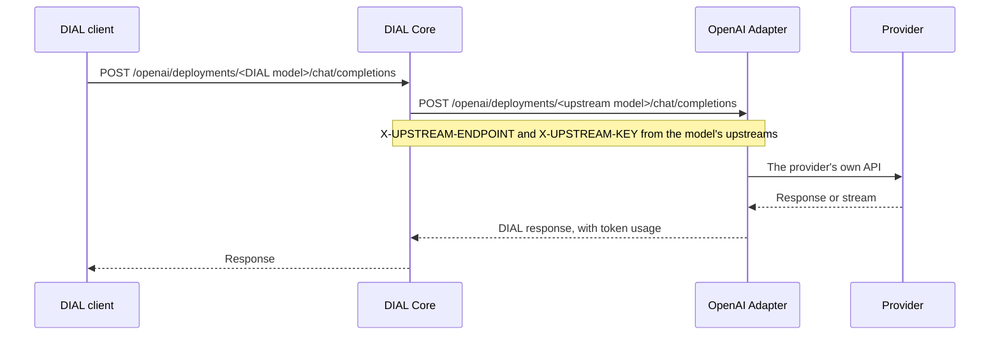

# DIAL OpenAI Adapter

:::warning

The standalone DIAL OpenAI, Bedrock, and Vertex AI adapters will be deprecated soon. Use [DIAL Model Provider](../4.model-provider/0.index.md) instead: it combines these three adapters in one service, and serves this adapter under `/compat/openai`. To move your models, see [Migrate from the standalone adapters](../4.model-provider/2.migration.md).

:::

The DIAL OpenAI Adapter connects DIAL Core to models that speak an OpenAI-style API: Azure OpenAI, the OpenAI Platform, Azure AI Foundry, OpenAI models on Amazon Bedrock, Mistral, Alibaba Cloud Model Studio, vLLM, and providers of the Anthropic Messages API. It serves them to Core through the DIAL APIs, so chat, image, video, speech, and embedding models all look the same to DIAL clients. This page is for platform engineers who connect these models to DIAL.

:::info

- [Repository](https://github.com/epam/ai-dial-adapter-openai)
- [Releases](https://github.com/epam/ai-dial-adapter-openai/releases)
- [Docker Hub image tags](https://hub.docker.com/r/epam/ai-dial-adapter-openai/tags)

:::

## How it works



- **Two parts of the configuration.** The adapter's environment variables set how it behaves. Each model is a [model entry](../1.core/1.configuration/4.models.md) in DIAL Core: `endpoint` points at the adapter, and `upstreams` point at the provider.
- **Two deployment IDs.** The DIAL model ID is what clients call. The upstream model name is what the provider receives; it comes from the adapter URL, or from `overrideName`. Always set `overrideName` to keep them apart explicitly.
- **DIAL files.** With `DIAL_URL` set, the adapter can read and write DIAL files, such as attachments and generated images.

## DIAL APIs it serves

| API | Adapter endpoints | DIAL Core model field |
|---|---|---|
| Chat Completions | `POST /openai/deployments/<id>/chat/completions`, `POST /openai/v1/chat/completions` | `endpoint` |
| Responses | `POST`, `GET`, `DELETE /openai/v1/responses...`, and the dated form `/openai/responses?api-version=...` | `responsesEndpoint`, or `interfaces.openaiResponses` |
| Embeddings | `POST /openai/deployments/<id>/embeddings`, `POST /openai/v1/embeddings` | `endpoint` with `"type": "embedding"` |
| Anthropic Messages | `POST /anthropic/v1/messages` and the other proxied Claude API endpoints | `interfaces.anthropicMessages` |
| Tokenize | `POST /openai/deployments/<id>/tokenize` | `features.tokenizeEndpoint` |
| Truncate prompt | `POST /openai/deployments/<id>/truncate_prompt` | `features.truncatePromptEndpoint` |
| Configuration | `GET /openai/deployments/<id>/configuration` | `features.configurationEndpoint` |

The `/openai/v1/...` forms take the upstream model name from the `X-DIAL-DEPLOYMENT-ID` header that Core sends. For the Responses API, Core 0.42.0 and adapter 0.38.0 or later are required.

## What it connects to

| Provider | Chat | Responses | Embeddings | Other models |
|---|---|---|---|---|
| Azure OpenAI | Yes | Yes | Yes | Images (DALL·E 3, GPT Image 1), video (Sora, Sora 2), speech (TTS and STT) |
| OpenAI Platform | Yes | Yes | Yes | — |
| Azure AI Foundry | Yes | — | — | Claude through Anthropic Messages |
| Amazon Bedrock (OpenAI models) | Yes | Yes | — | — |
| Mistral Platform | Yes | — | — | — |
| Alibaba Cloud Model Studio | Yes | Yes | — | — |
| vLLM and vLLM-Omni | Yes | — | Yes | Speech-to-text (Qwen3-ASR), text-to-speech |
| Anthropic API and compatible providers | Yes, through Anthropic Messages | — | — | — |
| Azure AI Vision | — | — | Multimodal embeddings | — |

Each row, with its DIAL Core configuration, is in [Supported upstreams](1.supported-upstreams.md).

## Base configuration

From [ai-dial-samples](https://github.com/epam/ai-dial-samples). The adapter service in Docker Compose:

```yaml
adapter-dial-openai:
  image: epam/ai-dial-adapter-openai:0.45.1
  environment:
    DIAL_URL: http://core:8080
    LOG_LEVEL: INFO
```

A model in the DIAL Core configuration, served by the OpenAI Platform:

```json
{
  "models": {
    "gpt-4o": {
      "type": "chat",
      "displayName": "GPT-4o",
      "overrideName": "gpt-4o",
      "endpoint": "http://adapter-dial-openai:5000/openai/deployments/gpt-4o/chat/completions",
      "upstreams": [
        {
          "endpoint": "https://api.openai.com/v1/chat/completions",
          "key": "<OPENAI_API_KEY>"
        }
      ],
      "features": { "toolsSupported": true }
    }
  }
}
```

The same adapter serves any OpenAI-compatible server, such as Ollama in the samples, with the server's `/v1/chat/completions` URL as the upstream.

## Deployment

The adapter ships as the `epam/ai-dial-adapter-openai` image. Deploy it with the DIAL Helm charts, or in Docker Compose as above. To trust a private certificate authority, see [Configuration](3.configuration.md#private-certificate-authorities).
