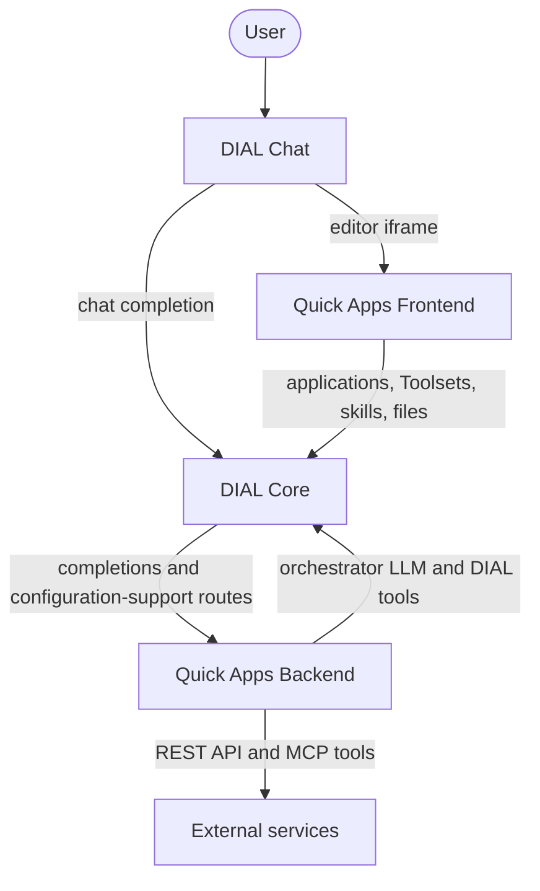
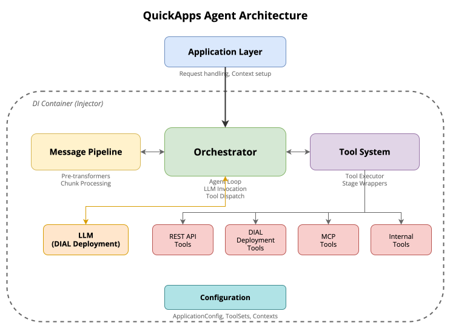

# DIAL Quick Apps

Quick Apps (2.0) let you build DIAL applications by composing them, not coding them. A Quick App is a JSON manifest. It wires DIAL-native tools, REST APIs, and MCP servers to an orchestrator, which can be any LLM registered in DIAL Core. Publishing a Quick App creates a DIAL application record that Core manages. This page is for platform engineers who deploy and run the Quick Apps services. It assumes you know [what Quick Apps are](../../3.building-with-dial/1.apps/2.quick-apps/0.index.md) from the authoring side.

:::info

| Component | Repository | Releases | Image tags |
|---|---|---|---|
| Backend | [GitHub](https://github.com/epam/ai-dial-quickapps-backend) | [Releases](https://github.com/epam/ai-dial-quickapps-backend/releases) | [Docker Hub](https://hub.docker.com/r/epam/ai-dial-quickapps-backend/tags) |
| Frontend | [GitHub](https://github.com/epam/ai-dial-quickapps-frontend) | [Releases](https://github.com/epam/ai-dial-quickapps-frontend/releases) | [Docker Hub](https://hub.docker.com/r/epam/ai-dial-quickapps-frontend/tags) |

:::

## Why Quick Apps

- **No orchestration code.** The agent loop, tool calls, retries, and fallbacks are declared in the manifest, and the backend runs them. The manifest is validated against a JSON schema.
- **One service for every app.** Quick Apps is one [application type](../1.core/1.configuration/8.application-type-schemas.md) in DIAL Core. Every Quick App is an application of that type, served by the same running backend.
- **Reuse what DIAL already has.** Any model, application, Toolset, or file in DIAL can become a tool. So can an external REST API or MCP server.
- **Regular DIAL applications to callers.** A Quick App is called through the Unified API like any other DIAL application. It can be shared and published, and it can be used as a tool by another Quick App.

## The two services

Quick Apps ships as two services. They are released separately but deployed together.

| Service | Repository | What it does |
|---|---|---|
| Quick Apps Backend | [ai-dial-quickapps-backend](https://github.com/epam/ai-dial-quickapps-backend) | Runs every Quick App: the orchestrator loop and the tools. It also serves the manifest's JSON schema to DIAL Core, and the predefined skills, prompts, Toolsets, and tools to the editor. Required. |
| Quick Apps Frontend | [ai-dial-quickapps-frontend](https://github.com/epam/ai-dial-quickapps-frontend) | The visual editor for Quick App settings. It is a static React app served by the DIAL Chat BFF (`chat-api`), and DIAL Chat opens it in an iframe. Optional. Without it, Quick Apps are created through the API or the DIAL Core configuration. |

## How the services fit together

- **Registration.** DIAL Core registers Quick Apps as an application type. The backend's schema endpoint supplies the type's schema, and `dial:applicationTypeEditorUrl` names the editor. See [DIAL Core and DIAL Chat](3.configuration/3.dial-core-and-chat.md).
- **Authoring.** When a user creates or edits a Quick App, DIAL Chat loads the editor in an iframe. The editor saves through the Chat BFF, which calls DIAL Core with the user's session. It lists the predefined building blocks through the routes Core exposes for the backend's `/v1/configuration-support/*` endpoints.
- **Running.** DIAL Core sends a Quick App's chat completion requests to the backend. The backend calls the orchestrator LLM, and DIAL tools such as deployments and Toolsets, through DIAL Core. It calls REST API tools and external MCP servers directly.

## Backend architecture

The backend has five main components:

- **Application layer** handles HTTP requests, manages the request context, and coordinates initialization.
- **Orchestrator** runs the agent loop, alternating LLM calls with tool calls.
- **Tool system** provides one abstraction over the tool types and runs tool calls in parallel.
- **Message pipeline** preprocesses messages before LLM calls and processes the streamed responses.
- **DI container** manages the components across request and singleton scopes.

## Capabilities

| Capability | What it gives an app |
|---|---|
| [Orchestration](1.capabilities/1.orchestration.md) | An agent loop over any DIAL model, with a system prompt and an iteration limit |
| [Tools](1.capabilities/2.tools.md) | REST APIs, DIAL models and applications, MCP servers, and built-in tools, called in parallel, with fallbacks, timeouts, tool discovery, and per-user filtering |
| [Contexts and files](1.capabilities/3.contexts-and-files.md) | Fixed text, files, and folders; attachments for the model; files passed to tools; web access; a DIAL workspace |
| [Skills](1.capabilities/4.skills.md) | Reusable instructions, read on demand or picked by the user on a message |
| [Hooks](1.capabilities/5.hooks.md) | Tool calls at the start and end of every turn, such as agent memory |
| [Time awareness](1.capabilities/6.time-awareness.md) | The current time, and the age of every tool result |
| [Errors](1.capabilities/7.errors.md) | Safe error messages, with a reference to find the cause in the logs |

Capabilities are switched on in each Quick App's [manifest](2.manifest/0.index.md), within the limits of the [backend's environment variables](3.configuration/1.backend.md). In 0.13.2, every capability is Stable except one Preview feature; see [Stable and Preview](1.capabilities/0.index.md#stable-and-preview).

The Python calculation tool additionally needs [Code Interpreter](../17.code-interpreter/0.index.md) sessions and [App Controller](../15.app-controller/0.index.md), reached through Core. These are execution infrastructure, separate from the two Quick Apps services; see [calculation-tool setup](../17.code-interpreter/1.configuration.md#enable-calculations-in-a-quick-app).

## ChatHub

ChatHub is a family of ready-made Quick Apps. Each one pairs a chat LLM with the same predefined tools: document search, image generation, web search, and a Python interpreter. See [ChatHub](4.chathub.md).

## Quick Apps elsewhere in the docs

- [Build a Quick App](../../7.chat-user-guide/3.catalog/2.agents.md#build-a-quick-app) — the editor, as users see it in DIAL Chat
- [Quick Apps](../../3.building-with-dial/1.apps/2.quick-apps/0.index.md) — when to build a Quick App, a tutorial, and creating one through the API
- [Install the Quick Apps feature](../../4.operating-dial/2.cloud-deployment/7.quick-apps-installation.md) — deploying the backend with the Helm chart

## Further reading

- [Agentic platform](../../2.understand-dial/3.capabilities/7.agentic-platform.md) — understand how agents and tools compose
- [Quick Apps capabilities](1.capabilities/0.index.md) — understand orchestration, tools, contexts, and runtime behavior

## Next steps

- [Configure Quick Apps](3.configuration/0.index.md) — connect the backend, editor, Core, and Chat
- [Quick App manifest](2.manifest/0.index.md) — look up the application properties the backend reads
- [Build an agent with a Toolset](../../3.building-with-dial/1.apps/2.quick-apps/1.tutorial-build-an-agent.md) — verify the deployment by creating an agent
