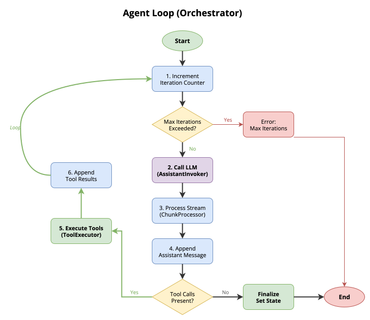

# Orchestration

The orchestrator is the LLM that drives a Quick App. The backend turns each chat completion request into an agent loop: the orchestrator answers, calls tools, reads their results, and answers again. This page covers how a request is processed, the agent loop, the orchestrator model, and the system prompt. It is for platform engineers and app developers who configure Quick Apps. It assumes you know [the Quick Apps capabilities](0.index.md).

## How a request is processed

1. **Validate the messages.** The `messages` array must have the shape `(system)? (user assistant)* user`. Tool messages and misplaced system messages are rejected with `400`. Every problem is listed in one response.
2. **Apply the system message policy.** A leading system message with text is rejected with `400`, unless the backend's `ALLOW_OVERRIDE_SYSTEM_MESSAGE` is `true`. See [System prompt](#system-prompt).
3. **Resolve templates.** Predefined prompts, Toolsets, and tools are replaced with their definitions, and each `override` patch is applied. A failure is reported in the **Initialization issues** stage.
4. **Build the tools and skills.** Each Toolset's tools are created, and DIAL skills are fetched. If an MCP Toolset needs sign-in, the user is asked once for all of them. See [MCP Toolsets](2.tools.md#mcp-toolsets).
5. **Prepare the messages.** This runs once per request. The system prompt is built, and synthetic tool-call pairs are added for the context files, the current time, and any skills picked on the message.
6. **Run the agent loop.**

Tools or skills that fail to load don't stop the request. They are listed in the **Initialization issues** stage, and the request continues without them. See [Errors](7.errors.md#initialization-issues).

## Agent loop

The orchestrator repeats one iteration until the LLM answers without tool calls:

1. Increment the iteration counter. If it exceeds the maximum, stop with an error message.
2. Send the prepared messages to the LLM and stream its response.
3. Collect the content, attachments, and tool calls from the stream.
4. If the response has tool calls, run them in parallel, add their results to the conversation, and start the next iteration. Otherwise, finalize the answer.



The loop ends when the LLM answers without tool calls, when the iteration limit is reached, or on an unrecoverable error.

- **Iteration limit.** `orchestrator.max_iterations` in the manifest, default `15`. `-1` means no limit. The backend's `DEFAULT_AGENT_MAX_ITERATIONS` sets the default for every app.
- **Tool history.** The tool calls of a turn are stored with the assistant message, and restored as tool-call pairs on the next turn. The orchestrator sees what it did before.

## Orchestrator model

`orchestrator.deployment` names a DIAL model and its parameters:

```json
{
  "orchestrator": {
    "deployment": {
      "deployment_id": "<MODEL_ID>",
      "parameters": { "temperature": 0.5, "reasoning_effort": "high" }
    }
  }
}
```

- **Default model.** When a manifest leaves out `deployment`, the backend's `DEFAULT_ORCHESTRATOR_DEPLOYMENT_ID` is used. The schema also offers it as the default for new manifests.
- **Parameters.** Sampling parameters, `max_tokens`, and `stop` are passed to the model. `reasoning_effort` is dropped, with a warning in the **Initialization issues** stage, when the model doesn't advertise `features.reasoningEfforts`. `custom_fields.configuration` is forwarded too, for model features such as Anthropic `betas`.
- **Model-side tools.** Tools the model's deployment declares in DIAL Core as `static_function` defaults, such as search grounding on Gemini, are sent to the model with the app's tools. The model runs them on its side; the backend doesn't execute them.
- **Model stages.** `orchestrator.propagate_stages`, default `true`, shows the model's own stages, such as reasoning steps, in the answer.

The fields are in [Orchestrator](../2.manifest/1.orchestrator.md).

## System prompt

`orchestrator.system_prompt` has three types:

| Type | Source |
|---|---|
| `custom` | Inline text in `content`, with `{name}` placeholders filled from `variables` |
| `dial` | A prompt file in DIAL, at `path` |
| `predefined` | A named template shipped with the backend, such as the [ChatHub](../4.chathub.md) prompts |

The backend builds the system message from several parts: the configured prompt, then the skill list, MCP resource cards, and other feature text. A client's own system message is never passed through:

- With `ALLOW_OVERRIDE_SYSTEM_MESSAGE=false`, the default, a request with a non-empty system message fails with `400`: `role 'system' is not accepted by this application; it uses its own system prompt.` An empty system message is accepted and ignored.
- With `ALLOW_OVERRIDE_SYSTEM_MESSAGE=true`, the client's text replaces only the configured prompt. The other parts are still added.

DIAL Chat offers a system prompt field for an application unless its DIAL Core `features.systemPromptSupported` is `false`. Set it to `false` for every Quick App. See [Quick App applications](../3.configuration/3.dial-core-and-chat.md#quick-app-applications).

## Next steps

- [Tools](2.tools.md) — how tool calls run, fail, and are shown
- [Orchestrator](../2.manifest/1.orchestrator.md) — every orchestrator field
- [Errors](7.errors.md) — what users see when a turn fails
