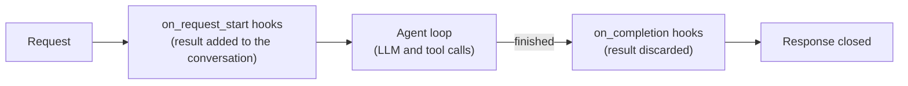

# Hooks

A hook calls a configured tool at a fixed point of every request, without the model deciding to call it. A typical use is agent memory: recall memories before the model answers, and save the turn after. This page covers hook events, configuration, argument templates, failures, and tools hidden from the model. It is for app developers who configure Quick Apps. It assumes you know [tools](2.tools.md).

## Events



| Event | When it runs | What happens to the result |
|---|---|---|
| `on_request_start` | Before the first LLM call | Added to the conversation as a tool call and its result, as if the model had called the tool |
| `on_completion` | After the answer is streamed, before the response closes | Discarded. The hook runs for its side effect only. |

- **`on_request_start` frequency.** With `append_if_changed`, the default, an identical result replaces the earlier pair, and a different result is added as a new pair. With `always`, a pair is added every turn.
- **`on_completion` order.** These hooks run one after another, in manifest order. The response stays open until they finish, and MCP sessions of the request are still open for them.
- **When `on_completion` doesn't run.** It doesn't run when the turn ends with tool calls handed back to the client.

## Configure a hook

`hooks` is a list in the manifest:

```json
{
  "hooks": [
    {
      "kind": "tool_call",
      "event": "on_request_start",
      "name": "recall-memory",
      "toolset_name": "memory_server",
      "tool_name": "search_memories",
      "arguments": { "query": "${last_user_message.content}" }
    },
    {
      "kind": "tool_call",
      "event": "on_completion",
      "name": "save-memory",
      "toolset_name": "memory_server",
      "tool_name": "save_memory",
      "arguments": {
        "user_message": { "$eval": "last_user_message.content" },
        "assistant_message": { "$eval": "last_assistant_message.content" }
      },
      "timeout_seconds": 20
    }
  ]
}
```

| Field | Required | Default | Description |
|---|---|---|---|
| `kind` | Yes | — | `tool_call`, the only kind |
| `event` | Yes | — | `on_request_start` or `on_completion` |
| `tool_name` | Yes | — | The tool's name in its Toolset, or the exact function name |
| `toolset_name` | No | — | The Toolset of a REST API or MCP tool. Leave it out for DIAL deployment and internal tools. |
| `arguments` | No | `{}` | The tool's arguments, as a [template](#argument-templates) |
| `name` | No | — | A label for the logs |
| `timeout_seconds` | No | `15` for `on_request_start`, `30` for `on_completion` | The time limit of one run |
| `frequency` | No | `append_if_changed` | `on_request_start` only: `always` or `append_if_changed` |
| `refresh_condition` | No | — | `on_request_start` only: `{"kind": "ttl", "ttl_minutes": N}`, to refresh the result after N minutes. It can't be combined with templated `arguments`. |

## Argument templates

`arguments` is a [JSON-e](https://json-e.js.org) template, rendered against the conversation when the hook runs.

| Name | Events | Value |
|---|---|---|
| `messages` | Both | The conversation: each message's `role`, `content`, `tool_calls`, and `tool_call_id` |
| `last_user_message` | Both | The last user message |
| `last_assistant_message` | Both | The last assistant message without tool calls, or `null` on the first turn |
| `iteration_count` | `on_completion` | The number of orchestrator iterations in the turn |
| `total_tool_calls` | `on_completion` | The number of tool calls in the turn |

- **Text or a typed value.** `"Q: ${last_user_message.content}"` puts the value into text. `{"$eval": "iteration_count"}` keeps its JSON type: a number, an object, or a list such as `messages[-4:]`.
- **Escaping.** Write a literal `${` as `$${`, and start an object key with a literal `$` as `$$`.
- **Missing values.** If an expression can't be evaluated for the request, such as `last_assistant_message.content` on the first turn, the hook is skipped for that request.
- **Validation.** When the manifest is loaded, the syntax and the names of `${...}`, `$eval`, and `$if` expressions are checked. Other operators are checked when the hook runs.
- **The message list.** `messages` also holds the system prompt, tool results, and pairs added by other features. Message content is text only; attachments aren't included.

To pass only the dialog, filter `messages` by role. `$map` drops an element when its `$if` has no `else`:

```json
{
  "arguments": {
    "dialog": {
      "$map": { "$eval": "messages" },
      "each(m)": {
        "$if": "m.role == 'user' || (m.role == 'assistant' && len(m.tool_calls) == 0)",
        "then": { "role": { "$eval": "m.role" }, "content": { "$eval": "m.content" } }
      }
    }
  }
}
```

## Failures and timeouts

A hook never fails the request.

| Situation | Outcome |
|---|---|
| The template can't be rendered for this request | The hook is skipped |
| The hook runs past its timeout | The hook is cancelled and skipped, with a warning in the logs |
| An unexpected error | The hook is skipped, and the error is logged |
| The tool fails | The tool's [fallback](2.tools.md#fallbacks) applies. For `on_completion`, its result is discarded, so the failure shows only in the logs. |

Logs name the hook and the event. Arguments and results are never logged.

## Tools hidden from the model

A tool that only hooks should call, such as `save_memory`, would still be offered to the model, which may start calling it. `hidden_from_model` on an MCP-based Toolset fixes that: `mcp`, `dial-mcp`, or `dial-app` over MCP.

```json
{
  "tool_sets": [
    {
      "type": "dial-app",
      "name": "AppMemory",
      "deployment_id": "memory",
      "transport": "mcp",
      "allowed_tools": ["prime_memories", "save_memory", "search_memories"],
      "hidden_from_model": ["prime_memories", "save_memory"]
    }
  ],
  "hooks": [
    { "kind": "tool_call", "event": "on_request_start", "toolset_name": "AppMemory", "tool_name": "prime_memories" },
    { "kind": "tool_call", "event": "on_completion", "toolset_name": "AppMemory", "tool_name": "save_memory",
      "arguments": { "user_message": { "$eval": "last_user_message.content" } } }
  ]
}
```

The model is offered `AppMemory_search_memories` only, and both hooks run.

- A hidden tool isn't in the model's tool list or in [tool discovery](2.tools.md#dynamic-tool-discovery). Hooks call it as usual, and other tools of the same Toolset stay visible.
- If the model asks for a hidden tool anyway, nothing runs. It gets a tool response saying the platform calls that tool, and the loop continues.
- Entries are tool names as the MCP server reports them. When `allowed_tools` is set, every entry must be in it, or the manifest is rejected.
- A tool the server adds later is visible unless `allowed_tools` pins the set. Set both.
- On the chat completion branch of `dial-app`, `hidden_from_model` is ignored with a warning.
- During a rolling upgrade, a replica older than 0.13.0 ignores the field and shows the tools to the model.

| Symptom | Likely cause |
|---|---|
| `tool '...' not found in initialized tools` | The tool is missing from the server's tool list, or from `allowed_tools` |
| Manifest rejected: `hidden_from_model entries not present in allowed_tools` | Add the entry to `allowed_tools`, or remove it from `hidden_from_model` |
| The model still sees the tool | The request ran on an older replica |

## Further reading

- [Time awareness](./6.time-awareness.md) — the current time and the age of tool results
- [Tool sets](../2.manifest/2.tool-sets.md) — `allowed_tools` and `hidden_from_model` on each Toolset type
- [Quick Apps capabilities: Tools](./2.tools.md) — fallbacks and timeouts
