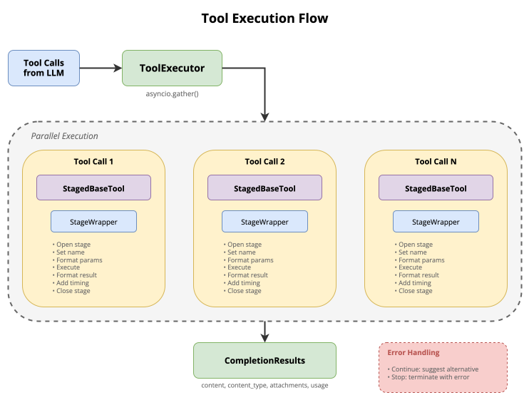

# Tools

A Quick App's tools come from its Toolsets: REST APIs, DIAL models and applications, MCP servers, and the backend's internal tools. This page covers how tool calls run, appear in DIAL Chat, fail, and time out. It also covers which tools the model is offered, and the features specific to DIAL deployments and MCP. It is for platform engineers and app developers who configure Quick Apps. It assumes you know [orchestration](1.orchestration.md).

## Toolset types

| `type` | Connects to | Fields |
|---|---|---|
| `rest-api` | HTTP endpoints described in the manifest | [`rest-api`](../2.manifest/2.tool-sets.md#rest-api) |
| `dial-deployment` | DIAL models and applications, each wrapped as a tool | [`dial-deployment`](../2.manifest/2.tool-sets.md#dial-deployment) |
| `dial-app` | A DIAL application: its MCP tools when it advertises MCP, otherwise one chat completion tool | [`dial-app`](../2.manifest/2.tool-sets.md#dial-app) |
| `mcp` | An MCP server by URL | [`mcp`](../2.manifest/2.tool-sets.md#mcp) |
| `dial-mcp` | An MCP Toolset registered in DIAL | [`dial-mcp`](../2.manifest/2.tool-sets.md#dial-mcp) |
| `internal` | Tools built into the backend, such as the Python interpreter | [`internal`](../2.manifest/2.tool-sets.md#internal) |
| `predefined` | A named Toolset template, such as `chathub` | [`predefined`](../2.manifest/2.tool-sets.md#predefined) |

Toolsets of every type can be combined in one app. The model chooses tools by their names and descriptions, so give each tool a clear, distinct description.

## How a tool call runs

When the LLM requests several tools, the backend runs them concurrently and returns the results in the order of the calls. Each call:

- Has its `file:` parameters resolved first. See [File parameters](3.contexts-and-files.md#file-parameters).
- Runs inside a stage that DIAL Chat shows with the tool name, parameters, duration, and result.
- Returns content, attachments, usage, and citations in one result format.



A tool name the model invents goes back to the model as a tool error, so it can correct the call.

## Stages

`features.stage_display` decides which tool stages DIAL Chat shows:

| `level` | Stages shown |
|---|---|
| `none` | None, not even for errors |
| `error` | Failed tool calls only |
| `info` | Regular tool calls and errors. The default. |
| `debug` | Every tool call, including internal ones |

- The backend's `DEFAULT_STAGE_DISPLAY_LEVEL`, when set, overrides every app's level.
- When a Quick App calls another Quick App as a tool, the called app's stages appear under its `Calling X` stage. Set `propagate_sub_stages: false` to turn this off.
- Each tool can set its stage title and body, with `{argument}` placeholders, and how each parameter is shown. See [Display](../2.manifest/3.tools.md#display).

```json
{
  "features": {
    "stage_display": { "level": "debug", "propagate_sub_stages": false }
  }
}
```

## Fallbacks

When a tool call fails, its `fallback_configuration` decides what happens. The strategies are checked in order, and the first that matches applies:

- **`continue`.** The error text goes to the model as the tool result: `The tool call failed with an error: <text>`. The strategy's `instructions`, if any, are appended. The loop continues.
- **`hard_stop`.** The agent loop ends, and the user gets a generic message that the agent was stopped. The model receives nothing.

A strategy with `trigger_on` matches only errors whose text `contains` or `equals` a value. Without `trigger_on`, it matches every error. With no `fallback_configuration`, every error is forwarded to the model and the loop continues.

```json
{
  "fallback_configuration": {
    "strategies": [
      { "type": "hard_stop", "trigger_on": { "type": "contains", "value": "quota exceeded" } },
      {
        "type": "continue",
        "trigger_on": { "type": "contains", "value": "rate limit" },
        "instructions": "Wait a moment and retry with a smaller request."
      },
      { "type": "continue" }
    ],
    "display_error_in_stage": true
  }
}
```

- `instructions` on a strategy without `trigger_on` are logged as deprecated. Give such a strategy a `trigger_on`.
- `display_error_in_stage`, default `true`, shows the error text in the stage instead of a generic notice.
- The fields are in [Fallback configuration](../2.manifest/3.tools.md#fallback-configuration).

## Timeouts

Every tool call has a time budget: the app's `tool_defaults.timeout_seconds`, else the backend's `DEFAULT_TOOL_TIMEOUT_SECONDS` (default `300`), else the client library's default. The value must be greater than `0` and at most `3600`.

A call that runs over gets a built-in timeout message naming the tool. Strategies without `trigger_on` don't apply to timeouts. A strategy whose `trigger_on` matches the timeout text, such as `contains: "timed out"`, still does.

## Dynamic tool discovery

With many tools, sending every schema in each LLM request costs tokens and confuses the model. Dynamic tool discovery leaves deferred Toolsets out of the first request. The model finds their tools through the `internal_tool_search` tool, which matches the model's query to tool schemas in a separate LLM call.

```json
{
  "orchestrator": {
    "deployment": { "deployment_id": "<MODEL_ID>" },
    "tool_discovery": { "enabled": true, "service_model": "<SMALL_MODEL_ID>", "min_tools_for_deferral": 5 }
  }
}
```

- Toolsets are `deferred` by default. Set `"deferred": false` on a Toolset to always send it.
- Deferral applies to REST API, MCP, internal, and, from 0.13.0, DIAL deployment Toolsets.
- Toolsets with fewer tools than `min_tools_for_deferral` are always sent. The default is the backend's `MIN_TOOLS_FOR_DEFERRAL`, `10`.
- `service_model` is the model for the search call; without it, the orchestrator's model is used.

## Tool access filter

One app can serve users with different access in DIAL Core. With `features.tool_access_filter.enabled: true`, DIAL tools the calling user can't access are hidden from the model and from tool discovery, instead of failing with `403` mid-conversation.

```json
{ "features": { "tool_access_filter": { "enabled": true } } }
```

- **What it checks.** DIAL deployment tools, `dial-app` Toolsets, and `dial-mcp` Toolsets. MCP servers by URL, REST APIs, and internal tools aren't filtered.
- **How.** The backend asks DIAL Core once per request, with the user's credentials, through `GET /v1/deployment-names`. This needs DIAL Core 0.49.0 or later.
- **Failure.** If DIAL Core can't answer, every tool is offered. DIAL Core still checks access when a tool is called, so this isn't a security boundary.
- **Users' own applications.** With DIAL Core's `includeCustomApps` off, tools that point at them are treated as inaccessible.

## DIAL deployments as tools

A DIAL model or application can be a tool. The simple form, `dial-deployment-simple`, takes a deployment ID. The full form, `deployment-tool`, defines the tool's function, parameters, and system prompt. See [Tools](../2.manifest/3.tools.md).

- **Resumable subagents.** With `conversation_mode.resumable: true`, the tool returns a `session_id` on its first call. Follow-up calls that pass it back continue the same conversation with the subagent, including its own tool state. Without it, each call is independent. It applies to `deployment-tool`, `dial-deployment-simple`, and the chat completion branch of `dial-app`.
- **Citations.** With `propagate_annotations_to_choice: true`, the citation annotations the deployment returns are forwarded to the app's answer. The orchestrator is told to keep their `<cit data-id="..."></cit>` anchors in its text. DIAL Chat doesn't render annotations yet.
- **Model features of the called deployment.** A `deployment-tool` can pass `reasoning_effort` and `static_function` tools, such as web search grounding, in `deployment.parameters`. The called deployment runs these tools itself.

## MCP Toolsets

MCP tools come from `mcp`, `dial-mcp`, and MCP-enabled `dial-app` Toolsets.

- **Allowed tools.** `allowed_tools` limits which of the server's tools reach the model. Without it, every tool the server lists is offered.
- **One session per request.** Each MCP Toolset opens one session per request. It is reused across iterations and concurrent calls, so stateful servers keep their state within the request.
- **Interactive sign-in.** When a `dial-mcp` Toolset answers `401`, the backend asks DIAL Core to have the user sign in, then retries. It waits up to `DIAL_INTERACTIVE_LOGIN_TIMEOUT_SECONDS`, default `120`. This needs the `X-DIAL-CLIENT-CHANNEL-ID` request header, which DIAL Chat sends. Without it, the `401` is reported as an error.
- **Resources.** With `resources.enabled: true` on an `mcp` or `dial-mcp` Toolset, each resource the server declares gets a card in the system prompt, and the model reads them with the `read_mcp_resource` tool. Resources marked `eager` are fetched before the first LLM call and added to the conversation once. See [Resources](../2.manifest/2.tool-sets.md#mcp-resources).
- **Tools hidden from the model.** `hidden_from_model` lists MCP tools that only [hooks](5.hooks.md#tools-hidden-from-the-model) call.

## Python calculations

The predefined `py_interpreter` Toolset executes Python for calculations, file analysis, and visualizations. Quick Apps calls [Code Interpreter](../../18.code-interpreter/0.index.md) through Core's session API, transfers requested attachments, and returns the execution output to the orchestrator.

The editor's **Code Interpreter** toggle offers this tool to the model. The manifest form is a predefined Toolset with `template_name: py_interpreter`; see [internal tools](../2.manifest/2.tool-sets.md#internal). Service deployment and Core session settings are in [Code Interpreter configuration](../../18.code-interpreter/1.configuration.md). Kernel execution timeout and idle session lifetime are separate limits.

## Further reading

- [Tool sets](../2.manifest/2.tool-sets.md) — the fields of each Toolset type
- [Quick App manifest: Tools](../2.manifest/3.tools.md) — the fields of each tool type, display, and fallbacks
- [Contexts and files](./3.contexts-and-files.md) — how files reach tools and the orchestrator
- [Hooks](./5.hooks.md) — run configured tools at fixed points of every request
- [Orchestration](./1.orchestration.md) — how the orchestrator runs the agent loop
- [DIAL Code Interpreter](../../18.code-interpreter/0.index.md) — how the Jupyter-based interpreter serves Quick Apps
