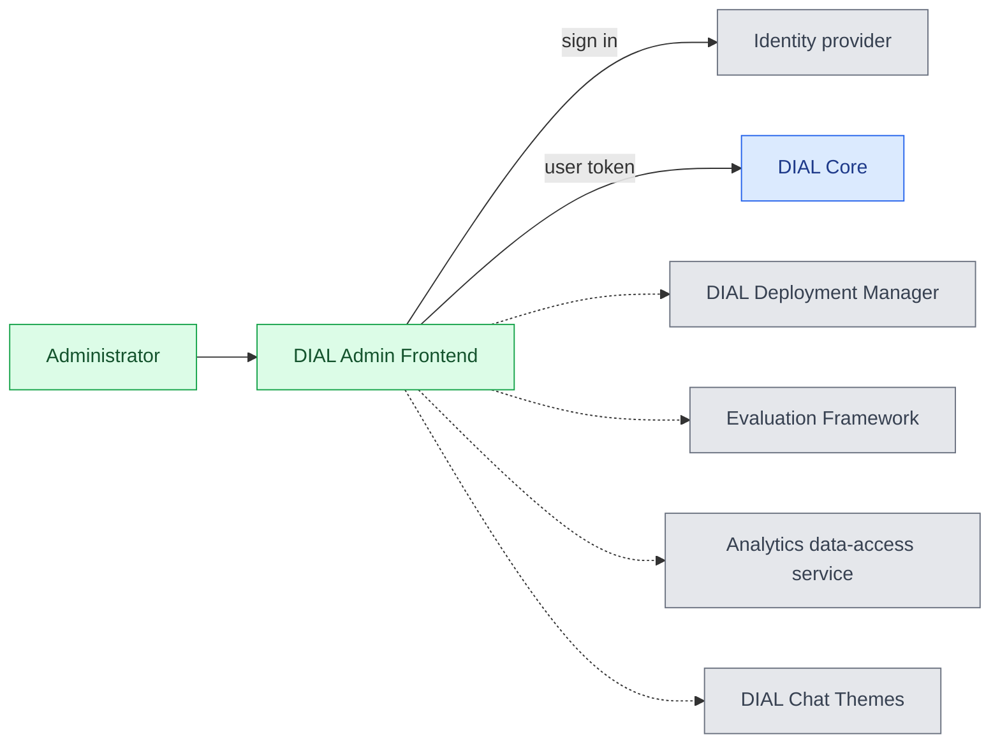

# DIAL Admin

DIAL Admin is the administration web application for DIAL. Platform administrators use it to configure the AI gateway, govern shared content and access, and work with optional deployment, evaluation, and analytics services. The service is [ai-dial-admin-frontend](https://github.com/epam/ai-dial-admin-frontend), a Next.js application with a server that calls the service APIs on behalf of the signed-in user. This reference is for platform engineers who deploy and configure it. For using the interface, start with [Administering DIAL](../../5.administering-dial-new/0.index.md).

:::info

| Component | Repository | Releases | Image tags |
|---|---|---|---|
| Frontend | [GitHub](https://github.com/epam/ai-dial-admin-frontend) | [Releases](https://github.com/epam/ai-dial-admin-frontend/releases) | [Docker Hub](https://hub.docker.com/r/epam/ai-dial-admin-frontend/tags) |
| Backend (optional) | [GitHub](https://github.com/epam/ai-dial-admin-backend) | [Releases](https://github.com/epam/ai-dial-admin-backend/releases) | [Docker Hub](https://hub.docker.com/r/epam/ai-dial-admin-backend/tags) |

:::

## How it works

Admin Frontend can work directly with DIAL Core, without Admin Backend. Set `DIAL_CORE_API_URL` and leave `DIAL_ADMIN_API_URL` unset. The frontend's server forwards the signed-in user's token to Core; Core validates the token and enforces administrator access. See [Authentication and administrator access](2.configuration/1.frontend.md#authentication-and-administrator-access).

The dashed arrows lead to optional services: [DIAL Deployment Manager](../11.deployment-manager/0.index.md), the [evaluation services](../10.evaluations/0.index.md), the Analytics data-access service, and [DIAL Chat Themes](../3.chat-themes/0.index.md). See [Dependencies](#dependencies).

Core's [Configuration API](../1.core/1.configuration/1.configuration-api.md) stores administrator-created configuration in Core's blob storage. File-defined entities remain visible in a read-only **file** root; editing an entity in Admin does not rewrite the configuration files. See [How DIAL Core is configured](../1.core/1.configuration/0.index.md).

## Dependencies

| Service | When it is needed |
|---|---|
| DIAL Core | Required for AI Gateway configuration, artifacts, governance, and publication review. Use a Core version that provides the Configuration API used by your Admin release. |
| Identity provider | Signs administrators in. Its token claims must match Core's admin rules. |
| [DIAL Chat Themes](../3.chat-themes/0.index.md) | Optional branding, palettes, and entity icons. |
| [DIAL Deployment Manager](../11.deployment-manager/0.index.md): backend and MCP proxy images | Optional. Builds images and manages model servings and containers, including stdio MCP servers wrapped for HTTP access. |
| [DIAL Evaluations](../10.evaluations/0.index.md): Evaluation Framework Backend and Evaluation Metrics | Optional. Run test suites and calculate evaluation scores. Admin connects to the framework backend and forwards the signed-in user's token to it. |
| [Analytics data-access service](https://github.com/epam/ai-dial-samples/blob/main/readmes/analytics-data-access-service-README.md) | Optional. Backs Analytics dashboards, queries, tables, pipelines, and sessions. Pipeline runtime controls also use an enrichment runner. |
| [Admin Backend](https://github.com/epam/ai-dial-admin-backend) | Optional compatibility path for backend-dependent screens and configuration import/export. See [Admin Backend configuration](2.configuration/2.backend.md). |

Admin Frontend needs no database of its own. Core and each optional backend retain their own state. Deploying the frontend or enabling a menu does not deploy those backends.

## Deployment

The container image is `epam/ai-dial-admin-frontend`; it serves the web application on port `3000` and exposes `/api/health`. Deploy it with the [`dial/dial-admin` Helm chart](../12.helm/1.configuration/4.dial-admin.md), as in [DIAL Admin installation](../../4.operating-dial/2.cloud-deployment/8.admin-installation.md), or with Docker Compose.

The [advanced setup sample](https://github.com/epam/ai-dial-samples/tree/main/2-dial-advanced-setup) runs Admin directly against Core with Keycloak authentication and Evaluation; see the [evaluation services' Docker Compose example](../10.evaluations/1.configuration/0.index.md#docker-compose-example). It also runs the Analytics Realtime → InfluxDB usage pipeline; the separate data-access service for Admin's Analytics screens must be supplied separately. See the [configuration example](2.configuration/1.frontend.md#docker-compose-example).
