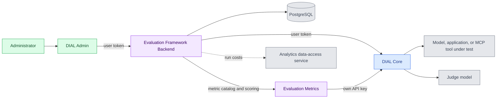

# DIAL Evaluations

The evaluation services run the test suites that the Evaluation section of DIAL Admin defines, and score the answers. Evaluation Framework Backend stores datasets, test suites, and runs, and sends each test request through DIAL Core. Evaluation Metrics calculates the scores. This reference is for platform engineers who deploy the two services next to [DIAL Admin](../8.admin/0.index.md). For the Evaluation screens, see [Evaluation overview](../../5.administering-dial-new/4.evaluation/0.index.md).

:::info

| Component | Repository | Releases | Image tags |
|---|---|---|---|
| Framework Backend | [GitHub](https://github.com/epam/ai-dial-admin-evaluation-framework-backend) | [Releases](https://github.com/epam/ai-dial-admin-evaluation-framework-backend/releases) | [Docker Hub](https://hub.docker.com/r/epam/ai-dial-admin-evaluation-framework-backend/tags) |
| Metrics | [GitHub](https://github.com/epam/ai-dial-admin-evaluation-metrics) | [Releases](https://github.com/epam/ai-dial-admin-evaluation-metrics/releases) | [Docker Hub](https://hub.docker.com/r/epam/ai-dial-admin-evaluation-metrics/tags) |

:::

## The two services

| Service | Repository | Image | What it does |
|---|---|---|---|
| Evaluation Framework Backend | [ai-dial-admin-evaluation-framework-backend](https://github.com/epam/ai-dial-admin-evaluation-framework-backend) | `epam/ai-dial-admin-evaluation-framework-backend` | Stores datasets, test suites, and runs in PostgreSQL. Runs test suites against models, applications, and MCP tools through DIAL Core, sends the answers to the metric providers, and keeps the scores. A Spring Boot service. |
| Evaluation Metrics | [ai-dial-admin-evaluation-metrics](https://github.com/epam/ai-dial-admin-evaluation-metrics) | `epam/ai-dial-admin-evaluation-metrics` | Publishes the metric catalog and calculates metric scores. Rule-based metrics run in the service; LLM metrics call a judge model through DIAL Core. A stateless FastAPI service. |

Evaluation is a Preview feature of DIAL Admin. The metrics the service ships with are listed in [Available metrics](../../5.administering-dial-new/4.evaluation/1.test-suites.md#available-metrics).

## How the services fit together

1. **DIAL Admin to the framework backend.** Setting `DIAL_EVAL_API_URL` on Admin Frontend turns on the Evaluation menu. Admin's server sends every evaluation request to the backend's `/api/v1` API with the signed-in user's token.
2. **Token validation.** The backend accepts the token only when its issuer, audience, and roles match one of the backend's identity providers. See [Security](1.configuration/1.framework-backend.md#security).
3. **Calls to DIAL Core.** The backend calls Core with the same user token to list deployments, run Try Out, run test suites, and call MCP tools. A user can evaluate only the deployments their token can reach. The backend's own API key, `DIAL_EF_API_KEY`, is used for the test case files it keeps in Core's storage.
4. **Metric catalog.** A sync job reads `GET /metrics` from each metric provider and stores the metric declarations that Admin's **Add metric** step lists. The job is off by default.
5. **Scoring.** After the target answers, the backend sends each metric to its provider's `POST /evaluate`. LLM metrics call the judge model through Core with the metrics service's own `DIAL_API_KEY`, so judge calls use that key's roles and limits.
6. **Results.** Scores and timing are stored in the backend's analytics database. Run cost figures come from the Analytics data-access service, when the backend is connected to one.

A run uses the token of the user who started it. If a long run outlasts that token, it fails. The optional [Application mode](1.configuration/1.framework-backend.md#application-mode) runs test suites through a DIAL Core application route with a per-request key instead.

## Dependencies

| Service | Needed by | Why |
|---|---|---|
| DIAL Core | Both services | Hosts the deployments under test and the judge and embeddings models, and stores test case files. Each service needs a Core [API key](../1.core/1.configuration/13.keys.md); the advanced sample uses one key for both. |
| PostgreSQL | Framework backend | Two databases, or two schemas: **meta** for datasets, test suites, and runs, and **analytics** for results and scores. The backend applies its own migrations at startup. |
| Identity provider | Framework backend | Issues the tokens Admin forwards. It is the provider that signs administrators in to DIAL Admin. |
| [DIAL Admin](../8.admin/0.index.md) | — | The interface for datasets, test suites, and runs. It connects only to the framework backend. |
| [Analytics data-access service](https://github.com/epam/ai-dial-samples/blob/main/readmes/analytics-data-access-service-README.md) | Framework backend, optional | Run cost figures, set with `DIAL_ADAS_URL`. |
| Grafana with Tempo | Framework backend, optional | Trace links in runs, set with `GRAFANA_BASE_URL`. |

## Deployment

| Service | Port | Endpoints |
|---|---|---|
| Framework backend | `8080` | The REST API under `/api/v1`, health checks at `/api/v1/health`, `/api/v1/health/ready`, and `/api/v1/health/live`, and Swagger UI at `/swagger-ui.html` |
| Framework backend | `9464` | Spring Boot Actuator, with Prometheus metrics at `/actuator/prometheus` |
| Evaluation Metrics | `5000` | `GET /metrics`, `POST /evaluate`, `GET /health`, and API docs at `/docs` |

Neither the `dial/dial` nor the `dial/dial-admin` Helm chart deploys the evaluation services. Run them from their images, as in the [Docker Compose example](1.configuration/0.index.md#docker-compose-example) and the [advanced setup sample](https://github.com/epam/ai-dial-samples/tree/main/2-dial-advanced-setup), which pins Framework Backend 0.5.0 and Metrics 0.3.0 with Admin Frontend 0.22.1.

**Warning**
> Evaluation Metrics has no authentication. Any client that reaches it can run LLM metrics with its DIAL Core API key. Keep it on an internal network that only the framework backend can reach.

**Warning**
> The framework backend has no per-user authorization yet. Every user it accepts can read and change all datasets, test suites, and runs.

## eval-cli

The framework backend's repository also contains `eval-cli`, a command-line tool that runs test suites from a pipeline. It copies the selected test suites on the backend, fetches their test cases, runs them against a target deployment through DIAL Core, and imports the results as a run. No image is published; build it from the repository at a release tag. It calls the backend with an `Api-Key` header, so the backend needs [API-key authentication](1.configuration/1.framework-backend.md#api-key-authentication). See the [eval-cli README](https://github.com/epam/ai-dial-admin-evaluation-framework-backend/blob/0.5.0/eval-cli/README.md) for its commands and settings.

## Evaluation elsewhere in the docs

- [Evaluations](../../2.understand-dial/3.capabilities/9.evaluations.md) — what DIAL can evaluate, and why
- [Evaluation overview](../../5.administering-dial-new/4.evaluation/0.index.md) — datasets, test suites, and runs in DIAL Admin
- [Admin Frontend evaluation settings](../8.admin/2.configuration/1.frontend.md#evaluation) — the setting that connects Admin
