# Agents

An agent is an application you can converse with in DIAL Chat. Some agents are a model with a fixed set of instructions; others combine a model with [toolsets](./3.toolsets.md), [skills](./4.skills.md), and files to do a particular job — answer questions about your documents, draft a proposal, or work with a system such as Jira. Unlike a bare [model](./1.models.md), an agent packages model capabilities with context and tools into a ready-to-use solution.

The **Agents** tab of the [Catalog](./0.index.md) lists every agent you can use: agents preconfigured in your DIAL environment, agents published by users, and agents you built yourself. Building one takes no code — see [Create an agent](#create-an-agent).

## Talk to an agent

Click an agent's card to open its details panel, then click **Use in chat**.

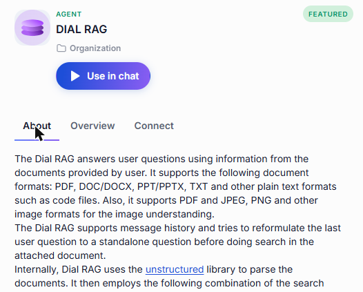

## Details panel

An agent's panel has three tabs.

### About

The description written by the agent's author — what the agent does, what inputs it expects, and any tips for getting the best results. Below the description, topic labels indicate the agent's area of expertise. You can filter by these topics in the Catalog's Browse section.

### Overview

**Specification** lists the agent's metadata. All fields are optional and appear only when provided.

| Field | Meaning |
|-------|---------|
| **Provider** | The AI provider behind the agent. |
| **Vendor** | The organization that built the agent. |
| **License** | The license under which the agent is offered. |
| **Knowledge cutoff date** | The date up to which the agent's training data extends. |
| **Parameters** | The number of parameters in the underlying model. |
| **Hosted by** | The organization that runs this agent instance. |
| **Release date** | When this version of the agent was released. |
| **Routes** | The routing paths the agent is reachable through. |

**Capabilities** tells you whether the agent supports:

| Capability | Meaning |
|------------|---------|
| **Tools** | Whether the agent can call external tools. |
| **Parallel tool calls** | Whether the agent can call several tools at once instead of one at a time. |
| **Configuration schema** | Whether the agent was built from a configurable builder template that defines its settings as a structured form. |
| **Skills** | Whether the agent can load and use skills. |

**Configuration** shows what users may attach to a conversation with the agent — for example, which file types are accepted as input attachments.

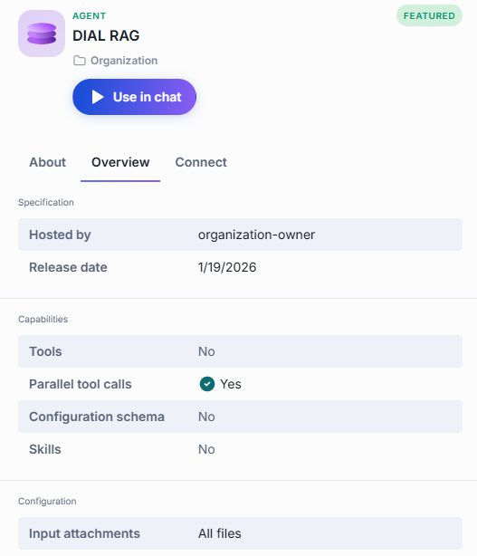

### Connect

What you need to call the agent from your own code instead of from the chat interface: its **Model ID**, its **Chat Completions** endpoint, and a cURL command you can copy, paste your API key into, and run. The endpoint and the command each have a copy button.

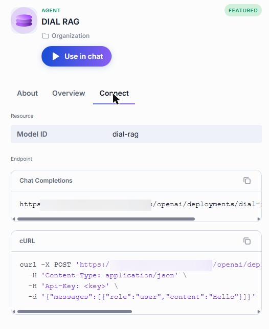

## What you can do with an agent

What actions are available depends on how the agent reached your Catalog. The agent's card shows its location — a folder in your personal files, or a folder within the organization.

### Preconfigured agents

Preconfigured agents are set up in the platform configuration by administrators. They carry the **Featured** label in the Catalog and their location shows an organization folder. These agents are read-only — you can only use them in chat.

### Published agents

Published agents are made available to the organization by any user or administrator. Their location shows a folder within the organization. Any user can request to unpublish a published agent — the request goes to an administrator for review.

- **Use in chat** — start a conversation with the agent.
- **Unpublish** — withdraw the agent from the organization. An unpublish request goes to an administrator for review.

### Agents shared with you

When another user shares an agent directly with you, it appears in the Catalog under **Shared with me**. You can use it in chat or remove it from your list — removing it does not delete the original agent.

- **Use in chat** — start a conversation with the agent.
- **Remove from My List** — remove the agent from your catalog.

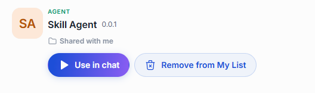

### Your own agents

Agents you created stay in your personal folder until you share or publish them. You have full control over your own agents.

- **Use in chat** — start a conversation with the agent.
- **Share** — let specific people access your agent. See [Sharing and publishing](../5.sharing-and-publishing.md).
- **Edit** — reopen the builder with your settings in place. See [Edit an agent](#edit-an-agent).
- **Publish** — offer the agent to your organization. A publication request goes to an administrator for review. See [Sharing and publishing](../5.sharing-and-publishing.md).
- **Revoke access** — remove access you previously shared with specific people.
- **Delete** — remove the agent permanently. See [Delete an agent](#delete-an-agent).

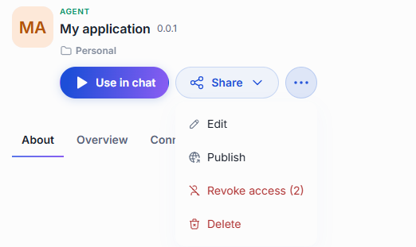

## Create an agent

Click **Create** in the Catalog and pick a runner under **Runners**. For what a runner is and how the menu is organized, see [Create your own](./0.index.md#create-your-own). Your organization may add runners of its own, and not every environment offers all of the ones below.

| Runner | What you get | Choose it when | Steps |
|---|---|---|---|
| **Quick App** | An agent built from a model, instructions, and add-ons. Nothing to code or host. | The task is something a general model can handle in one pass: analyze the inputs, make a plan, execute, and present the results. For example, answering questions from your documents, calling external APIs through toolsets, routing requests to specialist agents, or researching on the web. | [Build a Quick App](#build-a-quick-app) |
| **Custom App** | A registration for an application you built and host yourself. DIAL routes requests to it, and it appears in DIAL Chat like any other agent. | The application already runs on your side. | [Build a Custom App](#build-a-custom-app) |

Your new agent stays in your private folder, visible only to you, until you share or publish it.

### Build a Quick App

A Quick App lets you build an AI agent without writing code. You pick a model to drive the agent, write instructions that tell it how to behave, and connect it to the toolsets, skills, and files it needs. The model then decides which of them to use for each request — calling tools, reading documents, or handing off to other agents as the task requires.

Quick Apps suit a wide range of use cases:

- A Q&A assistant that answers questions using your company's documents (via DIAL RAG).
- A workflow agent that calls external APIs — weather services, CRMs, ticketing systems — through MCP toolsets.
- A multi-agent orchestrator that routes each request to the right specialist agent.
- A research assistant that retrieves and summarizes content from the web.
- A support assistant with conversation starters that guide users toward common tasks.

You can use other DIAL models and agents as building blocks in your agent's workflow, attach skills that teach it specific procedures, and let it browse the web for up-to-date information. Because a Quick App runs on DIAL infrastructure from the moment you create it, there is no server to provision and no deployment to schedule. It inherits the platform's access control, sharing, and cost limits automatically. You can share it with colleagues, publish it to the Catalog, or use it as a building block inside another Quick App.

:::note
For the developer's view of Quick Apps, including the JSON behind the editor, see [Quick Apps](../../3.building-with-dial/1.apps/2.quick-apps/0.index.md).
:::

The editor has three columns on one screen: **Metadata** on the left, **Instructions** and **Add-ons** in the middle, and **Configuration** on the right. The top bar has **Preview**, **Cancel**, and **Save**.

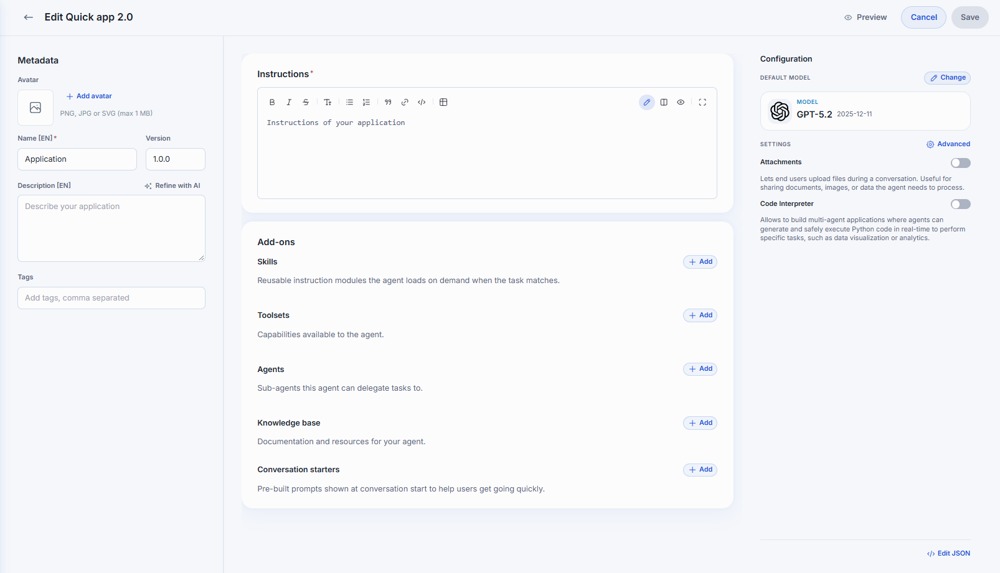

**Where to find what**

| I want to… | Go to |
|---|---|
| Name, describe, or tag the agent | [Metadata](#metadata) |
| Tell the model how to behave | [Instructions](#instructions) |
| Give the agent skills | [Add skills](#add-skills) |
| Connect external tools | [Add toolsets](#add-toolsets) |
| Let the agent delegate to other agents | [Add agents](#add-agents) |
| Give the agent documents to draw on | [Add a knowledge base](#add-a-knowledge-base) |
| Suggest example prompts to users | [Set up conversation starters](#set-up-conversation-starters) |
| Choose the model | [Default model](#default-model) |
| Let users upload files, or let the agent run Python | [Settings](#settings) |
| Set the temperature, time awareness, file tools, or web access | [Advanced settings](#advanced-settings) |
| Copy this agent's structure to another agent | [Edit JSON](#edit-json) |
| Test the agent, then save it | [Preview and save](#preview-and-save) |

#### Metadata

How the agent presents itself in the Catalog and in chat.

| Field | Required | Description |
|-------|:--------:|-------------|
| Avatar | No | PNG, JPG, or SVG, up to 1 MB. |
| Name | Yes | The name shown on the agent's card. |
| Version | No | A version string, for example `1.0.0`. |
| Description | No | A short summary shown on the card and in the About tab. You can use [Refine with AI](./0.index.md#refine-text-with-ai). |
| Tags | No | Topics that help people find the agent when filtering the Catalog. |

#### Instructions

The standing instructions the model follows in every conversation. They are required. The editor accepts Markdown and has a formatting toolbar, with edit, split, preview, and full-screen views.

:::tip[Tips for writing Instructions]
- State the agent's purpose clearly in the first sentence.
- Describe what the model should and should not do.
- If tools are connected, tell the model when and how to use them.
- Use `{{variable}}` syntax for values that may change across deployments.
:::

#### Add-ons

Add-ons are what the agent can use besides the model itself. The **Add-ons** card has a row for each kind. Every row has an **Add** button. The items you add are listed in the row. Click an item to see its details, or remove it.

##### Pick from the catalog

**Add** in the **Skills**, **Toolsets**, and **Agents** rows opens the same kind of window with the Catalog:

- Search by name.
- Filter by **My** or by topic, as in the Catalog itself.
- Select one item, several, or all of them.

A skill, toolset, or agent that was removed from the Catalog after you added it shows "This skill is no longer available", "This toolset is no longer available", or "This agent is no longer available".

##### Add skills

Skills are reusable instruction modules the agent loads on demand when the task matches. See [Skills](./4.skills.md).

1. In the **Skills** row, click **Add**.
2. In the window, [pick the skills](#pick-from-the-catalog).
3. Confirm.

##### Add toolsets

Toolsets are external tools and services the agent can call, such as MCP servers. See [Toolsets](./3.toolsets.md).

1. In the **Toolsets** row, click **Add**.
2. In the window, [pick the toolsets](#pick-from-the-catalog).
3. Confirm.

If you are not signed in to a toolset, its row says "Authorize to use this toolset." Click the toolset to open its details:

- **Tools** — the tools the toolset offers, with a search box and the number of tools.
- **Authentication** — sign in, or change your API key.

##### Add agents

Agents are the other agents and sub-agents this agent can delegate tasks to.

1. In the **Agents** row, click **Add**.
2. In the window, [pick the agents](#pick-from-the-catalog).
3. Confirm.

An agent that supports MCP has a **Settings** tab in its details. Its **Connect via** option offers **MCP**, which is the default, or **Chat Completion**.

##### Add a knowledge base

The knowledge base holds the files the agent draws on when answering: documentation and resources for your agent. These are the agent's context files.

1. In the **Knowledge base** row, click **Add**. The [File Manager](../4.files.md) opens.
2. Select the files the agent should draw on.
3. Confirm.

Each file in the row shows its path. To take a file out, remove it from the row.

##### Set up conversation starters

Conversation starters are buttons shown near the chat input that suggest example prompts, to help users start a conversation.

1. In the **Conversation starters** row, click **Add**. **Set up conversation starters** opens.
2. For each starter, enter a button label and the prompt to send in chat. Drag the starters to reorder them.
3. Set the options in the table below. They are available once you have at least one starter.
4. Click **Save**.

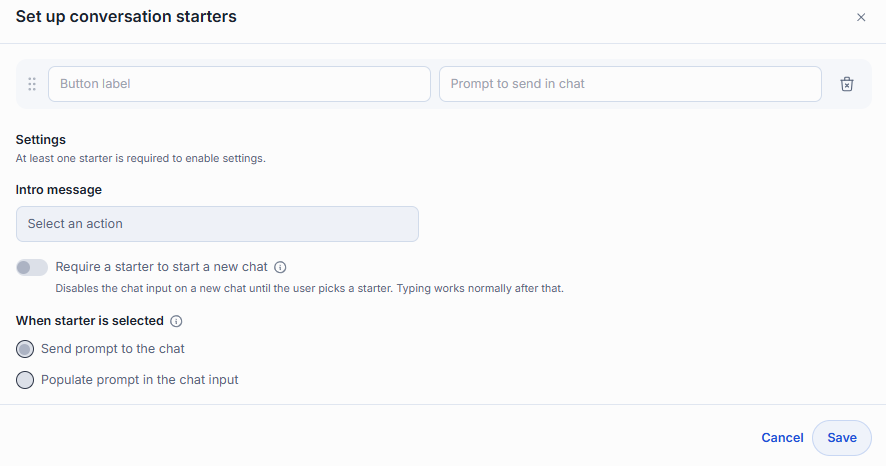

| Field | Description |
|-------|-------------|
| Button label | The label on the button. |
| Prompt to send in chat | The prompt behind it. |
| Intro message | A line shown above the buttons, for example "What do you want to talk about?" |
| When starter is selected | **Send prompt to the chat** sends the prompt immediately. **Populate prompt in the chat input** drops it into the message box so the user can edit it first. |
| Require a starter to start a new chat | Disables the chat input on a new chat until the user picks a starter. Typing works normally after that. |

#### Configuration

The **Configuration** column sets the model and the agent's capabilities.

##### Default model

The model that drives the agent: it picks tools, calls them, and composes the final answer. It replies to prompts and orchestrates everything else.

1. Click **Change**. The models catalog opens.
2. Search it, sort it by **Recently updated**, **Newest**, or **Name A-Z**, or filter it with **My** or **Topics**.
3. Open a model to see its pricing and limits, then select it.

##### Settings

| Setting | Description |
|---------|-------------|
| Attachments | Lets end users upload files during a conversation. When it is on, you list the allowed file types as [MIME types](https://developer.mozilla.org/en-US/docs/Web/HTTP/Basics_of_HTTP/MIME_types/Common_types). At least one type is required. |
| Code Interpreter | Lets the agent run Python to compute or plot something. It allows multi-agent applications where agents generate and safely run Python code in real time, for example for data visualization or analytics. |
| Advanced | Opens [Advanced settings](#advanced-settings). |

##### Advanced settings

Click **Advanced** in **Settings** to open the window. Click **Save** to apply the options, or **Close** to leave without applying.

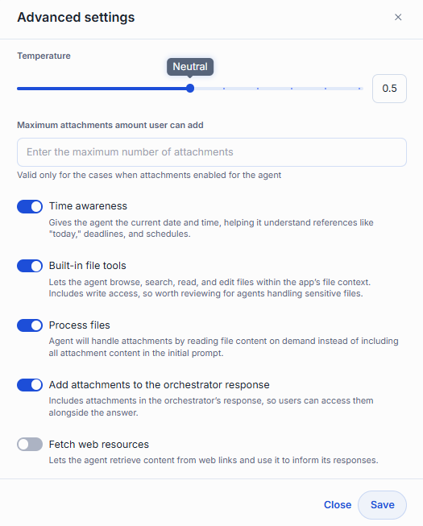

| Field | Description |
|-------|-------------|
| Temperature | How predictable the answers are, from Precise to Creative. It is available only for models that allow it. |
| Maximum attachments amount user can add | How many files one message may carry. It matters only when **Attachments** is on. It must be a whole number greater than 0. |
| Time awareness | Gives the agent the current date and time, so it understands references like "today", deadlines, and schedules. |
| Built-in file tools | Lets the agent browse, search, read, and edit files within the app's file context. It includes write access, so review it for agents that handle sensitive files. |
| Process files | The agent handles attachments by reading file content on demand, instead of putting all attachment content in the first prompt. This lets the agent read the files attached to a conversation. |
| Add attachments to the orchestrator response | Includes the files the agent produced in its response, so users can open them next to the answer. |
| Fetch web resources | Lets the agent retrieve content from web links and use it in its answers. |

##### Edit JSON

**Edit JSON**, at the bottom of **Configuration**, opens the agent's whole configuration as one JSON document. Edit it directly to set or read a field that the editor has no control for.

1. Click **Edit JSON**.
2. Edit the document. Use the icons in the header to copy the JSON or download it as a file, for example to reuse this agent's structure in another one.
3. Click **Save** to apply your changes to the editor, or **Cancel** to discard them.

**Save** is unavailable while the JSON is not valid, and the editor says why, for example "Invalid JSON", "The configuration must be a JSON object.", or "Invalid configuration". Your changes take effect for the agent when you click **Save** in the editor.

#### Preview and save

1. Click **Preview** in the top-right corner to test your agent. DIAL Chat first saves the agent, then opens a full-page chat in preview mode.
2. A banner reads "Preview mode: You are previewing" followed by the agent's name, then "Send a message to test how it responds. Usage is following your limits." Send messages and see how the agent responds with its current configuration.
3. Click **Back to setup** to return to the editor, change what you need, and click **Preview** again to test the new version.

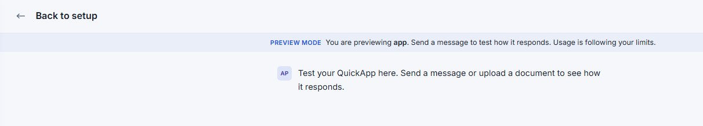

When you are done, click **Save** to register the agent, or **Cancel** to discard your changes and return to the Catalog.

- **Save** and **Preview** stay unavailable until the required fields are filled in correctly.
- If an agent with the same name and version already exists, DIAL Chat does not create the new one and shows "An application with this name and version already exists." Change the name or the version.

### Build a Custom App

Register a Custom App when you have built and hosted an application yourself and want it to appear in the Catalog so that anyone with access can use it in chat or connect to it through the API. Your application must expose a chat completion endpoint that follows the [Unified API](https://dialx.ai/dial_api#operation/sendChatCompletionRequest) — DIAL routes requests to the URL you provide during registration.

:::note
For how to build the application behind the registration, see [Custom Apps](../../3.building-with-dial/1.apps/4.custom-apps/0.index.md).
:::

The editor has two sections on one screen: **Metadata** on the left and **Setup** on the right.

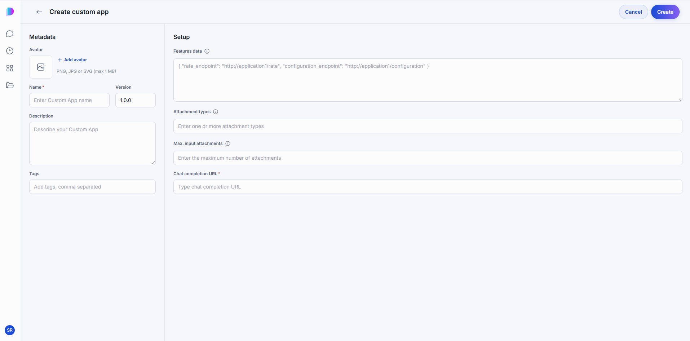

#### Metadata

How the agent presents itself in the Catalog and in chat.

| Field | Required | Description |
|-------|:--------:|-------------|
| Avatar | No | PNG, JPG, or SVG, up to 1 MB. |
| Name | Yes | The name shown on the agent's card. |
| Version | No | Defaults to `1.0.0`. |
| Description | No | A short summary shown on the card and in the About tab. You can use [Refine with AI](./0.index.md#refine-text-with-ai). |
| Tags | No | Topics that help people find the agent when filtering the Catalog. |

#### Setup

| Field | Required | Description |
|-------|:--------:|-------------|
| Features data | No | A JSON object declaring optional endpoints your application supports. `rate_endpoint` points to the URL where DIAL sends user feedback on responses. `configuration_endpoint` points to the URL that serves a settings UI, letting users customize the app's behavior per conversation. |
| Attachment types | No | Allowed file types, given as [MIME types](https://developer.mozilla.org/en-US/docs/Web/HTTP/Basics_of_HTTP/MIME_types/Common_types). |
| Max. input attachments | No | How many files one message may carry. |
| Chat completion URL | Yes | The URL of your application's chat completion endpoint. DIAL sends every user message to this address. |

Click **Create** to register the agent, or **Cancel** to return to the Catalog.

## Edit an agent

Open the agent's **...** menu and click **Edit**. The builder reopens with your settings in place; change what you need and click **Save**.

You can edit agents in two cases:

- **Your own agents** — found in your personal folder.
- **Agents shared with you with editing rights** — found in the Catalog under **Shared with me**.

A published version is fixed — keep working on your own copy and publish a new version when it is ready.

## Delete an agent

Open the agent's **...** menu and click **Delete**, then confirm. Deleting is permanent: anyone you shared the agent with loses access, and any configuration shared with it is lost.

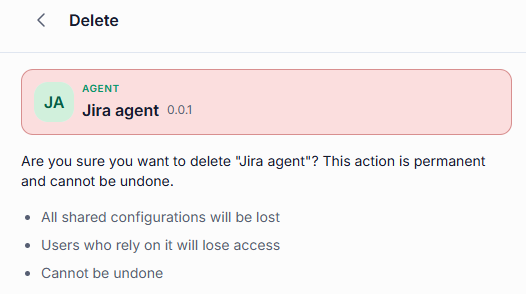

Only the agent's creator can delete it — editing rights do not grant delete access. To delete a published agent, unpublish it first.

## Further reading

- [Chat User Guide: Toolsets](./3.toolsets.md) — give your agent access to external systems
- [Chat User Guide: Skills](./4.skills.md) — teach your agent a procedure it can reuse
- [Sharing and publishing](../5.sharing-and-publishing.md) — share your agent or publish it to the Catalog
- [Chat User Guide: Models](./1.models.md) — the AI models agents are built on
- [Chat User Guide: Prompts](./5.prompts.md) — save and reuse prompt templates
- [Tutorial: build an agent with a Toolset](../../3.building-with-dial/1.apps/2.quick-apps/1.tutorial-build-an-agent.md) — build a research agent from an MCP server Toolset
