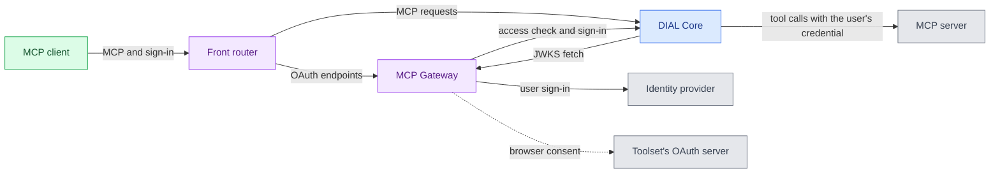

# DIAL MCP Gateway

DIAL MCP Gateway is an OAuth 2.0 authorization server that lets MCP clients outside DIAL Chat, such as Claude Code and Cursor, sign in to DIAL toolsets. It signs the user in at the deployment's identity provider, runs the toolset's own OAuth consent, and issues the client a token that DIAL Core accepts. This reference is for platform engineers who run [DIAL Core](../1.core/0.index.md) with [toolsets](../1.core/1.configuration/11.toolsets.md).

:::info

- [Repository](https://github.com/epam/ai-dial-mcp-gateway)
- [Releases](https://github.com/epam/ai-dial-mcp-gateway/releases)
- [Docker Hub image tags](https://hub.docker.com/r/epam/ai-dial-mcp-gateway/tags)

:::

## What the gateway solves

A toolset that signs in with OAuth needs an upstream credential for each user, for example a Notion token. DIAL Core stores that credential per user, injects it on every tool call, and never returns it to the client. The client holds only a DIAL token.

Users normally create the upstream credential through the sign-in buttons in DIAL Chat or [DIAL Admin](../../6.administering-dial-new/1.ai-gateway/3.toolsets.md#authentication). An MCP client has no such screen, and a deployment that uses Core only as a model and MCP gateway may not run DIAL Chat at all. The gateway gives MCP clients a standard OAuth sign-in instead. Sources: [README](https://github.com/epam/ai-dial-mcp-gateway/blob/0.1.0/README.md#L17-L37) and [handoff brief](https://github.com/epam/ai-dial-mcp-gateway/blob/0.1.0/docs/HANDOFF.md#L11-L25).

The gateway also shields MCP clients from identity providers that don't support the MCP authorization specification. A provider without client ID metadata documents or dynamic client registration never faces the client; the gateway is the authorization server the client sees.

## How it relates to DIAL Core toolsets

The gateway decides nothing about access and stores no upstream credential. It reads the toolset from Core as the signed-in user, and Core answers with the toolset's OAuth settings and that user's sign-in status. What happens next depends on that answer.

| Toolset state in Core | What the gateway does |
|---|---|
| The user is denied by the toolset's `userRoles` | Stops with a no-access page. Core answers `403`, the same decision it makes on every tool call. |
| The user holds a credential at user level, or the toolset has a global credential | Skips the upstream consent and issues the token. Works for every authentication type. |
| `OAUTH` with no stored credential | Sends the browser to the toolset's authorization server with Core's client ID and PKCE challenge, then passes the returned code to `POST /v1/ops/toolset/signin` at `USER` level. Core exchanges the code and stores the credential. |
| Any type other than `OAUTH`, such as `API_KEY`, with no stored credential | Stops with a page that says the credential is configured in DIAL directly. The same sign-in succeeds once a credential is stored at user or global level. |
| Unknown toolset | Stops with a not-registered page. Core answers `404`. |

The code exchange happens inside Core, which holds the client secret and the PKCE verifier. The gateway never sees the upstream token. See the [branch logic](https://github.com/epam/ai-dial-mcp-gateway/blob/0.1.0/gateway/federation.py#L251-L270), the [flow description](https://github.com/epam/ai-dial-mcp-gateway/blob/0.1.0/docs/gateway-configuration.md#the-federation-flow), and the [sign-in request](https://github.com/epam/ai-dial-mcp-gateway/blob/0.1.0/gateway/flow.py#L358-L383).

The gateway serves DIAL [applications with an MCP endpoint](../1.core/1.configuration/7.applications.md#mcp) as well. An application has no upstream credential, so its sign-in is the identity provider sign-in plus Core's access check. In both cases the token carries the user's own identity claims, so Core applies the same roles and finds the same stored credentials as for that user's other DIAL clients.

## How the gateway fits together

The front router and the gateway run in one pod and publish one origin. The router sends the OAuth endpoints to the gateway and MCP traffic straight to [DIAL Core](../1.core/0.index.md), so the gateway is not on the data path. See [Endpoints and sign-in flow](2.api.md) for the full map.

1. **The client is challenged.** An MCP request without a token reaches Core, which answers `401`. The router replaces Core's `WWW-Authenticate` header with one that points to the gateway's protected-resource document.
2. **The client registers and starts OAuth.** The client is pre-registered, presents a client ID metadata document, or registers dynamically when `DCR_ENABLED=true`. It then starts the authorization code flow with PKCE `S256` and a `resource` parameter that names the toolset.
3. **The gateway runs the sign-in.** The user signs in at the identity provider, Core checks access, and the user approves the client on first use. When Core holds no credential for an `OAUTH` toolset, the upstream consent runs and Core stores the result.
4. **The gateway issues tokens.** The access token is an RS256 JWT that copies the user's identity claims, signed with the gateway's key. The refresh token carries the identity provider's refresh token, encrypted.
5. **Core serves the tool calls.** Core verifies the token against the gateway's JWKS through an extra [identity provider entry](1.configuration/0.index.md#configure-dial-core), then injects the user's stored credential on each call.

## Dependencies

| Dependency | Purpose |
|---|---|
| DIAL Core | Serves the MCP requests, checks access, stores and injects toolset credentials, and verifies the gateway's tokens. Needs an identity provider entry for the gateway and `toolsets.security` settings; see [Configure DIAL Core](1.configuration/0.index.md#configure-dial-core). |
| OpenID Connect identity provider | The provider DIAL Core already trusts for users. The gateway signs users in through its own confidential client there. Keycloak and Entra B2C are the providers the repository records as tested. |
| Front router | nginx `1.27-alpine` running the repository's `router/nginx.conf`, in the same pod as the gateway. |
| Persistent volume | Holds the dynamic client registration store. Needed only when `DCR_ENABLED=true`. |
| Toolset authorization servers | The OAuth servers of the toolsets' MCP servers. The user's browser reaches them during consent. |

## Deployment

| Item | Value |
|---|---|
| Image | `epam/ai-dial-mcp-gateway`, Python 3.12 on Alpine, user and group `10001`, `linux/amd64` only |
| Router image | `nginx:1.27-alpine` with `router/nginx.conf` from the same release tag as the gateway image, mounted read-only |
| Ports | `8090` on the router, the single public port. `8091` on the gateway, reachable by Core for the JWKS and never exposed outside the pod. |
| Liveness | `GET /healthz` returns `{"status": "ok"}`. It doesn't check Core or the identity provider; there is no readiness endpoint. |
| State | Sign-in flows, codes, client approvals, and revoked tokens are in memory. The dynamic client registration store is the only file. |
| Replicas | One. The gateway is not horizontally scalable. |
| Helm | Not part of the [`dial` chart](../12.helm/0.index.md). The repository defines a [pod contract](https://github.com/epam/ai-dial-mcp-gateway/blob/0.1.0/docs/pod-contract.md), not a chart. |
| Logs | Standard output. Audit events are JSON lines on the `gateway.audit` logger; the router and server access logs are off because request lines carry codes. |

Sources: [Dockerfile](https://github.com/epam/ai-dial-mcp-gateway/blob/0.1.0/Dockerfile#L39-L84), [Compose file](https://github.com/epam/ai-dial-mcp-gateway/blob/0.1.0/docker-compose.yml#L120-L344), [health route](https://github.com/epam/ai-dial-mcp-gateway/blob/0.1.0/gateway/app.py#L70-L80), [server start](https://github.com/epam/ai-dial-mcp-gateway/blob/0.1.0/gateway/__main__.py#L106-L119), and the [pod contract's assumptions](https://github.com/epam/ai-dial-mcp-gateway/blob/0.1.0/docs/pod-contract.md#8-assumptions).

The repository's [README](https://github.com/epam/ai-dial-mcp-gateway/blob/0.1.0/README.md#L39-L60) lists one remaining production-readiness stage: a closing security review of the production deployment shape.

**Warning**
> The gateway's signing key lets its holder issue tokens that DIAL Core accepts for any user. Deliver it from a secret store, never bake it into an image, and rotate it as described in [Key rotation](1.configuration/1.environment-variables.md#key-rotation).
