# Scheduled tasks

A scheduled task is a message that DIAL Chat sends for you on a schedule. You pick a model or an agent, write the instructions, and choose when it runs: once, hourly, daily, weekly, monthly, or every few weeks. Every run produces its own conversation, so you can open the result later like any other chat. You can also run a task on demand with **Start now**.

Use it for work you would otherwise repeat by hand: have an agent summarize overnight support tickets every morning, generate a weekly project status report from your team's updates, or check a competitor's pricing page daily and flag changes.

> Scheduled tasks are an optional feature. If **Scheduled tasks** is missing from the sidebar, your deployment has not enabled it.

## Allow tasks to run while you are away

Tasks run without you, so DIAL Chat needs your authorization once. You give it by logging in to the **Dial native** extension. Until you do, scheduled runs cannot start on their own.

The **Scheduled tasks** page tells you which state you are in:

| You see | What it means | What to do |
|---|---|---|
| A **Log in required** banner with a login button | You have not authorized scheduled runs yet. | Click the button. A sign-in popup opens. If your browser blocks it, allow popups for DIAL Chat and try again. |
| A red **Limited access** banner: "You can't create or edit tasks. Contact your administrator for more details." | The approval for scheduled tasks is missing. This can happen after you log out of **Dial native**. | Log in again. If the banner stays, contact your administrator. |

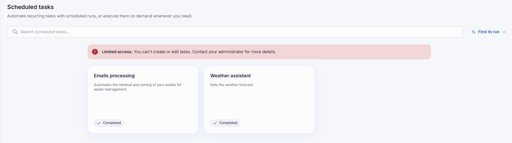

While the banner shows, you cannot create, edit, or run tasks. You can still pause or delete the ones you have.

You can also log in or out at any time in [Settings, Extensions](./6.usage-and-settings.md#extensions).

## The task list

Click **Scheduled tasks** in the sidebar. The page lists your tasks as cards.

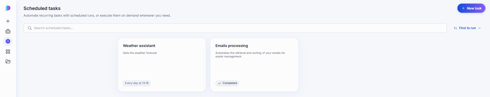

Each card shows the task name, its description, and a badge:

| Badge | Meaning |
|---|---|
| A schedule, for example **Every day at 14:43** or **Every 2 weeks on Monday at 9:00 AM** | The task is active and runs on this schedule. |
| **Paused** | The task is switched off and does not run until you switch it back on. |
| **Completed** | The task has finished all its runs. |

To find a task, type in **Search scheduled tasks**. The sort menu offers **First to run**, **Last to run**, **Newest**, and **Name A-Z**. To create a task, click **New task** at the top right of the page.

## Create a task

On the **Scheduled tasks** page, click **New task**. The form has two parts: **Details** on the left and **Configuration** on the right. The page for editing an existing task has the same fields.

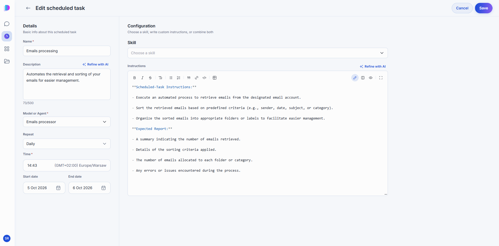

### Details

| Field | Required | What it does |
|---|---|---|
| **Name** | Yes | Shown on the card and as the title of the task page. |
| **Description** | No | Up to 500 characters. [Refine with AI](./3.catalog/0.index.md#refine-text-with-ai) rewrites your draft. |
| **Model or Agent** | Yes | The model or agent that receives the instructions on every run. |
| **Repeat** | Yes | **One-time**, **Hourly**, **Daily**, **Weekly**, **Monthly**, or **Custom**. Controls the schedule fields below. |
| **Start date**, **End date** | No | Hourly, daily, weekly, and monthly tasks only. The window in which the task is active. The end date must be after the start date, and neither can be in the past. **Custom** has no window. |

The remaining schedule fields depend on the **Repeat** value you choose:

| Repeat | You also set |
|---|---|
| One-time | **Date and time**: a specific future date and time. |
| Hourly | **Minutes past the hour**: 0 to 59. |
| Daily | **Time**. |
| Weekly | **Day** and **Time**. |
| Monthly | **Day of month** (1 to 31) and **Time**. |
| Custom | **Every**: 1 to 10 weeks. **Time**. **Day**: one day of the week, chosen with the day buttons. |

DIAL Chat uses your browser's time zone. The **Time** field shows it next to the value, for example `(GMT+02:00) Europe/Warsaw`.

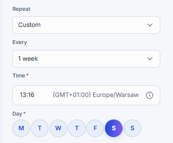

A **Custom** task runs on the chosen weekday every 1 to 10 weeks, with no start or end date, until you pause or delete it. It counts calendar weeks of the year, so the count restarts every January. For intervals of three weeks or more, the gap across New Year can be shorter than the interval you chose.

### Configuration

Tell the task what to do with a skill, with instructions, or with both. You must provide at least one.

- **Skills**: choose one or more skills from the list. You can search it by name, and it includes your own skills, skills shared with you, and published skills. The task page shows the chosen skills in its configuration. For more about skills, see [Skills](./3.catalog/4.skills.md).
- **Instructions**: the message the task sends on every run. The editor accepts Markdown and offers [Refine with AI](./3.catalog/0.index.md#refine-text-with-ai). Describe the expected result as well as the work, for example which summary you want back.

Skills work only with a model or agent that supports them:

- If the selected model or agent does not support skills, the **Skills** field is disabled and a hint reads "Selected model does not support skills. Select a different model to use a skill."
- If you choose skills and then switch to a model or agent that does not support them, the field turns red and a message reads "Selected model does not support skills. Remove the skill or select different model to proceed." You cannot save the task until you remove the skills or select another model or agent.

Click **Save** to create the task. **Cancel** discards the form. If you have unsaved changes, DIAL Chat asks "Discard unsaved changes?" before you leave, and **Discard changes** confirms.

## Open a task

On the **Scheduled tasks** page, click a task card to open its page.

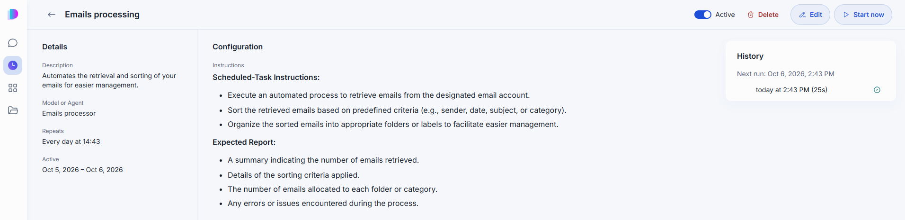

- The left column repeats the task's description, model or agent, schedule, and active window.
- The center shows the instructions.
- The **History** card on the right shows when the next run happens and lists past runs with their time and duration, for example `(1m 5s)`. Click a run to open its conversation.

A run has one of four statuses:

| Status | Meaning |
|---|---|
| **Succeeded** | The run finished. |
| **Failed** | The run did not finish. Point to the status icon to read the reason the scheduler reported. |
| **Running** | The run is in progress. |
| **Missed** | The run did not start at its scheduled time. |

## Manage a task

The buttons at the top of the task page manage the task: the **Active** switch, **Delete**, **Edit**, and **Start now**.

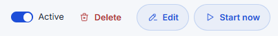

### Pause and resume a task

Switch **Active** off to pause the task. A paused task keeps its settings, shows **Paused** on its card, and does not run until you switch **Active** back on. A message confirms each change: "Task paused" or "Task resumed".

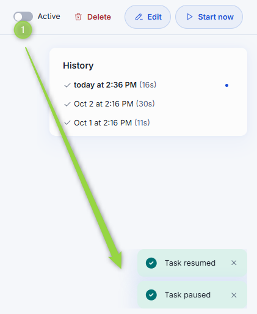

You cannot reactivate a task that already completed or whose active window has ended. Create a new task instead.

### Run a task now

Click **Start now** to run the task immediately, without waiting for the schedule. It also works for a paused or completed task. While the run is in progress, **Start now** is unavailable, and **History** shows the run with a spinner. When the run finishes, the spinner changes to the run's status and duration.

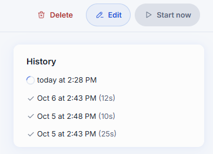

If something goes wrong, DIAL Chat tells you what to do:

| Message | What to do |
|---|---|
| "Could not confirm that the task started. Check History before trying again." | Open **History**. The run may have started anyway. |
| "This run has not reported completion yet. Refresh its status." | Click **Refresh status**. |
| "Sign in to DIAL Chat to run this task." | Log in first. See [Allow tasks to run while you are away](#allow-tasks-to-run-while-you-are-away). |

### Edit a task

Click **Edit** to change any field. Some schedules cannot be edited in the form yet. In that case the page says so, and you can still pause or delete the task.

### Delete a task

Click **Delete** and confirm. Deleting a task is permanent, but the conversations from its earlier runs stay available in your chat list.

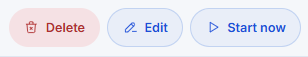

## Read the results

Each run creates a conversation in your chat list, under **My chats**. The list shows one row per task, and the row opens the latest run. A run you have not opened yet shows the task name in bold with a blue dot. After you open it, the dot is hollow.

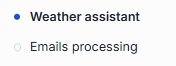

To see only your scheduled tasks, click the filter icon in the **Chats and tasks** header, point to **Type**, and choose **Task**. Choose **Chat** to hide them, or **All** to show everything. A dot on the filter icon shows that a filter is applied.

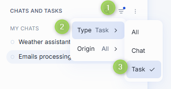

Open an older run from the task's **History**. At the top of a run conversation, a banner shows the task name and the time of the run. Click **Task details** in the banner to go back to the task page.

You can continue the conversation as in any other chat, for example to ask a follow-up question about the result.

## Next steps

- [Conversations](./1.conversations.md): work with the conversations that runs create
- [Skills](./3.catalog/4.skills.md): write a skill that a task can apply on every run
- [Agents](./3.catalog/2.agents.md): choose the agent a task runs with
