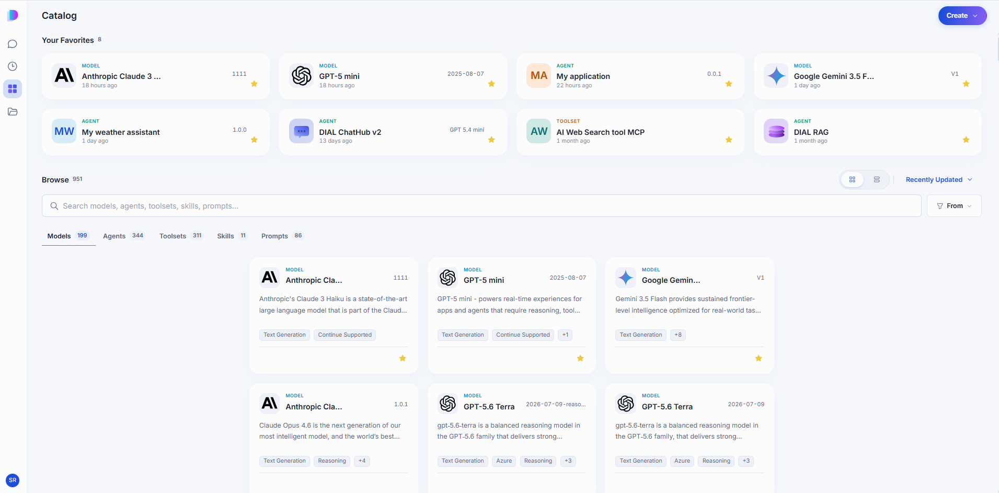
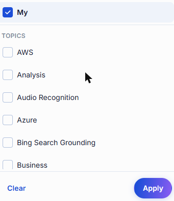
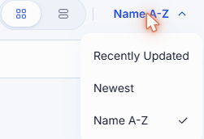
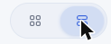
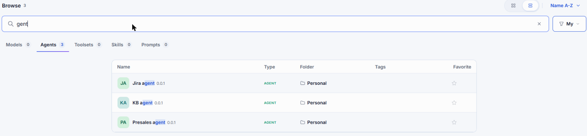
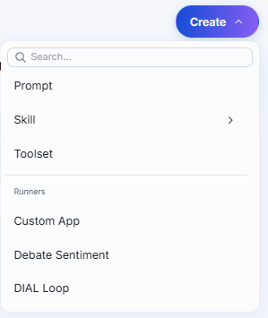

# Catalog

The Catalog is the single place where you find everything you can work with in DIAL Chat: AI models, agents, toolsets, skills, and prompts. It combines items configured by your organization for this DIAL deployment with items published by other users and items you created yourself. What you see depends on your role — your own items are always visible, and everything else is governed by the permissions your administrator assigned to you.

Click **Catalog** in the sidebar on the left.

From the Catalog you can:

- Start a conversation with any model or agent.
- Keep the items you use most as favorites so they appear at the top of the Catalog and in the agent selector when you start a conversation.
- View an item's description, pricing, and your usage.
- Copy an endpoint URL and a ready-made cURL command to call an item from your own code.
- Apply a skill directly to a message — not only through an agent — as long as the selected agent supports working with skills.
- Build your own agents, toolsets, skills, and prompts, without writing code.

**Note**
> Access to every item except those you created yourself is governed by your role. See [Authentication and access control](../../2.understand-dial/4.security-and-governance/1.authentication-and-access-control.md).

## Your Favorites

**Your Favorites** sits at the top of the Catalog and holds the items you starred, of any type. Click the star on a card, or the star in an item's details panel, to add it; click the star again to remove it. Favorites are personal — starring an item changes nothing for anyone else.

## Browse

Below your favorites, **Browse** lists everything available to you, split into five tabs. Each tab shows how many items it holds. Click any card to open that item's details panel — what the panel contains differs by type, so see the page for the type you are interested in.

| Tab | What it holds |
|-----|---------------|
| [Models](./1.models.md) | The AI models available in your DIAL environment. |
| [Agents](./2.agents.md) | All AI agents you can use — your own and those published organization-wide. |
| [Toolsets](./3.toolsets.md) | Connections to MCP servers that let agents reach external systems. |
| [Skills](./4.skills.md) | Reusable instructions an agent picks up when a task calls for them. Users can also apply a skill directly to a message. |
| [Prompts](./5.prompts.md) | Prompts saved for reuse in conversations. |

A tab with nothing to show says so. For example, with **My** switched on and nothing created yet, the tab shows an empty message with a **Create** button for that kind of item.

Use the controls above the list to narrow it down:

- **Search** — type part of a name to filter the current tab.
- **Filter** — **My** limits the list to items you created yourself, so your own work is not buried among everything published across the organization. **Topics** limits it to a subject area, such as Analysis or Business. Clear both to see everything again.

  

- **Sort** — order by **Recently Updated**, **Newest**, or **Name A-Z**.

  

- **View** — switch between cards and a compact list that shows type, folder, tags, and favorite state in columns.

  

  

## Create your own

Click **Create** to build something of your own. The menu has a search box and two parts.

The upper part creates the building blocks that agents use:

| Option | What you get |
|--------|--------------|
| **Prompt** | A prompt you want to reuse. See [Prompts](./5.prompts.md). |
| **Skill** | A set of instructions agents can load on demand. Choose **Write instructions** to write it in the editor, or **Upload** to add a skill you already have. See [Skills](./4.skills.md). |
| **Toolset** | A connection to an MCP server. See [Toolsets](./3.toolsets.md). |

The lower part, under **Runners**, creates agents. A runner is a ready-made way to build one kind of agent. You pick a runner, fill in its settings, and DIAL runs the agent for you. Each runner is built for a different kind of agent. For example, [Quick App](./2.agents.md#build-a-quick-app) assembles an agent from a model, toolsets, skills, and files without code, [Custom App](./2.agents.md#build-a-custom-app) registers an application you host yourself, and [DIAL Loop](./2.agents.md#build-a-loop-agent) turns an agent project into a DIAL agent.

Which runners you see depends on what your administrator has made available in your DIAL environment and on your permissions. Your administrator can add runners of their own, such as **Debate Sentiment** in the screenshot. The list can be long and the screenshot shows only part of it. Scroll it, or type in the search box at the top of the menu. For how runners and the agents they create work, see [DIAL Apps overview](../../3.building-with-dial/1.apps/0.index.md#schema-based-apps) and [Agent Builder](../../2.understand-dial/5.foundations/1.core-concepts-and-glossary/2.glossary.md#agent-builder) in the glossary. For the steps to build each kind of agent, see [Agents](./2.agents.md#create-an-agent).

If you leave an editor with unsaved changes, DIAL Chat asks "Discard unsaved changes?" Click **Keep editing** to stay, or **Discard changes** to leave without saving.

## Refine text with AI

The editors for prompts, skills, toolsets, and agents, and the scheduled task form, offer **Refine with AI** next to some text fields. It rewrites your draft to be clearer. The fields are:

- **Prompts and skills:** description and instructions.
- **Toolsets and agents:** description.
- **Scheduled tasks:** description and instructions.

1. Write a draft in the field.
2. Click **Refine with AI**. The button reads **Refining** while it works, and you cannot edit the field until it finishes.
3. Read the result. Click **Regenerate** to get another version, or **Restore original** to get your draft back.

If the text did not need changes, DIAL Chat says so and leaves it as it is. If the request fails, the field shows "Could not refine this text. Please try again." and your draft stays as it was.

**Note**
> **Refine with AI** appears only when your administrator has set up a model for it. If you do not see it, it is not available in your deployment.

## What you can change

Two rules apply to every item type in the Catalog:

- You can edit and delete only the items you created yourself. Everything else is read-only for you, however it reached your Catalog.
- A published item cannot be deleted. Unpublish it first, then delete it. See [Sharing and publishing](../5.sharing-and-publishing.md).

Anything you create stays in your private folder, visible only to you, until you share or publish it.

## Next steps

- [Models](./1.models.md) — see what a model costs, what it supports, and how much of it you have used
- [Agents](./2.agents.md) — use an agent, or build one with the no-code builders
- [Toolsets](./3.toolsets.md) — connect an MCP server and sign in to it
- [Skills](./4.skills.md) — write reusable instructions agents can pick up on demand
- [Prompts](./5.prompts.md) — save and reuse prompt templates
