# Agents

An agent is an application you can converse with in DIAL Chat. Some agents are a model with a fixed set of instructions; others combine a model with [toolsets](./3.toolsets.md), [skills](./4.skills.md), and files to do a particular job — answer questions about your documents, draft a proposal, or work with a system such as Jira. Unlike a bare [model](./1.models.md), an agent packages model capabilities with context and tools into a ready-to-use solution.

The **Agents** tab of the [Catalog](./0.index.md) lists every agent you can use: agents preconfigured in your DIAL environment, agents published by users, and agents you built yourself. Building one takes no code — see [Create an agent](#create-an-agent).

## Talk to an agent

Click an agent's card to open its details panel, then click **Use in chat**.

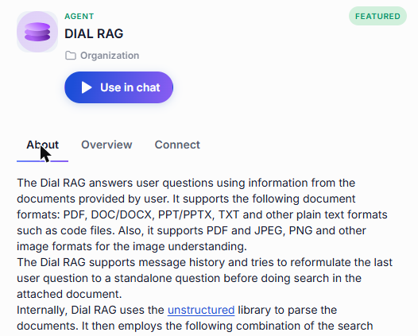

## Details panel

An agent's panel has three tabs.

### About

The description written by the agent's author — what the agent does, what inputs it expects, and any tips for getting the best results. Below the description, topic labels indicate the agent's area of expertise. You can filter by these topics in the Catalog's Browse section.

### Overview

**Specification** lists the agent's metadata. All fields are optional and appear only when provided.

| Field | Meaning |
|-------|---------|
| **Provider** | The AI provider behind the agent. |
| **Vendor** | The organization that built the agent. |
| **License** | The license under which the agent is offered. |
| **Knowledge cutoff date** | The date up to which the agent's training data extends. |
| **Parameters** | The number of parameters in the underlying model. |
| **Hosted by** | The organization that runs this agent instance. |
| **Release date** | When this version of the agent was released. |
| **Routes** | The routing paths the agent is reachable through. |

**Capabilities** tells you whether the agent supports:

| Capability | Meaning |
|------------|---------|
| **Tools** | Whether the agent can call external tools. |
| **Parallel tool calls** | Whether the agent can call several tools at once instead of one at a time. |
| **Configuration schema** | Whether the agent was built from a configurable builder template that defines its settings as a structured form. |
| **Skills** | Whether the agent can load and use skills. |

**Configuration** shows what users may attach to a conversation with the agent — for example, which file types are accepted as input attachments.

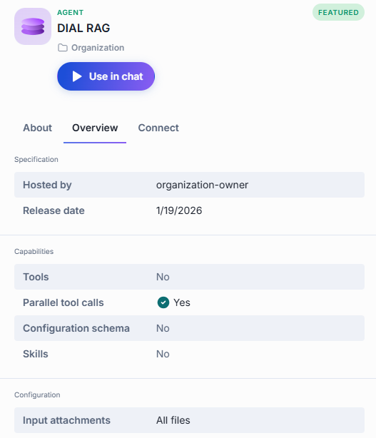

### Connect

What you need to call the agent from your own code instead of from the chat interface: its **Model ID**, its **Chat Completions** endpoint, and a cURL command you can copy, paste your API key into, and run. The endpoint and the command each have a copy button.

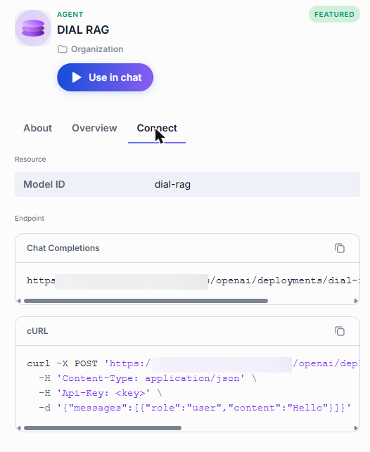

## What you can do with an agent

What actions are available depends on how the agent reached your Catalog. The agent's card shows its location — a folder in your personal files, or a folder within the organization.

### Preconfigured agents

Preconfigured agents are set up in the platform configuration by administrators. They carry the **Featured** label in the Catalog and their location shows an organization folder. These agents are read-only — you can only use them in chat.


### Published agents

Published agents are made available to the organization by any user or administrator. Their location shows a folder within the organization. Any user can request to unpublish a published agent — the request goes to an administrator for review.

- **Use in chat** — start a conversation with the agent.
- **Unpublish** — withdraw the agent from the organization. An unpublish request goes to an administrator for review.

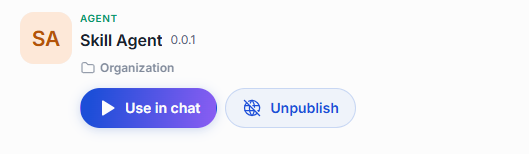

### Agents shared with you

When another user shares an agent directly with you, it appears in the Catalog under **Shared with me**. You can use it in chat or remove it from your list — removing it does not delete the original agent.

- **Use in chat** — start a conversation with the agent.
- **Remove from My List** — remove the agent from your catalog.

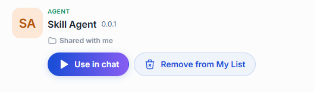

### Your own agents

Agents you created stay in your personal folder until you share or publish them. You have full control over your own agents.

- **Use in chat** — start a conversation with the agent.
- **Share** — let specific people access your agent. See [Sharing and publishing](../5.sharing-and-publishing.md).
- **Edit** — reopen the builder with your settings in place. See [Edit an agent](#edit-an-agent).
- **Publish** — offer the agent to your organization. A publication request goes to an administrator for review. See [Sharing and publishing](../5.sharing-and-publishing.md).
- **Revoke access** — remove access you previously shared with specific people.
- **Delete** — remove the agent permanently. See [Delete an agent](#delete-an-agent).

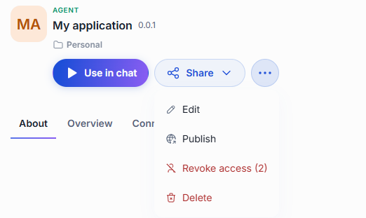

## Create an agent

Click **Create** in the Catalog and pick a runner under **Runners**. A runner is a ready-made way to build one kind of agent. See [Create your own](./0.index.md#create-your-own). The runners below are the defaults. Your organization may add runners of its own, and not every environment offers all of them.

- **Quick App** — build an AI agent by picking a model, writing instructions, and connecting tools and files. Nothing to host, nothing to code.
- **Custom App** — register an application you built and host yourself, so that it appears in DIAL Chat like any other agent.
- **DIAL Loop agent** — take an agent project you developed locally in a coding-agent harness such as Claude Code, Codex, or OpenCode, and make it available to other users in DIAL. You can also build one from scratch in the editor. The agent plans, runs code, and edits files in a loop until the task is done.

Your new agent stays in your private folder, visible only to you, until you share or publish it.

### Build a Quick App

A Quick App lets you build an AI agent without writing code. You pick a model to drive the agent, write instructions that tell it how to behave, and connect it to the toolsets, skills, and files it needs. The model then decides which of them to use for each request — calling tools, reading documents, or handing off to other agents as the task requires.

Quick Apps suit a wide range of use cases:

- A Q&A assistant that answers questions using your company's documents (via DIAL RAG).
- A workflow agent that calls external APIs — weather services, CRMs, ticketing systems — through MCP toolsets.
- A multi-agent orchestrator that routes each request to the right specialist agent.
- A research assistant that retrieves and summarizes content from the web.
- A support assistant with conversation starters that guide users toward common tasks.

You can use other DIAL models and agents as building blocks in your agent's workflow, attach skills that teach it specific procedures, and let it browse the web for up-to-date information. Because a Quick App runs on DIAL infrastructure from the moment you create it, there is no server to provision and no deployment to schedule. It inherits the platform's access control, sharing, and cost limits automatically. You can share it with colleagues, publish it to the Catalog, or use it as a building block inside another Quick App.

**Note**
> For the developer's view of Quick Apps, including the JSON behind the editor, see [Quick Apps](../../3.building-with-dial/1.apps/2.quick-apps/0.index.md).

The editor has two sections on one screen: **Metadata** on the left and **Setup** on the right.

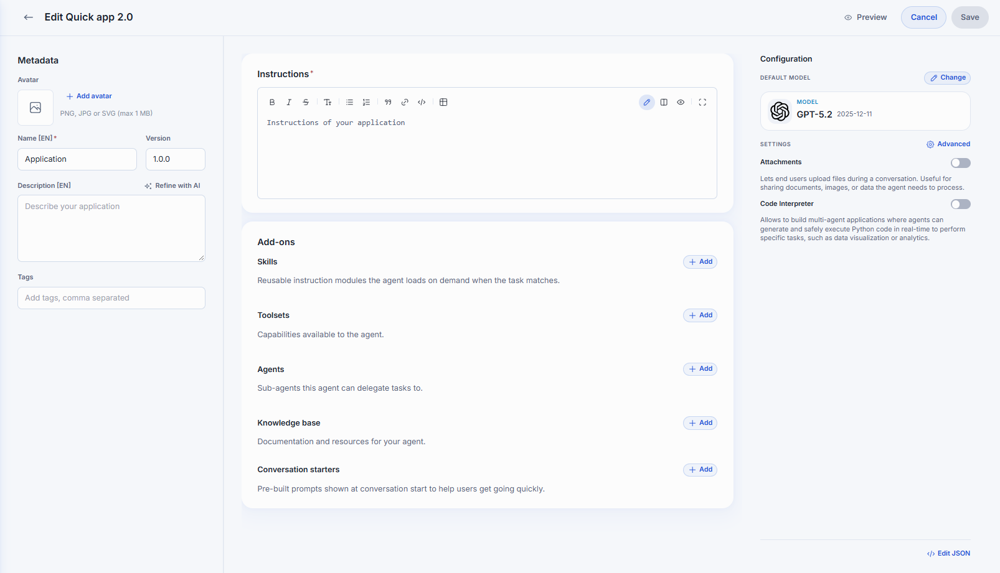

#### Metadata

How the agent presents itself in the Catalog and in chat.

| Field | Required | Description |
|-------|:--------:|-------------|
| Avatar | No | PNG, JPG, or SVG, up to 1 MB. |
| Name | Yes | The name shown on the agent's card. |
| Version | No | A version string, for example `1.0.0`. |
| Description | No | A short summary shown on the card and in the About tab. You can use [Refine with AI](./0.index.md#refine-text-with-ai). |
| Tags | No | Topics that help people find the agent when filtering the Catalog. |

#### Setup

Everything about how the agent behaves, grouped into collapsible sections.

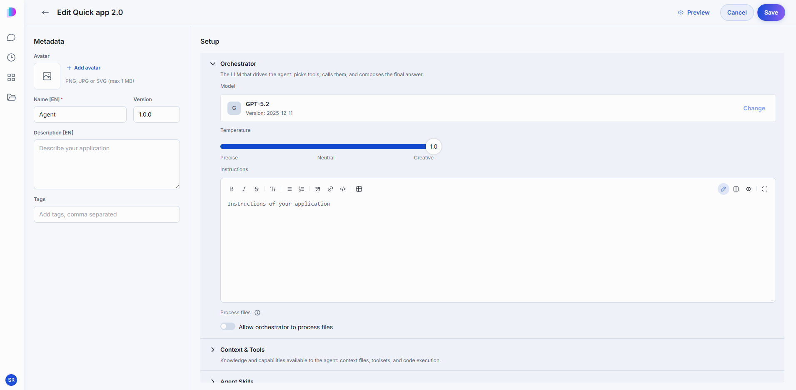

**Orchestrator** — the model that drives the agent: it picks tools, calls them, and composes the final answer.

| Field | Description |
|-------|-------------|
| Model | The model that replies to prompts and orchestrates everything else. |
| Temperature | How predictable the answers are, from Precise to Creative. |
| Instructions | The standing instructions the model follows in every conversation. |
| Process files | When enabled, the orchestrator can read files attached to a conversation. |

**Tips for writing Instructions:**

- State the agent's purpose clearly in the first sentence.
- Describe what the model should and should not do.
- If tools are connected, tell the model when and how to use them.
- Use `{{variable}}` syntax for values that may change across deployments.

**Context & Tools** — knowledge and capabilities available to the agent: context files, toolsets, and code execution.

| Field | Description |
|-------|-------------|
| Agents & Toolsets | Other agents and [toolsets](./3.toolsets.md) this agent may call. Advanced users can edit the same thing as JSON. |
| Context files | Files the agent draws on when answering. |
| Code Interpreter | Lets the agent run Python to compute or plot something. |
| File tools | When enabled, the orchestrator can access, read, write, and edit files in the app's file context. |

**Agent Skills** — reusable instruction modules the agent loads on demand when the task matches. See [Skills](./4.skills.md).

**User attachments** — rules for files that end users can upload during a conversation.

| Field | Description |
|-------|-------------|
| Attachment types | Allowed file types, given as [MIME types](https://developer.mozilla.org/en-US/docs/Web/HTTP/Basics_of_HTTP/MIME_types/Common_types). |
| Max. attachments number | How many files one message may carry. |

**Conversation starters** — buttons shown near the chat input that suggest example prompts to help users start a conversation.

| Field | Description |
|-------|-------------|
| Button title | The label on the button. |
| Prompt to send in chat | The prompt behind it. |
| Intro text | A line shown above the buttons. |
| Starters behavior | Send the prompt immediately, or drop it into the message box so the user can edit it first. |
| Disable chat input | Restrict the conversation to the starters only. |

**Advanced settings** — **Time awareness** tells the agent the current date and time.

#### Preview

Click **Preview** in the top-right corner to test your agent. DIAL Chat first saves the agent, then opens a full-page chat in preview mode. A banner reads "Preview mode: You are previewing" followed by the agent's name, then "Send a message to test how it responds. Usage is following your limits." Send messages and see how the agent responds with its current configuration. Click **Back to setup** to return to the editor, change what you need, and click **Preview** again to test the new version.

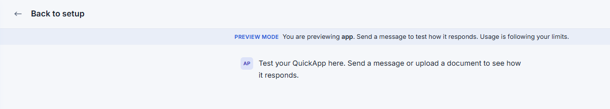

Click **Save** to register the agent, or **Cancel** to discard your changes and return to the Catalog. **Save** and **Preview** stay unavailable until the required fields are filled in correctly. If an agent with the same name and version already exists, DIAL Chat does not create the new one and shows "An application with this name and version already exists." Change the name or the version.

### Build a Custom App

Register a Custom App when you have built and hosted an application yourself and want it to appear in the Catalog so that anyone with access can use it in chat or connect to it through the API. Your application must expose a chat completion endpoint that follows the [Unified API](https://dialx.ai/dial_api#operation/sendChatCompletionRequest) — DIAL routes requests to the URL you provide during registration.

**Note**
> For how to build the application behind the registration, see [Custom Apps](../../3.building-with-dial/1.apps/5.custom-apps/0.index.md).

The editor has two sections on one screen: **Metadata** on the left and **Setup** on the right.

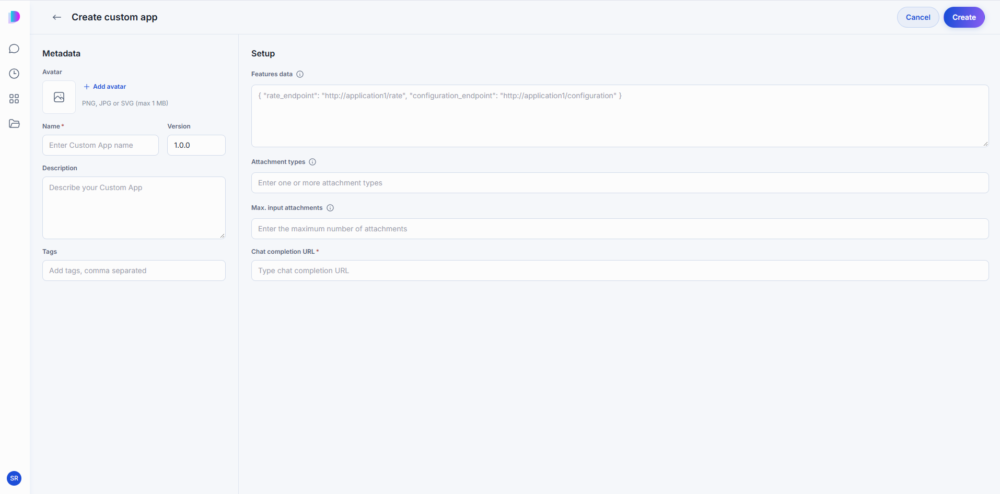

#### Metadata

How the agent presents itself in the Catalog and in chat.

| Field | Required | Description |
|-------|:--------:|-------------|
| Avatar | No | PNG, JPG, or SVG, up to 1 MB. |
| Name | Yes | The name shown on the agent's card. |
| Version | No | Defaults to `1.0.0`. |
| Description | No | A short summary shown on the card and in the About tab. You can use [Refine with AI](./0.index.md#refine-text-with-ai). |
| Tags | No | Topics that help people find the agent when filtering the Catalog. |

#### Setup

| Field | Required | Description |
|-------|:--------:|-------------|
| Features data | No | A JSON object declaring optional endpoints your application supports. `rate_endpoint` points to the URL where DIAL sends user feedback on responses. `configuration_endpoint` points to the URL that serves a settings UI, letting users customize the app's behavior per conversation. |
| Attachment types | No | Allowed file types, given as [MIME types](https://developer.mozilla.org/en-US/docs/Web/HTTP/Basics_of_HTTP/MIME_types/Common_types). |
| Max. input attachments | No | How many files one message may carry. |
| Chat completion URL | Yes | The URL of your application's chat completion endpoint. DIAL sends every user message to this address. |

Click **Create** to register the agent, or **Cancel** to return to the Catalog.

### Build a Loop Agent

DIAL Loop lets you turn an agent project into a DIAL agent that others can use, without rebuilding it. 

Suppose you have developed a project locally in Claude Code. It has instructions in CLAUDE.md, a set of skills, a few plugins and subagents, connections to MCP servers, and a folder of knowledge files. It works well on your laptop, but only you can use it. With DIAL Loop you point a DIAL agent at where those parts already live. They can be in a Git repository, SharePoint or OneDrive, or a DIAL files folder. When someone sends a request, DIAL Loop sets up the files in the layout the harness expects. The harness then works exactly as it does on your machine. The result is an ordinary DIAL agent. Colleagues can open it in DIAL Chat, share it, publish it to the Catalog, or call it from other agents, without installing anything or having access to your computer.

You can do all of this in the editor inside DIAL Chat, with no local setup.

#### How a run works

The agent is the same kind of coding agent you know from the command line. It plans and keeps a task list, calls tools, runs code and shell commands, edits files, and revises its work until the task is done. What you set in the editor shapes each run:

1. **Request.** Someone sends a message to the agent in DIAL Chat, or another agent calls it. Each request runs in its own isolated environment, and every command is sandboxed.
2. **Setup.** DIAL Loop places the agent's instructions, files, skills, and plugins in the environment, in the folder layout that the harness expects. It also writes the [run briefing](#environment) and starts the MCP servers that you allowed.
3. **Work.** The harness drives the model. The agent plans, runs commands, edits files, and calls the toolsets and agents that you added. It can reach only the hosts on the [egress allowlist](#egress-allowlist).
4. **Result.** You follow the plan and the tool calls step by step in the conversation. The files that the agent produces are attached to its answer. Changes to sources that you set to write back are saved at the end of the run.

The **harness** is the coding agent that carries out the work: Claude Code, OpenCode, or Codex. It decides the names and folders that DIAL Loop uses, such as the instruction file and the skills folder. See [Harness](#harness).

Some labels in the editor, such as **Egress allowlist** and the **Project** section of the run briefing, call the agent a project. It is the same thing.

##### Whose access the agent uses

The agent acts as the person who sends the message. Toolsets, called agents, DIAL files, and SharePoint use that person's own access and sign-ins. The exception is a run that starts from a Teams channel, which acts as the bot's DIAL key. See [Teams](#teams).

#### Create a Loop agent

1. Click **Create** in the [Catalog](./0.index.md) and choose **DIAL Loop**. The editor opens.
2. Enter the **Name** in [Metadata](#metadata-2).
3. In [Configuration](#configuration), choose the [harness](#harness) and the [model](#model). The agent can't run without a model.
4. Write the [instructions](#instructions). Add [files](#files), [skills](#skills), [plugins](#plugins), [toolsets](#toolsets), or [agents](#agents-1) that the agent needs.
5. Click **Save** in the page header.

Your new agent stays in your private folder until you share or publish it. See [Sharing and publishing](../5.sharing-and-publishing.md).

#### The editor layout

The editor has three columns.

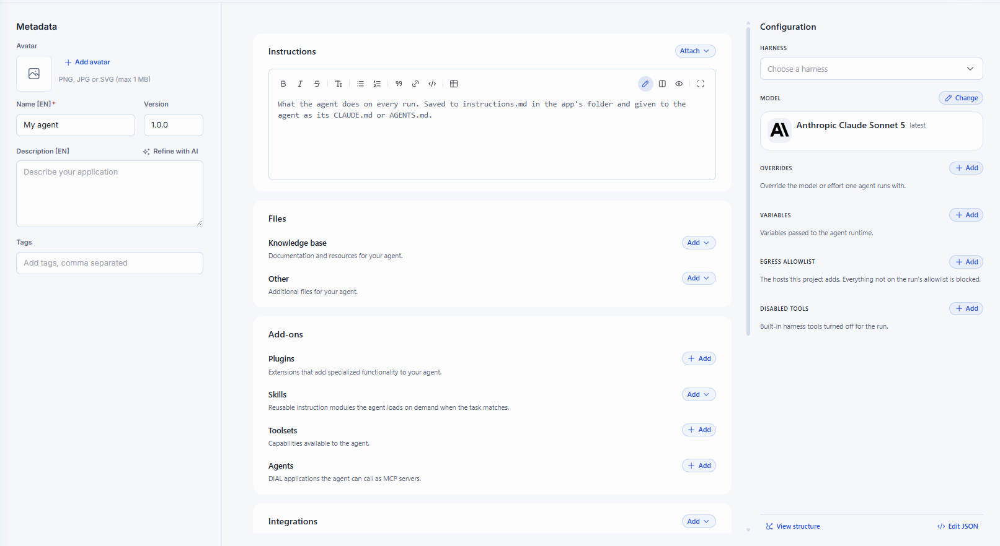

| Column | What it holds |
|--------|---------------|
| Left: [Metadata](#metadata-2) | How the agent presents itself in the Catalog and in chat. |
| Middle: work column | Cards that scroll together. This is where you define what the agent works with. |
| Right: [Configuration](#configuration) | The [harness](#harness), the [model](#model), and the settings that belong to them. |

The cards of the work column, from top to bottom:

| Card | What it does in a run |
|------|-----------------------|
| [Instructions](#instructions) | Tells the agent what to do on every run. |
| [Files](#files) | Places documents, data, and reference material in the agent's working folder. |
| [Add-ons](#add-ons) | Gives the agent plugins, skills, toolsets, and other agents to use. |
| [Integrations](#integrations) | Gives the agent keys and sign-ins to run with, and connects it to Teams. |
| [Connections](#connections) | Lists the sources that your files, skills, and plugins come from. |
| [Advanced](#advanced) | Switches how the run behaves beyond the harness. |
| [Environment](#environment) | Sets the briefing that the agent receives about its own run. |

#### Metadata

How the agent presents itself in the Catalog and in chat.

| Field | Required | Description |
|-------|:--------:|-------------|
| Avatar | No | PNG, JPG, or SVG, up to 1 MB. |
| Name | Yes | The name shown on the agent's card. |
| Version | No | Defaults to `1.0.0`. |
| Description | No | A short summary shown on the card and in the About tab. You can use [Refine with AI](./0.index.md#refine-text-with-ai). |
| Tags | No | Topics that help people find the agent when filtering the Catalog. |


#### Instructions

Instructions tell the agent what to do on every run. The card is the first in the work column and holds a Markdown editor.

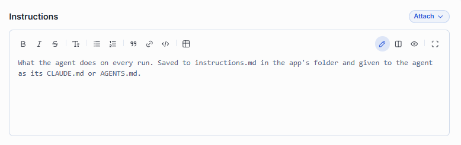

Type in the editor to write the instructions in place. The toolbar has text formatting, lists, a quote, a link, code, and a table. Buttons at the end of the toolbar switch between edit, split, and preview modes, and expand the editor to full screen.

The instructions are written to a file when you save the agent. After the first save, the text stays editable in the same editor. Edit it there, and the file is updated on the next save.

In place, the instructions are saved as `instructions.md` in the agent's own folder. The agent sees them under the name its [harness](#harness) expects: `CLAUDE.md` for Claude Code, `AGENTS.md` for Codex and OpenCode. If the agent already has an `AGENTS.md` or `CLAUDE.md` in place, the editor opens and edits that file instead. Only the owner of the agent can write its instructions.

After you save the agent, the instruction file also appears in **Other** under the path **DIAL › agent-name-version › instructions.md**. You can open or remove it from there.

##### Attach an instruction file

To use an existing file instead of writing one, click **Attach** and choose:

| Option | What it does |
|--------|--------------|
| **DIAL repository** | Opens the file manager over DIAL file storage. Pick exactly one file. Folders can't be picked. See [Add from the DIAL repository](#add-from-the-dial-repository). |
| **Connection** | Opens a popup where you paste a link, pick a connection, or add a connector, and then browse the source for one file. See [Add from a connection](#add-from-a-connection). |

The attached file appears as a chip in the card header. You can't edit an attached file in the card. What the text area shows depends on where the file comes from:

- **A text file from DIAL file storage** is shown in the text area as a read-only preview.
- **A file from a connection** isn't shown. The card names the source. Edit the file there.

Click **×** on the chip to detach the file. Detaching doesn't delete the file.

If the agent already has instructions, attaching a file opens a pop-up that asks you to confirm the replacement. It says that the previous file will be deleted. An agent can have only one instruction file.

You can also add an instruction file from **Knowledge base** or **Other**: open its row and set **Kind** to **Instructions** (see [Edit a resource](#edit-a-resource)). The file then appears on the Instructions card as the attached instruction file.

#### Files

The Files card holds everything the agent reads or works on at the start of each run. It has two blocks: **Knowledge base** for reference material, and **Other** for any other files.

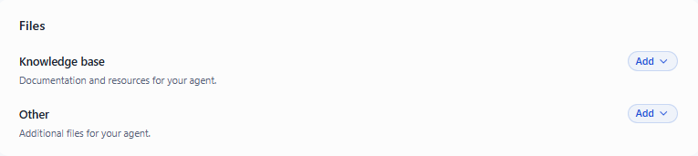

##### How the agent uses files

At the start of each run, the content is placed in the agent's working folder, at its own path or at the **Destination** you set. How it arrives depends on the source:

- A folder added with **Mount** stays linked to its store, so the agent's changes are written back as it works.
- Everything else is copied in. If you set the item to write back, the agent's changes are saved to the source at the end of the run. Otherwise, the agent can read the item, but its changes are not saved. See **Direction** in [Edit a resource](#edit-a-resource).

To manage your files in DIAL, see [File Manager](../4.files.md).

Each block has an **Add** menu with two options, **DIAL repository** and **Connection**. The block you add from sets the kind of the item.

##### Knowledge base

The Knowledge base holds documentation and reference material for the agent: wikis, specifications, and data it reads to answer questions.

Click **Add** and choose where the content comes from:

| Option | What it does |
|--------|--------------|
| **DIAL repository** | Opens the file manager over DIAL file storage, where you pick folders and files. See [Add from the DIAL repository](#add-from-the-dial-repository). |
| **Connection** | Opens a popup where you paste a link, pick a connection, or add a connector, and then browse the source. See [Add from a connection](#add-from-a-connection). |

After you add an item, click its row to edit it. See [Edit a resource](#edit-a-resource).

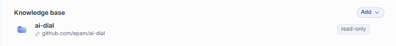

##### Other

Other holds any other file the agent needs at the start of each run: working documents, data, and templates. It also lists the agent's instruction file, run logs, files written in place, and kept folders when the agent has them. You can open and remove these rows, but they can't be added from here. Removing a file that was written in place, such as `instructions.md`, deletes it from the agent's folder in DIAL.

Click **Add** and choose where the content comes from:

| Option | What it does |
|--------|--------------|
| **DIAL repository** | Opens the file manager over DIAL file storage, where you pick folders and files. See [Add from the DIAL repository](#add-from-the-dial-repository). |
| **Connection** | Opens a popup where you paste a link, pick a connection, or add a connector, and then browse the source. See [Add from a connection](#add-from-a-connection). |

After you add an item, click its row to edit it. See [Edit a resource](#edit-a-resource).

##### Add from the DIAL repository

Use this to add folders and files that are already in DIAL file storage. It is available wherever a section offers **DIAL repository**: Knowledge base, Other, and Instructions.

1. Choose **DIAL repository**. The file manager opens with the tabs **All**, **My files**, **Shared**, and **Organization**. You can search, upload files, create a folder, download, rename, and delete.
2. Pick folders, files, or both, and click **Add**. A folder is added whole, under its own name. A file is added by itself. A file at the top level of a bucket can't be added. Pick the folder it sits in, or a file inside a folder. An item that is already added isn't added twice. For instructions you pick exactly one file, and folders can't be picked.

DIAL files are read-only and are copied into each run. Each run reads them with the signed-in user's own permissions. Other people can run an agent that uses your private folder only if they have access to that folder.

##### Add from a connection

Use this to add content from a source outside DIAL, such as a Git repository, SharePoint, or OneDrive. It is available wherever a section offers **Connection**: Knowledge base, Other, Skills, Plugins, and Instructions.

1. Choose **Connection**. A popup opens. Its title names what you add: **Add knowledge**, **Add files**, **Add skills**, **Add a plugin**, or **Add instructions**.
2. Tell the editor where the content is, in one of three ways:
   - Paste a path, repository, or URL in the field. The editor resolves it and names the connection it used. If the link is public, for example a public GitHub repository, the content is read without a sign-in. For knowledge, files, and instructions, click **Add** and the item is added as a read-only source.
   - Under **or pick a connection**, choose one of the agent's connections. Its status badge shows whether it is connected. **Manage in Connections** opens the connection's settings.
   - Under **or add a connector**, click **Use** to add a connector that your DIAL deployment offers, such as GitHub or SharePoint. A connector marked **public** needs no sign-in. A connector the agent already uses shows **Used**.
3. If the connection needs a sign-in, click **Connect** and sign in. When it succeeds, the connection shows the status **connected**. A connection that needs no sign-in, such as a public source, can be used right away.
4. Click **Browse**. A popup lists the folders and files of the source. Use **Filter** to narrow the list, and tick the folders and files to add.
5. For a SharePoint source added from Knowledge base or Other, the popup has two tabs that set how the content reaches the run. These tabs appear only there:
   - **Mount — live, writes back**: folders are mounted from one copy of the store folder, and the agent's changes are written back to SharePoint as it works. Files are copied in beside them, read-only. A connection can have only one mount. If it already has one, add the folders to the existing mount. A mount with several folders shows one row per folder.
   - **Copy in — read-only**: everything you tick is copied into the workspace, read-only.
6. To set more options for one item, such as the branch, a pinned commit, the direction, and the destination, tick exactly one item and click **Advanced…**. The options are the ones in [Edit a resource](#edit-a-resource).
7. Click **Add**.

Skills and plugins add a step after Browse, where the editor lists what it found in the source. It is described in their own sections.

If the connection isn't on the **Connections** card yet, it appears there.

##### Edit a resource

Clicking a Knowledge base or Other row opens **Edit resource**, followed by the name of the connection.

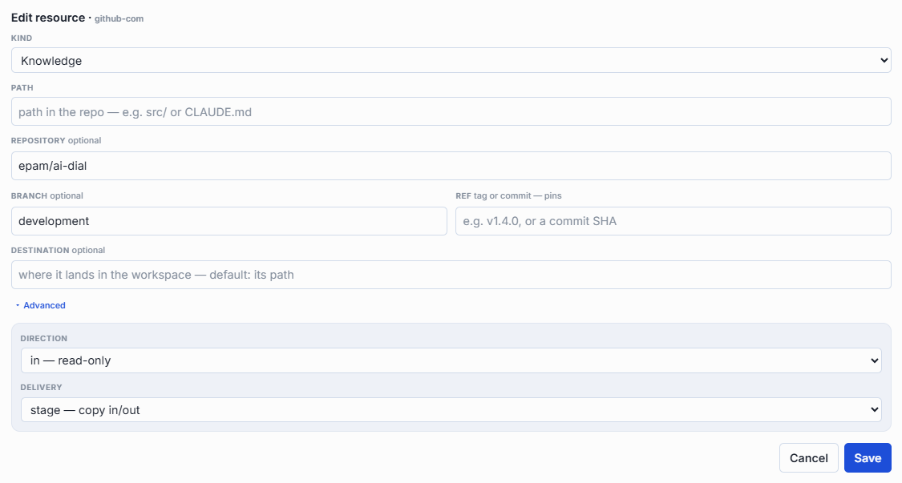

| Field | Required | Description |
|-------|:--------:|-------------|
| Kind | Yes | What the item is for: Files, Knowledge, Instructions, Skill, Logs, or Plugin. The item moves to the section that matches its kind: Knowledge to Knowledge base, Files and Logs to Other, Instructions to the Instructions card, Skill to Skills, and Plugin to Plugins. |
| Path | No | The folder or file in the repository or store, for example `src/` or `CLAUDE.md`. |
| Repository | No | The repository, as `owner/name`. Empty uses the connection's own repository. |
| Branch | No | The branch to read. Empty uses the connection's branch, then `main`. Can't be combined with Ref. |
| Ref | No | A tag or commit that pins the item to an exact version. A tag resolves like a branch. A commit is fetched by its ID. Can't be combined with Branch. |
| Destination | No | Where the item lands in the agent's workspace. The default is its path. For a whole repository, it is the folder the clone goes in. |

Expand **Advanced** for two more settings:

| Field | Options | Description |
|-------|---------|-------------|
| Direction | **in**: read-only. **in_out**: write back. | With **in**, the agent can only read, and nothing it leaves is saved to the source. With **in_out**, the agent may push a branch or open a pull request. A public source is always read-only. |
| Delivery | **stage**: copy in/out. **mount**: attach the store. | **stage** copies the content into the run. **mount** attaches the store live. Mount works only for folders. |

Click **Save** to apply your changes, or **Cancel** to discard them.

#### Add-ons

The Add-ons card lists the extensions the agent works with, in four sections. An empty section shows a one-line description. A section with items shows a list of rows instead.

| Section | What it adds |
|---------|--------------|
| [Plugins](#plugins) | Ready-made bundles of skills, subagents, commands, and MCP servers. |
| [Skills](#skills) | Reusable instructions that the agent loads when a task matches. |
| [Toolsets](#toolsets) | External tools, such as a CRM or a web search, that the agent calls through MCP. |
| [Agents](#agents-1) | Other DIAL agents that your agent can hand work to. |

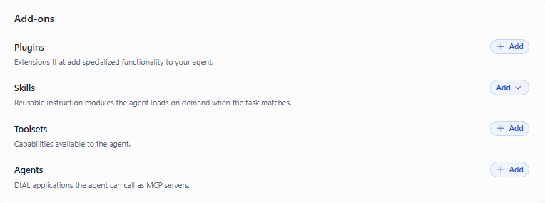

Each section has an **Add** button. Plugins, Toolsets, and Agents have one way to add. Skills opens a menu with two ways to add. The buttons stay disabled until the agent has loaded.

A row shows the item's name, version, and where it comes from. **Needs sign-in** means that the item's connection isn't signed in. **Not available in this DIAL** means that the catalog no longer lists the item. Click a row to open the item. Hover over a row to show the trash icon that removes it.

##### Pick items from the Catalog

You pick skills, toolsets, and agents from the [DIAL Catalog](./0.index.md). Click **Add** in [Skills](#skills) and choose **Catalog**, or click **Add** in [Toolsets](#toolsets) or [Agents](#agents-1). A picker opens with the items you can use.

1. Search the list, sort it, or narrow it with the **From** filter.
2. Tick the items to add. Items that the agent already has are ticked. Untick one to remove it from the agent.
3. Click **Add** to save your changes together. **Cancel** closes the picker and changes nothing.

##### Plugins

A plugin is a ready-made bundle that can include skills, subagents, commands, and its own tool connections. Use one when you already have a plugin, or want to reuse a team's shared plugin, instead of recreating its parts one by one.

DIAL Loop reads plugins in the Claude Code plugin format: a folder or a Git repository that can hold:

| Part | Where it is in the plugin |
|------|---------------------------|
| Manifest: the plugin's name, version, and description | `.claude-plugin/plugin.json` |
| Skills | `skills/` |
| Subagents, one Markdown file each | `agents/` |
| Commands | `commands/` |
| MCP servers | `.mcp.json` |

A marketplace is a repository that lists several plugins in `.claude-plugin/marketplace.json`. When you add a marketplace, you choose which of its plugins to take. A folder or repository with no manifest is read as a single plugin.

###### How the agent uses a plugin

When the agent runs, the plugin is placed in the run read-only, and the harness loads it. With Claude Code:

- The plugin's skills become available to the agent, and the agent loads them when a task matches.
- The plugin's subagents become available to the agent. Their names are prefixed with the plugin name, for example `my-plugin:reviewer`. Use that name to set a model or an effort for a subagent in [Overrides](#overrides).
- The plugin's MCP servers run only if you opt in when you add the plugin.

On OpenCode, the plugin's subagents are translated to the form that harness uses. On Codex, only the plugin's skills are used.

To see what a run receives, use [View structure](#view-structure).

###### Add plugins

1. Click **Add** in **Plugins**. The **Add a plugin** popup opens. The note in its header shows where the plugin goes in the run. With Claude Code it reads **loaded natively, outside the project**. This means that the plugin is loaded as a whole from its own location. It isn't copied into the agent's project files, so its skills don't mix with the agent's own skills. On harnesses that can't load a plugin as a whole, the note names the skills folder instead, and only the plugin's skills are copied there.
2. Choose the source and click **Browse**: paste a path, repository, or URL, pick one of the agent's connections, or add a connector. See [Add from a connection](#add-from-a-connection) for the options.
3. The editor reads the source and lists the plugins it finds. For a Git repository, you can enter a branch, tag, or commit, and click **Discover** to read it again. For a SharePoint or OneDrive source, you enter a folder instead. An empty folder means the connection's own folder.
4. Tick the plugins to add. If the source is a marketplace, nothing is ticked at first. If it is a single plugin, it is ticked for you. Each plugin shows its name, version, description, and how many skills, agents, and commands it holds. Above eight plugins, a **Filter plugins** field appears.
5. For each ticked plugin, choose what to keep:

   | Part | What you can do |
   |------|-----------------|
   | Skills | Untick the skills you don't want. Unticked skills are left out of the agent. |
   | Agents | Untick the subagents you don't want. Where the harness supports it, set a model and an effort for each subagent. The values become [overrides](#overrides). |
   | MCP servers | Tick **Start its MCP servers** to run the plugin's own servers inside each run. Only local Node and Python servers can start. Remote servers are never started. |

6. For a Git source, **Pin to commit** is ticked by default. The plugin stays on that exact commit until you change it. Untick it to follow the branch instead.
7. Click **Add plugin**, or **Add N plugins** if you ticked several.

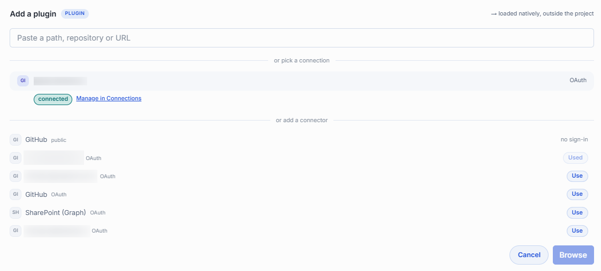

The list shows what each plugin contains, for example **2 skills · 1 agent**. **nothing to stage** means that the plugin has no skills, subagents, or commands. A repository that isn't set up as a plugin, such as a regular code repository, is listed this way. It adds nothing to the agent except the MCP servers declared in its `.mcp.json`. The dialog lists them under **Start its MCP servers**, with a note on each.

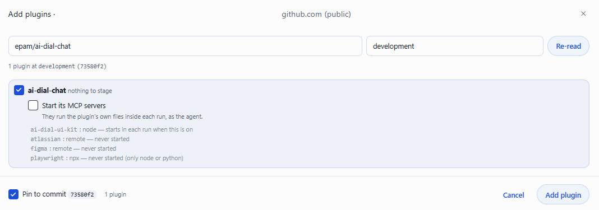

To give the agent a repository's `CLAUDE.md` or skills instead, add them with **Instructions**, **Skills**, or **Files**, not as a plugin.

The editor refuses two plugins that would land under the same name, and tells you which. A plugin row shows its name, version, and source, with a badge when you left parts out. Click it to reopen the dialog as **Edit plugin**. The editor reads the source again, so you can change what you left out and the pinned commit.

###### Messages you may see

| Message | What it means and what to do |
|---------|------------------------------|
| No plugin found in *connection*'s folder. `.`: nothing names this plugin — pick its folder, or give it a manifest name. | The source points at the root of the connection, and the root has no plugin manifest with a name. Enter the plugin's own folder in the **Folder** field, or add a `.claude-plugin/plugin.json` with a `name` to the plugin. |
| Couldn’t re-read the source — the stored plugin is kept as is. | You opened **Edit plugin**, and the editor couldn't read the source again. For example, the connection is signed out or the source has moved. The plugin stays as it was stored. You can still save it. |

**Note**
> Plugins are read-only. Their hooks are always removed, because they would run the plugin author's code inside the agent.

##### Skills

A [skill](./4.skills.md) is a reusable instruction module (a `SKILL.md` file) that teaches the agent a specific procedure, such as how to produce a report in your company's format.

###### How the agent uses skills

At the start of each run, the skills from all sources are merged into the one skills folder that the harness reads. For Claude Code, this is `.claude/skills`. The agent loads a skill only when a task matches its description, so a large set of skills doesn't clutter every request. A clear description is what makes the agent pick the right skill.

###### Add skills from the Catalog

1. Click **Add** in **Skills** and choose **Catalog**. The picker lists the skills of the [DIAL Catalog](./0.index.md).
2. Tick the skills to add. See [Pick items from the Catalog](#pick-items-from-the-catalog).
3. Click **Add**.

**Note**
> If you pick a skill that is yours or shared with you, people you share the agent with need access to the skill too. See [Sharing and publishing](../5.sharing-and-publishing.md).

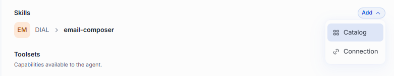

A skill from the catalog appears in the list as a path in DIAL, for example `DIAL › email-composer`.

###### Add skills from a connection

1. Click **Add** in **Skills** and choose **Connection**. The **Add skills** popup opens. It adds skills from a source such as Git, SharePoint, or OneDrive.
2. Choose the source and click **Browse**: paste a path, repository, or URL, pick one of the agent's connections, or add a connector. Then choose the folder that holds the skills. For a public link, there is no Browse step. See [Add from a connection](#add-from-a-connection).
3. Click **Find skills**. The editor lists the skills it finds. Use **Filter these skills** to narrow the list.
4. Tick the skills to add and click **Add N**.

A skill with the same name as one already in the agent can't be added until you rename or remove the other one. A skill with the same name as a built-in harness skill is allowed, but it shadows the built-in one. If two skills with the same name come from different sources at run time, the conflict rule on the [Advanced](#advanced) card decides: error (stop), ignore (keep the first), or overwrite (use the new one).

**Note**
> Skills are read-only.

##### Toolsets

A [toolset](./3.toolsets.md) is a connection to an [MCP](https://modelcontextprotocol.io/) server that gives the agent access to external systems, such as Notion, GitHub, Jira, a CRM, or a database. Each toolset brings a set of tools: individual functions, such as "search pages" or "create an issue", that the agent can call while working on a request. Toolsets come from the DIAL Catalog.

###### How the agent uses toolsets

The agent calls a toolset's tools through MCP, with the permissions of the person using the agent. If that person hasn't signed in to a toolset, DIAL Chat offers the sign-in before the request starts. If they still haven't signed in, that toolset is left out and named in the response. It never blocks the request. See [Authentication](./3.toolsets.md#authentication).

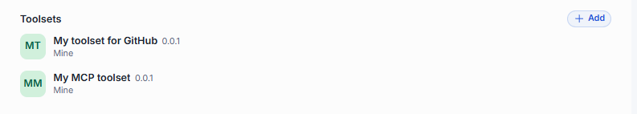

###### Add toolsets

1. Click **Add** in **Toolsets**. The picker lists the toolsets of the [DIAL Catalog](./0.index.md).
2. Tick the toolsets to add. You can tick several. See [Pick items from the Catalog](#pick-items-from-the-catalog).
3. Click **Add**.

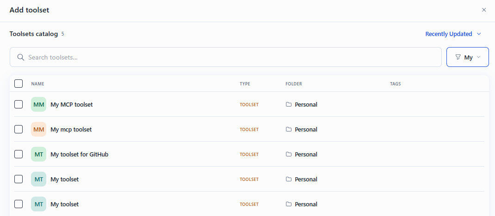

Click a toolset's row to see its description, scope, and ID, or to delete it. If the catalog no longer lists the toolset, the details say that it was removed or isn't shared with you.

##### Agents

An [agent](./2.agents.md) is an application you can converse with in DIAL Chat. Add other agents from the DIAL Catalog so that your agent can hand work to them, such as specialists for research, data lookup, or review. An added agent can be any agent in the catalog that is served as MCP: a [Quick App](#build-a-quick-app), a [Custom App](#build-a-custom-app), a [Code App](../../3.building-with-dial/1.apps/3.code-apps/0.index.md), a DIAL Loop agent, or an external application.

###### How the agent uses agents

The agent calls each added agent as a tool. The called agent runs as the person who is using your agent, so it has that person's access.

###### Add agents

1. Click **Add** in **Agents**. The picker lists the DIAL applications of the [DIAL Catalog](./0.index.md) that are served as MCP. The agent you are editing is never in the list.
2. Tick the agents to add. See [Pick items from the Catalog](#pick-items-from-the-catalog).
3. Click **Add**.

To choose the model that orchestrates the agents, use [Model](#model).

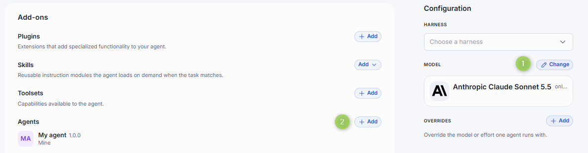

Click an agent's row to see its details or delete it.

#### Integrations

Integrations give the agent keys and sign-ins to run with, beyond its files. Use them when the agent's commands need a vendor API key, when it reads SharePoint, or when people should reach it in Microsoft Teams.

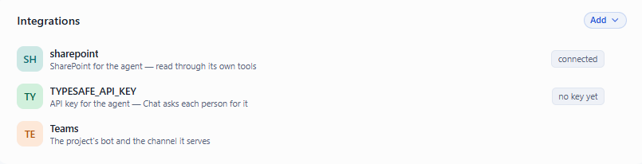

| Integration | What it is for |
|-------------|----------------|
| [API key](#api-key) | A key that the agent's commands read from an environment variable, for example to call a vendor API. |
| [SharePoint](#sharepoint) | Access to the SharePoint and OneDrive files that each person may read. |
| [Teams](#teams) | A Microsoft Teams bot that serves the agent in a channel and in private chats. Shown only if your DIAL deployment offers it. |

Click **Add** and choose an integration. Click a row to open it. Hover over a row to show the trash icon that removes it.

##### API key

Use an API key when the agent's commands call a service that needs one, for example `TYPESAFE_API_KEY`.

###### How the agent uses an API key

The agent's commands read the key from the environment variable you name. You never enter the key in the editor. Each person who uses the agent provides their own key, and DIAL stores it as that person's own credential. If a person hasn't provided a key yet, DIAL Chat asks for it at their first run.

###### Add an API key

1. Click **Add** in **Integrations** and choose **API key…**.
2. Enter the name of the environment variable, in upper case, with the vendor in the name, for example `TYPESAFE_API_KEY`. The popup shows the service that it declares.
3. Click **Add**.

A row shows the variable name and one of these badges:

| Badge | Meaning |
|-------|---------|
| **key saved** | Your key is stored in DIAL as your own. |
| **no key yet** | DIAL Chat asks you for the key at the first run. |
| **project key** | The project's own key is stored in DIAL. |
| **service missing** | The service is gone from the project. Remove the key and add it again. |
| **unchecked** | The status of the key isn't known yet. |

**Note**
> Only the owner of the agent can add keys to it. Removing an API key from the agent deletes its service from DIAL, together with the key that every person stored for it.

###### Provide your API key

Each person who uses the agent provides their key in the agent's details panel in the [Catalog](./0.index.md).

1. Open the agent's details panel. Under **Application credentials**, the service shows the variable that the key is handed to, for example `TYPESAFE_API_KEY`.
2. Enter your key in **API key** and click **Add**.
3. To let the agent use the key in scheduled and background runs, tick **Allow offline use**.

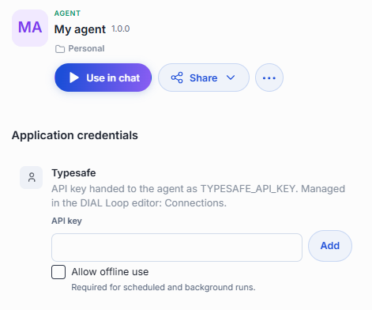

##### SharePoint

Use SharePoint when the agent should read documents from SharePoint or OneDrive during a run.

###### How the agent uses SharePoint

The agent searches and reads SharePoint and OneDrive during the run, with each person's own sign-in. It can read anything that person may read, and it writes nothing. The agent never sees the sign-in itself. DIAL Chat asks each person to sign in at their first run.

**Note**
> This is different from adding SharePoint content in [Files](#files). Files places the content in the agent's working folder before the run. This integration lets the agent read SharePoint on demand while it works.

###### Add SharePoint

1. Click **Add** in **Integrations** and choose **SharePoint…**.
2. Click **Serve** next to the SharePoint sign-in to use. The list shows the sign-ins that your DIAL deployment offers. If it is empty, a DIAL admin has to publish one.

##### Teams

Use Teams to let people work with the agent from a Microsoft Teams channel or in a private chat with the agent's bot. The bot belongs to this agent. It is stored in DIAL as the agent's credential and is used for everyone who works with the agent.

###### How the agent uses Teams

The agent can post the results of its runs to a channel. Channel members can start runs by mentioning the bot. These runs act as the DIAL key that you give the bot, not as a person. In a private chat, people sign in to DIAL through the bot and act as themselves.

###### Set up Teams

Before you start, an administrator needs these items in Azure:

- An Entra app registration, and a client secret for it.
- An Azure Bot resource for that app, with its messaging endpoint pointing at DIAL Loop's `/api/messages`.
- The Teams app package with that bot ID, installed in the channel by a team owner.
- For private chat: an OAuth connection on the bot, and `token.botframework.com` in the package's valid domains.

Then, in the editor:

1. Click **Add** in **Integrations** and choose **Teams…**. The **Teams bot** section shows the bot's status, for example **not configured**.
2. Enter the bot's details:

   | Field | Required | Description |
   |-------|:--------:|-------------|
   | Tenant ID | Yes | The ID of your Microsoft tenant. It must be a GUID. |
   | Bot (client) ID | Yes | The Application (client) ID of the Entra app registration. It must be a GUID. |
   | Client secret | Yes | The client secret of the app registration. It is sent once to DIAL and never shown again. |
   | DIAL key for channel runs | No | A DIAL API key that a DIAL admin issued for this bot. Runs that start from a channel act as this key. |
   | Sign-in connection for private chat | No | The name of the bot's OAuth connection in Azure. It can have letters, digits, spaces, dots, dashes, and underscores. Leave it empty for no private chat. |
   | Microsoft sign-in connection for shared files | No | The name of the bot's Azure AD OAuth connection, with the same characters as the other connection name. With it, the bot can open the SharePoint and OneDrive files that people share in a private chat. Without it, only files uploaded from a device are read. |

3. Click **Save to DIAL**. The status changes to **configured**. The coordinates and the secret can't be read back. To change any of them, click **Replace**. **Remove bot** deletes the bot for everyone who works with the agent, and it stops answering in Teams. You have to confirm it. The secret can't be read back, so adding the bot again needs the secret.
4. In **This project in Teams**, bind the agent to a channel:

   | Field | Description |
   |-------|-------------|
   | Channel | The link to the channel (**… → Get link to channel**) or its ID. |
   | Direct messages to | Email addresses, one per line. Used only when a run asks for direct messages. |
   | Runs may post their results to the channel | Lets the agent post results. |
   | Channel members may start runs by mentioning the bot | Lets members start runs. They run as the bot's DIAL key. |
   | People may chat with the bot privately | Lets people sign in to DIAL and act as themselves. Needs the sign-in connection. |

5. Click **Bind**. The status changes to **bound**. Click **Unbind** and confirm to stop the bot from serving the agent in the channel. It sends no more direct messages for the agent.

#### Connections

The Connections card lists the sources the agent reads from. It has no **Add** button. A connection appears here when you add files, knowledge, skills, plugins, or instructions from it in another section. See [Add from a connection](#add-from-a-connection). A card with no connections is empty until you do.

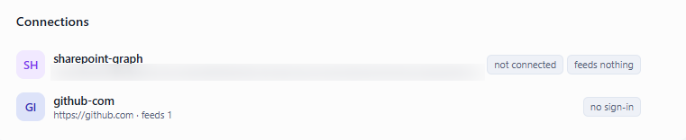

Each row shows the connection's name, its address, and badges:

| Badge | Meaning |
|-------|---------|
| **connected** / **not connected** | Whether you are signed in to a connection that needs a sign-in. |
| **no sign-in** | The source is public and needs no sign-in. |
| **feeds N** / **feeds nothing** | How many items in the agent use this connection. **feeds nothing** means that nothing in the agent is taken from it. |

Click a connection to open a popup with its details. There you can connect to the source or disconnect from it. A connection that needs a sign-in shows its status, for example **connected**. A connection that needs no sign-in, such as a public source, can be used right away.

#### Advanced

Advanced settings control how a run behaves beyond the harness. The card summarizes the current settings as badges: the conflict rule, whether thinking is on, and the DIAL and Git integrations that are turned on.

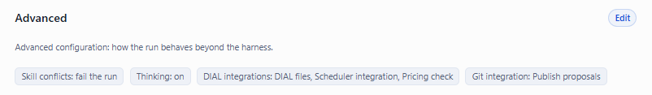

##### Change advanced settings

1. Click **Edit** on the **Advanced** card.
2. Change the settings you need.
3. Click **Save**, or **Cancel** to discard your changes. Only the settings you changed are written to the agent.

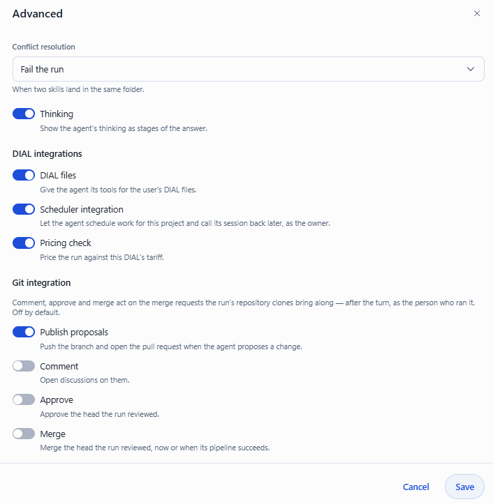

##### General

| Setting | Default | Description |
|---------|---------|-------------|
| Conflict resolution | **Fail the run** | What happens when two [skills](#skills) land in the same folder. **Fail the run** stops the run. **Keep the earlier skill** ignores the newcomer. **Take the later skill** overwrites the earlier one. |
| Thinking | On | Shows the agent's thinking as stages of the answer. |

##### DIAL integrations

| Setting | Default | Description |
|---------|---------|-------------|
| DIAL files | On | Gives the agent its tools for the user's DIAL files. |
| Scheduler integration | On | Lets the agent schedule work for this agent and call its session back later, as the owner. |
| Pricing check | On | Prices the run against this DIAL's tariff. |
| Tool Search | Off | Loads the tools of the DIAL toolsets only when the agent searches for them, in the same way on every harness and model. It replaces the harness's own tool search. Use it when the agent has many toolsets. Claude Code defers tools through DIAL only for Claude models, so with other models it loads every tool upfront. |

##### Git integration

| Setting | Default | Description |
|---------|---------|-------------|
| Publish proposals | On | Pushes the branch and opens the pull request when the agent proposes a change. See **Direction** in [Edit a resource](#edit-a-resource). |
| Comment | Off | Opens discussions on the merge requests that the run reviewed. |
| Approve | Off | Approves the head that the run reviewed. |
| Merge | Off | Merges the head that the run reviewed, now or when its pipeline succeeds. |

**Note**
> Comment, Approve, and Merge act on the merge requests that the run's repository clones bring along. They are done after the turn, as the person who ran it.

#### Environment

The Environment card controls the briefing that the agent receives about its own run. At every run, DIAL Loop writes the briefing to the file `.loop/ENVIRONMENT.md` in the agent's working folder. The agent can read the file but can't change it.

The briefing lets the agent know its limits without having to find them by failing. For example, a host that isn't on the egress allowlist doesn't respond, which looks like an outage, so the agent keeps retrying. With the briefing, the agent knows which hosts it can reach.

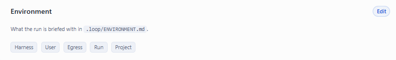

The card shows a badge for each section that is on. All five sections are on by default.

##### Edit the run briefing

1. Click **Edit** on the **Environment** card. The **Run briefing** popup opens.
2. Turn the sections on or off.
3. Click **Save**, or **Cancel** to discard your changes.

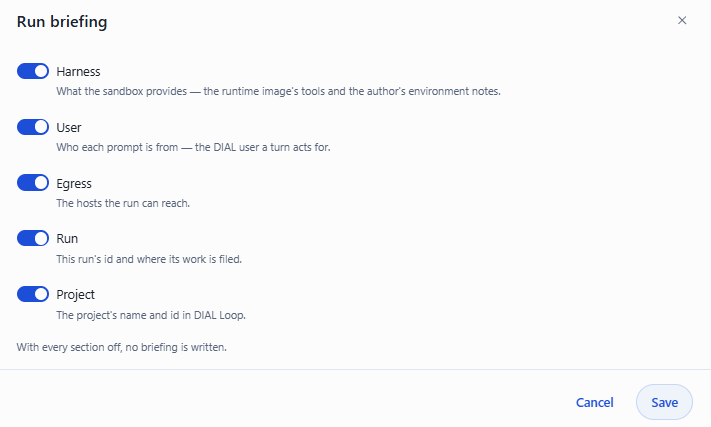

| Section | What it tells the agent |
|---------|-------------------------|
| Harness | What the sandbox provides: the tools of the runtime image and the author's environment notes. |
| User | The DIAL user that the agent acts for in each turn. |
| Egress | The hosts that the run can reach. See [Egress allowlist](#egress-allowlist). |
| Run | The ID of this run and where its work is filed. |
| Project | The name and ID of the agent in DIAL Loop. |

If every section is off, no briefing is written, and the card shows **not written**.

#### Configuration

The Configuration column, on the right of the editor, sets how the agent runs: which harness and model drive it, and the settings that belong to them.

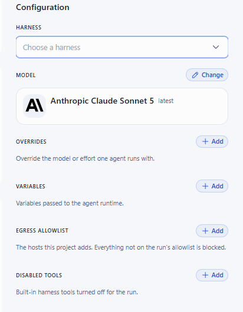

At the foot of the column, [View structure](#view-structure) shows what the agent's run is built from, and [Edit JSON](#edit-json) opens the agent's whole configuration as JSON.

##### Harness

The harness is the coding agent that runs your project. DIAL Loop supports three harnesses: Claude Code, OpenCode, and Codex. DIAL Loop places the agent's files in the layout that the harness expects, so the harness works as it does on a local machine. The harness is a setting of the agent, so you can move a finished agent to another harness without rebuilding it.

The harness decides:

- The name of the instruction file, and where skills are placed. See [Instructions](#instructions) and [Skills](#skills).
- How plugins are loaded. See [Plugins](#plugins).
- Which model, effort, and override options are available. See [Model](#model) and [Overrides](#overrides).
- The names of the built-in tools that you can disable. See [Disabled tools](#disabled-tools).

Choose a harness in the **Harness** list. If you don't choose one, DIAL Loop uses the default harness of your deployment.

OpenCode has one more setting, **Model API**, which sets the API that OpenCode uses to call the model:

| Option | When to use it |
|--------|----------------|
| Responses (default) | Most models. |
| Chat Completions | A model whose Responses stream breaks. |
| Anthropic Messages | Claude deployments. |

##### Model

The model drives the agent. The card shows the selected model. If no model is selected, the card says "No model — this project cannot start a run".

###### Change the model

1. Click **Change** in **Model**. The **Select model** picker opens with the models of your DIAL deployment. See [Models](./1.models.md).
2. Select a model. You can search the list.
3. Where the harness supports it, set the options in the footer of the picker:
   - **Effort**: how much reasoning effort the model spends. Claude Code and Codex support it. Leave it at **Default** to use the model's own default.
   - **1M context**: a larger context window. Only Claude Code supports it.
4. Click **Add**.

The card then shows the effort and **1M context**, if you set them. If you switch to a harness that doesn't support 1M context, the option is removed from the model.

##### Overrides

Subagents run on the agent's model by default. An override gives one subagent, or all of them, its own model or effort. For example, a research subagent can run on a cheaper model. Subagents come from your [plugins](#plugins).

###### Add overrides

1. Click **Add** in **Overrides**.
2. In the first field, enter the subagent as `plugin:agent`, for example `my-plugin:reviewer`, or `*` for every subagent.
3. Select a model, or leave **inherit model**. Select an effort, or leave **inherit effort**.
4. To add another override, add a row. To remove one, click the trash icon.
5. Click **Save**.

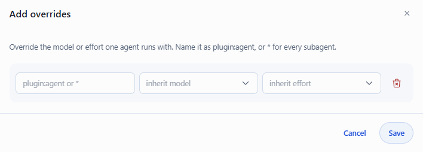

Each harness supports different overrides:

| Harness | Model of a named subagent | Model of every subagent (`*`) | Effort of a named subagent | Effort of every subagent (`*`) |
|---------|:---:|:---:|:---:|:---:|
| Claude Code | Yes | Yes | Yes | No |
| Codex | No | Yes | No | Yes |
| OpenCode | No | No | No | No |

If the harness can't apply an override, the editor says so, and the override is kept but not applied. On OpenCode, every agent runs on the agent's model.

##### Variables

Variables are environment variables that are passed to the agent runtime, for example to change a timeout.

###### Add variables

1. Click **Add** in **Variables**.
2. Enter a key and a value, for example `MCP_TIMEOUT` and `120000`. A key can have letters, digits, and underscores, and can't start with a digit.
3. To add another variable, add a row. To remove one, click the trash icon.
4. Click **Save**.

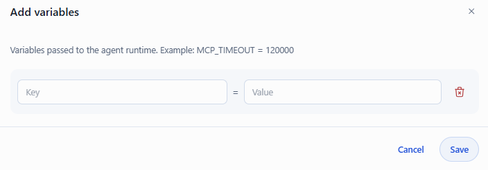

##### Egress allowlist

The egress allowlist is the list of hosts that the run can reach. The run's allowlist is the platform's own list plus the hosts that you add here. Everything that isn't on it is blocked. The [Egress section of the run briefing](#edit-the-run-briefing) tells the agent which hosts it can reach.

###### Add egress allowlist hosts

1. Click **Add** in **Egress allowlist**.
2. Enter a host name, for example `api.example.com`. Don't add a scheme, a path, a port, or spaces. You can use `*` as a wildcard.
3. To add another host, add a row. To remove one, click the trash icon.
4. Click **Save**.

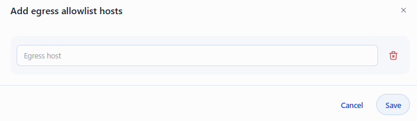

##### Disabled tools

Disabled tools are built-in tools of the harness that are turned off for the run, for example `WebSearch`. Use the harness's own names for the tools.

**Note**
> Disabling a core tool of the harness cripples the run.

###### Add disabled tools

1. Click **Add** in **Disabled tools**.
2. Enter the name of the tool.
3. To add another tool, add a row. To remove one, click the trash icon.
4. Click **Save**.

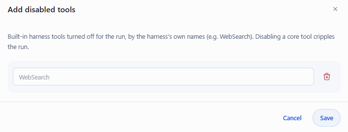

##### View structure

**View structure** opens the **Application structure** popup, a read-only tree of the folders that the agent's run is built from, organized to match its setup. Use it to check what the agent receives before you run it.

##### Edit JSON

**Edit JSON** opens the whole saved configuration of the agent as one JSON document. Every card and every setting in the editor changes a part of this document. Edit it directly to set or read a field that the editor has no control for.

###### Edit the JSON

1. Click **Edit JSON** at the foot of the **Configuration** column.
2. Change the document. Use the icons in the header to copy the JSON or download it as a file.
3. Click **Apply** to save your changes. Click **Revert** to discard them.

The editor checks only that the text is valid JSON, that the document is an object, and that `connections` is an array and `harness` is an object. DIAL validates everything else when you apply. If DIAL refuses a change, the reason is shown below the text, and the document stays as it was.

**Note**
> The document never holds secrets. A connection names where content comes from, and each person signs in separately. Don't paste keys or tokens into it.

###### What the document holds

Each top-level property matches a part of the editor:

| Property | What it holds | Where you set it in the editor |
|----------|---------------|--------------------------------|
| `harness` | The harness `type` (`claude-code`, `opencode`, or `codex`), the `model`, the `effort`, the `env` variables, and the `subagents` overrides. | [Harness](#harness), [Model](#model), [Overrides](#overrides), [Variables](#variables) |
| `connections` | The sources of the agent. Each connection has a `name`, a `type`, and its `resources`. | [Connections](#connections) and every **Add** flow |
| `toolsets` | The IDs of the toolsets and agents that the agent uses. | [Toolsets](#toolsets), [Agents](#agents-1) |
| `egress_hosts` | The hosts that the agent adds to the allowlist. | [Egress allowlist](#egress-allowlist) |
| `disabled_tools` | The names of the harness's built-in tools that are turned off. | [Disabled tools](#disabled-tools) |
| `skills_conflict` | `error`, `ignore`, or `overwrite`. | [Advanced](#advanced) |
| `thinking` | `true` or `false`. | [Advanced](#advanced) |
| `dial` | The switches `files`, `scheduler`, `pricing`, and `tool_search`. | [Advanced](#advanced) |
| `git` | The switches `publish_proposals`, `comment`, `approve`, and `merge`. | [Advanced](#advanced) |
| `environment_sections` | The sections of the run briefing that are on: `harness`, `user`, `egress`, `run`, and `project`. | [Environment](#environment) |
| `integrations` | The Teams binding. | [Teams](#teams) |

Each item in `resources` of a connection is one source, as in [Edit a resource](#edit-a-resource):

| Field | Same as in Edit a resource |
|-------|----------------------------|
| `kind` | **Kind**: `instructions`, `skill`, `knowledge`, `files`, `logs`, or `plugin`. |
| `path` | **Path**. |
| `repo`, `branch`, `ref` | **Repository**, **Branch**, and **Ref**. |
| `destination` | **Destination**. |
| `direction` | **Direction**: `in` or `in_out`. |
| `mode` | **Delivery**: `stage` or `mount`. |

An example of a small document:

```json
{
  "harness": { "type": "claude-code", "effort": "medium" },
  "egress_hosts": ["api.example.com"],
  "disabled_tools": ["WebSearch"],
  "skills_conflict": "error",
  "thinking": true,
  "dial": { "tool_search": true }
}
```

## Edit an agent

Open the agent's **...** menu and click **Edit**. The builder reopens with your settings in place; change what you need and click **Save**.

You can edit agents in two cases:

- **Your own agents** — found in your personal folder.
- **Agents shared with you with editing rights** — found in the Catalog under **Shared with me**.

A published version is fixed — keep working on your own copy and publish a new version when it is ready.

## Delete an agent

Open the agent's **...** menu and click **Delete**, then confirm. Deleting is permanent: anyone you shared the agent with loses access, and any configuration shared with it is lost.

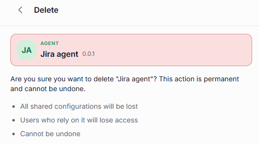

Only the agent's creator can delete it — editing rights do not grant delete access. To delete a published agent, unpublish it first.

## Next steps

- [Models](./1.models.md) — the AI models agents are built on
- [Toolsets](./3.toolsets.md) — give your agent access to external systems
- [Skills](./4.skills.md) — teach your agent a procedure it can reuse
- [Prompts](./5.prompts.md) — save and reuse prompt templates
- [Sharing and publishing](../5.sharing-and-publishing.md) — share your agent or publish it to the Catalog
- [File Manager](../4.files.md) — manage the files that your agents use
